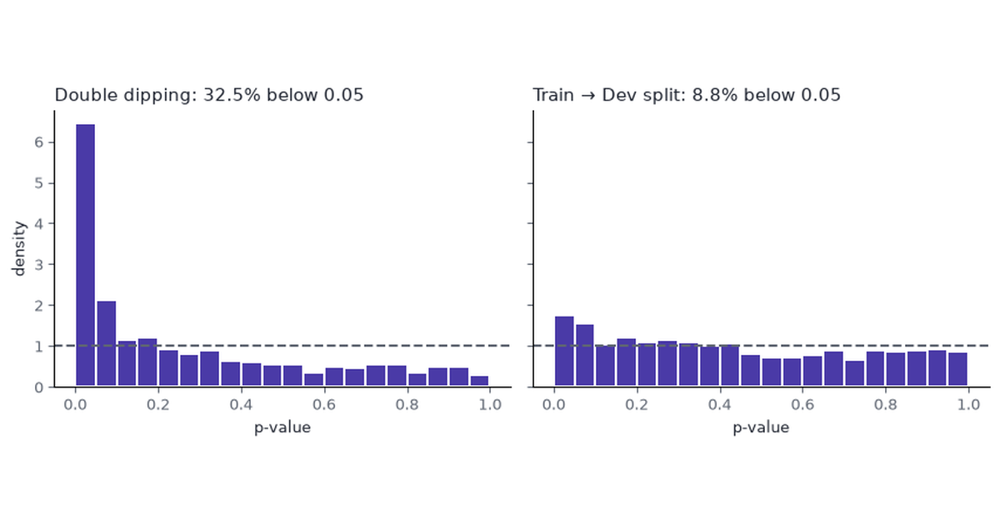

Interpreting a clustering means naming the features that make the clusters differ, in a
way that still holds on rows the clustering never saw.

The usual route starts with a scatter plot. You run k-means on a table of a thousand
measurements, colour a two-dimensional embedding by cluster, and see three islands. The
next question is what separates them, so you test every feature between clusters and sort
by p-value. The list comes back long and confident. The strange part is that the same
steps, run on a table of pure noise, also return a long and confident list. The clusters
were found by looking for differences, and the test then asks whether there are
differences.

## The double-dipping trap

K-means places its boundaries where the cluster means are furthest apart. A t-test or
ANOVA on the same rows then asks whether the means differ across those boundaries. The
data chose the hypothesis and then tested it, so the test's null distribution no longer
applies. Neuroscience named this *double dipping* after it inflated brain-imaging results
(Kriegeskorte et al. 2009).

- **What breaks:** the p-value. It assumes the groups were fixed before the data were
  seen. Here the groups are a function of the data.
- **What it looks like:** a p-value histogram piled up near zero, even when no feature
  differs between any real populations.
- **Why high dimensions make it worse:** with 1,000 features, k-means can always find
  some direction along which a split separates the rows. The features that load on that
  direction then "differ" between clusters.

The remedy is to use different rows for different jobs.

## Train → Dev → Test protocol

A clustering analysis makes three separate decisions. Each one needs rows that played no
part in the decision before it.

1. **Train: draw the boundaries.** Fit the scaler and k-means on the training rows only.
   Choose the number of clusters here as well.
2. **Dev: explain the boundaries.** Freeze the centroids and assign each dev row to its
   nearest centroid. Fit an explanation of that assignment on dev rows: here, an
   L1-regularised logistic regression (a *sparse surrogate*) that predicts the cluster
   label from the features and keeps only the features it needs. Tune the surrogate by
   cross-validation inside dev.
3. **Test: grade the explanation.** Touch the test rows once, after the feature list is
   fixed. Two checks:
   - **Fidelity:** does the surrogate reproduce the centroids' assignments on rows neither
     has seen?
   - **Prediction strength** (Tibshirani and Walther 2005): cluster the test rows afresh,
     using only the dev-selected features, and measure how often pairs the fresh
     clustering puts together are also put together by the train centroids. Scores
     near 1 mean the partition recurs in new data; Tibshirani and Walther suggest 0.8
     to 0.9 as the bar.

The split has the same purpose as in supervised learning, where a test set is spent once
([The Test Set Is Spent Once](../train-dev-test-splits/)). An earlier post here,
[Feature Importance After Clustering](../features-importance-after-clustering/), fits a
decision tree to cluster labels on the rows that made them; the protocol moves that fit
to rows the clustering never saw.

## Implementation in scikit-learn

### Data

The data are synthetic, so the true answer is known. The generating process:

- 1,500 rows, 1,000 features, three groups of equal expected size.
- Group $k$ has its own 5 *driver* features, shifted by $\delta$ noise standard deviations.
  The other 985 features are independent standard normal noise in every group.
- $\delta = 2.5$ is the world with real clusters; $\delta = 0$ is the null world, with
  one population and nothing to find.

It stands in for a wide assay, such as a protein panel or an expression matrix, where a
few measurements define subtypes and most are irrelevant to them. A wrong answer costs a
follow-up experiment on features that never mattered. K-means fits this data because the
groups are spherical and equal-sized, which is k-means' own model.

### Pipeline

The pipeline fits k-means on Train only, assigns Dev out of sample, and fits the
L1 surrogate on Dev. The surrogate's penalty is the strongest one whose cross-validated
accuracy is within one standard error of the best (the *one-standard-error rule*), which
favours short feature lists.

```{python}
#| label: setup
#| code-fold: true
import warnings

import matplotlib.pyplot as plt
import numpy as np
import pandas as pd
from IPython.display import Markdown
from scipy import stats
from scipy.optimize import linprog, minimize
from sklearn.cluster import KMeans
from sklearn.exceptions import ConvergenceWarning
from sklearn.feature_selection import mutual_info_classif
from sklearn.linear_model import LogisticRegression
from sklearn.metrics import adjusted_rand_score
from sklearn.model_selection import StratifiedKFold, cross_val_score, train_test_split
from sklearn.preprocessing import StandardScaler

warnings.filterwarnings("ignore", category=ConvergenceWarning)


def md_table(df):
    """Markdown table that keeps strings as written (no numeric re-parsing)."""
    return Markdown(df.to_markdown(index=False, disable_numparse=True))
```

```{python}
#| label: pipeline
#| code-fold: show
from types import SimpleNamespace

N, P, K, PER_CLUSTER = 1500, 1000, 3, 5  # rows, features, clusters, drivers per cluster


def make_data(snr, seed):
    """Group k is shifted by `snr` noise SDs on its own PER_CLUSTER driver features."""
    rng = np.random.default_rng(seed)
    drivers = rng.choice(P, K * PER_CLUSTER, replace=False)  # cluster k owns a block of 5
    centres = np.zeros((K, P))
    for k in range(K):
        centres[k, drivers[k * PER_CLUSTER : (k + 1) * PER_CLUSTER]] = snr
    group = rng.integers(0, K, N)
    X = centres[group] + rng.standard_normal((N, P))
    return X, group, drivers


def three_way_split(n, seed):
    """50% train, 25% dev, 25% test."""
    train, rest = train_test_split(np.arange(n), test_size=0.5, random_state=seed)
    dev, test = train_test_split(rest, test_size=0.5, random_state=seed)
    return train, dev, test


def l1_logit(C):
    # saga visits rows in random order; a fixed random_state makes reruns identical
    return LogisticRegression(
        C=C, l1_ratio=1.0, solver="saga", tol=1e-3, max_iter=5000, random_state=0
    )


def sparse_surrogate(X, labels, seed, Cs=np.logspace(-2, -0.5, 6)):
    """L1 logistic regression; strongest penalty within one SE of the best CV accuracy."""
    cv = StratifiedKFold(5, shuffle=True, random_state=seed)
    acc = np.array([cross_val_score(l1_logit(C), X, labels, cv=cv, n_jobs=-1) for C in Cs])
    mean, se = acc.mean(axis=1), acc.std(axis=1, ddof=1) / np.sqrt(cv.n_splits)
    C = Cs[np.flatnonzero(mean >= mean.max() - se[mean.argmax()])[0]]  # smallest C = strongest
    return l1_logit(C).fit(X, labels)


def run(snr, seed):
    X, group, drivers = make_data(snr, seed)
    train, dev, test = three_way_split(N, seed)

    scaler = StandardScaler().fit(X[train])  # statistics from train only
    X_tr, X_dev, X_te = (scaler.transform(X[i]) for i in (train, dev, test))

    km = KMeans(K, n_init=20, random_state=seed).fit(X_tr)  # 1. train: draw the boundaries
    dev_labels = km.predict(X_dev)  # 2. dev: assign out of sample...
    surrogate = sparse_surrogate(X_dev, dev_labels, seed)  # ...and explain the assignment
    selected = np.flatnonzero(np.abs(surrogate.coef_).max(axis=0) > 0)

    return SimpleNamespace(
        snr=snr, seed=seed, X=X, group=group, drivers=drivers,
        train=train, dev=dev, test=test, X_tr=X_tr, X_dev=X_dev, X_te=X_te,
        km=km, dev_labels=dev_labels, surrogate=surrogate, selected=selected,
    )


real = run(snr=2.5, seed=0)
null = run(snr=0.0, seed=0)
for r in (real, null):
    hits = np.intersect1d(r.selected, r.drivers).size
    print(f"snr={r.snr}: surrogate keeps {r.selected.size} features, {hits} of 15 drivers")
```

```{python}
#| label: fmt
def pct(x):
    return f"{100 * x:.1f}%"


def rng_str(values, f=lambda v: f"{v:.2f}"):
    """'lo–hi' over the defined values (NaN means 'undefined on that seed')."""
    values = [v for v in values if not np.isnan(v)]
    if not values:
        return "undefined"
    lo, hi = min(values), max(values)
    return f(lo) if f(lo) == f(hi) else f"{f(lo)}–{f(hi)}"


R = {}
R["real_sel"] = str(real.selected.size)
R["real_hits"] = str(np.intersect1d(real.selected, real.drivers).size)
R["null_sel"] = str(null.selected.size)
R["null_hits"] = str(np.intersect1d(null.selected, null.drivers).size)
R["real_ari"] = f"{adjusted_rand_score(real.group[real.train], real.km.labels_):.2f}"
if null.selected.size == 0:
    R["null_sentence"] = "In the null world, on this seed, the surrogate keeps no features."
else:
    R["null_sentence"] = (
        f"In the null world, on this seed, the surrogate keeps {R['null_sel']} features, "
        f"{R['null_hits']} of them drivers by name only, since no feature carries signal there."
    )
```

With real clusters, k-means on Train recovers the groups (adjusted Rand index
`{python} R["real_ari"]` against the truth), and the surrogate keeps
`{python} R["real_sel"]` features, `{python} R["real_hits"]` of them true drivers.

`{python} R["null_sentence"]` The one-standard-error rule pushes towards an empty list
there: when no weaker penalty beats the strongest by more than one standard error of
cross-validated accuracy, the rule takes the strongest, which zeroes every coefficient.
It does not always get there. An empty list is good news, and a non-empty one is not yet
evidence that the clusters exist.

### Double dipping, measured

The naive analysis clusters all 1,500 rows and runs a one-way ANOVA per feature on the
same rows. The split analysis runs the same ANOVA on Dev rows, labelled by the Train
centroids. In the null world every feature is noise, so a calibrated test flags 5% of them
at $p < 0.05$.

```{python}
#| label: anova
def anova_pvalues(X, labels):
    return stats.f_oneway(*[X[labels == c] for c in np.unique(labels)]).pvalue


def double_dipped_pvalues(r):
    X_all = StandardScaler().fit_transform(r.X)
    labels = KMeans(K, n_init=20, random_state=r.seed).fit_predict(X_all)
    return anova_pvalues(X_all, labels)


def noise_flagged(pvals, r):
    noise = np.setdiff1d(np.arange(P), r.drivers)
    return (pvals[noise] < 0.05).mean()


p_dd = double_dipped_pvalues(null)
p_split = anova_pvalues(null.X_dev, null.dev_labels)
R["dd_null"] = pct(noise_flagged(p_dd, null))
R["split_null"] = pct(noise_flagged(p_split, null))
```

```{python}
#| label: fig-pvalues
#| fig-cap: "P-values of 1,000 pure-noise features tested against k-means clusters. Left: clusters fitted on the rows being tested. Right: clusters fitted on Train, tested on Dev. The dashed line is the flat histogram a calibrated test gives."
INK, MUTED, C1 = "#1F2430", "#5F6672", "#4A3AA7"
fig, axes = plt.subplots(1, 2, figsize=(9, 3.4), sharey=True)
bins = np.linspace(0, 1, 21)
for ax, pv, title in [
    (axes[0], p_dd, f"Double dipping: {R['dd_null']} below 0.05"),
    (axes[1], p_split, f"Train → Dev split: {R['split_null']} below 0.05"),
]:
    ax.hist(pv, bins=bins, density=True, color=C1, edgecolor="white", linewidth=1.5)
    ax.axhline(1.0, color=MUTED, linestyle="--", linewidth=1.5)
    ax.set_title(title, color=INK, fontsize=11, loc="left")
    ax.set_xlabel("p-value", color=INK)
    for side in ("top", "right"):
        ax.spines[side].set_visible(False)
    ax.tick_params(colors=MUTED)
axes[0].set_ylabel("density", color=INK)
fig.tight_layout()
plt.show()
```

Double dipping flags `{python} R["dd_null"]` of the noise features; the Train → Dev split
flags `{python} R["split_null"]`. The split removes most of the inflation and not all of
it, and the remainder is the subject of the section on what the split cannot license.

### Test-set checks

The feature list says which features the partition uses. The test rows say whether that
explanation and that partition hold up on new data.

```{python}
#| label: test-checks
def fidelity(r):
    """Share of test rows where the surrogate agrees with the train centroids."""
    return (r.surrogate.predict(r.X_te) == r.km.predict(r.X_te)).mean()


def prediction_strength(r):
    """Tibshirani & Walther (2005), with the fresh test clustering on dev-selected features."""
    if r.selected.size == 0:
        return np.nan
    fresh = KMeans(K, n_init=20, random_state=r.seed).fit_predict(r.X_te[:, r.selected])
    frozen = r.km.predict(r.X_te)
    strengths = []
    for c in range(K):
        members = np.flatnonzero(fresh == c)
        m = members.size
        if m < 2:
            return 0.0
        together = frozen[members][:, None] == frozen[members][None, :]
        strengths.append((together.sum() - m) / (m * (m - 1)))
    return min(strengths)


for r in (real, null):
    print(f"snr={r.snr}: fidelity {fidelity(r):.3f}, prediction strength {prediction_strength(r):.3f}")
R["real_fid"], R["real_ps"] = f"{fidelity(real):.3f}", f"{prediction_strength(real):.2f}"
null_chance = np.bincount(null.km.predict(null.X_te)).max() / len(null.test)
if null.selected.size == 0:
    R["null_bullet"] = (
        f"fidelity {fidelity(null):.3f}, against {null_chance:.2f} for always guessing the "
        "largest cluster. With no features selected there is nothing to re-cluster the test "
        "rows on, so prediction strength is undefined. The empty list is the verdict."
    )
else:
    R["null_bullet"] = (
        f"fidelity {fidelity(null):.3f}, against {null_chance:.2f} for always guessing the "
        f"largest cluster, and prediction strength {prediction_strength(null):.2f}. Both fall "
        "well short, and that is the warning the feature list never gives."
    )
```

- **Real clusters:** fidelity `{python} R["real_fid"]`, prediction strength
  `{python} R["real_ps"]`. The surrogate reproduces the partition on unseen rows, and a
  fresh clustering of those rows on the selected features finds the same groups.
- **Null:** `{python} R["null_bullet"]`

### Ten seeds, two worlds

One seed can produce a clean coincidence, so the table repeats the run on ten seeds and
reports the range.

```{python}
#| label: seeds
SEEDS = range(10)


def summarise(r):
    return dict(
        ari=adjusted_rand_score(r.group[r.train], r.km.labels_),
        dd=noise_flagged(double_dipped_pvalues(r), r),
        split=noise_flagged(anova_pvalues(r.X_dev, r.dev_labels), r),
        n_sel=r.selected.size,
        hits=np.intersect1d(r.selected, r.drivers).size,
        fid=fidelity(r),
        ps=prediction_strength(r),
    )


rows = {snr: [summarise(run(snr, s)) for s in SEEDS] for snr in (0.0, 2.5)}
spec = [
    ("Train ARI against the truth", "ari", lambda v: f"{v:.2f}"),
    ("Noise flagged at p < 0.05, double dipping", "dd", pct),
    ("Noise flagged at p < 0.05, Train → Dev split", "split", pct),
    ("Features the surrogate keeps", "n_sel", lambda v: f"{v:.0f}"),
    ("True drivers among them (of 15)", "hits", lambda v: f"{v:.0f}"),
    ("Test fidelity", "fid", lambda v: f"{v:.3f}"),
    ("Test prediction strength", "ps", lambda v: f"{v:.2f}"),
]
seed_table = pd.DataFrame(
    [
        {
            "Quantity": label,
            "Null world (δ = 0)": rng_str([d[key] for d in rows[0.0]], f),
            "Real clusters (δ = 2.5)": rng_str([d[key] for d in rows[2.5]], f),
        }
        for label, key, f in spec
    ]
)
S = {
    (snr, key): rng_str([d[key] for d in rows[snr]], f)
    for snr in rows
    for _, key, f in spec
}
empty_null = sum(d["n_sel"] == 0 for d in rows[0.0])
assert 0 < empty_null < len(SEEDS)  # the prose describes both kinds of null seed
S["empty_null"] = str(empty_null)
S["kept_null"] = str(len(SEEDS) - empty_null)
S["max_fid_null"] = f"{max(d['fid'] for d in rows[0.0]):.3f}"
S["min_fid_real"] = f"{min(d['fid'] for d in rows[2.5]):.3f}"
S["max_sel_null"] = f"{max(d['n_sel'] for d in rows[0.0])}"
assert max(d["ps"] for d in rows[0.0] if d["n_sel"]) < min(d["ps"] for d in rows[2.5])
md_table(seed_table)
```

Prediction strength is undefined on a seed whose surrogate keeps no features, and the
range covers the seeds where it is defined.

- In the null world, double dipping flags `{python} S[(0.0, "dd")]` of noise features and
  the split flags `{python} S[(0.0, "split")]`, against a nominal 5%.
- With real clusters the inflation disappears for both (`{python} S[(2.5, "dd")]` and
  `{python} S[(2.5, "split")]`), because the boundaries follow the drivers and the noise
  features carry nothing about them.
- In the null world the surrogate keeps no features on `{python} S["empty_null"]` of ten
  seeds, and up to `{python} S["max_sel_null"]` on the other `{python} S["kept_null"]`.
- The test-set checks separate the worlds on every seed. Null fidelity is at most
  `{python} S["max_fid_null"]` and real fidelity at least `{python} S["min_fid_real"]`.
  Where the null surrogate keeps features, prediction strength is
  `{python} S[(0.0, "ps")]`, against `{python} S[(2.5, "ps")]` with real clusters.

## What the split cannot license

The Train → Dev split leaves inflation in the null world because the Dev labels are still
a function of the Dev features. Each Dev row's label is "which train centroid is nearest",
and that is computed from the row's own feature values. When the centroids differ a little
along feature $j$, Dev rows with high values of $j$ lean towards one cluster, and an ANOVA
on $j$ detects the lean. Gao, Bien and Witten (2024) note that the inflation persists even
when separate data sets define the groups and test them, and build a test that conditions
on the clustering; Chen and Witten (2023) give the k-means version.

The split does license narrower claims. Sorted by what each needs:

| Claim | Licensed by |
|---|---|
| The partition is drawn mostly along features $S$ | Dev selection, plus test fidelity |
| The partition recurs in new data | Test prediction strength |
| Feature $j$'s mean differs between the clusters, $p < 0.05$ | Selective inference, or data fission |

The third row needs one of two methods. Selective inference (Gao et al.; Chen and Witten)
conditions the test on the clustering having come out the way it did. *Data fission*
(Leiner et al. 2025) splits each observation instead of the rows: with Gaussian noise of
known variance $\sigma^2$, draw $Z \sim N(0, \sigma^2)$ and form $f = X + Z$ and
$g = X - Z$. The two are independent given the means, so clustering on $f$ and testing on
$g$ gives calibrated p-values. Data thinning (Neufeld et al. 2024) extends the idea to
other distributions. The cost is that both halves are noisier than $X$.

### Three tests in the browser

The widget runs the three analyses on fresh synthetic data: two groups, 400 rows, with
the first 5 features shifted by the signal-to-noise ratio and the rest pure noise. Each
point is one feature's p-value from the first replicate; the tiles pool enough
replicates for about 2,000 noise tests per setting.

::: {.widget-container}

```{=html}
<div class="widget-header"><span class="widget-title">Testing features against k-means clusters</span><span class="widget-badge">interactive</span></div>
```

```{ojs}
//| echo: false
import { simulate, METHODS, NOMINAL } from "./model.js"
```

```{ojs}
//| echo: false
viewof p = Inputs.range([10, 2000], {value: 10, step: 1, transform: Math.log, label: "Features (p)"})
```

```{ojs}
//| echo: false
viewof snr = Inputs.range([0, 4], {value: 0, step: 0.25, label: "Signal-to-noise"})
```

```{ojs}
//| echo: false
viewof seed = Inputs.range([1, 20], {value: 1, step: 1, label: "Seed"})
```

```{ojs}
//| echo: false
result = simulate({p, snr, seed})
```

```{ojs}
//| echo: false
html`<div class="widget-stats">${result.rates.map((r) => html`<div class="widget-stat">
  <div class="widget-stat-value">${r.falsePositive === null ? "—" : (100 * r.falsePositive).toFixed(1) + "%"}</div>
  <div class="widget-stat-label">${r.method}: noise flagged at p < ${NOMINAL}</div>
  <div class="widget-note">${r.driverTests ? `drivers found (Bonferroni): ${r.driverHits} of ${r.driverTests}` : "no drivers at zero signal"}${r.oneCluster ? ` · ${r.oneCluster} of ${result.reps} replicates put every tested row in one cluster` : ""}</div>
</div>`)}</div>`
```

```{ojs}
//| echo: false
Plot.plot({
  width: Math.max(300, Math.min(width, 760)),
  height: 420,
  marginLeft: 40,
  marginRight: 92,
  style: {background: "transparent"},
  fy: {label: null, domain: METHODS.map((m) => m.label)},
  x: {label: "Feature index", ticks: 4},
  y: {label: "−log₁₀ p (capped at 20)", domain: [0, 20], clamp: true, grid: true, ticks: 3},
  symbol: {domain: ["noise", "driver"], range: ["circle", "diamond"]},
  color: {domain: ["noise", "driver"], range: ["var(--w-muted)", "var(--w-c3)"], legend: true},
  marks: [
    Plot.frame({stroke: "var(--w-rule)"}),
    Plot.ruleY([-Math.log10(NOMINAL)], {stroke: "var(--w-ink)", strokeDasharray: "4 3"}),
    Plot.dot(result.points, {
      fy: "method", x: "feature", y: "score",
      fill: "kind", symbol: "kind",
      r: (d) => (d.kind === "driver" ? 5 : 2.5),
      fillOpacity: (d) => (d.kind === "driver" ? 1 : 0.6),
      stroke: (d) => (d.kind === "driver" ? "var(--w-surface)" : "none"),
      channels: {p: {value: "p", label: "p-value"}},
      tip: {format: {fy: false, score: false, p: (v) => v.toExponential(2)}},
    }),
  ],
})
```

```{=html}
<p class="widget-note">Dashed line: p = 0.05. Points above it are flagged. Drivers are the first five features.</p>
```

:::

Instructions, each checked against the model on a grid of slider settings and five seeds:

1. **Leave the signal at 0 and set features to 10.** Double dipping flags about three
   noise features in four, the sample split about three in five, and data fission about
   one in twenty.
2. **Drag the features up to 2,000.** The split's excess fades towards 5%, because the
   centroids' small differences are spread over many features. The double-dipping excess
   shrinks too and stays a few points above 5%.
3. **Set features to 50 and signal to 1.** The clusters are real now, and the split
   still flags more than one noise feature in ten, because weak drivers leave the
   boundaries partly drawn in noise. Fission stays calibrated and pays for it: it finds a
   minority of the drivers, where the split finds nearly all of them.
4. **Raise the signal to 3, features still at 50.** All three tests settle near 5% on
   noise features. Once the boundaries follow real drivers, the noise features carry
   nothing about them.

## Interpretation methods by feature count

Which explanation method fits depends mostly on the feature count $p$, relative to the row
count and to how correlated the features are. The bands are rules of thumb.

| Features | Typical data | Method | What it reports | Where it stops working |
|---|---|---|---|---|
| < 10 | lab panels, survey scales | Per-feature ANOVA or Kruskal–Wallis on held-out labels, with effect sizes ($\eta^2$, Cohen's $d$) | how much each feature moves between clusters | the p-value is still circular; report the effect size with an interval |
| 10s–100s | clinical and customer tables | Sparse surrogate: L1 logistic regression, or a threshold tree with one leaf per cluster (Moshkovitz et al. 2020) | a short rule set that reproduces the partition | correlated features make the chosen set unstable; check test fidelity |
| 1,000s | expression panels, text n-grams | mRMR filter to a shortlist, then a sparse surrogate on it | a short, non-redundant feature list | mutual-information estimates get noisy at a few hundred rows |
| 100k+ | ATAC peaks, SNP arrays, raw pixels | Deep metric learning (a learned embedding, e.g. a triplet loss; Schroff et al. 2015), clustering in that space, and CEM counterfactuals for individuals | per-individual minimal changes | a global feature list stops meaning much; explanations depend on the learned model |

The implementation's 1,000 features sit in the third band, and the L1 surrogate worked
there because its 15 drivers are independent of each other. Correlated features are what
the third band's filter is for.

## Information-theoretic feature selection (mRMR)

Many wide tables measure the same thing several times: a gene and its co-regulated
neighbours, a pixel and the pixels beside it. Ranking features by how much they say about
the cluster label then fills the shortlist with copies of the strongest signal and leaves
weaker, distinct drivers off it.

*Minimum redundancy, maximum relevance* (mRMR; Peng, Long and Ding 2005) builds the
shortlist greedily. At each step it adds the feature $j$ that maximises

$$
\underbrace{I(x_j; c)}_{\text{relevance}} \;-\; \frac{1}{|S|}\sum_{s \in S} \underbrace{I(x_j; x_s)}_{\text{redundancy}},
$$

where $c$ is the Dev cluster label, $S$ is the set chosen so far, and $I$ is mutual
information. Relevance here uses scikit-learn's nearest-neighbour estimator. Redundancy
uses the Gaussian formula $I = -\tfrac12 \log(1 - \rho^2)$, which is exact for jointly
normal features and costs one correlation matrix.

The test overwrites 20 noise columns with noisy copies (noise SD 0.3) of two drivers, one
from each of two clusters. Each method then picks 15 features from the Dev rows.

```{python}
#| label: mrmr
def with_proxies(r, n_copies=10, noise_sd=0.3):
    """Overwrite 2 x n_copies noise columns with noisy copies of drivers 0 and 5."""
    rng = np.random.default_rng(1000 + r.seed)
    X = r.X.copy()
    noise = np.setdiff1d(np.arange(P), r.drivers)
    slots = rng.choice(noise, 2 * n_copies, replace=False)
    source = np.repeat(r.drivers[[0, PER_CLUSTER]], n_copies)
    X[:, slots] = X[:, source] + noise_sd * rng.standard_normal((N, slots.size))
    return X, slots, source


def mrmr(X, labels, k, seed):
    relevance = mutual_info_classif(X, labels, random_state=seed)
    rho = np.corrcoef(X, rowvar=False)
    redundancy = -0.5 * np.log1p(-np.clip(rho**2, 0, 1 - 1e-12))
    chosen = [int(relevance.argmax())]
    while len(chosen) < k:
        score = relevance - redundancy[:, chosen].mean(axis=1)
        score[chosen] = -np.inf
        chosen.append(int(score.argmax()))
    return np.array(chosen), relevance


def coverage(picked, r, slots, source):
    """Distinct drivers represented (a copy counts for its source), and copies picked."""
    represented = set(np.intersect1d(picked, r.drivers))
    represented |= set(source[np.isin(slots, picked)])
    return len(represented), int(np.isin(picked, slots).sum())


mrmr_rows = []
for s in SEEDS:
    r = run(2.5, s)
    X, slots, source = with_proxies(r)
    scaler = StandardScaler().fit(X[r.train])
    X_tr, X_dev = scaler.transform(X[r.train]), scaler.transform(X[r.dev])
    labels = KMeans(K, n_init=20, random_state=s).fit(X_tr).predict(X_dev)
    picked, relevance = mrmr(X_dev, labels, 15, s)
    top = np.argsort(-relevance)[:15]
    lasso = sparse_surrogate(X_dev, labels, s)
    kept = np.flatnonzero(np.abs(lasso.coef_).max(axis=0) > 0)
    mrmr_rows.append(
        dict(
            top=coverage(top, r, slots, source),
            mrmr=coverage(picked, r, slots, source),
            lasso=coverage(kept, r, slots, source) + (kept.size,),
        )
    )

M = {
    m: (rng_str([d[m][0] for d in mrmr_rows], str), rng_str([d[m][1] for d in mrmr_rows], str))
    for m in ("top", "mrmr", "lasso")
}
M["lasso_n"] = rng_str([d["lasso"][2] for d in mrmr_rows], str)
md_table(
    pd.DataFrame(
        [
            {"Method (15 picks unless stated)": "Top 15 by relevance only",
             "Distinct drivers covered (of 15)": M["top"][0], "Copies picked": M["top"][1]},
            {"Method (15 picks unless stated)": "mRMR, 15 picks",
             "Distinct drivers covered (of 15)": M["mrmr"][0], "Copies picked": M["mrmr"][1]},
            {"Method (15 picks unless stated)": f"L1 surrogate ({M['lasso_n']} kept)",
             "Distinct drivers covered (of 15)": M["lasso"][0], "Copies picked": M["lasso"][1]},
        ]
    )
)
```

Over ten seeds:

- **Relevance alone** spends `{python} M["top"][1]` of its 15 picks on copies and covers
  `{python} M["top"][0]` distinct drivers.
- **mRMR** picks `{python} M["mrmr"][1]` copies and covers `{python} M["mrmr"][0]`.
- **The L1 surrogate**, fitted on all 1,000 features, covers `{python} M["lasso"][0]`
  drivers but keeps `{python} M["lasso"][1]` copies alongside them. It does not collapse
  redundancy either; it only gets away with that while fitting on every feature is
  affordable.

mRMR's place is ahead of the surrogate when $p$ is large enough that the surrogate
should only see a shortlist. Its picks are still a function of the Dev labels, so the
same test-set checks apply to the list it produces.

## Contrastive explanations (CEM)

A feature list explains the partition. An individual asks a different question: what is
the smallest change to *this* row that would move it to another cluster? The
*Contrastive Explanations Method* (CEM; Dhurandhar et al. 2018) answers it with two
objects:

- **Pertinent positive:** the smallest subset of the row's features that alone keeps it
  in its cluster.
- **Pertinent negative:** the smallest change $\delta$ whose addition moves the row to a
  different cluster. This is the counterfactual cluster transition.

CEM finds $\delta$ by minimising an elastic-net penalty, $\beta\lVert\delta\rVert_1 +
\lVert\delta\rVert_2^2$, plus a hinge loss for not having changed class. It optionally
adds an autoencoder term that keeps $x + \delta$ near the data. For k-means the class
change is linear in $\delta$. Row $x$ moves to cluster $t$ with margin $\kappa$ when, for
every other centroid $c_j$,

$$
2\,(c_j - c_t)^\top (x + \delta) \;\le\; \lVert c_j\rVert^2 - \lVert c_t\rVert^2 - \kappa .
$$

That gives $K - 1$ linear constraints, so the pertinent negative is a small convex
problem. Its dual has only $K - 1$ variables, and the primal solution is a soft
threshold of $-A^\top\lambda$. The code solves the dual exactly and checks the result
against the centroids. It also solves the pure-$\ell_1$ version as a linear program, for
contrast.

```{python}
#| label: cem
def constraints(x, centres, target, margin):
    others = [j for j in range(len(centres)) if j != target]
    A = np.array([2 * (centres[j] - centres[target]) for j in others])
    b = np.array([centres[j] @ centres[j] - centres[target] @ centres[target] for j in others])
    return A, b - margin - A @ x  # A @ delta <= rhs


def pertinent_negative(x, centres, target, beta=1.0, margin=1.0):
    """argmin beta*|d|_1 + |d|_2^2  s.t. x + d is nearest `target` by `margin` (exact dual)."""
    A, rhs = constraints(x, centres, target, margin)

    def delta(lam):
        g = A.T @ lam
        return -np.sign(g) * np.maximum(np.abs(g) - beta, 0) / 2

    def neg_dual(lam):
        d = delta(lam)
        return -(beta * np.abs(d).sum() + d @ d + lam @ (A @ d - rhs))

    lam = minimize(neg_dual, np.ones(len(rhs)), bounds=[(0, None)] * len(rhs)).x
    return delta(lam)


def l1_only(x, centres, target, margin=1.0):
    """argmin |d|_1 under the same constraints, as a linear program."""
    A, rhs = constraints(x, centres, target, margin)
    p = len(x)
    sol = linprog(np.ones(2 * p), A_ub=np.hstack([A, -A]), b_ub=rhs, bounds=(0, None))
    return sol.x[:p] - sol.x[p:]


centres = real.km.cluster_centers_
test_labels = real.km.predict(real.X_te)
# Which k-means cluster each driver belongs to: driver block g -> the cluster most of
# true group g's train rows fell in. (k-means numbers its clusters arbitrarily.)
owner = np.full(P, -1)
for g in range(K):
    cluster = np.bincount(real.km.labels_[real.group[real.train] == g], minlength=K).argmax()
    owner[real.drivers[g * PER_CLUSTER : (g + 1) * PER_CLUSTER]] = cluster

stats_en, stats_l1 = [], []
for x, a in zip(real.X_te, test_labels):
    t = (a + 1) % K
    for fn, out in ((pertinent_negative, stats_en), (l1_only, stats_l1)):
        d = fn(x, centres, t)
        changed = np.flatnonzero(np.abs(d) > 1e-8)
        drv = changed[owner[changed] >= 0]
        # source-cluster drivers should go down, target-cluster drivers up
        expected = np.where(owner[drv] == t, 1, np.where(owner[drv] == a, -1, 0))
        out.append(dict(
            n=changed.size,
            n_drivers=drv.size,
            direction_ok=int((np.sign(d[drv]) == expected).sum()),
            big=np.abs(d).max(),
            moved=real.km.predict((x + d)[None])[0] == t,
        ))
en, l1 = pd.DataFrame(stats_en), pd.DataFrame(stats_l1)
assert en.moved.all() and l1.moved.all()
C = dict(
    rows=str(len(en)),
    en_n=rng_str(en.n, lambda v: f"{v:.0f}"),
    en_drv=pct(en.n_drivers.sum() / en.n.sum()),
    en_dir=pct(en.direction_ok.sum() / en.n_drivers.sum()),
    en_med=f"{en.big.median():.2f}",
    en_max=f"{en.big.max():.2f}",
    l1_n=rng_str(l1.n, lambda v: f"{v:.0f}"),
    l1_med=f"{l1.big.median():.1f}",
    l1_max=f"{l1.big.max():.1f}",
    data_max=f"{np.abs(real.X_tr[:, real.drivers]).max():.1f}",
)

# one row, shown in full
x, a = real.X_te[0], test_labels[0]
t = (a + 1) % K
d = pertinent_negative(x, centres, t)
changed = np.flatnonzero(np.abs(d) > 1e-8)


def role(j):
    if owner[j] < 0:
        return "noise"
    side = {a: " (source)", t: " (target)"}.get(owner[j], "")
    return f"driver of cluster {owner[j]}{side}"


C["a"], C["t"] = str(a), str(t)
md_table(
    pd.DataFrame(
        {
            "Feature": [str(j) for j in changed],
            "Role (from the generator)": [role(j) for j in changed],
            "Value": [f"{x[j]:+.2f}" for j in changed],
            "Counterfactual": [f"{x[j] + d[j]:+.2f}" for j in changed],
        }
    )
)
```

The table shows one test row, moved from cluster `{python} C["a"]` to cluster
`{python} C["t"]` (values in Train standard-deviation units). Over all
`{python} C["rows"]` test rows:

- **Elastic net (CEM's penalty):** a counterfactual changes `{python} C["en_n"]`
  features, and `{python} C["en_drv"]` of all changes land on true drivers. Of those,
  `{python} C["en_dir"]` go the expected way: the source cluster's drivers down, the
  target cluster's up. The largest single change in a row has median
  `{python} C["en_med"]` units and never exceeds `{python} C["en_max"]`.
- **Pure $\ell_1$:** a linear program with $K - 1 = 2$ constraints has an optimal vertex
  with at most 2 nonzero coordinates, so it changes `{python} C["l1_n"]` features. The
  largest change has median `{python} C["l1_med"]` units and reaches
  `{python} C["l1_max"]`, where no driver value in the Train rows exceeds
  `{python} C["data_max"]` in absolute value. CEM's $\ell_2$ term, and its optional
  autoencoder, exist to stop counterfactuals leaving the data.

Counterfactuals are computed from the Train centroids and are applied to Test rows, so
the explanation is out of sample. They describe the partition, not the population: a row
moved across a boundary that k-means drew in noise is moved across nothing.

## Constraints

- **Sample splitting is not selective inference.** The Train → Dev split licenses claims
  about what the partition uses and whether it recurs. It does not license a p-value for
  "the clusters differ on feature $j$"; the widget shows the excess at low $p$.
- **Data fission needs a known noise model.** The Gaussian version needs $\sigma^2$, and
  both halves carry extra noise. Data thinning covers Poisson, binomial and other
  convolution-closed families.
- **Prediction strength needs enough test rows to cluster.** With 375 test rows and 1,000
  features, a fresh k-means on all features can fail even when the clusters are real,
  which is why the check here uses only the dev-selected features.
- **The bands in the scaling table depend on rows and correlation.** 1,000 independent
  features with 1,500 rows are easier than 200 correlated features with 80 rows.
- **The synthetic data favour k-means.** Spherical, equal-sized groups are k-means' own
  model. On elongated or unequal groups, the partition itself can be wrong before any
  explanation starts; see [Clustering Has No Labels to Tune Against](../clustering-tuning-metrics/).

Same. Rows. Flag. Noise. Split. Rows. Explain. Boundaries. Only. Fresh. Rows. Confirm.

## References

- Chen, Y. T. and Witten, D. M. (2023). Selective inference for k-means clustering.
  *Journal of Machine Learning Research* 24(152). <https://jmlr.org/papers/v24/22-0371.html>
- Dhurandhar, A., Chen, P.-Y., Luss, R., Tu, C.-C., Ting, P., Shanmugam, K. and Das, P.
  (2018). Explanations based on the missing: towards contrastive explanations with
  pertinent negatives. *NeurIPS 2018*. <https://arxiv.org/abs/1802.07623>
- Gao, L. L., Bien, J. and Witten, D. (2024). Selective inference for hierarchical
  clustering. *Journal of the American Statistical Association* 119(545).
  <https://arxiv.org/abs/2012.02936>
- Kriegeskorte, N., Simmons, W. K., Bellgowan, P. S. F. and Baker, C. I. (2009).
  Circular analysis in systems neuroscience: the dangers of double dipping. *Nature
  Neuroscience* 12, 535–540. <https://doi.org/10.1038/nn.2303>
- Leiner, J., Duan, B., Wasserman, L. and Ramdas, A. (2025). Data fission: splitting a
  single data point. *Journal of the American Statistical Association*.
  <https://arxiv.org/abs/2112.11079>
- Moshkovitz, M., Dasgupta, S., Rashtchian, C. and Frost, N. (2020). Explainable k-means
  and k-medians clustering. *ICML 2020*. <https://arxiv.org/abs/2002.12538>
- Neufeld, A., Dharamshi, A., Gao, L. L. and Witten, D. (2024). Data thinning for
  convolution-closed distributions. *Journal of Machine Learning Research* 25(57).
  <https://jmlr.org/papers/v25/23-0446.html>
- Peng, H., Long, F. and Ding, C. (2005). Feature selection based on mutual information:
  criteria of max-dependency, max-relevance, and min-redundancy. *IEEE Transactions on
  Pattern Analysis and Machine Intelligence* 27(8), 1226–1238.
  <https://doi.org/10.1109/TPAMI.2005.159>
- Schroff, F., Kalenichenko, D. and Philbin, J. (2015). FaceNet: a unified embedding for
  face recognition and clustering. *CVPR 2015*. <https://arxiv.org/abs/1503.03832>
- Tibshirani, R. and Walther, G. (2005). Cluster validation by prediction strength.
  *Journal of Computational and Graphical Statistics* 14(3), 511–528.
  <https://doi.org/10.1198/106186005X59243>
