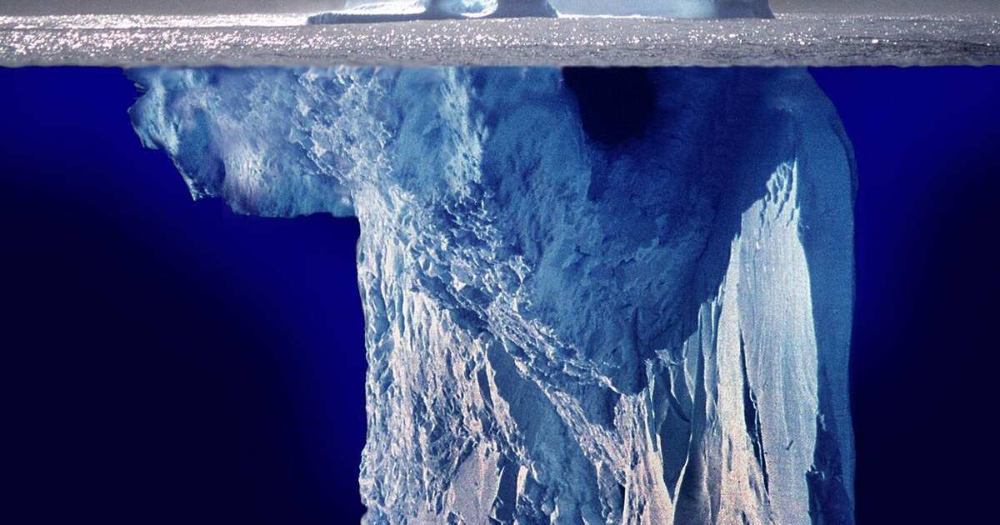

A brain that predicts what comes next still has to settle a prior question — how much of the past counts as *now* — and the hierarchy of clocks that answers it is what keeps a self from flickering with every fresh sensation.

## A prediction still has to decide how long now is

Step out onto a noisy street and a car horn splits the air. Your ears jump at the edge of the sound in milliseconds, yet your sense of who is standing on the pavement and where you are walking does not reset when the horn blasts. The surprise registers, and you stay you.

In [The One Thing Always in the Room](../consciousness-recursive-prediction/), we followed Karl Friston's free energy principle to one account of where that self comes from: if perception is a stack of predictions correcting their own errors, the predictor itself is the one term that turns up in every frame, and the self is the compression that finally models that invariant. Yet a stack of predictions by itself has a missing piece. Nothing in the rule "update on prediction error" says why the top of the stack holds still when a horn goes off, instead of rewriting its estimate of who you are at the speed of the ear.

When Georg Northoff came to Bogotá, we had a good conversation about where that stability lives. He described Karl Friston's work and cognitive neuroscience as the tip of an iceberg — the visible part where beliefs update, actions fire, and tasks get done — while the bulk of the ice sits underneath the sea. What lies beneath the waterline, in his view, is the brain's own spatiotemporal structure: a hierarchy of timescale priors that feeds continuously into the predicting self before a single task or thought gets underway.

## Every cortical rung listens through a different window

Tap a guitar string in a dry closet and the note dies in a fraction of a second; tap it in a cathedral and the room holds the tone for seconds. Before any melody is played, the room already has an opinion about how long an event lasts.

Cortical circuits differ in the same way even when nothing much is happening. Record from a patch of cortex at rest, compare its activity at one moment with its activity a short lag $\Delta t$ later, and the correlation drops off roughly as an exponential, $\exp(-\Delta t / \tau)$. That decay constant $\tau$ is what Northoff and colleagues call an *intrinsic neural timescale* (and what John Murray's macaque recordings mapped across the cortical sheet): the length of the window over which a neural population naturally pools its own recent past.

Those windows are not uniform across the brain; they form a steep gradient. Primary sensory areas — visual, auditory, somatosensory cortex — run fast clocks, with $\tau$ in the tens of milliseconds, because a circuit that lingered on the last phoneme would blur the next one. Climb up through association cortex toward transmodal hubs and the default mode network — the regions most consistently tied to self-referential thought and autobiographical continuity — and $\tau$ stretches into hundreds of milliseconds and beyond. Each rung listens to the world through a window of a different width, which raises a mechanical question: what happens when a hierarchy of windows like that is wired into Friston's prediction loop?

## Slow windows act as priors that refuse to flicker

In active inference, every rung of the cortical hierarchy passes top-down predictions to the rung beneath it and receives bottom-up prediction errors in return. How much a rung moves when an error arrives depends on a prior over *rate of change*: if a level assumes its hidden cause changes slowly, a brief spike of error is treated as local weather rather than a shift in climate. Northoff's intrinsic timescales turn that abstract prior into hardware. A rung with a long window $\tau$ physically averages over dozens of fast cycles from the rung beneath it, so only errors that persist on the slow rung's own timescale can bend its state.

To see the two timescales pull apart, the interactive simulation generates a synthetic $2{,}000\text{ ms}$ sensory stream sampled every $10\text{ ms}$. The stream combines a slow sinusoidal baseline (standing in for an ongoing bodily and situational state), seeded zero-mean Gaussian noise (standing in for rapid sensory fluctuations), and a $120\text{ ms}$ surprise burst starting at $t = 900\text{ ms}$ (standing in for a sudden transient disturbance like the horn on the street). We use a synthetic two-filter model here so the true underlying baseline and the isolated deflection from the burst are known at every millisecond; if a slow rung chased the raw noise in a real brain, the self-model would jitter with every saccade and acoustic edge. Two leaky integrators read that stream in parallel: a fast sensory rung fixed at $\tau_{\text{fast}} = 40\text{ ms}$, and a slow prior rung whose timescale $\tau_{\text{slow}}$ we can step from $40\text{ ms}$ up to $600\text{ ms}$.

At the default setting ($\tau_{\text{slow}} = 300\text{ ms}$, sharp burst of $2.5$), the slow prior's autocorrelation half-life is $208\text{ ms}$, only $10\%$ of the fast sensory noise passes into the slow state, and the $2.5$-unit surprise burst deflects the slow state by a peak of $0.88$. Step $\tau_{\text{slow}}$ down to $40\text{ ms}$ so the slow rung matches the sensory clock: the half-life drops to $28\text{ ms}$, passed noise jumps to $34\%$, and the burst yanks the state by $2.40$ units — the two traces collapse onto each other and the baseline is lost in the spike. Now step $\tau_{\text{slow}}$ up through $120\text{ ms}$ (half-life $83\text{ ms}$, noise $18\%$, peak deflection $1.65$) to $600\text{ ms}$: the half-life reaches $416\text{ ms}$, passed noise falls to $7\%$, and the burst moves the slow state by just $0.49$. Toggling the surprise burst to moderate ($1.5$) or none ($0.0$) at $\tau_{\text{slow}} = 300\text{ ms}$ lowers the peak deflection to $0.53$ and $0.00$ while the $10\%$ noise floor stays fixed.

::: {#widget-timescales}
:::

```{=html}
<script src="widgets.js"></script>
```

That gap between the dashed sensory trace ($2.40$ units of deflection at $\tau = 40\text{ ms}$) and the solid slow trace ($0.49$ units at $\tau_{\text{slow}} = 600\text{ ms}$) is what a hierarchy of timescale priors buys. The fast rung has to be jumpy so you do not step in front of the car; the slow rung has to be stubborn so the person stepping back on the kerb is still the person who left the house five minutes ago. Even so, a stubborn filter only explains so much.

## Caveat: a slow clock is not yet a someone

A leaky integrator with $\tau = 600\text{ ms}$ is five lines of arithmetic, and nobody thinks a low-pass filter on a circuit board has an inner life. Northoff's hierarchy of intrinsic timescales explains why a self-model has *temporal thickness* — why the predictor's estimate of itself spans seconds and scenes rather than resetting every forty milliseconds — just as recursive prediction explains why the boundary between self and world falls where action has reliable control. Neither mechanism, on its own, explains why that temporally thick model feels like anything from the inside. What the timescale hierarchy does settle is a constraint: whatever accounts for subjective continuity cannot be built out of fast clocks alone.

## The water holds the tip up

Return to Northoff's iceberg from that conversation in Bogotá. Friston's free energy principle gives the calculus at the waterline — predictions flowing down, errors flowing up, action and perception trading off to keep surprise low. Underneath that calculus sits a physical commitment to time: a nested stack of integration windows, widening from tens of milliseconds at the sensory rim to hundreds of milliseconds and seconds in the networks that track the organism itself. Without those slow priors underneath the sea, a predictive brain would still correct its errors frame by frame, but it could never pool enough frames together to notice the one thing that never leaves the room.

Fast. Senses. Flicker. Slow. Priors. Pool. Errors. Fade. Selves. Endure.

## References

- Georg Northoff on spatiotemporal neuroscience and intrinsic neural timescales (*The Spontaneous Brain*, MIT Press).
- Karl Friston on the free energy principle, active inference, and hierarchical temporal scales in cortex.
- John D. Murray et al. (2014), "A hierarchy of intrinsic timescales across primate cortex," *Nature Neuroscience*.
- [The One Thing Always in the Room](../consciousness-recursive-prediction/) — the companion essay on recursive prediction and the self as an invariant.
