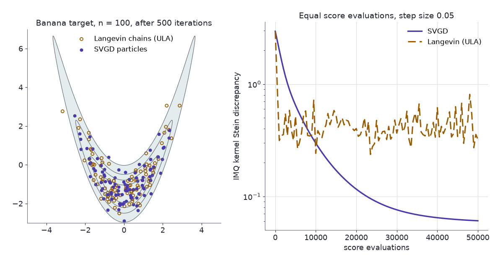

The kernel Stein discrepancy (KSD) measures how far a sample is from a target density using only the target's score, in closed form. Stein variational gradient descent (SVGD) moves a set of particles along the direction in which the same kernel says KL divergence falls fastest.

MCMC output is usually checked with trace plots, $\hat R$ and effective sample size. Those compare chains with one another, not with the target. A sampler with a bias, such as unadjusted Langevin with a large step or stochastic-gradient Langevin with minibatch noise, can mix well and settle on the wrong distribution, and every between-chain check still passes. Catching that needs a comparison of the sample with the target itself. The target is usually known only up to its normalising constant, so the comparison has to go through the score. [Part 2](../steins-method-normal-approximation/)'s Stein discrepancy does this, but it is a supremum over a class of functions. Taking that class to be a ball in a reproducing kernel Hilbert space turns the supremum into a double sum.

[Part 1](../steins-lemma/) built the Langevin Stein operator $\mathcal{A}_pf = f'+s_pf$ and showed that it does not see the normalising constant. [Part 2](../steins-method-normal-approximation/) turned Stein identities into distances. [Part 4](../stein-and-unnormalised-models/) uses the same discrepancy to fit models.

An AI agent (Claude) drafted the text and the interactive chart. Separate review passes checked each derivation numerically and each reference against its source.

Three ideas carry the post:

1. **Kernel Stein discrepancy.** With $f$ ranging over the unit ball of a kernel's Hilbert space, $\sup_f\mathbb{E}_q[\mathcal{A}_pf]$ has a closed form: the square root of $\mathbb{E}_{x,x'\sim q}[k_p(x,x')]$ for an explicit Stein kernel $k_p$.
2. **SVGD.** The function that attains that supremum is the direction of steepest descent of $\mathrm{KL}(q\Vert p)$ among small kernel-smooth moves of the sample. Moving particles along it is a sampler.
3. **Stein control variates.** $\mathcal{A}_pf$ has mean zero under $p$ for every $f$ in the Stein class, so it can be subtracted from an integrand to reduce Monte Carlo variance.

## Notation

- $p$: the target density on $\mathbb{R}^d$; $\tilde p=\mathcal{Z}p$ an unnormalised version; $s_p=\nabla\log p=\nabla\log\tilde p$ its score.
- $q$: the law of the sample; $x_1,\dots,x_n$ the sample.
- $\mathcal{A}_pf = \nabla\!\cdot f+s_p^\top f$ for a vector field $f:\mathbb{R}^d\to\mathbb{R}^d$ (Part 1).
- $k$: a positive definite kernel; $\mathcal{H}_k$ its reproducing kernel Hilbert space (RKHS), in which $f(x)=\langle f,k(x,\cdot)\rangle$.
- $\mathcal{H}_k^d$: vector fields $f=(f_1,\dots,f_d)$ with each $f_j\in\mathcal{H}_k$, and $\lVert f\rVert^2_{\mathcal{H}_k^d}=\sum_j\lVert f_j\rVert^2_{\mathcal{H}_k}$.
- Two kernels:
  - **RBF**, $k(x,x')=\exp\!\big(-\lVert x-x'\rVert^2/(2\ell^2)\big)$, with bandwidth $\ell$.
  - **Inverse multiquadric (IMQ)**, $k(x,x')=(c^2+\lVert x-x'\rVert^2)^{\beta}$ with $c>0$ and $\beta\in(-1,0)$. The default is $c=1$, $\beta=-\tfrac12$.

## Stein's identity in $d$ dimensions {#sec-identity}

Part 1 proved the one-dimensional identity and stated this one. The KSD closed form, the SVGD direction and the control variates all rest on it.

::: {.callout-important title="Proposition 1 — the Langevin identity in $\\mathbb{R}^d$"}
Let $p$ be positive and continuously differentiable on $\mathbb{R}^d$, and let $f$ be a continuously differentiable vector field with $\mathbb{E}_p\lVert f(X)\rVert<\infty$ and $\mathbb{E}_p\lvert(\mathcal{A}_pf)(X)\rvert<\infty$. Then

$$
\mathbb{E}_p\big[(\mathcal{A}_pf)(X)\big]=0.
$$ {#eq-stein-d}
:::

**Proof.**

1. $\mathcal{A}_pf = \nabla\!\cdot(fp)/p$, by the product rule.
2. On the ball $B_R$ of radius $R$, the divergence theorem gives $\int_{B_R}p\,\mathcal{A}_pf = \int_{B_R}\nabla\!\cdot(fp) = \oint_{\lVert x\rVert=R}p\,f\cdot\nu\,dS$, where $\nu$ is the outward normal.
3. Write $g(R)=\oint_{\lVert x\rVert=R}p\lVert f\rVert\,dS$. In polar coordinates, $\int_0^\infty g(R)\,dR = \mathbb{E}_p\lVert f\rVert<\infty$, so $g$ cannot stay bounded away from zero. There is a sequence $R_m\to\infty$ with $g(R_m)\to0$, and the boundary flux in step 2 is at most $g(R)$ in absolute value.
4. Along $R_m$, the left side of step 2 tends to $\mathbb{E}_p[\mathcal{A}_pf]$ by dominated convergence, and the right side tends to 0. $\blacksquare$

The integrability of $f$ under $p$ plays the role of Part 1's condition that $fp$ vanishes at an infinite end.

## Kernel Stein discrepancy {#sec-ksd}

Part 2 defined the Stein discrepancy $\mathcal{S}(q,\mathcal{A}_p,\mathcal{F}) = \sup_{f\in\mathcal{F}}\lvert\mathbb{E}_q[\mathcal{A}_pf]\rvert$ and left the supremum as an optimisation. A Hilbert-space ball makes it a projection. The closed form uses two RKHS facts:

- **Reproducing property.** $f(x)=\langle f,k(x,\cdot)\rangle_{\mathcal{H}_k}$.
- **Derivative reproducing property.** If $k$ has continuous mixed partial derivatives $\partial_{x_j}\partial_{x'_j}k$, then $\partial_jf(x) = \langle f,\partial_{x_j}k(x,\cdot)\rangle_{\mathcal{H}_k}$. Here $\partial_{x_j}k(x,\cdot)$ is the derivative in the first argument, and it is itself in $\mathcal{H}_k$.

::: {.callout-note title="Definition — kernel Stein discrepancy"}
$$
\mathrm{KSD}(q,p) = \sup\Big\{\mathbb{E}_q\big[(\mathcal{A}_pf)(X)\big] : f\in\mathcal{H}_k^d,\ \lVert f\rVert_{\mathcal{H}_k^d}\le1\Big\}.
$$

The ball is symmetric, so the supremum of the expectation equals the supremum of its absolute value.
:::

::: {.callout-important title="Theorem 2 — closed form (Liu, Lee & Jordan 2016; Chwialkowski, Strathmann & Gretton 2016)"}
Let $k$ have continuous mixed partial derivatives, and define the **Stein kernel**

$$
\begin{aligned}
k_p(x,x') ={}& s_p(x)^\top s_p(x')\,k(x,x') + s_p(x)^\top\nabla_{x'}k(x,x')\\
&+ \nabla_xk(x,x')^\top s_p(x') + \operatorname{tr}\!\big(\nabla_x\nabla_{x'}k(x,x')\big).
\end{aligned}
$$ {#eq-stein-kernel}

If $\mathbb{E}_q\big[k_p(X,X)^{1/2}\big]<\infty$, then

$$
\mathrm{KSD}^2(q,p) = \mathbb{E}_{x,x'\sim q}\big[k_p(x,x')\big],
$$ {#eq-ksd-closed}

with $x$ and $x'$ independent.
:::

The formula is from the two papers in the title. The integrability condition is the one in Gorham & Mackey (2017, Proposition 2); Chwialkowski et al. assume the stronger $\mathbb{E}_qk_p(X,X)<\infty$.

**Proof.**

1. **The operator as an inner product.** For $f\in\mathcal{H}_k^d$, the two reproducing properties give

   $$
   (\mathcal{A}_pf)(x) = \sum_{j=1}^d\big[s_{p,j}(x)f_j(x)+\partial_jf_j(x)\big] = \sum_{j=1}^d\big\langle f_j,\ \xi_j(x,\cdot)\big\rangle,
   \qquad \xi_j(x,\cdot) = s_{p,j}(x)\,k(x,\cdot)+\partial_{x_j}k(x,\cdot).
   $$

2. **Take expectations inside.** Expanding $\lVert\xi_j(x,\cdot)\rVert^2$ with the reproducing properties gives the $j$-th term of $k_p(x,x)$. So $\sum_j\mathbb{E}_q\lVert\xi_j(X,\cdot)\rVert\le\sqrt d\,\mathbb{E}_q[k_p(X,X)^{1/2}]<\infty$. Each $\xi_j(X,\cdot)$ is therefore Bochner integrable (integrable as a random element of $\mathcal{H}_k$), $\Xi_j = \mathbb{E}_q\,\xi_j(X,\cdot)$ lies in $\mathcal{H}_k$, and $\mathbb{E}_q\langle f_j,\xi_j(X,\cdot)\rangle = \langle f_j,\Xi_j\rangle$.
3. **The supremum is a norm.** $\mathbb{E}_q[\mathcal{A}_pf] = \langle f,\Xi\rangle_{\mathcal{H}_k^d}$ with $\Xi=(\Xi_1,\dots,\Xi_d)$. By Cauchy–Schwarz its supremum over the unit ball is $\lVert\Xi\rVert$, attained at $f=\Xi/\lVert\Xi\rVert$.
4. **Expand the norm.** $\lVert\Xi\rVert^2 = \sum_j\langle\mathbb{E}\,\xi_j(X,\cdot),\mathbb{E}\,\xi_j(X',\cdot)\rangle = \mathbb{E}_{X,X'}\sum_j\langle\xi_j(X,\cdot),\xi_j(X',\cdot)\rangle$. Expanding each inner product with the reproducing properties gives the four terms of @eq-stein-kernel, coordinate by coordinate. $\blacksquare$

Three consequences:

- **No normalising constant.** $k_p$ depends on $p$ only through $s_p$, which is the same for $p$ and $\tilde p$ (Part 1).
- **No samples from $p$.** Only the sample from $q$ enters.
- **Zero at the target.** For fixed $x'$, $x\mapsto k_p(x,x')$ is $\mathcal{A}_p$ applied to the field $k(\cdot,x')s_p(x')+\nabla_{x'}k(\cdot,x')$. When $k$ and its first and mixed second derivatives are bounded, as for the RBF and IMQ kernels, and $\mathbb{E}_p\lVert s_p(X)\rVert<\infty$, that field meets the conditions of Proposition 1. Then @eq-stein-d gives $\mathbb{E}_{x\sim p}k_p(x,x')=0$, and $\mathrm{KSD}(p,p)=0$.

**Smallest instance.** Take $d=1$, $p=N(0,1)$ (so $s_p(x)=-x$) and the RBF kernel. With $r=x-x'$, $\partial_xk = -\tfrac{r}{\ell^2}k$, $\partial_{x'}k = \tfrac{r}{\ell^2}k$ and $\partial_x\partial_{x'}k = \big(\tfrac{1}{\ell^2}-\tfrac{r^2}{\ell^4}\big)k$. The four terms collapse to

$$
k_p(x,x') = \Big(xx' - \frac{r^2}{\ell^2} + \frac{1}{\ell^2} - \frac{r^2}{\ell^4}\Big)\,k(x,x'),
\qquad k_p(x,x) = x^2+\frac{1}{\ell^2}.
$$

### Estimators

Replacing $q$ by the sample gives two estimators of $\mathrm{KSD}^2$, each $O(n^2d)$ to compute:

- **V-statistic**, $\frac{1}{n^2}\sum_{i,j}k_p(x_i,x_j)$. It is the squared KSD of the empirical measure itself, so it is never negative. It is biased upward: its mean is $\frac{n-1}{n}\mathrm{KSD}^2+\frac1n\mathbb{E}_qk_p(X,X)$.
- **U-statistic**, $\frac{1}{n(n-1)}\sum_{i\ne j}k_p(x_i,x_j)$. It is unbiased for $\mathrm{KSD}^2$ and can be negative.

Goodness-of-fit tests use these as test statistics. When $q=p$ the U-statistic is degenerate, so its limit law is not normal, and the tests calibrate with a bootstrap. Liu, Lee & Jordan (2016) use the U-statistic. Chwialkowski, Strathmann & Gretton (2016) use the V-statistic with a wild bootstrap, which reweights the terms with random signs drawn along the chain and so also handles correlated MCMC samples.

The V-statistic does not vanish on an exact sample at finite $n$. For 100 exact draws from the banana target of @sec-chart, the IMQ KSD ranges from 0.30 to 0.43 over five seeds. That is the noise floor any finite i.i.d. sample sits on.

### Kernel choice {#sec-imq}

Gorham & Mackey (2017) separate kernels that make KSD a reliable convergence check from kernels that do not:

- **Light tails fail in $d\ge3$.** For the standard normal target in $d\ge3$, KSD with the Gaussian, Matérn or compactly supported Wendland kernel can go to zero along a sequence of samples that does not converge to the target (their Theorem 6). The kernel's features decay too fast to penalise mass drifting away.
- **IMQ succeeds.** With the IMQ kernel ($c>0$, $\beta\in(-1,0)$), $\mathrm{KSD}\to0$ implies weak convergence for every target that is *distantly dissipative* with a Lipschitz score (their Theorem 8). Distantly dissipative means the score points back toward the bulk at long range, $\liminf_{r\to\infty}\kappa(r)>0$ with $\kappa(r) = \inf\{-2\langle s_p(x)-s_p(y),x-y\rangle/\lVert x-y\rVert^2 : \lVert x-y\rVert=r\}$. Their examples include finite Gaussian mixtures with a common covariance, and Bayesian linear, logistic and Huber regression posteriors with Gaussian priors. Of the chart's three targets only the mixture is in this class: the banana's score grows like $x^3$ and is not distantly dissipative along the ridge, and the donut's score is not Lipschitz at the origin.
- **One dimension is safe.** In $d=1$, for targets in the same distantly dissipative class, any kernel $k(x,y)=\Phi(x-y)$ with $\Phi$ twice continuously differentiable and a non-vanishing generalised Fourier transform works, Gaussian included (their Theorem 5). Neither Theorem 5 nor Theorem 6 covers $d=2$, so for Gaussian and Matérn kernels in two dimensions the paper says nothing either way.

The chart in @sec-chart uses the IMQ kernel with $c=1$ and $\beta=-\tfrac12$, the default of Gorham & Mackey (2017). Its targets are two-dimensional, so it cannot show the $d\ge3$ failure.

## Stein variational gradient descent {#sec-svgd}

KSD measures a distance, and its maximiser $\Xi/\lVert\Xi\rVert$ is a direction: the direction in which the sample most violates Stein's identity. Moving the sample along that direction reduces the KL divergence fastest.

::: {.callout-important title="Theorem 3 — steepest descent of KL (Liu & Wang 2016, Theorem 3.1 and Lemma 3.2)"}
Let $q$ and $p$ be smooth positive densities. For a smooth field $\phi$ and small $\epsilon$, let $T(x)=x+\epsilon\phi(x)$, and let $T_\#q$ be the law of $T(X)$ when $X\sim q$. Under regularity conditions that allow differentiation under the integral,

$$
\frac{d}{d\epsilon}\,\mathrm{KL}\big(T_\#q\,\Vert\,p\big)\Big\rvert_{\epsilon=0} = -\,\mathbb{E}_q\big[(\mathcal{A}_p\phi)(X)\big].
$$ {#eq-kl-derivative}

Over $\phi\in\mathcal{H}_k^d$ with $\lVert\phi\rVert\le1$, the fastest decrease is $-\mathrm{KSD}(q,p)$, attained at $\phi^*/\lVert\phi^*\rVert$, where

$$
\phi^*(\cdot) = \mathbb{E}_{x\sim q}\big[k(x,\cdot)\,s_p(x)+\nabla_xk(x,\cdot)\big].
$$ {#eq-svgd-direction}
:::

**Proof.**

1. **Move the map onto $p$.** KL divergence is unchanged when the same invertible map is applied to both arguments. So $\mathrm{KL}(T_\#q\Vert p) = \mathrm{KL}(q\Vert T^{-1}_\#p)$, and $T^{-1}_\#p$ has density $p(T(x))\,\lvert\det\nabla T(x)\rvert$.
2. **Write it out.** $\mathrm{KL}(T_\#q\Vert p) = \mathbb{E}_q[\log q(X)] - \mathbb{E}_q\big[\log p\big(X+\epsilon\phi(X)\big) + \log\det\big(I+\epsilon\nabla\phi(X)\big)\big]$. For small $\epsilon$ the determinant is positive.
3. **Differentiate at $\epsilon=0$.** $\frac{d}{d\epsilon}\log p(x+\epsilon\phi(x)) = s_p(x)^\top\phi(x)$ and $\frac{d}{d\epsilon}\log\det(I+\epsilon\nabla\phi)\big\rvert_{\epsilon=0} = \operatorname{tr}\nabla\phi = \nabla\!\cdot\phi$. Together these give @eq-kl-derivative.
4. **Optimise over the ball.** By step 3 of Theorem 2's proof, $\mathbb{E}_q[\mathcal{A}_p\phi] = \langle\phi,\Xi\rangle$, which is maximised over the unit ball at $\Xi/\lVert\Xi\rVert$ with value $\lVert\Xi\rVert=\mathrm{KSD}(q,p)$. By the reproducing property, $\Xi(\cdot) = \mathbb{E}_q[s_p(x)k(x,\cdot)+\nabla_xk(x,\cdot)]$, which is @eq-svgd-direction. $\blacksquare$

Liu & Wang (2016) state the same result over the ball of radius $\mathrm{KSD}(q,p)$, where the optimal direction is $\phi^*$ itself and the derivative is $-\mathrm{KSD}^2$.

### The particle update

Replace $q$ by the current particles and step along $\phi^*$ (Liu & Wang 2016, Algorithm 1):

$$
x_i \leftarrow x_i + \epsilon\,\hat\phi^*(x_i),
\qquad
\hat\phi^*(x) = \frac1n\sum_{j=1}^n\Big[\underbrace{k(x_j,x)\,s_p(x_j)}_{\text{driving force}} + \underbrace{\nabla_{x_j}k(x_j,x)}_{\text{repulsion}}\Big].
$$ {#eq-svgd-update}

- **Driving force.** A kernel-weighted average of the scores at nearby particles pulls $x$ toward high density, smoothed over the bandwidth.
- **Repulsion.** For the RBF kernel, $\nabla_{x_j}k(x_j,x) = \frac{x-x_j}{\ell^2}k(x_j,x)$. It points from $x_j$ toward $x$, so it pushes particles apart. Without it, every particle would climb to a mode.
- **One particle.** With $n=1$, $\nabla_xk(x,x)=0$ for a translation-invariant kernel, and @eq-svgd-update becomes gradient ascent on $\log p$. One SVGD particle finds a mode.
- **Bandwidth.** Liu & Wang (2016) write the RBF kernel as $\exp(-\lVert x-x'\rVert^2/h)$ and set $h = \mathrm{med}^2/\log n$, where $\mathrm{med}$ is the median pairwise distance between particles, so that $\sum_jk(x_i,x_j)\approx n\exp(-\mathrm{med}^2/h)=1$. In this post's convention, that is $\ell^2 = \mathrm{med}^2/(2\log n)$.
- **Step size.** Liu & Wang use AdaGrad, which scales each coordinate's step by its past gradients. The chart uses a fixed $\epsilon$, so that the comparison with Langevin uses one step size for both.

### Gradient flow

As $n\to\infty$ and then $\epsilon\to0$, with time $t$ measured as $\epsilon$ times the number of steps, the limiting particle density $q_t$ follows the continuity equation $\partial_tq_t = -\nabla\!\cdot\big(q_t\,\phi^*_{q_t,p}\big)$ (Liu 2017). Along it the KL divergence falls at a rate set by the KSD (Liu 2017, Theorem 3.4):

$$
\frac{d}{dt}\mathrm{KL}(q_t\Vert p) = \int\partial_tq_t\,\log\frac{q_t}{p}
= \mathbb{E}_{q_t}\Big[\phi^{*\top}\big(s_{q_t}-s_p\big)\Big]
= -\,\mathbb{E}_{q_t}\big[\mathcal{A}_p\phi^*\big]
= -\,\mathrm{KSD}^2(q_t,p).
$$

- The second equality integrates by parts once, with boundary terms assumed to vanish.
- The third applies @eq-stein-d under $q_t$: $\mathbb{E}_{q_t}[\phi^{*\top}s_{q_t}] = -\mathbb{E}_{q_t}[\nabla\!\cdot\phi^*]$.
- The fourth is step 4 of Theorem 3, with $\phi^*=\Xi$.

Langevin dynamics obeys the same identity with the Fisher divergence $\mathbb{E}_{q_t}\lVert s_{q_t}-s_p\rVert^2$ in place of $\mathrm{KSD}^2$ (Liu 2017, §3.5). Part 4 returns to that divergence.

## SVGD and Langevin on three targets {#sec-chart}

The targets are synthetic two-dimensional densities, each written as an unnormalised log-density and its score. Each stands in for a posterior shape that breaks simpler samplers:

- **Banana:** $x\sim N(0,1.5^2)$ and $y\mid x\sim N(0.6x^2-1.5,\ 0.6^2)$. A curved ridge, like the posterior of a model that identifies only a product or a square of its parameters.
- **Mixture:** $0.7\,N\big((-\tfrac{\delta}{2},0),I\big)+0.3\,N\big((\tfrac{\delta}{2},0),I\big)$ with separation $\delta$. Two explanations of the data with unequal weight.
- **Donut:** $\log\tilde p = -(\lVert x\rVert-3)^2/(2\cdot0.5^2)$. Mass on a ring, like a posterior constrained near a sphere.

A wrong answer here means reporting posterior means and intervals from a sample that misses part of the target, or weights it wrongly.

The comparison holds the budget fixed. SVGD moves $n$ particles; unadjusted Langevin (ULA) runs $n$ independent chains, $x\leftarrow x+\epsilon\,s_p(x)+\sqrt{2\epsilon}\,\xi$ with $\xi\sim N(0,I)$. Both start from the same points and use the same step size and number of iterations, so both make $n$ score evaluations per iteration. SVGD also pays $O(n^2)$ kernel evaluations per iteration, which the count leaves out.

The chart shows both point sets over the target's contours, and their KSD against score evaluations.

::: {#widget-svgd}
:::

```{=html}
<script src="model.js"></script>
<script src="widgets.js"></script>
```

Things to try:

1. **Defaults** (banana, $n=100$, $\epsilon=0.05$, median-heuristic bandwidth). Press **Play**. Langevin is ahead at first: after 50 iterations its KSD is lower on all five seeds checked (0.27 to 0.40, against 0.42 to 0.61 for SVGD). Langevin's trace is noisy, so the two curves cross back and forth for a while: SVGD first drops below it between iterations 31 and 61, and stays below from somewhere between iteration 77 and 119, depending on the seed. After 500 iterations it reaches 0.060 to 0.067, against 0.22 to 0.38 for Langevin, which sits near the 0.30 to 0.43 floor of 100 exact draws.
2. **Step size.** Press **Reset**, set $\epsilon$ to 0.1 and press **Play**. Langevin diverges on the banana on every seed checked, because its step is too large for the score's steep walls. SVGD stays finite up to 0.2, because the kernel average damps each particle's step.
3. **Bandwidth.** Press **Reset**, untick the median heuristic, set $\ell=0.05$ and press **Play**. The kernel weight between distinct particles is now close to zero, so the driving force shrinks to about $\tfrac1n s_p(x_i)$: each particle runs its own gradient ascent with step $\epsilon/n$, and only near neighbours still repel. The particles slide onto the ridge and bunch closer to it than the target does, and KSD is still 0.72 to 0.97 after 500 iterations. Press **Reset** again and set $\ell=2$: the kernel averages scores over too wide an area, and KSD ends at 0.16 to 0.24. With $\ell=0.5$ (after another **Reset**) it ends at 0.051 to 0.067, about where the median heuristic lands (0.055 to 0.070, with $\ell$ settling near 0.57). These ranges cover 20 seeds, so they hold however many times **Reset** has been pressed.
4. **Missing mode.** Choose the mixture, set the separation to 8 and the initial centre $x_0$ to 4, so every particle starts on the lighter mode. After 1,000 iterations SVGD has kept all of them there: the share with $x>0$ is 1.00, against a target of 0.30. KSD reads 0.042 to 0.046, lower than for 100 exact draws from the mixture (0.17 to 0.25). The heavy mode is too far away for the kernel or the score to see.
5. **Same mixture, centred start.** Set $x_0=0$. The particles split between the modes, but after 1,000 iterations 0.35 to 0.43 of them sit on the lighter one, not 0.30.

Item 4 is a blindness of score-based methods in general: far from a component, the score carries almost no information about that component's weight (Wenliang & Kanagawa 2020). A low KSD certifies the sample against the score, and the score does not know about modes it has not visited.

{fig-alt="Left: purple SVGD dots spread evenly along a U-shaped ridge; hollow amber Langevin points scattered more unevenly over the same ridge. Right: on a log axis, the Langevin curve drops fast then fluctuates around 0.3 to 0.5, while the SVGD curve falls smoothly below it after about 9,000 evaluations and reaches about 0.06."}

## Using KSD on MCMC output {#sec-mcmc}

The same discrepancy that drives SVGD can audit any sampler's output.

### A sample-quality check

Compute the KSD of a sampler's output against $p$. Unlike between-chain diagnostics, it compares the sample with the target. It can therefore rank step sizes or approximate samplers by how close their output is to $p$, not only by how well they mix. Gorham & Mackey (2015) introduced Stein discrepancies for this purpose. Liu, Lee & Jordan (2016) and Chwialkowski et al. (2016) gave the kernel closed form, and Gorham & Mackey (2017) showed which kernels make it a reliable convergence check.

### Stein thinning

MCMC output is usually thinned by keeping every tenth or hundredth point after a burn-in. Stein thinning (Riabiz et al. 2022) instead picks points greedily to make the selected set's KSD small:

$$
\pi(j)\in\operatorname*{arg\,min}_{i=1,\dots,n}\ \frac{k_p(x_i,x_i)}{2}+\sum_{j'=1}^{j-1}k_p\big(x_{\pi(j')},x_i\big).
$$ {#eq-stein-thinning}

The rule is greedy minimisation of the V-statistic. Adding a point $x$ to a selected set $S$ of size $j-1$ raises the double sum $\sum_{a,b}k_p(a,b)$, which is $j^2\,\mathrm{KSD}^2_V$ of the enlarged set, by $k_p(x,x)+2\sum_{s\in S}k_p(s,x)$, half of which is @eq-stein-thinning.

- Points are selected with replacement, so an index can repeat.
- The cost is at most $O(nm^2)$ for $m$ selected points.
- Riabiz et al. use an IMQ base kernel with a preconditioner.

### Stein points

Stein points (Chen et al. 2018) use the same greedy objective, minimised over all of $\mathbb{R}^d$ instead of over a chain's output, starting from a global maximum of $p$. That start agrees with the objective: at the first step it is $k_p(x,x)/2$ alone, and for the IMQ kernel $k_p(x,x) = c^{2\beta}\lVert s_p(x)\rVert^2-2\beta d\,c^{2(\beta-1)}$, which every stationary point of $p$ minimises.

## Stein control variates {#sec-control}

Estimating $\mathbb{E}_p[g]$ by a sample average has variance $\operatorname{Var}_p(g)/n$. Subtracting a function with known mean zero leaves the mean unchanged and can cut the variance. Stein's identity produces such functions from any $f$ in the Stein class, using only the score.

::: {.callout-important title="Proposition 4 — Stein control variates"}
Let $f_1,\dots,f_J$ satisfy the conditions of Proposition 1, and let $\psi(x) = \big((\mathcal{A}_pf_1)(x),\dots,(\mathcal{A}_pf_J)(x)\big)^\top$. Assume $g$ and $\psi$ have finite variance under $p$, and that $\Sigma = \operatorname{Cov}_p(\psi)$ is positive definite. Then, for every $\beta\in\mathbb{R}^J$:

1. $\mathbb{E}_p[g-\beta^\top\psi] = \mathbb{E}_p[g]$.
2. $\operatorname{Var}_p(g-\beta^\top\psi)$ is minimised at $\beta^*=\Sigma^{-1}c$, where $c=\operatorname{Cov}_p(\psi,g)$.
3. The minimum is $\operatorname{Var}_p(g)\,(1-R^2)$, where $R^2 = c^\top\Sigma^{-1}c/\operatorname{Var}_p(g)$ is the squared multiple correlation between $g$ and $\psi$.
:::

**Proof.**

1. $\mathbb{E}_p[\psi]=0$ by @eq-stein-d.
2. $\operatorname{Var}(g-\beta^\top\psi) = \operatorname{Var}(g)-2\beta^\top c+\beta^\top\Sigma\beta$, a convex quadratic in $\beta$. Its gradient $-2c+2\Sigma\beta$ vanishes at $\beta^*=\Sigma^{-1}c$.
3. Substituting, $\operatorname{Var}(g)-2c^\top\Sigma^{-1}c+c^\top\Sigma^{-1}c = \operatorname{Var}(g)-c^\top\Sigma^{-1}c$. $\blacksquare$

**Smallest instance.** Take $p=N(0,1)$ and $g(x)=x+x^2$, which has $\operatorname{Var}(g)=3$.

- $f_1=1$ gives $\psi_1 = s_p = -x$.
- $f_2=x$ gives $\psi_2=1-x^2$.
- With $\psi_1$ alone, $\beta^*=-1$ and $g-\beta^*\psi_1 = x^2$, so the variance falls from 3 to 2 ($R^2=\tfrac13$).
- With both, $g+\psi_1+\psi_2 = 1$: zero variance, and the estimate is exact.

Polynomial $f$ remove polynomial $g$ completely under a Gaussian target.

In practice $\beta^*$ is estimated from the same sample, which adds a small bias unless the sample is split.

**Control functionals** (Oates, Girolami & Chopin 2017) let $f$ range over $\mathcal{H}_k^d$ instead of a finite family. Then $\psi=\mathcal{A}_pf$ ranges over an RKHS whose kernel is the Stein kernel $k_p$ of @eq-stein-kernel. Adding constants gives the kernel $k_+ = 1+k_p$.

1. **Fit.** Fit $g\approx c+\psi$ by kernel ridge regression with $k_+$. The fit is $\sum_i\alpha_ik_+(\cdot,x_i)$ with $\alpha = (K_++\lambda nI)^{-1}\mathbf{g}$, where $(K_+)_{ij} = k_+(x_i,x_j)$ and $\mathbf{g}=(g(x_1),\dots,g(x_n))^\top$.
2. **Integrate the fit.** $\mathbb{E}_{x\sim p}k_p(x,x_i)=0$ (@sec-ksd), so $\mathbb{E}_pk_+(x,x_i)=1$, and the fitted function integrates to $\mathbf{1}^\top\alpha$.
3. **Simplify.** With $K_+ = \mathbf{1}\mathbf{1}^\top+K_p$ and the Sherman–Morrison formula,

   $$
   \hat\mu_{\mathrm{CF}} = \mathbf{1}^\top\big(K_++\lambda nI\big)^{-1}\mathbf{g}
   = \frac{\mathbf{1}^\top(K_p+\lambda nI)^{-1}\mathbf{g}}{1+\mathbf{1}^\top(K_p+\lambda nI)^{-1}\mathbf{1}}.
   $$ {#eq-control-functional}

This is a weighted sum of the $g(x_i)$, with weights that do not depend on $g$ and sum to just under one for small $\lambda$. Oates et al. define the estimator with sample splitting, where one part of the sample fits and the other averages, and prove a mean squared error of $O(n^{-7/6})$ under their conditions. They recommend the unsplit form @eq-control-functional for its lower variance.

## Unnormalised posteriors {#sec-posteriors}

For a Bayesian posterior $p(\theta\mid y)\propto p_0(\theta)\,L(y\mid\theta)=\tilde p(\theta)$, with prior $p_0$ and likelihood $L$, the score is

$$
s_p(\theta) = \nabla\log p_0(\theta)+\nabla\log L(y\mid\theta).
$$

The evidence $\int p_0L$ never appears. KSD (@eq-stein-kernel), the SVGD direction (@eq-svgd-direction), Stein thinning (@eq-stein-thinning) and control functionals (@eq-control-functional) take only $s_p$ from the target.

Smallest instance: logistic regression with a $N(0,\tau^2I)$ prior, features $x_i$ and labels $y_i\in\{0,1\}$. The score is $-\theta/\tau^2+\sum_i\big(y_i-\sigma(x_i^\top\theta)\big)x_i$, with $\sigma$ the logistic function. It costs one pass over the data, the same as a gradient step.

## Constraints

- **Mode blindness.** KSD and SVGD see only the score along the sample. A component far from every particle contributes nothing, so a sample that misses it can have a lower KSD than an exact sample (item 4).
- **Kernel choice.** In $d\ge3$, light-tailed kernels can certify a non-converging sample. Use IMQ with $\beta\in(-1,0)$ for convergence checks.
- **Dimension.** Each kernel evaluation compares $d$-dimensional vectors, and kernel distances concentrate as $d$ grows, so KSD tests and SVGD's repulsion should be expected to weaken in high dimensions. Neither is checked here beyond $d=2$.
- **Cost.** KSD, SVGD and Stein thinning are $O(n^2)$ per evaluation or step. Control functionals solve an $n\times n$ linear system.
- **Bandwidth.** Too small a bandwidth turns SVGD into slow independent gradient ascent, and too large a bandwidth over-smooths it (item 3). The median heuristic is a rule of thumb, not a guarantee.
- **Finite-sample floor.** The V-statistic KSD of an exact i.i.d. sample is positive: 0.30 to 0.43 for 100 banana draws. Interacting particles can go below it, and so can a sample that misses a mode (item 4), so a value below the floor does not by itself certify a sample.

## Next in the series

- [Part 4](../stein-and-unnormalised-models/) turns the same machinery on model fitting. With $\mathcal{F}$ a ball in $L^2(q)$ instead of an RKHS, the Stein discrepancy becomes the square root of the Fisher divergence of score matching; with an $L^2$ penalty in place of the ball, it becomes the Fisher divergence itself, up to a constant. Stein identities then supply training losses for denoisers, control variates for policy gradients, and a generator update that pulls SVGD's direction back to network weights.
- [Nuisance Leakage in JEPA Embeddings](../stein-jepa-nuisance-leakage/) uses KSD to $N(0,I)$ with an IMQ kernel as an anti-collapse regulariser for a self-supervised encoder.

Kernels. Close. The. Supremum. Particles. Follow. It. Modes. Hide.

## References

- Chen, W. Y., Mackey, L., Gorham, J., Briol, F.-X. & Oates, C. (2018). [Stein points](https://proceedings.mlr.press/v80/chen18f.html). *Proceedings of the 35th International Conference on Machine Learning*, PMLR 80, 844–853.
- Chwialkowski, K., Strathmann, H. & Gretton, A. (2016). [A kernel test of goodness of fit](https://proceedings.mlr.press/v48/chwialkowski16.html). *Proceedings of the 33rd International Conference on Machine Learning*, PMLR 48, 2606–2615.
- Gorham, J. & Mackey, L. (2015). [Measuring sample quality with Stein's method](https://proceedings.neurips.cc/paper/2015/hash/698d51a19d8a121ce581499d7b701668-Abstract.html). *Advances in Neural Information Processing Systems* 28.
- Gorham, J. & Mackey, L. (2017). [Measuring sample quality with kernels](https://proceedings.mlr.press/v70/gorham17a.html). *Proceedings of the 34th International Conference on Machine Learning*, PMLR 70, 1292–1301.
- Liu, Q. (2017). [Stein variational gradient descent as gradient flow](https://proceedings.neurips.cc/paper/2017/hash/17ed8abedc255908be746d245e50263a-Abstract.html). *Advances in Neural Information Processing Systems* 30.
- Liu, Q., Lee, J. & Jordan, M. (2016). [A kernelized Stein discrepancy for goodness-of-fit tests](https://proceedings.mlr.press/v48/liub16.html). *Proceedings of the 33rd International Conference on Machine Learning*, PMLR 48, 276–284.
- Liu, Q. & Wang, D. (2016). [Stein variational gradient descent: a general purpose Bayesian inference algorithm](https://proceedings.neurips.cc/paper/2016/hash/b3ba8f1bee1238a2f37603d90b58898d-Abstract.html). *Advances in Neural Information Processing Systems* 29.
- Oates, C. J., Girolami, M. & Chopin, N. (2017). [Control functionals for Monte Carlo integration](https://doi.org/10.1111/rssb.12185). *Journal of the Royal Statistical Society: Series B* 79(3), 695–718.
- Riabiz, M., Chen, W. Y., Cockayne, J., Swietach, P., Niederer, S. A., Mackey, L. & Oates, C. J. (2022). [Optimal thinning of MCMC output](https://doi.org/10.1111/rssb.12503). *Journal of the Royal Statistical Society: Series B* 84(4), 1059–1081.
- Wenliang, L. K. & Kanagawa, H. (2020). [Blindness of score-based methods to isolated components and mixing proportions](https://arxiv.org/abs/2008.10087). *arXiv* 2008.10087.
- [Stein's Method, Part 1: Stein's Lemma](../steins-lemma/) — the identity, its converse, and the Langevin operator.
- [Stein's Method, Part 2: Normal Approximation](../steins-method-normal-approximation/) — the Stein equation, bounds on its solution, and the Stein discrepancy.
- [Stein's Method, Part 4: Models Without Normalising Constants](../stein-and-unnormalised-models/) — score matching and Stein-based training losses.
- [Nuisance Leakage in JEPA Embeddings Is Set by Regulariser Strength and Width](../stein-jepa-nuisance-leakage/) — KSD as an anti-collapse regulariser.
