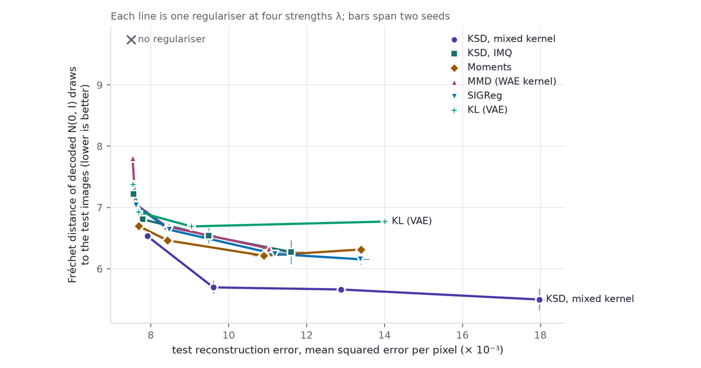
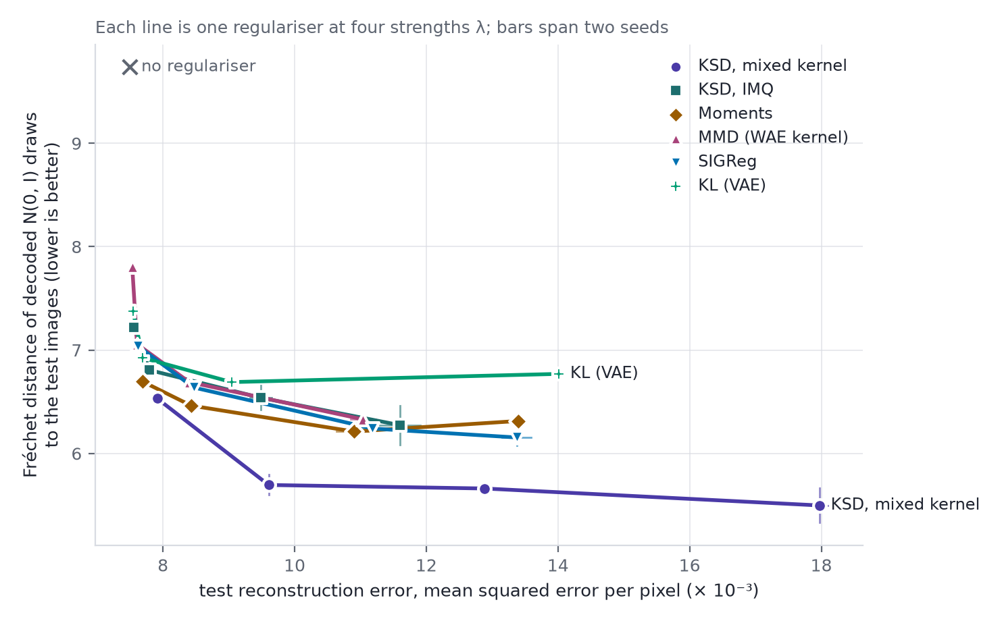
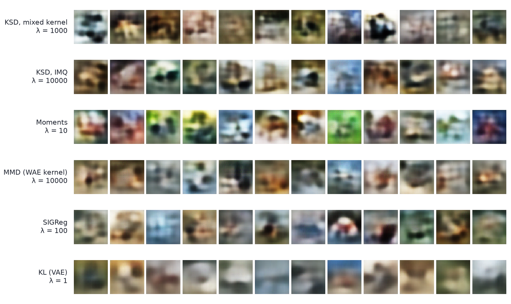

The kernel Stein discrepancy (KSD) can sit in a training loss and pull a batch of codes toward a chosen distribution, using nothing from that distribution but its score.

Anyone who has trained a variational autoencoder has added a KL term to the loss. Anyone who has trained a self-supervised image encoder has added VICReg's variance and covariance terms, or something like them, to stop every image mapping to the same vector. Both terms say the same thing, *make the codes look like $N(0, I)$*, and both say it partially. The VAE's KL acts on one image at a time, so it also charges for whatever a code says about its image. VICReg's terms see only the batch covariance, so a batch arranged as ten tight clusters with identity covariance passes them unchanged.

[Part 1](../steins-lemma/) proved Stein's identity and [Part 2](../steins-method-normal-approximation/) turned it into a normal approximation. [Part 3](../kernel-stein-discrepancy-and-svgd/) built the kernel Stein discrepancy: a distance from a sample to a target that needs only the target's score, and for $N(0, I)$ the score is $-z$. [Part 4](../stein-and-unnormalised-models/) fitted models with the same operator, [Part 5](../steins-method-for-mcmc/) applied it to Markov chains and [Part 6](../steins-method-in-neural-networks/) to neural networks. The [JEPA nuisance study](../stein-jepa-nuisance-leakage/) used KSD as an anti-collapse term without saying what it does to a batch. This part says what it does, and measures it on CIFAR-10.

An AI agent (Claude) ran the experiments and drafted the text and the interactive chart. Separate passes checked each derivation numerically and each reference against its source.

Three ideas carry the post:

1. **KSD of a batch is a loss.** For $N(0, I)$ it has a closed form in the batch's distances and inner products, costs $O(n^2 d)$, and its V-statistic is the squared length of the step SVGD would take from the batch. A batch with zero KSD is one SVGD would not move.
2. **The kernel sets what the regulariser can see.** Under the linear kernel $1 + x^\top y$, KSD is the moment penalty $\lVert \bar z\rVert^2 + \lVert \hat M_2 - I\rVert_F^2$ that VICReg-type terms approximate. A characteristic kernel sees the whole law in principle, but in 64 dimensions a wide kernel is nearly linear in the squared distance, and only a narrow one keeps the extra sight.
3. **What a regulariser should see depends on how the codes are used.** A VAE decodes draws from $N(0, I)$, and there a mixed kernel that sees shape gave the best prior samples of six regularisers on CIFAR-10. A JEPA's embedding only has to avoid collapse, and there the kernels that see about two moments gave the best linear probes, while the mixed kernel gave the worst of those that prevented collapse.

## Notation

- $z_1, \dots, z_n \in \mathbb{R}^d$: a batch of codes, the latents of a VAE or the embeddings of a JEPA. $\bar z$ is the batch mean and $\hat M_2 = \frac1n\sum_i z_i z_i^\top$ its second-moment matrix.
- $p = N(0, I_d)$: the target. Its score is $s_p(z) = \nabla \log p(z) = -z$.
- $\mathcal{A}_p f = \nabla\!\cdot f + s_p^\top f$: the Langevin Stein operator of Part 1, for a vector field $f : \mathbb{R}^d \to \mathbb{R}^d$. For $p = N(0, I)$ it is $\nabla\!\cdot f - z^\top f$.
- $k(x, y)$: a base kernel, with RKHS $\mathcal{H}_k$; $\mathcal{H}_k^d$ is the $d$-fold product for vector fields. $k_p$ is its Stein kernel. $u = \lVert x - y\rVert^2$.
- Two base kernels recur. IMQ, $k = (1 + u)^{-1/2}$, as in Part 3. Gaussian, $k = e^{-u/2\ell^2}$, with bandwidth $\ell$.
- $\lambda$: the weight of a regulariser in a loss.

## Regularisers that target $N(0, I)$ {#sec-regs}

Every regulariser in this post takes the codes an encoder produces and returns a number that is small when they look like draws from $N(0, I_d)$. Six are compared.

- **KL**, the VAE's term. The encoder outputs a mean $\mu(x)$ and variances $\sigma^2(x)$ for each image, and pays
  $$
  \mathrm{KL}\big(N(\mu, \operatorname{diag}\sigma^2)\,\big\Vert\,N(0, I)\big) = \tfrac12 \sum_{j=1}^d \big(\mu_j^2 + \sigma_j^2 - \log\sigma_j^2 - 1\big)
  $$
  per image (Kingma & Welling 2014).
- **Moments.** $R_{\mathrm{mom}} = \lVert \bar z\rVert^2 + \lVert \hat M_2 - I\rVert_F^2$: the batch's mean and second moments against the target's. The experiments use an unbiased version of it (@sec-uv).
- **VICReg** (Bardes et al. 2022): a hinge on each coordinate's standard deviation below 1, plus the squared off-diagonal covariances. It names no target distribution and has no term for the mean.
- **MMD** (Gretton et al. 2012): compares the batch with a fresh sample $y_1, \dots, y_n \sim N(0, I)$ through kernel averages.
- **SIGReg** (Balestriero & LeCun 2025): projects the batch onto random unit directions and compares each projection's empirical characteristic function with $e^{-t^2/2}$, the characteristic function of $N(0, 1)$, through an Epps–Pulley-type statistic (Epps & Pulley 1983). This post follows the paper's Algorithm 1: weight $e^{-t^2/2}$, 17 quadrature points on $[-5, 5]$, the statistic multiplied by the batch size, 256 directions redrawn every step. The paper recommends 1,024 directions.
- **KSD** (Liu, Lee & Jordan 2016; Chwialkowski, Strathmann & Gretton 2016): the U-statistic of Part 3,
  $$
  \widehat{\mathrm{KSD}}{}^2_U(z_{1:n}) = \frac{1}{n(n-1)} \sum_{i \neq j} k_p(z_i, z_j).
  $$

They differ in what they need from the target:

| Regulariser | Needs from $N(0, I)$ | Acts on | Cost per batch |
|---|---|---|---|
| KL | its density, and the encoder's | one image at a time | $O(nd)$ |
| Moments | mean and covariance | the batch | $O(nd^2)$ |
| VICReg | a target standard deviation | the batch | $O(nd^2)$ |
| MMD | samples | the batch | $O(n^2 d)$ |
| SIGReg | the 1-D characteristic function | the batch, along $M$ directions | $O(nMd + nMT)$ |
| KSD | the score $-z$ | the batch | $O(n^2 d)$ |

$M$ is the number of directions and $T$ the number of quadrature points in SIGReg's integral.

### The VAE's KL term {#sec-kl}

The VAE's term is not a batch regulariser. Averaged over the data, it splits into two parts (Hoffman & Johnson 2016):

::: {.eq-hero}
ELBO surgery

$$
\mathbb{E}_{x}\Big[\mathrm{KL}\big(q(z \mid x)\,\Vert\,p(z)\big)\Big]
\;=\;
\underbrace{\class{t3}{I_q(x;\,z)}}_{\text{what the code says about } x}
\;+\;
\underbrace{\class{t1}{\mathrm{KL}\big(q(z)\,\Vert\,p(z)\big)}}_{\text{how far the codes are from } p}
$$ {#eq-surgery}

$q(z) = \mathbb{E}_x\, q(z \mid x)$ is the aggregate posterior: the law of a code when the image is drawn at random. Hoffman & Johnson write the mutual information between $z$ and the image's index in the data set, which is the same quantity for a finite data set.
:::

::: {.stein-proof}
**Proof.** Split the log-ratio inside the KL through $q(z)$, then average over $x$ and $z \sim q(z \mid x)$:

$$
\begin{aligned}
\mathbb{E}_{x}\,\mathbb{E}_{z \mid x}\Big[\log\frac{q(z \mid x)}{p(z)}\Big]
&= \mathbb{E}_{x}\,\mathbb{E}_{z \mid x}\Big[\log\frac{q(z \mid x)}{q(z)}\Big]
\;+\; \mathbb{E}_{x}\,\mathbb{E}_{z \mid x}\Big[\log\frac{q(z)}{p(z)}\Big] \\[6pt]
&= I_q(x;\, z) \;+\; \mathbb{E}_{z \sim q(z)}\Big[\log\frac{q(z)}{p(z)}\Big]
&& \class{tm}{\text{$z$ averaged over $x$ has law $q(z)$}} \\[6pt]
&= I_q(x;\, z) \;+\; \mathrm{KL}\big(q(z) \,\Vert\, p(z)\big). && \blacksquare
\end{aligned}
$$
:::

- Sampling from the prior needs only the second term to be small. The first term is the price of a code that carries information about its image.
- A batch regulariser targets the second term alone: the batch of codes is a sample from $q(z)$. That is the Wasserstein autoencoder's design (Tolstikhin et al. 2018), with MMD as the batch term; InfoVAE's MMD variant does the same (Zhao et al. 2019).

## KSD of a batch {#sec-ksd}

Part 3 wrote the Stein kernel for a general target and base kernel. Its four terms pair the score with the kernel and its derivatives:

$$
k_p(x, y)
= \class{t1}{s_p(x)^\top s_p(y)\, k(x, y)}
+ \class{t2}{s_p(x)^\top \nabla_y k(x, y) + s_p(y)^\top \nabla_x k(x, y)}
+ \class{t3}{\operatorname{tr}\big(\nabla_x \nabla_y^\top k(x, y)\big)}.
$$

For $p = N(0, I_d)$ every term is explicit.

::: {.callout-important title="Proposition 1 — the Stein kernel of N(0, I)"}
For the Gaussian base kernel $k(x, y) = e^{-u/2\ell^2}$ with $u = \lVert x - y\rVert^2$,

$$
k_p(x, y) \;=\; e^{-\lVert x - y\rVert^2 / 2\ell^2}\,
\Big(\,
\class{t1}{x^\top y}
\;+\; \class{t3}{\frac{d}{\ell^2}}
\;-\; \class{t2}{\lVert x - y\rVert^2} \Big(\class{t2}{\frac{1}{\ell^2}} + \class{t3}{\frac{1}{\ell^4}}\Big)
\Big).
$$ {#eq-stein-gauss}

For the IMQ base kernel $k = (1 + u)^{-1/2}$,

$$
k_p(x, y) \;=\; \frac{x^\top y}{(1 + u)^{1/2}} \;+\; \frac{d - u}{(1 + u)^{3/2}} \;-\; \frac{3u}{(1 + u)^{5/2}}.
$$ {#eq-stein-imq}
:::

::: {.stein-proof}
**Proof.** For the Gaussian kernel, $\nabla_x k = -(x - y)\,k/\ell^2$ and $\nabla_y k = (x - y)\,k/\ell^2$. With $s_p(x) = -x$, the three groups of terms are

$$
\begin{aligned}
\class{t1}{s_p(x)^\top s_p(y)\, k} &= x^\top y \; k, \\[8pt]
\class{t2}{s_p(x)^\top \nabla_y k + s_p(y)^\top \nabla_x k}
&= \frac{-x^\top (x - y) + y^\top (x - y)}{\ell^2}\, k
\;=\; -\frac{u}{\ell^2}\, k, \\[8pt]
\class{t3}{\operatorname{tr}\big(\nabla_x \nabla_y^\top k\big)}
&= \sum_{a=1}^{d} \Big(\frac{1}{\ell^2} - \frac{(x_a - y_a)^2}{\ell^4}\Big)\, k
\;=\; \Big(\frac{d}{\ell^2} - \frac{u}{\ell^4}\Big)\, k .
\end{aligned}
$$

Their sum is @eq-stein-gauss. For the IMQ kernel the same three lines use

$$
\nabla_x k = -\frac{x - y}{(1 + u)^{3/2}},
\qquad
\partial_{x_a}\partial_{y_a} k = \frac{1}{(1 + u)^{3/2}} - \frac{3\,(x_a - y_a)^2}{(1 + u)^{5/2}},
$$

and sum to @eq-stein-imq. $\blacksquare$
:::

The colours follow the three groups. The <span class="t1">score–score term</span> rewards pairs that point in opposite directions from the origin. The <span class="t3">trace term</span>'s $d/\ell^2$ charges every pair close enough to share the kernel, which pushes codes apart. The <span class="t2">cross terms</span> and the rest of the trace term give back in proportion to the squared distance, and under $p$ the three balance to zero on average. Both forms were checked against automatic differentiation of the four-term formula to $10^{-15}$.

**Smallest instance.** On the diagonal, $u = 0$, and @eq-stein-gauss gives $k_p(x, x) = \lVert x\rVert^2 + d/\ell^2$. The V-statistic $\frac{1}{n^2}\sum_{i,j} k_p(z_i, z_j)$ includes those $n$ diagonal terms, the U-statistic does not. So

$$
\widehat{\mathrm{KSD}}{}^2_V = \frac{n-1}{n}\,\widehat{\mathrm{KSD}}{}^2_U \;+\; \frac{1}{n}\Big(\frac{1}{n}\sum_{i=1}^n \lVert z_i\rVert^2 + \frac{d}{\ell^2}\Big).
$$

The V-statistic is the U-statistic plus a ridge penalty of weight $1/n$ on the codes. @sec-uv says which to train with.

### Relation to SVGD {#sec-svgd}

Part 3's Theorem 3 (Liu & Wang 2016) found the direction in which moving a sample lowers its KL divergence to $p$ fastest:

$$
\phi^*_{q}(\cdot) = \mathbb{E}_{z \sim q}\big[k(z, \cdot)\, s_p(z) + \nabla_z k(z, \cdot)\big],
$$

and Part 3's Theorem 2 showed $\mathrm{KSD}(q, p) = \lVert \phi^*_q \rVert_{\mathcal{H}_k^d}$. Applied to the batch's own empirical law:

::: {.eq-hero}
KSD of a batch is the length of its SVGD step

$$
\widehat{\mathrm{KSD}}{}^2_V(z_{1:n})
\;=\;
\Bigg\lVert\;
\frac{1}{n}\sum_{i=1}^{n}
\bigg[\;
\underbrace{\class{t1}{k(z_i, \cdot)\,(-z_i)}}_{\text{drift to the origin}}
\;+\;
\underbrace{\class{t2}{\nabla_{z_i} k(z_i, \cdot)}}_{\text{repulsion between codes}}
\;\bigg]
\;\Bigg\rVert^2_{\mathcal{H}_k^d}
$$ {#eq-svgd-norm}

The bracket, averaged over the batch, is the velocity SVGD would give every point.
:::

- A batch with zero V-statistic KSD is a fixed point of SVGD: the drift toward the origin and the repulsion between codes cancel everywhere.
- Penalising KSD and running SVGD on the codes use the same field. SVGD moves the codes along it, which needs only the score (amortised SVGD; Wang & Liu 2016; Part 4). The KSD penalty differentiates its squared length, which needs the derivative of the score as well. For $N(0, I)$ that derivative is $-I$, so the two cost the same.
- Minimising KSD over a free set of particles, with no encoder, is KSD descent (Korba et al. 2021). It can stall at spurious stationary points, such as configurations symmetric about a plane.

### U- or V-statistic {#sec-uv}

The two estimators differ by the diagonal, and as losses they fail in opposite directions.

- **The V-statistic is never negative**, because @eq-svgd-norm writes it as a squared norm. Its expectation over batches is not $\mathrm{KSD}^2(q, p)$, though: it adds $\frac1n\mathbb{E}_q\, k_p(z, z)$, which for both base kernels grows with $\lVert z\rVert^2$. Minimising it shrinks the codes. The bias carries a factor $d$, so it matters most in high dimension.
- **The U-statistic is unbiased**: averaged over batches it equals $\mathrm{KSD}^2(q, p)$, which is zero only at $q = p$. But it can be negative, and for some kernels it has no floor. Under the linear kernel of @sec-see, one code sent far out lowers it without limit whenever the rest of the batch is slightly narrower than the target along that code's direction, at a rate proportional to $\lVert z\rVert^2/n$. Under IMQ, two codes sent off in opposite directions lower it more slowly, since @eq-stein-imq gives $k_p(x, -x) \approx -\lVert x\rVert/2$ for large $x$. Under the Gaussian kernel every term decays, so it is bounded.

The rule this post follows:

- **Descending a fixed set of points**, as in the interactive chart of @sec-chart, needs a loss with a floor: the V-statistic.
- **Training an encoder on fresh batches** needs the right expectation: the U-statistic. Its escape routes are not hypothetical. The VAE of @sec-vae found both at strong $\lambda$, so a U-statistic loss needs a kernel whose Stein kernel is bounded, or a watch on the largest codes.

### Gradient of the moment penalty {#sec-affine}

The moment penalty's gradient on one code is

$$
\frac{\partial R_{\mathrm{mom}}}{\partial z_i}
\;=\;
\frac{2}{n}\,\bar z \;+\; \frac{4}{n}\,\big(\hat M_2 - I\big)\, z_i .
$$

It is an affine function of $z_i$, with the same matrix for every code. A gradient step therefore moves the whole batch by one affine map, and an affine map sends a ring to an ellipse and four clusters to four clusters. Whatever shape the batch has beyond its first two moments, the moment penalty can stretch it but never change it. KSD's gradient on $z_i$ depends on where the other codes are, so it can.

## Kernel choice {#sec-see}

The moment penalty is not a different kind of object from KSD. It is KSD under the simplest kernel.

::: {.callout-important title="Proposition 2 — the moment penalty is KSD under the linear kernel"}
Let $k(x, y) = 1 + x^\top y$ and $p = N(0, I_d)$. For every $q$ with finite second moments, with $m = \mathbb{E}_q z$ and $M_2 = \mathbb{E}_q zz^\top$,

$$
\mathrm{KSD}^2(q, p) \;=\; \class{t1}{\lVert m \rVert^2} \;+\; \class{t2}{\lVert M_2 - I \rVert_F^2}.
$$ {#eq-linear-ksd}

Applied to the batch's empirical law, this is $R_{\mathrm{mom}}$.
:::

::: {.stein-proof}
**Proof.** The RKHS of $1 + x^\top y$ is the affine functions $a + b^\top x$ with norm $\sqrt{a^2 + \lVert b\rVert^2}$. So $\mathcal{H}_k^d$ is the affine vector fields $f(z) = a + Bz$, with $\lVert f\rVert^2 = \lVert a\rVert^2 + \lVert B\rVert_F^2$.

1. For such $f$, $\nabla\!\cdot f = \operatorname{tr} B$, so $\mathcal{A}_p f(z) = \operatorname{tr} B - z^\top a - z^\top B z$.
2. Taking expectations, $\mathbb{E}_q \mathcal{A}_p f = -a^\top m + \langle B,\, I - M_2\rangle_F$.
3. KSD is the supremum of $\lvert\mathbb{E}_q \mathcal{A}_p f\rvert$ over $\lVert f\rVert \le 1$. A linear functional's supremum over a unit ball is the norm of its representer, here $(-m,\, I - M_2)$, whose squared norm is @eq-linear-ksd. $\blacksquare$
:::

- **Reading.** The linear kernel tests Stein's identity on affine vector fields only. A constant field checks the mean and a linear field checks the second moments; nothing in the test class can see a third moment.
- **VICReg** depends on the batch only through its covariance matrix, so it is blind to the same things, and to the mean as well.
- **Polynomial kernels.** Under $(1 + x^\top y)^r$ the test fields are polynomials of degree $r$, and $\mathcal{A}_p f$ is a polynomial of degree $r + 1$: KSD then sees moments up to order $r + 1$.
- **Characteristic kernels.** Under the IMQ or Gaussian kernel, $\mathrm{KSD}(q, p) = 0$ only when $q = p$ (Liu, Lee & Jordan 2016; Chwialkowski, Strathmann & Gretton 2016). Gorham & Mackey (2017) add that the IMQ KSD also controls convergence, while for $d \ge 3$ the Gaussian KSD can go to zero along a sequence whose mass escapes to infinity.

### Two-dimensional batches {#sec-chart}

The chart puts the comparison where it can be seen. It draws a batch of codes in two dimensions, from a law with the same mean and covariance as $N(0, I)$, and the direction each regulariser would move every code. Its bars score the batch under all five regularisers, in standard deviations above their spread on Gaussian batches of the same size. Descending moves the codes themselves, with no encoder in between, using the V-statistic (@sec-uv).

::: {#widget-forces}
:::

```{=html}
<script src="model.js"></script>
<script src="widgets.js"></script>
```

**Things to try.** The ranges are over the first five draws ("New draw") at the default batch size of 150.

1. **Ring, Moments.** The arrows are short, and the Moments bar sits between −1.0 and 0.8 null standard deviations, inside the tick. Every kernel bar is far past it: KSD with the IMQ kernel at 23–29, the Gaussian kernel at 49–56, MMD at 6–12, SIGReg at 9–13.
2. **Press Descend.** After the full 3,000 steps the mean of $\lvert z\rvert^4$ is still 4.1–4.2, against 8 for $N(0, I)$, and the mean of $\lvert z\rvert^2$ is still 2.00. The moment penalty has nothing to correct, so the ring stays a ring (@sec-affine).
3. **Switch to KSD IMQ, press New draw, then Descend.** The ring fills in: the mean of $\lvert z\rvert^4$ ends at 6.6–6.7. The mean of $\lvert z\rvert^2$ ends at 1.92, below 2. That is the V-statistic's ridge penalty from @sec-uv, pulling codes in. With the Gaussian kernel it ends at 1.81–1.82.
4. **Shrunk.** Every regulariser flags a batch with the wrong scale, the moment penalty included (56–60 null standard deviations). Collapse is a failure of the second moment, which every regulariser here can see.

### High dimension {#sec-highdim}

The chart is two-dimensional. The CIFAR-10 runs use $d = 64$, and there a characteristic kernel can see much less than it can in principle.

The reason is concentration. For two independent draws $x, y \sim N(0, I_d)$, $u = \lVert x - y\rVert^2$ is $2\chi^2_d$: its mean is $2d$ and its standard deviation $\sqrt{8d}$, a relative spread of $\sqrt{2/d}$, or 18% at $d = 64$. Expand the base kernel around $2d$:

$$
k(u) \;=\; \underbrace{k(2d) + k'(2d)\,(u - 2d)}_{\text{affine in } u}
\;+\; \tfrac12\, k''(2d)\,(u - 2d)^2 \;+\; \cdots,
\qquad
u = \lVert x\rVert^2 + \lVert y\rVert^2 - 2\,x^\top y .
$$

- The affine part depends on $x$ and $y$ only through $\lVert x\rVert^2$, $\lVert y\rVert^2$ and $x^\top y$: a kernel of low polynomial degree, close kin of the linear kernel. El Karoui (2010) proves the matrix version: for data with independent coordinates, as the sample size and dimension grow together, a kernel matrix is close to a linear-kernel matrix plus low-rank terms.
- What is left for seeing shape is the curvature. Its size relative to the slope, one standard deviation of $u$ away from $2d$, is

$$
r \;=\; \frac{\tfrac12\,\lvert k''(2d)\rvert\,\sqrt{8d}}{\lvert k'(2d)\rvert}.
$$

| Base kernel | $r$ at $d = 64$ |
|---|---|
| IMQ, $(1 + u)^{-1/2}$ | $\tfrac{3}{4}\sqrt{8d}/(1 + 2d) = 0.13$ |
| Gaussian, $\ell^2 = d$ (the usual MMD median heuristic) | $\sqrt{8d}/4d = 0.09$ |
| Gaussian, $\ell^2 = d/\log n$, $n = 256$ (the SVGD median heuristic) | $\sqrt{8d}\,\log n/4d = 0.49$ |

The first two kernels are close to affine in $u$ over every pair a batch contains, so their KSD sees about what the moment penalty sees. Only the narrow Gaussian kernel keeps enough curvature to see shape. This is one face of the decline in power of kernel tests with dimension at a fixed sample size, against alternatives that do not get easier as the dimension grows (Ramdas et al. 2015). Zhao et al. (2019) report the same from the training side: their VAE regularised with the SVGD direction performed well only with a two-dimensional latent space.

A direct test makes the point. Four laws share the target's mean and covariance: the corners of the cube $\{\pm 1\}^d$, the sphere of radius $\sqrt d$, independent coordinates with Student-$t_5$ tails scaled to variance 1, and ten Gaussian clusters, whitened. For each law and each regulariser, 200 batches of $n = 256$ were drawn; a batch is flagged when its value exceeds the 95th percentile of the same regulariser on 200 Gaussian batches. A regulariser that sees only the first two moments flags about 5% of batches.

| Regulariser | $d = 2$, all four | $d = 64$: corners | sphere | $t_5$ | clusters |
|---|---|---|---|---|---|
| Moments | 0–10% | 2% | 9% | 12% | 7% |
| KSD, IMQ | 45–100% | 4% | 4% | 4% | 7% |
| KSD, Gaussian, $\ell^2 = d$ | 60–100% | 4% | 4% | 4% | 8% |
| KSD, Gaussian, $\ell^2 = d/\log n$ | 69–100% | 12% | 8% | 33% | 99% |
| KSD, mixed | 49–100% | 10% | 9% | 16% | 81% |
| MMD, WAE kernel | 24–100% | 7% | 4% | 1% | 4% |
| SIGReg | 42–100% | 12% | 12% | 9% | 7% |

The $d = 2$ column ranges over the four laws; for every kernel the lowest figure is the $t_5$ law. The mixed kernel is defined in @sec-scale; SIGReg uses 256 directions.

- In two dimensions every characteristic kernel flags every law but the heavy-tailed one every time. The moment penalty stays near the 5% chance level on all four.
- In 64 dimensions IMQ, the wide Gaussian kernel and MMD sit at the 5% level: from one batch they see about what the moment penalty sees. Only the narrow kernels pick up the clusters.
- SIGReg looks at one-dimensional projections, and most projections of a high-dimensional law are close to Gaussian (Diaconis & Freedman 1984). The clusters occupy 9 of the 64 dimensions, and most of its 256 random directions point mostly elsewhere.

### Scale control {#sec-scale}

The narrow kernel has the opposite problem. A Gaussian kernel at a fixed bandwidth sees nothing of a batch whose codes are far apart compared with $\ell$, and its KSD falls toward zero as the batch spreads. This is Gorham & Mackey's (2017) warning about Gaussian-kernel KSD, that it ignores mass in the tails, here acting on a loss.

A test separates the two failure modes. An encoder in miniature produces $z = \varepsilon \odot s + b$, with $\varepsilon \sim N(0, I_{64})$ redrawn every step, and learns only the 64 scales $s$ and the shift $b$, by Adam on the regulariser alone. The right answer is every $s_j = 1$. The scales start log-uniform on $[0.05, 3]$, and three seeds were run for 1,500 steps each.

| Loss on fresh batches of 256 | Learned scales, three seeds (target 1) |
|---|---|
| Moments, V-statistic | 0.85–0.93 |
| Moments, U-statistic | 0.95–1.05 |
| KSD, IMQ, V-statistic | 0.63–0.75 |
| KSD, IMQ, U-statistic | 0.91–1.09 |
| KSD, Gaussian, $\ell^2 = d/\log n$, U-statistic | 0.16–9.07 |
| KSD, mixed kernel, U-statistic | 0.94–1.06 |
| MMD, WAE kernel | 0.91–1.09 |
| SIGReg | 0.89–1.11 |

- The V-statistics shrink every coordinate: by up to 15% for the moment penalty and by 25–37% for IMQ. That is the ridge penalty of @sec-uv, scaled up by $d = 64$.
- The narrow Gaussian kernel on its own does not recover the scale at all.

The fix uses the linearity of KSD in its base kernel: the Stein kernel of $k_1 + w\,k_2$ is $k_{1,p} + w\,k_{2,p}$, so

$$
\mathrm{KSD}^2_{k_1 + w k_2} \;=\; \mathrm{KSD}^2_{k_1} \;+\; w\, \mathrm{KSD}^2_{k_2}.
$$

The **mixed kernel** of this post is IMQ plus $w = 10$ times a Gaussian kernel. IMQ's heavy tails pin the scale and the Gaussian part sees the shape. Its bandwidth is set from the batch, $\ell^2 = \mathrm{med}^2/(2\log n)$ with $\mathrm{med}^2$ the median squared distance between codes, as in SVGD. Under the target $\mathrm{med}^2 \approx 2d$, which gives the $\ell^2 = d/\log n$ of the detection table. The gradient flows through the median. With the median detached, spreading the batch lowers the loss at the current bandwidth. The descent direction then points outward even when the batch is already too wide (in a test at $d = 64$, at 1.5, 3 and 10 times the target's scale), so nothing stops it spreading. The weight $w = 10$ is the ratio of the two parts' standard deviations on Gaussian batches, rounded: it lets the Gaussian part's signal through without drowning it in IMQ's noise.

## Data: CIFAR-10 {#sec-data}

The two experiments ask a regulariser for different things. A VAE samples from the prior, so every part of the code distribution the decoder never saw becomes a bad image. A JEPA never samples: its embedding is used through linear probes and nearest neighbours, so it only has to avoid collapse.

- **Source.** CIFAR-10 (Krizhevsky 2009): 60,000 colour images of 32 × 32 pixels in ten classes (airplane, automobile, bird, cat, deer, dog, frog, horse, ship, truck), 6,000 per class, split 50,000 for training and 10,000 for test. The images come from the 80 million tiny images collection, and paid students labelled them.
- **Motive.** It was built as a benchmark for object recognition at small scale.
- **What this post asks of it.** Whether decoded draws from $N(0, I)$ look like its images, and whether a self-supervised embedding separates its classes.
- **Cost of a wrong answer.** Choosing a regulariser that costs reconstruction quality and buys nothing, or one that leaves the codes off the target where the decoder has never been trained.
- **Why it fits.** Natural images with known classes give both a generative test and a representation test, at a size where the more than a hundred training runs behind this post fit on one laptop GPU (an Apple M1 Pro).

## A VAE on CIFAR-10 {#sec-vae}

### Setup

- **Encoder.** Three convolutions with stride 2 (64, 128 and 256 channels, batch norm, SiLU), then a linear map to $d = 64$ codes. The VAE's encoder outputs 128 numbers, a mean and a log-variance per coordinate.
- **Decoder.** The mirror image, with transposed convolutions and a sigmoid output.
- **Loss.** The squared reconstruction error summed over an image's 3,072 pixels, averaged over the batch, plus $\lambda R$.
  - KL arm: the standard VAE. The code is sampled, $z = \mu + \sigma \odot \varepsilon$, and $R$ is the per-image KL.
  - Batch arms: the encoder is deterministic and $R$ acts on the batch of 256 codes: moments, MMD, SIGReg, KSD with IMQ, KSD with the mixed kernel. With MMD this is the Wasserstein autoencoder of Tolstikhin et al. (2018).
  - All KSD and moment terms are U-statistics (@sec-uv).
- **Training.** 15 epochs of Adam (learning rate $10^{-3}$, cosine schedule), batch 256, two seeds per setting, four values of $\lambda$ per regulariser, and a plain autoencoder for reference.

### Measurements

- **Reconstruction**: mean squared error per pixel on the 10,000 test images.
- **Prior samples**: 10,000 codes drawn from $N(0, I_{64})$ and decoded. Their quality is the Fréchet distance between Gaussians fitted to classifier features of the decoded images and of the test images, $\lVert\mu_1 - \mu_2\rVert^2 + \operatorname{tr}\big(\Sigma_1 + \Sigma_2 - 2(\Sigma_1^{1/2}\Sigma_2\Sigma_1^{1/2})^{1/2}\big)$. This is the FID formula of Heusel et al. (2017) with a different feature map: a small convolutional classifier trained once on CIFAR-10 (92.3% test accuracy) in place of an ImageNet Inception network. Its numbers compare runs within this post and nowhere else.
- **Reconstructions** get the same distance, as a floor: the decoder's own blur, before any mismatch between codes and prior. The gap between the two distances is what the regulariser can close.
- **The codes themselves**, for the test images (for the VAE, its samples $\mu + \sigma\odot\varepsilon$): $\lVert \mathrm{Cov} - I\rVert_F/\sqrt d$, and the mean squared 2-Wasserstein distance between $N(0, 1)$ and the codes projected onto 512 random directions.

### Results

The figure plots each regulariser's trade-off: reconstruction error against the quality of decoded prior samples, one point per strength $\lambda$.

{#fig-vae-frontier fig-alt="Line chart. Six regulariser lines run from the left, at reconstruction error 7.5 to 8 thousandths, down and to the right. KL, MMD, SIGReg, moments and KSD with the IMQ kernel bunch between Fréchet distances 6.2 and 6.8; KSD with the mixed kernel drops to 5.7 at reconstruction error 9.6 thousandths and stays between 5.5 and 5.7. The unregularised autoencoder sits alone at the top left, at 9.7."}

- **Every regulariser earns its place.** The plain autoencoder reconstructs best (mean squared error $7.50\times10^{-3}$ per pixel), but its decoded prior samples score 9.74 against 5.09 for its reconstructions: its codes are nowhere near $N(0, I)$ ($\lVert\mathrm{Cov} - I\rVert_F/\sqrt d = 21$).
- **The mixed kernel gives the best prior samples at every strength above the weakest.** At $\lambda = 100$ it reaches 5.70 (5.60–5.79 over the two seeds) at reconstruction error $9.61\times10^{-3}$. At comparable reconstruction error the others score 6.46–6.69: moments 6.46 at 8.43, KSD with IMQ 6.54 at 9.49, SIGReg 6.64 at 8.47, MMD 6.69 at 8.40, KL 6.69 at 9.04. No other regulariser gets below 6.15 at any strength tried.
- **The gap between prior samples and reconstructions** is the part a regulariser can close. The mixed kernel leaves 0.37–0.47 of it at $\lambda \ge 100$; every other batch regulariser leaves at least 0.58.
- **KL closes the gap the other way.** At $\lambda = 1$ its gap is only 0.19, and its codes have the smallest sliced 2-Wasserstein distance to $N(0, I)$ of any run (0.0005). But its reconstructions score 6.58: the per-image KL charges for the information in the code (@eq-surgery), and the decoder blurs.
- **The two U-statistics without a floor were exploited**, as @sec-uv warned. Among 2,000 test codes, the largest draw from $N(0, I_{64})$ would have norm about 10, and the ten largest would carry about 0.8% of the total squared norm.
  - Moment penalty, $\lambda \ge 1$ (six runs): the largest code has norm 23–136. At $\lambda \ge 10$ the ten largest carry 15–21%, and the mean excess kurtosis of the projections is 30.
  - KSD with IMQ, $\lambda \ge 1000$ (four runs): largest norm 31–58, the ten largest 4–10%.
  - Every other regularised run, the mixed kernel's included: largest norm below 19, the ten largest below 2%.
- **The code diagnostics do not explain the mixed kernel's lead.** MMD, SIGReg and the mixed kernel all bring the codes' covariance within about 0.2 of $I$ and their projections within a sliced 2-Wasserstein distance of 0.002 of $N(0, 1)$. Whatever the mixed kernel fixes beyond that lives where second moments and one-dimensional projections cannot see, and the detection table found only the narrow kernels looking there.

The decoded samples themselves, at reconstruction errors between $1.09$ and $1.40\times10^{-2}$:

{#fig-vae-samples fig-alt="Six rows of twelve small blurred 32 by 32 images, one row per regulariser. The moment-penalty row is the most saturated in colour; the KL row is the most washed out; the mixed-kernel row shows the most varied shapes and contrasts."}

Every row is blurred, as small autoencoders on CIFAR-10 are. The differences the Fréchet distance measures show as saturation and contrast. The moment penalty's row is oversaturated, the KL row washed out, and the mixed kernel's row the most varied in colour and contrast.

## A JEPA on CIFAR-10 {#sec-jepa}

A joint-embedding predictive architecture (JEPA; Assran et al. 2023) learns from two views of one image: an encoder embeds both, and a predictor maps one embedding to the other. Its loss has a trivial minimum, every image sent to the same vector, and the regulariser is what rules it out.

### Setup

- **Views.** Two augmentations of each image, with the operations of SimCLR (Chen et al. 2020) and no blur: a random resized crop (20–100% of the area), a horizontal flip, colour jitter of strength 0.4 with probability 0.8, and grayscale with probability 0.2.
- **Encoder.** A small residual network (four residual blocks, 32 to 256 channels, 1.4 million parameters) gives 256 backbone features; an MLP projector maps them to a 64-dimensional embedding $z$. A second MLP, the predictor, maps one view's embedding to a guess at the other's.
- **Loss.** The mean squared prediction error in both directions plus $\lambda\,\big(R(z_1) + R(z_2)\big)/2$. There is no EMA target and no stop-gradient, so the regulariser alone prevents collapse, as in the [JEPA nuisance study](../stein-jepa-nuisance-leakage/).
- **Arms.** VICReg (variance and covariance terms in their published 25 : 1 ratio; since the loss averages the two views' terms, $\lambda = 2$ gives VICReg's published weights relative to the prediction error), moments, MMD, SIGReg (256 random directions per step), KSD with IMQ, KSD with the mixed kernel, and no regulariser.
- **Choosing $\lambda$.** Each arm ran at $\lambda \in \{0.01, 0.1, 1, 10\}$ for 4 epochs with one seed; the value with the best linear-probe accuracy on 5,000 training images held out from the probe was kept. The test set played no part. The chosen values: 0.1 for KSD with IMQ, 1 for MMD and VICReg, and 0.01 for SIGReg, moments and the mixed kernel. SIGReg and moments peaked at the bottom of the grid; the mixed kernel scored between 43.5% and 44.9% at all four values.
- **Training.** 12 epochs of AdamW (one-cycle schedule, peak learning rate $2\times10^{-3}$), batch 256, three fresh seeds per arm (one for the unregularised run).

### Measurements

- **Linear probe**: a logistic regression on the frozen backbone features of the 50,000 training images, scored on the 10,000 test images; and a 20-nearest-neighbour classifier on the same features.
- **The embedding**: its effective rank (Roy & Vetterli 2007), the exponential of the entropy of the normalised singular values of the centred test embeddings, out of 64; and the same Gaussian diagnostics as the VAE's codes.

### Results

Test accuracy of the linear probe and the 20-nearest-neighbour classifier, at each arm's chosen $\lambda$, with the range over three seeds. *Class separation* is the between-class sum of squares of the test embeddings over the within-class sum: how much of the embedding's spread lies between CIFAR-10's classes rather than inside them.

| Regulariser | $\lambda$ | Linear probe | 20-NN | Class separation | Effective rank (of 64) |
|---|---|---|---|---|---|
| KSD, IMQ | 0.1 | 69.3% (68.9–69.5) | 65.5% | 0.25 | 29.8 |
| MMD, WAE kernel | 1 | 68.9% (68.7–69.2) | 64.5% | 0.37 | 20.3 |
| SIGReg | 0.01 | 67.6% (67.5–67.8) | 62.3% | 0.40 | 17.2 |
| VICReg | 1 | 65.6% (64.7–66.4) | 60.9% | 0.21 | 25.7 |
| Moments | 0.01 | 56.6% (49.3–60.4) | 52.7% | 0.03 | 51.3 |
| KSD, mixed | 0.01 | 44.5% (43.5–45.2) | 39.6% | 0.08 | 42.8 |
| None (one seed) | — | 30.3% | 30.9% | — | collapsed |

- **The wide kernels win.** KSD with IMQ and MMD are level within their seed ranges; SIGReg is under two points behind, and VICReg nearly four (65.6%, at half its published weights, the strength the pilot chose). In 64 dimensions all three of the leaders see little beyond the first two moments of a batch (@sec-highdim), and at the chosen strengths none of them makes the embedding Gaussian: its covariance stays 0.9–2.1 away from $I$ in $\lVert\mathrm{Cov} - I\rVert_F/\sqrt d$.
- **The mixed kernel, best in the VAE, is the worst here of the regularisers that prevent collapse.** Its probe reaches 44.5%, and in the pilot it scored 43.5–44.9% at every strength tried. Its embedding is spread over more directions (effective rank 42.8) but keeps less than a third of the class separation of the leaders. That is what a kernel that sees cluster structure, and pushes it toward a Gaussian, would be expected to do to an embedding whose clusters are its classes. The table shows the association, not the mechanism.
- **The moment penalty's escape route was found again.** Its largest test embeddings have norm 111–238, depending on the seed. The mean excess kurtosis of its projections is 239, and its probe varies by 11 points across seeds.
- **Without a regulariser the embedding collapses.** The prediction error reaches zero, every test embedding lies within 0.2 of the origin, and the probe on the backbone features falls to 30.3%.

The two experiments point in opposite directions, and for the same reason. A VAE decodes draws from the prior, so every region of the code distribution matters and a regulariser that sees shape pays for itself. A JEPA's embedding is read by a linear probe, which needs the classes apart and the coordinates in use, not a Gaussian. There the regularisers that see about two moments do as well as anything, and the one that sees more flattens the structure the probe needs.

## Using KSD as a regulariser {#sec-recipe}

The steps the experiments support, for a target $p$ whose score is known:

1. **Write the Stein kernel in closed form.** For $N(0, I)$ it is @eq-stein-gauss or @eq-stein-imq. The loss costs $O(n^2 d)$ per batch and needs the derivative of the score through automatic differentiation; for $N(0, I)$ that derivative is the constant $-I$.
2. **Train on the U-statistic.** The V-statistic shrinks the codes, by 25–37% per coordinate with IMQ at $d = 64$ (@sec-scale).
3. **Choose the kernel by how the codes are used.** If they will be sampled, as in a VAE, combine two kernels in high dimension: IMQ alone pins the scale and sees little else, a narrow Gaussian kernel alone sees shape and loses the scale, and the mixed kernel adds them (IMQ plus a Gaussian kernel at the batch's median bandwidth, gradient through the median, weighted by the ratio of the two parts' spreads on Gaussian batches). If the regulariser only has to prevent collapse, as in a JEPA, IMQ alone at a small $\lambda$ did best here, and the mixed kernel did worst.
4. **Watch the largest codes.** A U-statistic whose Stein kernel is unbounded below can be lowered by a few codes sent far out, and an encoder finds that route (@sec-vae).
5. **Sweep $\lambda$ and plot the trade-off.** One strength per regulariser compares nothing; @fig-vae-frontier needed four per line.

## Constraints

- **Toy scale.** Small networks, 15 and 12 epochs, two or three seeds per setting. The absolute numbers are far from the state of the art on CIFAR-10, and the Fréchet distances use this post's own classifier, so they compare runs here and nowhere else.
- **One dimension, one batch size.** Every run uses $d = 64$ and $n = 256$. The curvature argument of @sec-highdim predicts that the balance between wide and narrow kernels moves with both.
- **Coarse frontiers.** Four strengths per regulariser, placed using a 3-epoch pilot.
- **Who was tuned.** The mixed kernel's weight and bandwidth come from the synthetic tests of @sec-highdim and @sec-scale, not from CIFAR-10. MMD uses the Wasserstein autoencoder's published kernel and SIGReg its published Algorithm 1, neither tuned further. A kernel tuned for MMD or more directions for SIGReg might close some of the gap.
- **Other Stein-based fixes untested.** Sliced KSD (Gong et al. 2021) optimises its projection directions and is another answer to the blindness of @sec-highdim. Pu et al. (2017) train a VAE's encoder with SVGD itself. Neither was run.
- **The median bandwidth** is a piecewise-smooth function of the batch, and its gradient flows through one pair of codes per step.
- **The JEPA's strengths came from a coarse grid.** SIGReg and the moment penalty peaked at its lowest value, 0.01, so a smaller $\lambda$ might suit them better. The probe measures linear separability only; the [JEPA nuisance study](../stein-jepa-nuisance-leakage/) measures what an embedding keeps that it should not, which can rank regularisers differently.

Wide. Kernels. Count. Moments. Narrow. Kernels. See. Shape. Uses. Decide.

## References

- Assran, M., Duval, Q., Misra, I., Bojanowski, P., Vincent, P., Rabbat, M., LeCun, Y. & Ballas, N. (2023). [Self-supervised learning from images with a joint-embedding predictive architecture](https://doi.org/10.1109/CVPR52729.2023.01499). *Proceedings of the IEEE/CVF Conference on Computer Vision and Pattern Recognition*, 15619–15629.
- Balestriero, R. & LeCun, Y. (2025). [LeJEPA: provable and scalable self-supervised learning without the heuristics](https://arxiv.org/abs/2511.08544). arXiv:2511.08544.
- Bardes, A., Ponce, J. & LeCun, Y. (2022). [VICReg: variance-invariance-covariance regularization for self-supervised learning](https://openreview.net/forum?id=xm6YD62D1Ub). *International Conference on Learning Representations*.
- Chen, T., Kornblith, S., Norouzi, M. & Hinton, G. (2020). [A simple framework for contrastive learning of visual representations](https://proceedings.mlr.press/v119/chen20j.html). *Proceedings of the 37th International Conference on Machine Learning*, PMLR 119, 1597–1607.
- Chwialkowski, K., Strathmann, H. & Gretton, A. (2016). [A kernel test of goodness of fit](https://proceedings.mlr.press/v48/chwialkowski16.html). *Proceedings of the 33rd International Conference on Machine Learning*, PMLR 48, 2606–2615.
- Diaconis, P. & Freedman, D. (1984). [Asymptotics of graphical projection pursuit](https://doi.org/10.1214/aos/1176346703). *Annals of Statistics* 12(3), 793–815.
- El Karoui, N. (2010). [The spectrum of kernel random matrices](https://doi.org/10.1214/08-AOS648). *Annals of Statistics* 38(1), 1–50.
- Epps, T. W. & Pulley, L. B. (1983). [A test for normality based on the empirical characteristic function](https://doi.org/10.1093/biomet/70.3.723). *Biometrika* 70(3), 723–726.
- Gong, W., Li, Y. & Hernández-Lobato, J. M. (2021). [Sliced kernelized Stein discrepancy](https://openreview.net/forum?id=t0TaKv0Gx6Z). *International Conference on Learning Representations*.
- Gorham, J. & Mackey, L. (2017). [Measuring sample quality with kernels](https://proceedings.mlr.press/v70/gorham17a.html). *Proceedings of the 34th International Conference on Machine Learning*, PMLR 70, 1292–1301.
- Gretton, A., Borgwardt, K. M., Rasch, M. J., Schölkopf, B. & Smola, A. (2012). [A kernel two-sample test](https://jmlr.org/papers/v13/gretton12a.html). *Journal of Machine Learning Research* 13, 723–773.
- Heusel, M., Ramsauer, H., Unterthiner, T., Nessler, B. & Hochreiter, S. (2017). [GANs trained by a two time-scale update rule converge to a local Nash equilibrium](https://proceedings.neurips.cc/paper/2017/hash/8a1d694707eb0fefe65871369074926d-Abstract.html). *Advances in Neural Information Processing Systems* 30.
- Hoffman, M. D. & Johnson, M. J. (2016). [ELBO surgery: yet another way to carve up the variational evidence lower bound](http://web.archive.org/web/20201111190435/http://approximateinference.org/2016/accepted/HoffmanJohnson2016.pdf). *NIPS 2016 Workshop on Advances in Approximate Bayesian Inference*.
- Kingma, D. P. & Welling, M. (2014). [Auto-encoding variational Bayes](https://arxiv.org/abs/1312.6114). *International Conference on Learning Representations*.
- Korba, A., Aubin-Frankowski, P.-C., Majewski, S. & Ablin, P. (2021). [Kernel Stein discrepancy descent](https://proceedings.mlr.press/v139/korba21a.html). *Proceedings of the 38th International Conference on Machine Learning*, PMLR 139, 5719–5730.
- Krizhevsky, A. (2009). [Learning multiple layers of features from tiny images](https://www.cs.toronto.edu/~kriz/learning-features-2009-TR.pdf). Technical report, University of Toronto.
- Liu, Q., Lee, J. & Jordan, M. (2016). [A kernelized Stein discrepancy for goodness-of-fit tests](https://proceedings.mlr.press/v48/liub16.html). *Proceedings of the 33rd International Conference on Machine Learning*, PMLR 48, 276–284.
- Liu, Q. & Wang, D. (2016). [Stein variational gradient descent: a general purpose Bayesian inference algorithm](https://proceedings.neurips.cc/paper/2016/hash/b3ba8f1bee1238a2f37603d90b58898d-Abstract.html). *Advances in Neural Information Processing Systems* 29.
- Pu, Y., Gan, Z., Henao, R., Li, C., Han, S. & Carin, L. (2017). [VAE learning via Stein variational gradient descent](https://proceedings.neurips.cc/paper/2017/hash/443dec3062d0286986e21dc0631734c9-Abstract.html). *Advances in Neural Information Processing Systems* 30. <!-- codespell:ignore carin -->
- Ramdas, A., Reddi, S. J., Póczos, B., Singh, A. & Wasserman, L. (2015). [On the decreasing power of kernel and distance based nonparametric hypothesis tests in high dimensions](https://doi.org/10.1609/aaai.v29i1.9692). *Proceedings of the AAAI Conference on Artificial Intelligence* 29(1).
- Roy, O. & Vetterli, M. (2007). [The effective rank: a measure of effective dimensionality](https://www.eurasip.org/Proceedings/Eusipco/Eusipco2007/Papers/a5p-h05.pdf). *Proceedings of the 15th European Signal Processing Conference (EUSIPCO)*, 606–610.
- Tolstikhin, I., Bousquet, O., Gelly, S. & Schölkopf, B. (2018). [Wasserstein auto-encoders](https://openreview.net/forum?id=HkL7n1-0b). *International Conference on Learning Representations*.
- Wang, D. & Liu, Q. (2016). [Learning to draw samples: with application to amortized MLE for generative adversarial learning](https://arxiv.org/abs/1611.01722). *arXiv* 1611.01722.
- Zhao, S., Song, J. & Ermon, S. (2019). [InfoVAE: balancing learning and inference in variational autoencoders](https://doi.org/10.1609/aaai.v33i01.33015885). *Proceedings of the AAAI Conference on Artificial Intelligence* 33(1), 5885–5892.
- [Stein's Method, Part 1: Stein's Lemma](../steins-lemma/) — the identity, Gaussian integration by parts and Price's theorem.
- [Stein's Method, Part 2: Normal Approximation](../steins-method-normal-approximation/) — the Stein equation, bounds on its solution, and the Wasserstein bound for sums.
- [Stein's Method, Part 3: Kernel Stein Discrepancy and SVGD](../kernel-stein-discrepancy-and-svgd/) — the Langevin identity in $d$ dimensions, KSD and SVGD.
- [Stein's Method, Part 4: Models Without Normalising Constants](../stein-and-unnormalised-models/) — score matching, SURE losses and Stein control variates for policy gradients.
- [Stein's Method, Part 5: Markov Chain Monte Carlo](../steins-method-for-mcmc/) — the Poisson equation, the bias of unadjusted Langevin and zero-variance control variates.
- [Stein's Method, Part 6: Neural Networks and Machine Learning](../steins-method-in-neural-networks/) — wide random networks, hidden directions, and a map of the series in machine learning.
- [Nuisance Leakage in JEPA Embeddings Is Set by Regulariser Strength and Width](../stein-jepa-nuisance-leakage/) — KSD as an anti-collapse regulariser.
