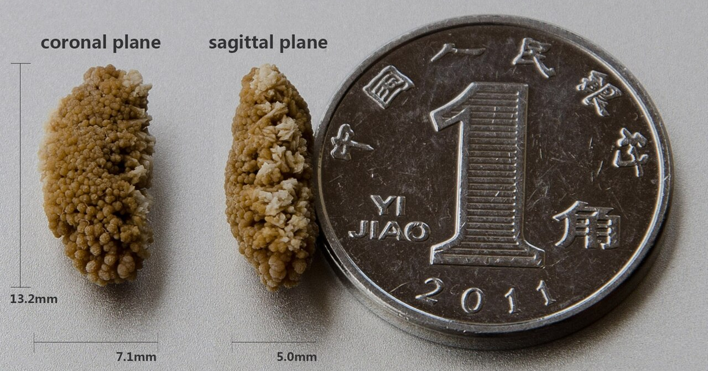

The option with the better track record is not always the better option, and one table of kidney-stone patients shows how to tell the two apart.

You already compare things by their track record. You pick the restaurant with more good reviews, the course with the higher pass rate, the surgeon with fewer complications. That rule works when the options faced the same customers. It breaks when someone chose who went where, and outside an experiment someone almost always did.

This is the short version of [*Classical and Bayesian Causal Inference*](https://project-delphi.github.io/inferencia-causal/index.en.html#/hero), an interactive deck by Jhonier Rangel and me ([Spanish version](https://project-delphi.github.io/inferencia-causal/)). The deck covers far more ground; its running example is the table here.

## Keyhole surgery wins on the scoreboard

In 1986, Charig and colleagues reported on 700 patients treated for kidney stones. Half got treatment A, open surgery. Half got treatment B, a keyhole procedure through a small cut in the back. Nobody flipped a coin: the doctors chose.

The success rates:

- **A (open surgery):** 273 of 350, or 78.0%.
- **B (keyhole):** 289 of 350, or 82.6%.

B wins by 4.6 percentage points. If you had to pick a surgery from this alone, you would pick B.

## Split the patients by stone size and A wins twice

The study also recorded whether each stone was small or large (the cut-off is 2 cm). Break the same 700 patients into those two groups and the ranking flips:

| Stone size | A (open) | B (keyhole) | A minus B |
|---|---|---|---|
| Small | 81/87 = 93.1% | 234/270 = 86.7% | +6.4 points |
| Large | 192/263 = 73.0% | 55/80 = 68.8% | +4.3 points |
| All patients | 273/350 = 78.0% | 289/350 = 82.6% | −4.6 points |

A beats B on small stones. A beats B on large stones. B beats A overall. No arithmetic is wrong; this reversal has a name, **Simpson's paradox**.

The trick is in who got what. Large stones are harder: both surgeries fail on them more often. And the doctors sent the hard cases to open surgery. Three in four of A's patients (263 of 350) had large stones, against fewer than one in four of B's (80 of 350). B's scoreboard win mostly says B was handed the easier patients.

Stone size here is a **confounder**: something that pushes on both which treatment a patient gets and how the patient does. A confounder can make a treatment look better or worse than it is, and here it reverses the sign.

## A decision needs "what if everyone got A?"

The scoreboard answers one question: how did the patients who happened to get A do? A doctor choosing a surgery for the next patient needs a different one: how would patients do if we gave all of them A, compared with giving all of them B? The deck calls this the gap between *seeing* and *doing*.

Every patient has two possible futures, one under A and one under B. We only ever see the future for the treatment they got. The other is a **potential outcome** that never happened. Causal inference fills in the missing futures using the patients who did take the other road. That works only when they are comparable, and within one stone size they are: a small-stone patient who got B stands in for a small-stone patient who got A.

So estimate each surgery's success rate separately for small and large stones, then average those rates using the stone mix of all 700 patients: 357 small (51%) and 343 large (49%). That gives every treatment the same patients.

- **Everyone gets A:** 0.51 × 93.1% + 0.49 × 73.0% = **83.3%**
- **Everyone gets B:** 0.51 × 86.7% + 0.49 × 68.8% = **77.9%**

A now wins by **5.4 points**. This reweighting is called **standardization**, or g-computation. Regression adjustment, propensity-score weighting and doubly robust estimators fill most of the deck's estimation section. They do this reweighting when there are too many groups to fit in a table, and on this data all three return 5.4.

## Five points, but not five points you can bank

A 5.4-point estimate from 700 patients still comes with noise. Its standard error is 3.4 points, so the classical 95% confidence interval runs from **−1.2 to +12.0 points**. Zero is inside it. The data favour A, but a frequentist would not reject "no difference".

The Bayesian half of the deck asks the question a patient would ask: how likely is it that A is better? Start every success rate from a flat prior (every value from 0% to 100% equally plausible), update on the counts, and redo the reweighting for every draw from the posterior. The answer:

- **P(A is better) = 0.94.**
- **P(A is better by more than 2 points) = 0.83.**

Run the same calculation on the unadjusted scoreboard and P(A is better) is 0.06. Skipping the confounder does not just shrink the answer; it turns 94% confidence in A into 94% confidence in B.

## Caveat: reweighting only fixes the confounders you wrote down

Every number in the last two sections rests on one assumption: stone size is the *only* thing that both steered the doctors and affected success. If doctors also sent frailer patients to keyhole surgery, the adjustment misses it. No amount of data on these 700 patients can test this. You defend it with knowledge of how the decisions were made, drawn as a diagram of what causes what.

What you can ask is how strong a hidden confounder would have to be to erase the result. The **E-value** answers that. Here it is 1.97: a hidden factor would have to make both getting B and failing about twice as likely to wipe out A's advantage. That is a big effect, but not an absurd one. The 1.97 is for the 5.4-point estimate, though. The confidence interval already reaches zero, so "no difference" fits the data without any hidden confounder at all.

When the confounder cannot be measured at all, adjustment is off the table. The deck's later sections cover what is left: natural experiments like difference-in-differences, instrumental variables, regression discontinuity and synthetic control, which find a source of variation the confounder does not touch.

## Compare futures, not people

The scoreboard compared two groups of people, and the doctors had already sorted those groups by difficulty. A decision compares two futures for the same people. Getting from one to the other took three moves: name what drives both the choice and the outcome, reweight so both treatments face the same patients, and say how sure you are. On these 700 patients that turned "B is better by 4.6 points" into "A is probably better by about 5". The answer is still only as good as the claim that stone size was the one thing steering the doctors. The deck works through all three moves with widgets and quizzes; [How Causality Works](../causality-from-toddlers-to-do-calculus/) takes the same ideas to a product team's dashboard.

Raw. Rates. Mislead. Stone. Size. Flips. Them. Reweight. Then. Doubt.

## References

- Rangel, J. and Kalia, R. (2026). [*Classical and Bayesian Causal Inference: An interactive introduction*](https://project-delphi.github.io/inferencia-causal/index.en.html#/hero).
- Charig, C. R., Webb, D. R., Payne, S. R. and Wickham, J. E. (1986). Comparison of treatment of renal calculi by open surgery, percutaneous nephrolithotomy, and extracorporeal shockwave lithotripsy. *BMJ* 292.
- Julious, S. A. and Mullee, M. A. (1994). Confounding and Simpson's paradox. *BMJ* 309.
- Pearl, J. (2009). *Causality*, 2nd ed. Cambridge University Press.
- Imbens, G. W. and Rubin, D. B. (2015). *Causal Inference for Statistics, Social, and Biomedical Sciences*. Cambridge University Press.
- Hernán, M. A. and Robins, J. M. (2020). *Causal Inference: What If*. Chapman & Hall/CRC.
- VanderWeele, T. J. and Ding, P. (2017). Sensitivity analysis in observational research: introducing the E-value. *Annals of Internal Medicine* 167(4).
