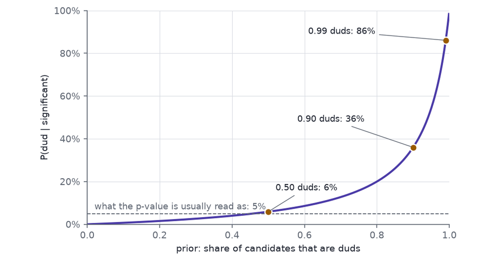

```{python}
#| label: setup
#| include: false
from pathlib import Path

import matplotlib.pyplot as plt
import numpy as np
import pandas as pd
from IPython.display import Markdown
from scipy import optimize, stats

INK, MUTED, RULE = "#1F2430", "#5F6672", "#D8DBE2"
PURPLE, AMBER, GREEN = "#4A3AA7", "#9A5B00", "#009E73"
plt.rcParams.update({
    "figure.dpi": 140, "savefig.dpi": 140,
    "figure.facecolor": "white", "axes.facecolor": "white",
    "font.size": 9, "axes.titlesize": 9,
    "axes.labelcolor": INK, "axes.edgecolor": MUTED,
    "xtick.color": MUTED, "ytick.color": MUTED,
    "axes.spines.top": False, "axes.spines.right": False,
    "legend.frameon": False,
})
Path("figures").mkdir(exist_ok=True)
SEED = 20261123


def pct(x, d=0):
    return f"{100 * x:.{d}f}%"


def md(df):
    return Markdown(df.to_markdown(index=False, disable_numparse=True))


# World population in 2024: UN, World Population Prospects 2024.
WORLD = 8.2e9
# Baptised Catholics in 2024: Annuarium Statisticum Ecclesiae 2024, via Vatican News.
CATHOLICS = 1.422e9
POPES = 1
```

A p-value is a probability of data given a hypothesis, $P(D \mid H_0)$, and the 95% of a confidence interval is a probability about an interval given a parameter, $P(\theta \in C(D) \mid \theta)$. The questions people bring to them are $P(H_0 \mid D)$ and $P(\theta \mid D)$. After working through this tutorial you should be able to say which way any statistical statement conditions, and what it would take to turn it around.

Start with something nobody gets wrong. Every Pope is Catholic: $P(\text{Catholic} \mid \text{Pope}) = 1$. Is a random Catholic therefore likely to be the Pope? Obviously not. There is one Pope and about `{python} f"{CATHOLICS / 1e9:.1f}"` billion Catholics, so $P(\text{Pope} \mid \text{Catholic})$ is about 1 in `{python} f"{CATHOLICS / 1e9:.1f}"` billion. Same two events, opposite order, a billion-fold gap.

Nobody makes this mistake with Popes. Almost everybody makes it with p-values. Richard McElreath points this out in the first chapter of *Statistical Rethinking*: scientists routinely read a p-value as the probability that their hypothesis is true, and a confidence interval as the range where the parameter probably lies. The reverse mistake almost never happens.

The tutorial assumes a first course in probability: events, conditional probability, densities and the normal distribution. Every number in it is computed by the folded code.

## Notation and conditional probability

Throughout:

- $D$ is the observed data.
- $H_0$ is a null hypothesis and $H_1$ its alternative.
- $\theta$ is a parameter: a fixed but unknown number, such as a true mean.
- $P(\cdot)$ is a probability; $p(\cdot)$ is a density.

::: {.callout-note}
## Definition: conditional probability

For events $A$ and $B$ with $P(B) > 0$,
$$
P(A \mid B) = \frac{P(A \text{ and } B)}{P(B)}.
$$
Restrict attention to the cases where $B$ holds, and ask what fraction of them also have $A$.
:::

Turning the condition around changes the denominator. $P(\text{Pope} \mid \text{Catholic})$ divides one person by the number of Catholics; $P(\text{Catholic} \mid \text{Pope})$ divides the same person by the number of Popes.

Multiplying the definition out gives the **product rule**, and since "$A$ and $B$" is symmetric it holds both ways round:
$$
P(A \text{ and } B) = P(A \mid B)\,P(B) = P(B \mid A)\,P(A).
$$ {#eq-product}

@eq-product is what makes a flip possible: one conditional can be rewritten in terms of the other. But the rewriting needs the unconditional probabilities $P(A)$ and $P(B)$, which neither conditional contains.

## The law of total probability

The denominator $P(B)$ is the overall probability of the evidence. To build it, split the world into cases $A_1, \dots, A_k$ that do not overlap and together cover everything (a **partition**), and add up the routes to $B$:
$$
P(B) = \sum_{i=1}^{k} P(B \mid A_i)\,P(A_i).
$$ {#eq-total}

For a continuous parameter the sum becomes an integral over every value $\theta$ could take:
$$
p(D) = \int p(D \mid \theta)\,p(\theta)\,d\theta.
$$ {#eq-total-cont}

For the Pope, the partition is {Pope, not Pope}. Being Catholic is certain for the one person in the first case and has its ordinary frequency for everyone in the second.

## Bayes' theorem

Divide @eq-product by $P(B)$ and expand $P(B)$ with @eq-total.

::: {.callout-note}
## Bayes' theorem

Discrete form, for a hypothesis $H$ and its complement:
$$
P(H \mid D) = \frac{P(D \mid H)\,P(H)}{P(D \mid H)\,P(H) + P(D \mid \text{not } H)\,P(\text{not } H)}.
$$
Continuous form, for a parameter $\theta$:
$$
p(\theta \mid D) = \frac{p(D \mid \theta)\,p(\theta)}{\int p(D \mid \theta')\,p(\theta')\,d\theta'} \;\propto\; p(D \mid \theta)\,p(\theta).
$$
:::

The pieces have names:

- **Prior**, $P(H)$ or $p(\theta)$: what is known before the data.
- **Likelihood**, $P(D \mid H)$ or $p(D \mid \theta)$: the probability of the observed data, read as a function of the hypothesis or parameter.
- **Evidence**, the denominator: every route to $D$, by total probability.
- **Posterior**, $P(H \mid D)$ or $p(\theta \mid D)$: what is known after the data.

```{python}
#| label: pope
p_pope = POPES / WORLD
p_cath_given_pope = 1.0
p_cath_given_other = (CATHOLICS - POPES) / (WORLD - POPES)

# Law of total probability, then Bayes' theorem.
p_cath = p_cath_given_pope * p_pope + p_cath_given_other * (1 - p_pope)
p_pope_given_cath = p_cath_given_pope * p_pope / p_cath
assert np.isclose(p_cath, CATHOLICS / WORLD)
assert np.isclose(p_pope_given_cath, 1 / CATHOLICS)

WORLD_B = f"{WORLD / 1e9:.1f}"
CATH_B = f"{CATHOLICS / 1e9:.3f}"
ONE_IN = f"{1 / p_pope_given_cath / 1e9:.2f}"
```

**Worked example.** The UN puts the world's population at `{python} WORLD_B` billion in 2024, and the Vatican counts just over `{python} CATH_B` billion baptised Catholics. So $P(\text{Pope})$ is 1 in `{python} WORLD_B` billion, and total probability gives $P(\text{Catholic})$ = `{python} pct(p_cath, 1)`. Then

```{python}
#| echo: false
#| output: asis
bayes = (r"$$P(\text{Pope} \mid \text{Catholic}) = \frac{1 \times 1/@W\text{ billion}}{@C}"
         r" \approx \frac{1}{@N\text{ billion}}.$$")
print(bayes.replace("@W", WORLD_B).replace("@C", f"{p_cath:.3f}").replace("@N", ONE_IN))
```

The likelihood, $P(\text{Catholic} \mid \text{Pope}) = 1$, contributed a factor of one. The answer came from the prior and the evidence: how rare Popes are and how common Catholics are. Nobody calls that prior subjective. Without it there is no answer.

## P-values: $P(D \mid H_0)$, not $P(H_0 \mid D)$

::: {.callout-note}
## Definition: p-value

Choose a test statistic $T$, larger when the data look less like $H_0$. With observed value $t_{\text{obs}}$, the p-value is
$$
p = P\big(T(D^*) \ge t_{\text{obs}} \mid H_0\big),
$$
where $D^*$ is a hypothetical new dataset drawn under $H_0$. The result is **significant** at level $\alpha$ when $p \le \alpha$, so $P(\text{sig} \mid H_0) \le \alpha$, with equality for a continuous test statistic.
:::

Every term in the definition conditions on $H_0$. The p-value is a statement about data in a world where the null is true. It is $P(D \mid H_0)$ in spirit (a tail area rather than the probability of one dataset), and it cannot, by itself, be $P(H_0 \mid D)$.

### Worked example: a drug screen

Take a synthetic lab whose shape is typical of any search through many candidates where most do nothing: drug screens, genome scans, a field running many studies. $H_0$ for each drug is "this drug is a dud".

```{python}
#| label: screen
N_DRUGS, N_WORK = 1000, 100
ALPHA, POWER = 0.05, 0.80        # P(sig | H0) and P(sig | H1)

n_duds = N_DRUGS - N_WORK
false_alarms = round(ALPHA * n_duds)
true_hits = round(POWER * N_WORK)
missed = N_WORK - true_hits
quiet = n_duds - false_alarms
n_sig = false_alarms + true_hits
share_duds = false_alarms / n_sig


def p_null_given_sig(prior_null, alpha=ALPHA, power=POWER):
    """P(H0 | sig) by Bayes' theorem, total-probability denominator written out."""
    return alpha * prior_null / (alpha * prior_null + power * (1 - prior_null))


assert np.isclose(p_null_given_sig(n_duds / N_DRUGS), share_duds)
# The figure's alt text quotes these counts.
assert (N_DRUGS, N_WORK, true_hits, missed, false_alarms, quiet, n_sig) == (1000, 100, 80, 20, 45, 855, 125)
```

- The lab tests `{python} f"{N_DRUGS:,}"` candidates: `{python} N_WORK` work, `{python} n_duds` are duds. So $P(H_0)$ = `{python} f"{n_duds / N_DRUGS:.2f}"`.
- A dud is significant with probability $\alpha$ = `{python} ALPHA` (the screen assumes a continuous statistic, so equality holds): `{python} false_alarms` false alarms.
- A working drug is significant with probability $1 - \beta$ = `{python} POWER`, the test's **power**: `{python} true_hits` real hits.
- So `{python} n_sig` drugs are significant, and `{python} false_alarms` of them are duds.

```{python}
#| label: fig-screen
#| fig-cap: "The drug screen as counts. The two significant groups sit next to each other: the real hits and the duds that got lucky."
#| fig-alt: "A tree. 1,000 candidate drugs split into 100 that work and 900 duds. The 100 split into 20 missed and 80 significant. The 900 split into 45 significant and 855 not significant. A bracket joins the 80 and the 45: 125 significant, of which 45, or 36 percent, are duds."
fig, ax = plt.subplots(figsize=(7.4, 3.4))
X0, X1, X2 = 0.0, 1.7, 3.4
nodes = {
    "root": (X0, 0.0, f"{N_DRUGS:,} candidate drugs", INK),
    "work": (X1, 1.1, f"{N_WORK} work", INK),
    "dud": (X1, -1.1, f"{n_duds} duds", INK),
    "missed": (X2, 1.65, f"{missed} missed", MUTED),
    "hit": (X2, 0.55, f"{true_hits} significant", PURPLE),
    "alarm": (X2, -0.55, f"{false_alarms} significant", AMBER),
    "quiet": (X2, -1.65, f"{quiet} not significant", MUTED),
}
edges = [("root", "work", pct(N_WORK / N_DRUGS)), ("root", "dud", pct(n_duds / N_DRUGS)),
         ("work", "missed", pct(1 - POWER)), ("work", "hit", pct(POWER)),
         ("dud", "alarm", pct(ALPHA)), ("dud", "quiet", pct(1 - ALPHA))]
for a, b, lab in edges:
    (xa, ya, *_), (xb, yb, *_) = nodes[a], nodes[b]
    ax.plot([xa, xb], [ya, yb], color=RULE, lw=1.2, zorder=1)
    ax.text((xa + xb) / 2, (ya + yb) / 2, lab, ha="center", va="center", fontsize=8,
            color=MUTED, bbox=dict(fc="white", ec="none", pad=1), zorder=2)
for x, y, text, col in nodes.values():
    ax.text(x, y, text, ha="center", va="center", fontsize=9, color=col,
            fontweight="bold" if col in (PURPLE, AMBER) else "normal",
            bbox=dict(boxstyle="round,pad=0.45", fc="white", ec=col if col != INK else RULE),
            zorder=3)
bx = X2 + 0.75
ax.plot([bx, bx + 0.1, bx + 0.1, bx], [0.55, 0.55, -0.55, -0.55], color=INK, lw=1)
ax.text(bx + 0.2, 0, f"{n_sig} significant\n{false_alarms} are duds: {pct(share_duds)}",
        va="center", fontsize=9.5, color=INK, fontweight="bold")
ax.set_xlim(-0.75, 5.6)
ax.set_ylim(-2.0, 2.0)
ax.axis("off")
plt.show()
```

Pick a significant drug. The counts say $P(H_0 \mid \text{sig})$ = `{python} false_alarms` / `{python} n_sig` = **`{python} pct(share_duds)`**, not `{python} pct(ALPHA)`. Bayes' theorem gives the same, with the evidence term listing both routes to "significant":

```{python}
#| echo: false
#| output: asis
prior = n_duds / N_DRUGS
s = (r"$$P(H_0 \mid \text{sig}) = \frac{\alpha\,P(H_0)}{\alpha\,P(H_0) + (1-\beta)\,P(H_1)}"
     r" = \frac{@a \times @p}{@a \times @p + @w \times @q} = \frac{@n}{@d} = @r.$$")
for k, v in {"@a": f"{ALPHA:.2f}", "@p": f"{prior:.2f}", "@w": f"{POWER:.2f}",
             "@q": f"{1 - prior:.2f}", "@n": f"{ALPHA * prior:.3f}",
             "@d": f"{ALPHA * prior + POWER * (1 - prior):.3f}",
             "@r": f"{p_null_given_sig(prior):.2f}"}.items():
    s = s.replace(k, v)
print(s)
```

### The answer depends on the prior

Hold $\alpha$ and the power fixed and vary only $P(H_0)$.

```{python}
#| label: fig-prior
#| fig-cap: "P(H₀ | significant) against the prior P(H₀), with α and power held fixed. The dashed line is the 5% a p-value is usually taken to mean."
#| fig-alt: "A curve that rises slowly from zero, then steeply as P(H0) approaches one. Marked points: 0.5 gives about 6 percent, 0.9 gives 36 percent, 0.99 gives about 86 percent. A dashed line sits at 5 percent."
PRIORS = [0.50, 0.90, 0.99]
POST = {p: p_null_given_sig(p) for p in PRIORS}
assert [pct(v) for v in POST.values()] == ["6%", "36%", "86%"]  # quoted in the alt text
grid = np.linspace(0, 0.999, 600)
fig, ax = plt.subplots(figsize=(6.4, 3.8))
ax.plot(grid, p_null_given_sig(grid), color=PURPLE, lw=2)
ax.axhline(ALPHA, color=MUTED, ls="--", lw=0.9)
ax.text(0.02, ALPHA + 0.02, "what the p-value is usually read as: 5%", color=MUTED, fontsize=8.5)
for p, (dx, dy) in zip(PRIORS, [(0.02, 0.10), (-0.32, 0.12), (-0.38, 0.03)]):
    ax.scatter(p, POST[p], s=48, color=AMBER, edgecolor="white", lw=1.2, zorder=3)
    ax.annotate(f"P(H0) = {p:.2f}: {pct(POST[p])}", (p, POST[p]), (p + dx, POST[p] + dy),
                color=INK, fontsize=8.5, arrowprops=dict(arrowstyle="-", color=MUTED, lw=0.7))
ax.set_xlabel("prior P(H0): share of candidates that are duds")
ax.set_ylabel("P(H0 | significant)")
ax.set_xlim(0, 1)
ax.set_ylim(0, 1)
ax.yaxis.set_major_formatter(plt.FuncFormatter(lambda v, _: f"{v:.0%}"))
ax.grid(color=RULE, lw=0.5)
fig.savefig("figures/prior-curve.png", dpi=150, bbox_inches="tight")
plt.show()
```

At $P(H_0)$ = `{python} f"{PRIORS[0]:.2f}"`, $P(H_0 \mid \text{sig})$ = `{python} pct(POST[0.50])`; at `{python} f"{PRIORS[1]:.2f}"`, `{python} pct(POST[0.90])`; at `{python} f"{PRIORS[2]:.2f}"`, `{python} pct(POST[0.99])`. Same test, same $\alpha$, very different answers. The p-value is $P(\text{Catholic} \mid \text{Pope})$ with $H_0$ as the Pope and the data as the Catholic. The researcher wants $P(\text{Pope} \mid \text{Catholic})$, and only the base rate $P(H_0)$ gets there.

## Confidence intervals: $P(\theta \in C(D) \mid \theta)$, not $P(\theta \mid D)$

::: {.callout-note}
## Definition: confidence procedure

A $100(1-\alpha)\%$ confidence procedure is a rule $C$ that turns any dataset into a set $C(D)$ such that
$$
P\big(\theta \in C(D) \mid \theta\big) \ge 1 - \alpha \quad \text{for every } \theta.
$$
The probability is over the random data $D$; $\theta$ is fixed.
:::

::: {.callout-note}
## Definition: credible interval

A $100(1-\alpha)\%$ credible interval is a set $I$ with
$$
P(\theta \in I \mid D) = \int_I p(\theta \mid D)\,d\theta = 1 - \alpha.
$$
The probability is over $\theta$, from the posterior; the data are fixed.
:::

The two definitions condition in opposite directions. In a confidence statement the interval is random and the parameter is not, so once the data are in and $C(D) = [a, b]$ is two numbers, nothing random is left: $\theta \in [a, b]$ is true or false. "There is a 95% probability that $\theta$ is in $[a, b]$" is a credible-interval sentence, and it needs $p(\theta \mid D)$, so it needs a prior.

```{python}
#| label: intervals
MU, SIGMA, N = 10.0, 2.0, 20
rng = np.random.default_rng(SEED)
T = stats.t.ppf(0.975, N - 1)


def t_intervals(n_rep):
    x = rng.normal(MU, SIGMA, (n_rep, N))
    m, se = x.mean(1), x.std(1, ddof=1) / np.sqrt(N)
    return m - T * se, m + T * se


lo, hi = t_intervals(100)
covers = (lo <= MU) & (MU <= hi)
lo_big, hi_big = t_intervals(200_000)
long_run = ((lo_big <= MU) & (MU <= hi_big)).mean()
assert (MU, N) == (10.0, 20)  # quoted in the caption
```

```{python}
#| label: fig-intervals
#| fig-cap: "One hundred 95% t-intervals, each from a fresh synthetic sample of 20 normal measurements with true mean 10 (vertical line). Amber intervals miss it. The 95% is a property of the procedure C, not of any one interval."
#| fig-alt: "One hundred horizontal segments stacked vertically around a vertical line at 10. Most are purple and cross the line; a handful are amber and lie wholly to one side."
fig, ax = plt.subplots(figsize=(6.4, 4.6))
for k in range(100):
    ax.plot([lo[k], hi[k]], [k, k], color=PURPLE if covers[k] else AMBER,
            lw=1.1 if covers[k] else 1.8, solid_capstyle="round")
ax.axvline(MU, color=INK, lw=1)
ax.set_yticks([])
ax.spines["left"].set_visible(False)
ax.set_xlabel("interval for the mean")
ax.set_title(f"{covers.sum()} of 100 intervals contain the true value", loc="left", color=INK)
plt.show()
```

`{python} int(covers.sum())` of these 100 contain $\mu$; over `{python} f"{len(lo_big):,}"` repetitions the coverage is `{python} pct(long_run, 1)`. Coverage is a property of the pile. The next two examples show what goes wrong when it is used to describe one interval.

### Worked example: the stuck gauge

A gauge is stuck: each reading is $X_i = \theta \pm 1$, each sign with probability $\tfrac12$, independently. Take two readings, $D = (x_1, x_2)$, and use the rule
$$
C(D) = \begin{cases} \tfrac12(x_1 + x_2) & \text{if } x_1 \ne x_2, \\ x_1 - 1 & \text{if } x_1 = x_2. \end{cases}
$$
This is Example 1 in Berger and Wolpert's *The Likelihood Principle*, which states it with abstract variables; the gauge framing is ours.

```{python}
#| label: gauge
THETA = 3                        # the true value; the rule's behaviour does not depend on it


def report(x1, x2):
    return (x1 + x2) / 2 if x1 != x2 else x1 - 1


def posterior(x1, x2):
    """p(theta | D) under a flat prior: proportional to the likelihood."""
    cands = sorted({x1 - 1, x1 + 1, x2 - 1, x2 + 1})
    like = np.array([0.25 if abs(x1 - c) == 1 and abs(x2 - c) == 1 else 0.0 for c in cands])
    return dict(zip(cands, like / like.sum()))


rows = []
for e1 in (-1, 1):
    for e2 in (-1, 1):
        x1, x2 = THETA + e1, THETA + e2
        est = report(x1, x2)
        post_d = posterior(x1, x2)
        rows.append({"$D$": f"({x1}, {x2})", r"$P(D \mid \theta)$": "1/4", "$C(D)$": f"{est:g}",
                     r"covers $\theta$?": "yes" if est == THETA else "no",
                     r"$P(\theta = C(D) \mid D)$": pct(post_d.get(est, 0.0))})
FOUR = pd.DataFrame(rows)
exact_coverage = np.mean([r[r"covers $\theta$?"] == "yes" for r in rows])
POST_DIFF = posterior(THETA - 1, THETA + 1)[THETA]          # readings differ
POST_SAME = posterior(THETA + 1, THETA + 1)[THETA]          # readings match
assert (THETA, exact_coverage, POST_DIFF, POST_SAME) == (3, 0.75, 1.0, 0.5)  # captions, alt text

REPS = 200_000
g = np.random.default_rng(SEED + 1)
X = THETA + g.choice([-1, 1], size=(REPS, 2))
differ = X[:, 0] != X[:, 1]
est = np.where(differ, X.mean(1), X[:, 0] - 1)
hit = est == THETA
cov_all, cov_diff, cov_same = hit.mean(), hit[differ].mean(), hit[~differ].mean()
share_diff = differ.mean()
post_on_est = np.where(differ, POST_DIFF, POST_SAME)   # what the posterior says, run by run
assert abs(cov_all - 0.75) < 0.01 and cov_diff == 1.0 and abs(cov_same - 0.5) < 0.01
```

**Coverage.** With $\theta$ fixed, the readings differ with probability $\tfrac12$, and then $C(D) = \theta$ always. They match with probability $\tfrac12$, and then $C(D) = \theta$ only if both readings were $\theta + 1$, which has probability $\tfrac12$ given a match. So
$$
P\big(\theta \in C(D) \mid \theta\big) = \tfrac12 \cdot 1 + \tfrac12 \cdot \tfrac12 = \tfrac34
$$
for every $\theta$. $C$ is a valid 75% confidence procedure. @tbl-gauge lists the four equally likely datasets for $\theta$ = `{python} THETA`.

```{python}
#| label: tbl-gauge
#| tbl-cap: "Every possible dataset when θ = 3. The rule covers θ in three of four, but the posterior probability that it has done so is 100% or 50%, never 75%."
md(FOUR)
```

**Posterior.** Each reading has likelihood $p(x_i \mid \theta) = \tfrac12$ if $x_i = \theta \pm 1$ and 0 otherwise. Multiply the two and look at which $\theta$ survive:

- If $x_1 \ne x_2$, only $\theta = \tfrac12(x_1 + x_2)$ has nonzero likelihood. Any prior that puts weight on it gives $P(\theta = C(D) \mid D) = 1$.
- If $x_1 = x_2 = x$, both $\theta = x - 1$ and $\theta = x + 1$ have likelihood $\tfrac14$. A flat prior gives each posterior probability $\tfrac12$.

So on the data you actually have, you are either certain or flipping a coin, and the data tell you which. The 75% is an average over datasets you did not get: $\tfrac12 \cdot 100\% + \tfrac12 \cdot 50\%$. Berger and Wolpert treat this under **relevant subsets** (their §2.2): an observable feature of the data, here whether the readings match, splits the cases into groups whose coverage differs from the advertised level.

```{python}
#| label: fig-gauge
#| fig-cap: "The two-reading rule run 200,000 times. Bars: the share of runs where C(D) = θ, overall and split by whether the readings differed or matched. Dashed line: the 75% confidence level, reported for every dataset. Green diamonds: P(θ = C(D) | D) under a flat prior, which matches each group's hit rate."
#| fig-alt: "Three bars. All runs: 75 percent. Readings differ: 100 percent. Readings match: 50 percent. A dashed line at 75 percent crosses all three. Green diamonds sit on top of each bar."
labels = ["all runs", f"readings differ\n({pct(share_diff)} of runs)",
          f"readings match\n({pct(1 - share_diff)} of runs)"]
rates = [cov_all, cov_diff, cov_same]
said = [post_on_est.mean(), POST_DIFF, POST_SAME]
fig, ax = plt.subplots(figsize=(6.0, 3.6))
ax.bar(range(3), rates, width=0.55, color=[MUTED, PURPLE, PURPLE])
for k, r in enumerate(rates):
    ax.text(k, r + 0.05, pct(r, 1), ha="center", color=INK, fontsize=9)
ax.scatter(range(3), said, marker="D", s=46, color=GREEN, edgecolor="white", lw=1.2, zorder=3,
           label="posterior P(θ = C(D) | D)")
ax.axhline(0.75, color=AMBER, ls="--", lw=1.1, label="75% confidence, reported for every dataset")
ax.set_xticks(range(3), labels)
ax.set_ylim(0, 1.18)
ax.set_yticks([0, 0.25, 0.5, 0.75, 1.0])
ax.yaxis.set_major_formatter(plt.FuncFormatter(lambda v, _: f"{v:.0%}"))
ax.set_ylabel("share of runs with C(D) = θ")
ax.legend(loc="upper right", fontsize=8, bbox_to_anchor=(1.0, 1.12))
plt.show()
```

The simulation agrees: $C(D) = \theta$ in `{python} pct(cov_all, 1)` of runs overall, `{python} pct(cov_diff, 1)` when the readings differ and `{python} pct(cov_same, 1)` when they match. The confidence level answers $P(\theta \in C(D) \mid \theta)$: how often does the rule work? The posterior answers $P(\theta \mid D)$: what is $\theta$, given these readings?

### Worked example: a mass that must be positive

Prior knowledge can expose something starker than a misdescribed interval: an interval that is certainly wrong.

```{python}
#| label: mass
SD, Z = 0.1, stats.norm.ppf(0.975)      # balance noise (mg) and z_{0.975}
READING = -0.3                           # one unlucky reading
ci = (READING - Z * SD, READING + Z * SD)

# Flat prior on theta > 0: the posterior is N(x, SD^2) truncated to (0, inf).
post = stats.truncnorm(a=(0 - READING) / SD, b=np.inf, loc=READING, scale=SD)
cred_hi = post.ppf(0.95)                 # density falls from zero, so the 95% HPD set is [0, cred_hi]

TRUE_MASS = 0.05
w = np.random.default_rng(SEED + 2).normal(TRUE_MASS, SD, 200_000)
mass_cov = ((w - Z * SD <= TRUE_MASS) & (TRUE_MASS <= w + Z * SD)).mean()
all_negative = (w + Z * SD < 0).mean()
```

A balance reads $X \sim N(\theta, \sigma^2)$ with $\sigma$ = `{python} f"{SD:g}"` mg, and the mass satisfies $\theta > 0$. The standard 95% procedure is $C(X) = X \pm z_{0.975}\,\sigma$, with $z_{0.975}$ = `{python} f"{Z:.2f}"`. It has exact 95% coverage for every $\theta$: over `{python} f"{len(w):,}"` simulated weighings of a `{python} f"{TRUE_MASS:g}"` mg sample, `{python} pct(mass_cov, 1)`.

An unlucky reading of `{python} f"{READING:g}"` mg gives $C(X)$ = [`{python} f"{ci[0]:.2f}"`, `{python} f"{ci[1]:.2f}"`] mg. Every value in it is impossible, and `{python} pct(all_negative, 1)` of the simulated intervals were like this.

With a flat prior on $\theta > 0$,
$$
p(\theta \mid x) \propto \exp\!\Big(-\frac{(x - \theta)^2}{2\sigma^2}\Big)\,\mathbf{1}\{\theta > 0\},
$$
a normal centred at $x$ and truncated to $\theta > 0$. Its density is highest at zero and falls away, so the 95% credible interval with the highest density is $[0, q]$ with $P(\theta \le q \mid x) = 0.95$, here $q$ = `{python} f"{cred_hi:.2f}"` mg. The posterior cannot put mass where the prior has none. Morey et al. (2016) collect more confidence intervals that misdescribe the data in hand.

## When the two intervals agree

The misreading usually goes unpunished because, in the most common textbook model, the two intervals coincide.

Take $X_1, \dots, X_n \sim N(\theta, \sigma^2)$ with $\sigma$ known and a flat prior $p(\theta) \propto 1$. The likelihood, as a function of $\theta$, is proportional to $\exp\!\big(-n(\theta - \bar x)^2 / 2\sigma^2\big)$, so
$$
\theta \mid D \sim N\!\Big(\bar x, \frac{\sigma^2}{n}\Big), \qquad
P\Big(\theta \in \bar x \pm z_{0.975}\tfrac{\sigma}{\sqrt n} \;\Big|\; D\Big) = 0.95.
$$
The credible interval is the confidence interval, number for number. With $\sigma$ unknown and the prior $p(\theta, \sigma) \propto 1/\sigma$, the marginal posterior of $\theta$ is a $t_{n-1}$ distribution centred at $\bar x$ with scale $s/\sqrt n$, and the credible interval is the t-interval.

```{python}
#| label: agree
x0 = np.random.default_rng(SEED + 3).normal(MU, SIGMA, N)
xbar, s = x0.mean(), x0.std(ddof=1)
t_int = (xbar - T * s / np.sqrt(N), xbar + T * s / np.sqrt(N))

# Posterior under p(theta, sigma) ∝ 1/sigma, by brute-force integration on a grid
# rather than by the closed form, so the check is independent of the t formula.
th = np.linspace(xbar - 4 * s, xbar + 4 * s, 2001)
sg = np.linspace(s / 4, 4 * s, 2001)
TH, SG = np.meshgrid(th, sg, indexing="ij")
S2 = ((x0 - xbar) ** 2).sum()
logp = -(N + 1) * np.log(SG) - (S2 + N * (xbar - TH) ** 2) / (2 * SG**2)
marg = np.exp(logp - logp.max()).sum(axis=1)        # integrate out sigma
cdf = (np.cumsum(marg) - marg / 2) / marg.sum()      # midpoint rule
cred_int = (np.interp(0.025, cdf, th), np.interp(0.975, cdf, th))
assert np.allclose(t_int, cred_int, atol=2e-3)

FAR = 2.0                                    # the balance again, far from the boundary
post_far = stats.truncnorm(a=(0 - FAR) / SD, b=np.inf, loc=FAR, scale=SD)
ci_far = (FAR - Z * SD, FAR + Z * SD)
cred_far = (post_far.ppf(0.025), post_far.ppf(0.975))
assert np.allclose(ci_far, cred_far, atol=5e-4)
```

Numerically, for one synthetic sample of `{python} N`: the 95% t-interval is [`{python} f"{t_int[0]:.2f}"`, `{python} f"{t_int[1]:.2f}"`], and the credible interval found by integrating the posterior on a grid is [`{python} f"{cred_int[0]:.2f}"`, `{python} f"{cred_int[1]:.2f}"`]. On the balance, a reading of `{python} f"{FAR:g}"` mg, far from zero, gives [`{python} f"{ci_far[0]:.3f}"`, `{python} f"{ci_far[1]:.3f}"`] both ways.

So reading a confidence interval as a credible interval gives the right numbers here, by luck: the model is symmetric, the prior is flat, and the data are far from any boundary. The luck runs out with thin data, near a boundary (the mass), with a structure like the gauge's, or with an informative prior. The drug screen shows the same dependence on the prior for p-values.

The two approaches have costs and uses:

- **Bayesian:** a prior must be chosen and defended, and with thin data the posterior can move with that choice.
- **Frequentist:** a guarantee on long-run error rates, with no prior needed. A regulator or a factory running one procedure thousands of times needs exactly that.

For a scientist asking about one experiment, the question is usually $P(H_0 \mid D)$ or $P(\theta \mid D)$, and the prior is the only way to answer it.

## Summary

Every example has one shape: we have a probability with the hypothesis or parameter fixed, and we want one with the data fixed.

```{python}
#| label: tbl-summary
#| tbl-cap: "What each example gives, what is wanted, and what it takes to get there."
md(pd.DataFrame({
    "example": ["Pope", "drug screen", "stuck gauge", "positive mass"],
    "what we have": [
        r"$P(\text{Catholic} \mid \text{Pope}) = 1$",
        r"$P(\text{sig} \mid H_0) = " + f"{ALPHA}$",
        r"$P(\theta \in C(D) \mid \theta) = " + f"{exact_coverage:.2f}$",
        r"$P(\theta \in C(X) \mid \theta) = 0.95$",
    ],
    "what we want": [
        r"$P(\text{Pope} \mid \text{Catholic})$" + f": 1 in {ONE_IN} billion",
        r"$P(H_0 \mid \text{sig})$" + f": {pct(POST[0.5])}, {pct(POST[0.9])} or {pct(POST[0.99])}",
        r"$P(\theta = C(D) \mid D)$" + f": {pct(POST_DIFF)} or {pct(POST_SAME)}",
        r"$p(\theta \mid x)$" + f", given x = {READING:g} mg",
    ],
    "missing ingredient": [
        r"$P(\text{Pope})$: how rare Popes are",
        r"$P(H_0)$: the share of duds",
        r"$p(\theta)$, here flat",
        r"$p(\theta) = 0$ for $\theta \le 0$",
    ],
}))
```

Conditional probability, total probability and Bayes' theorem are uncontested mathematics. When the prior is a frequency, like a lab's track record, frequentists use @eq-total and Bayes' theorem too; the share of false discoveries is a frequentist quantity. The split comes when the hypothesis is one fixed fact or the parameter one fixed number. A Bayesian puts a probability on it. A frequentist does not, and so can state $P(D \mid H_0)$ and $P(\theta \in C(D) \mid \theta)$, but not $P(H_0 \mid D)$ or $P(\theta \mid D)$.

## Exercises

```{python}
#| label: exercises
E1_PRIOR, E1_POWER = 0.98, 0.50
e1 = p_null_given_sig(E1_PRIOR, power=E1_POWER)

# Break-even prior: P(H0 | sig) = alpha  <=>  P(H0) = power / (1 - alpha + power).
e2 = POWER / (1 - ALPHA + POWER)
assert np.isclose(p_null_given_sig(e2), ALPHA)
assert np.isclose(optimize.brentq(lambda q: p_null_given_sig(q) - ALPHA, 0.01, 0.99), e2)

E3_SAME, E3_DIFF = (7, 7), (6, 8)
e3_same_report, e3_same_post = report(*E3_SAME), posterior(*E3_SAME)
e3_diff_report, e3_diff_post = report(*E3_DIFF), posterior(*E3_DIFF)
```

1. A field tests hypotheses of which only 1 in `{python} round(1 / (1 - E1_PRIOR))` is true, so $P(H_0)$ = `{python} f"{E1_PRIOR:.2f}"`, at $\alpha$ = `{python} ALPHA` with power `{python} f"{E1_POWER:.2f}"`. What is $P(H_0 \mid \text{sig})$?
2. With $\alpha$ = `{python} ALPHA` and power `{python} f"{POWER:.2f}"`, for which prior $P(H_0)$ does $P(H_0 \mid \text{sig})$ equal $\alpha$, the reading most people give a significant result?
3. The stuck gauge reads (`{python} E3_SAME[0]`, `{python} E3_SAME[1]`). What does $C(D)$ report, and what is $p(\theta \mid D)$ under a flat prior? Repeat for (`{python} E3_DIFF[0]`, `{python} E3_DIFF[1]`).
4. Show that for $X \sim N(\theta, \sigma^2)$ with $\sigma$ known and a flat prior on the whole real line, the 95% credible interval and the 95% confidence interval coincide. What changes when the prior is restricted to $\theta > 0$?

::: {.callout-tip collapse="true"}
## Answers

1. $P(H_0 \mid \text{sig}) = \dfrac{\alpha P(H_0)}{\alpha P(H_0) + (1-\beta)(1 - P(H_0))}$ = `{python} f"{e1:.2f}"`. Most significant results in that field are false.
2. Setting $P(H_0 \mid \text{sig}) = \alpha$ and solving gives $P(H_0) = (1-\beta)/(1 - \alpha + 1 - \beta)$ = `{python} f"{e2:.2f}"`. A significant result is a false alarm no more than `{python} pct(ALPHA)` of the time only when at most about `{python} pct(e2)` of the hypotheses tested are null.
3. For (`{python} E3_SAME[0]`, `{python} E3_SAME[1]`): $C(D)$ = `{python} f"{e3_same_report:g}"`, reported with 75% confidence; the posterior is `{python} ", ".join(f"{pct(v)} on θ = {k}" for k, v in e3_same_post.items() if v > 0)`. For (`{python} E3_DIFF[0]`, `{python} E3_DIFF[1]`): $C(D)$ = `{python} f"{e3_diff_report:g}"`, and the posterior is `{python} ", ".join(f"{pct(v)} on θ = {k}" for k, v in e3_diff_post.items() if v > 0)`.
4. The likelihood is $\exp(-(x-\theta)^2/2\sigma^2)$; with $p(\theta) \propto 1$ the posterior is $N(x, \sigma^2)$, whose central 95% interval is $x \pm z_{0.975}\sigma$, the confidence interval. Restricting to $\theta > 0$ truncates the posterior at zero, so the credible interval can never contain a negative value, and it differs from the confidence interval most when $x$ is near or below zero.
:::

P-values. Condition. On. Hypotheses. Intervals. On. Parameters. Only. Priors. Flip.

## References

- Berger, J. O. & Wolpert, R. L. (1988). [*The Likelihood Principle*](https://doi.org/10.1214/lnms/1215466210), 2nd ed. IMS Lecture Notes–Monograph Series, vol. 6. Institute of Mathematical Statistics. The two-reading example is Example 1, §2.1, pp. 5–6; relevant subsets are §2.2.
- McElreath, R. (2020). [*Statistical Rethinking: A Bayesian Course with Examples in R and Stan*](https://doi.org/10.1201/9780429029608), 2nd ed. Chapman & Hall/CRC. Chapter 1, §1.3, p. 12.
- Morey, R. D., Hoekstra, R., Rouder, J. N., Lee, M. D. & Wagenmakers, E.-J. (2016). [The fallacy of placing confidence in confidence intervals](https://doi.org/10.3758/s13423-015-0947-8). *Psychonomic Bulletin & Review* 23(1), 103–123. Further reading: more confidence intervals that misdescribe the data in hand.
- United Nations, Department of Economic and Social Affairs, Population Division (2024). [World Population Prospects 2024](https://population.un.org/wpp/). World population of 8.2 billion in 2024.
- Vatican News (28 March 2026). [New data of Annuario Pontificio 2026 shows Catholics growing in Africa](https://www.vaticannews.va/en/vatican-city/news/2026-03/new-data-from-annuario-pontificio-2026-shows-catholics-growing.html). Reports the *Annuarium Statisticum Ecclesiae 2024* count of just over 1.422 billion Catholics in 2024.
