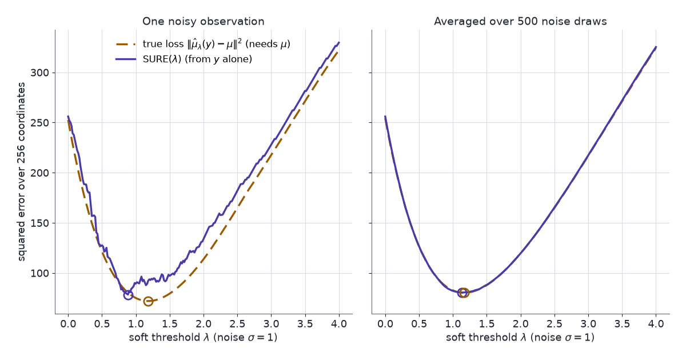

Energy-based and other unnormalised models are hard to fit by maximum likelihood, because the likelihood gradient needs the normalising constant. The model's score in $x$ does not, and Stein's identity turns that score into training objectives that never compute the constant.

Energy-based models write a density as $e^{-E_\theta(x)}$ up to a constant. Diffusion models train a network to output $\nabla_x\log p$ directly. Anyone who has fitted the first kind by maximum likelihood has run a sampler inside the training loop, because the likelihood gradient contains an expectation under the model itself. The $x$-score of the same model costs one backward pass: the normalising constant is a function of $\theta$ alone, so it vanishes when differentiating in $x$. Stein's identity is the bridge from that cheap quantity to an objective whose minimum is the right model.

[Part 1](../steins-lemma/) showed that the Langevin Stein operator $\mathcal{A}_pf=\nabla\!\cdot f+s_p^\top f$ does not see the normalising constant, and derived Stein's unbiased risk estimate (SURE). [Part 2](../steins-method-normal-approximation/) turned Stein identities into distances. [Part 3](../kernel-stein-discrepancy-and-svgd/) made the distance computable with kernels and used its steepest-descent direction, SVGD, as a sampler. This part fits models with the same tools. [Part 5](../steins-method-for-mcmc/) applies them to MCMC samplers, and [Part 6](../steins-method-in-neural-networks/) to neural networks.

An AI agent (Claude) drafted the text and the interactive charts. Separate review passes checked each derivation numerically and each reference against its source.

Two ideas carry the post:

1. **Score matching is Stein's identity under the data.** The unknown data score in the Fisher divergence is removed by one integration by parts, and the Fisher divergence equals a Stein discrepancy with an $L^2$-penalised critic.
2. **Stein identities are training signals.** Each tool from the earlier parts becomes a loss or a gradient with no normalising constant in it: SURE trains denoisers without clean data, the Gaussian identity builds unbiased control variates for policy gradients, and SVGD's direction trains a sampler network.

## Notation

- $q$: the data distribution, with density $q$ and score $s_q=\nabla\log q$; $x_1,\dots,x_n$ a sample from it.
- $p_\theta = \tilde p_\theta/\mathcal{Z}(\theta)$: the model, with $\mathcal{Z}(\theta)=\int\tilde p_\theta$. For an energy-based model, $\tilde p_\theta=e^{-E_\theta}$.
- $s_\theta = \nabla_x\log p_\theta = \nabla_x\log\tilde p_\theta$: the model's score in $x$.
- $\nabla_\theta$: a gradient in the parameters; $\nabla$ and $\nabla\!\cdot$ without a subscript act on $x$.
- $\mathcal{A}_pf = \nabla\!\cdot f+s_p^\top f$: the Langevin Stein operator (Parts 1 and 3).
- $\mathrm{D_F}(q\Vert p) = \mathbb{E}_q\lVert s_q-s_p\rVert^2$: the Fisher divergence.
- $y\sim N(\mu,\sigma^2I_d)$ and $\hat\mu(y)$: the SURE setting of Part 1.

## The maximum-likelihood gradient {#sec-mle}

Differentiate the log-likelihood of one point in $\theta$:

$$
\begin{aligned}
\nabla_\theta\log p_\theta(x) &= \nabla_\theta\log\tilde p_\theta(x) - \nabla_\theta\log\mathcal{Z}(\theta),\\
\nabla_\theta\log\mathcal{Z}(\theta) &= \frac{1}{\mathcal{Z}(\theta)}\int\nabla_\theta\tilde p_\theta = \mathbb{E}_{p_\theta}\big[\nabla_\theta\log\tilde p_\theta(X)\big].
\end{aligned}
$$ {#eq-mle-gradient}

The right-hand identity differentiates under the integral, then writes $\nabla_\theta\tilde p_\theta = \tilde p_\theta\nabla_\theta\log\tilde p_\theta$ and $\tilde p_\theta/\mathcal{Z}(\theta)=p_\theta$. The maximum-likelihood gradient is therefore a difference of two expectations: one under the data, and one under the model. The second needs samples from $p_\theta$ at every step, usually from an MCMC chain run inside the training loop. The derivative in $x$ has no such term:

$$
\nabla_x\log p_\theta(x) = \nabla_x\log\tilde p_\theta(x) - \underbrace{\nabla_x\log\mathcal{Z}(\theta)}_{=\,0}.
$$

Smallest instance: $\tilde p_\theta(x)=e^{-\theta x^2/2}$ with $\theta>0$, so $\mathcal{Z}(\theta)=\sqrt{2\pi/\theta}$. Then $\nabla_\theta\log\mathcal{Z} = -\tfrac{1}{2\theta} = \mathbb{E}_{p_\theta}[-X^2/2]$, which needs the model's second moment, while the score $-\theta x$ contains no trace of $\mathcal{Z}$.

The density in the next chart is synthetic: $\tilde p(x)=0.6\,e^{-(x+1.5)^2/(2\cdot0.7^2)}+0.4\,e^{-(x-1.5)^2/2}$, a two-component mixture written without its $1/\sqrt{2\pi}$ factors. The sample is 60 seeded draws from its normalised version. It stands in for an energy-based model whose constant is never computed.

The chart shows the same split for that fixed sample. Multiplying $\tilde p$ by a constant $c$ changes its total mass and the sample's log-likelihood. It changes nothing computed from the score.

::: {#widget-constant}
:::

Things to try:

1. Drag $c$ from $10^{-3}$ to $10^{3}$. The left curve keeps its shape while its axis scale moves by six orders of magnitude, and the total mass goes from $2.06\times10^{-3}$ to $2.06\times10^{3}$.
2. Watch the log-likelihood tile. It moves from $-481.56$ to $347.38$, a change of $60\ln10^6 = 828.93$: the likelihood depends on $c$ through $n\log c$.
3. Watch the KSD and score-matching tiles. They read $0.123780$ and $-0.508186$ at every $c$, to every printed digit, because the right panel's score does not move.

## Score matching {#sec-score-matching}

The Fisher divergence compares scores directly:

$$
J(\theta) = \tfrac12\,\mathrm{D_F}(q\Vert p_\theta) = \tfrac12\,\mathbb{E}_q\big\lVert s_\theta(X)-s_q(X)\big\rVert^2.
$$

It contains no $\mathcal{Z}(\theta)$, but it contains the data score $s_q$, which is unknown. Integration by parts removes it.

::: {.callout-important title="Theorem 1 — score matching (Hyvärinen 2005, Theorem 1)"}
Assume $q$ is positive and continuously differentiable, $s_\theta$ is continuously differentiable, $\mathbb{E}_q\lVert s_\theta\rVert^2$ and $\mathbb{E}_q\lVert s_q\rVert^2$ are finite, and $q(x)s_\theta(x)\to0$ as $\lVert x\rVert\to\infty$ (Hyvärinen's footnote 1). Assume also $\mathbb{E}_q\lvert\nabla\!\cdot s_\theta\rvert<\infty$, which the right side needs. Then

$$
J(\theta) = \mathbb{E}_q\Big[\tfrac12\lVert s_\theta(X)\rVert^2+\nabla\!\cdot s_\theta(X)\Big] + \text{const},
$$ {#eq-score-matching}

where the constant $\tfrac12\mathbb{E}_q\lVert s_q\rVert^2$ does not depend on $\theta$.
:::

**Proof.**

1. Expand the square: $\tfrac12\lVert s_\theta-s_q\rVert^2 = \tfrac12\lVert s_\theta\rVert^2 - s_\theta^\top s_q + \tfrac12\lVert s_q\rVert^2$.
2. The cross term is Stein's identity under $q$ applied to the field $f=s_\theta$: $\mathbb{E}_q[\mathcal{A}_qs_\theta] = \mathbb{E}_q[\nabla\!\cdot s_\theta + s_q^\top s_\theta] = 0$. Part 3's Proposition 1 gives it: $\mathbb{E}_q\lVert s_\theta\rVert$ is finite because $\mathbb{E}_q\lVert s_\theta\rVert^2$ is, and $\mathbb{E}_q\lvert\mathcal{A}_qs_\theta\rvert$ is finite by Cauchy–Schwarz and the integrability of $\nabla\!\cdot s_\theta$. So $\mathbb{E}_q[s_\theta^\top s_q] = -\mathbb{E}_q[\nabla\!\cdot s_\theta]$.
3. Substitute into step 1 and take expectations. $\blacksquare$

The sample version replaces $\mathbb{E}_q$ by the average over $x_1,\dots,x_n$:

$$
\hat J(\theta) = \frac1n\sum_{i=1}^n\Big[\tfrac12\lVert s_\theta(x_i)\rVert^2+\nabla\!\cdot s_\theta(x_i)\Big].
$$

Neither $s_q$ nor $\mathcal{Z}(\theta)$ appears. For an energy-based model, $s_\theta=-\nabla E_\theta$ and $\nabla\!\cdot s_\theta = -\Delta E_\theta$, the Laplacian of the energy. That costs $d$ backward passes per point when computed exactly.

Smallest instance: the Gaussian model of @sec-mle, $s_\theta(x)=-\theta x$ and $\nabla\!\cdot s_\theta=-\theta$. Then $\hat J(\theta) = \tfrac12\theta^2\,\overline{x^2}-\theta$, minimised at $\hat\theta = 1/\overline{x^2}$, the maximum-likelihood estimate of the precision when the mean is known to be zero.

## Fisher divergence and the penalised Stein discrepancy {#sec-fisher-stein}

[Part 2](../steins-method-normal-approximation/) defined the Stein discrepancy as $\sup_f\lvert\mathbb{E}_q[\mathcal{A}_pf]\rvert$ over a class of critics $f$, and Part 3 took the class to be a kernel ball. For a class closed under $f\mapsto-f$ the absolute value can be dropped, as here. Taking every square-integrable critic, with a penalty on its size, recovers the Fisher divergence.

::: {.callout-important title="Proposition 2 — the L² Stein discrepancy"}
Let $\lambda>0$, and let $\mathcal{F}$ be the set of fields $f$ with $\mathbb{E}_q\lVert f\rVert^2<\infty$ that satisfy Stein's identity under $q$, $\mathbb{E}_q[\mathcal{A}_qf]=0$. If $(s_p-s_q)\in\mathcal{F}$, then

$$
\sup_{f\in\mathcal{F}}\Big\{\mathbb{E}_q\big[(\mathcal{A}_pf)(X)\big]-\lambda\,\mathbb{E}_q\lVert f(X)\rVert^2\Big\} = \frac{1}{4\lambda}\,\mathrm{D_F}(q\Vert p),
\qquad
f^* = \frac{s_p-s_q}{2\lambda}.
$$ {#eq-l2-stein}
:::

**Proof.**

1. Subtract the zero $\mathbb{E}_q[\mathcal{A}_qf]$. The divergence terms cancel: $\mathbb{E}_q[\mathcal{A}_pf] = \mathbb{E}_q[(s_p-s_q)^\top f]$.
2. Maximise pointwise. For each $x$, $(s_p-s_q)^\top f-\lambda\lVert f\rVert^2$ is a concave quadratic in $f(x)$, maximised at $f^*(x) = (s_p(x)-s_q(x))/(2\lambda)$ with value $\lVert s_p(x)-s_q(x)\rVert^2/(4\lambda)$.
3. Take expectations under $q$. $\blacksquare$

Grathwohl et al. (2020) state this optimal critic. The value $\mathrm{D_F}/(4\lambda)$ follows by substitution. In Hyvärinen's normalisation it is $J/(2\lambda)$. Score matching and the $L^2$-penalised Stein discrepancy therefore have the same minimiser in $\theta$.

### Learning the critic

Grathwohl et al. (2020) train an energy-based model against a neural critic $f_\phi$ instead of computing the Laplacian:

$$
\min_\theta\ \max_\phi\ \ \mathbb{E}_q\big[s_\theta(X)^\top f_\phi(X)+\operatorname{tr}\nabla f_\phi(X)\big]-\lambda\,\mathbb{E}_q\lVert f_\phi(X)\rVert^2.
$$ {#eq-lsd}

- **Critic step.** Ascend in $\phi$. By Proposition 2, the maximum over all square-integrable critics is $\mathrm{D_F}(q\Vert p_\theta)/(4\lambda)$. A neural critic reaches it only as far as its family can represent $(s_\theta-s_q)/(2\lambda)$, so the inner maximum approximates it from below.
- **Model step.** Only the first term depends on $\theta$, so $\nabla_\theta = \mathbb{E}_q\big[(\nabla_\theta s_\theta(X))^\top f_\phi(X)\big]$. For $s_\theta=-\nabla E_\theta$, this is $-\mathbb{E}_q\big[\nabla_\theta\big(\nabla E_\theta(X)^\top f_\phi(X)\big)\big]$: one backward pass through the energy's input gradient, with no samples from the model and no $\mathcal{Z}(\theta)$.

### Minimum Stein discrepancy estimators

Barp et al. (2019) take this one step further. Any Stein operator $\mathcal{A}_{p_\theta}$ and Stein set $\mathcal{F}$ define an estimator

$$
\hat\theta = \operatorname*{arg\,min}_\theta\ \mathcal{S}\big(q_n,\mathcal{A}_{p_\theta},\mathcal{F}\big),
$$

with $\mathcal{S}$ the Stein discrepancy of Part 2 and $q_n$ the empirical distribution of the data. They show that score matching, contrastive divergence and minimum probability flow are special cases, each with its own operator and set, and they introduce diffusion versions of KSD and of score matching. Choosing the set decides the estimator:

| Stein set $\mathcal{F}$ | Discrepancy | Estimator |
|---|---|---|
| unit ball of $\mathcal{H}_k^d$ | KSD (Part 3) | minimum KSD |
| unit ball of $L^2(q)$, supremum squared | $\mathrm{D_F}$ | score matching (Barp et al. 2019, Theorem 2) |
| $L^2(q)$ with penalty $\lambda$ | $\mathrm{D_F}/(4\lambda)$ (Proposition 2) | score matching |
| neural critics with penalty $\lambda$ | learned approximation of $\mathrm{D_F}/(4\lambda)$ | Grathwohl et al. (2020) |

Over the unit ball of $L^2(q)$ the supremum is $\sqrt{\mathrm{D_F}}$, by Cauchy–Schwarz. The last two rows replace the ball by a penalty. The two exact $L^2$ rows are $\mathrm{D_F}$ and $\mathrm{D_F}/(4\lambda)$, so they have the same minimiser in $\theta$ as score matching. The neural-critic row shares it only when the critic family can represent $(s_\theta-s_q)/(2\lambda)$. Otherwise its inner maximum falls short of $\mathrm{D_F}/(4\lambda)$ by an amount that can depend on $\theta$, and so can its minimiser.

## SURE as a training loss {#sec-sure}

Part 1 derived SURE from Gaussian integration by parts: for $y\sim N(\mu,\sigma^2I_d)$ and a weakly differentiable estimator satisfying Part 1's integrability conditions, the risk has an unbiased estimate that does not involve $\mu$. Writing it in terms of $\hat\mu$ instead of the correction $g=\hat\mu-y$:

$$
\mathbb{E}\lVert\hat\mu(y)-\mu\rVert^2 = \mathbb{E}\Big[\lVert y-\hat\mu(y)\rVert^2 - d\sigma^2 + 2\sigma^2\,\nabla\!\cdot\hat\mu(y)\Big].
$$ {#eq-sure-mu}

Part 1's form follows by substituting $\hat\mu = y+g$ and $\nabla\!\cdot\hat\mu = d+\nabla\!\cdot g$.

### Training a denoiser without clean data

Soltanayev & Chun (2018) train a denoising network $h_w$ on noisy images $y_j = \mu_j+e_j$, $j=1,\dots,M$, each with $d$ pixels, $e_j\sim N(0,\sigma^2I_d)$ and $\sigma$ known, and no clean $\mu_j$. @eq-sure-mu makes the expected loss computable from $y_j$ alone. The divergence of a network is expensive, so they estimate it by a random finite difference (Ramani, Blu & Unser 2008):

$$
\nabla\!\cdot h_w(y) = \lim_{\varepsilon\to0}\mathbb{E}_{\tilde n}\Big[\tilde n^\top\,\frac{h_w(y+\varepsilon\tilde n)-h_w(y)}{\varepsilon}\Big],\qquad\tilde n\sim N(0,I_d).
$$

One draw of $\tilde n$ per image gives their training loss:

$$
\mathcal{L}(w) = \frac1M\sum_{j=1}^M\Big\{\lVert y_j-h_w(y_j)\rVert^2 - d\sigma^2 + \frac{2\sigma^2}{\varepsilon}\,\tilde n_j^\top\big(h_w(y_j+\varepsilon\tilde n_j)-h_w(y_j)\big)\Big\}.
$$ {#eq-sure-loss}

Its gradient follows from the chain rule, with $J_w(y)=\partial h_w(y)/\partial w$:

$$
\nabla_w\mathcal{L} = \frac1M\sum_{j=1}^M\Big\{-2\,J_w(y_j)^\top\big(y_j-h_w(y_j)\big) + \frac{2\sigma^2}{\varepsilon}\big(J_w(y_j+\varepsilon\tilde n_j)-J_w(y_j)\big)^\top\tilde n_j\Big\}.
$$

That is two forward passes per image, and a backward pass through each.

- **What the first term does.** On its own it would train $h_w$ to reproduce the noisy input, the identity map.
- **What the divergence term does.** It penalises sensitivity to the input in proportion to $\sigma^2$, which is what keeps $h_w$ from copying the noise.
- **Settings in the paper.** $\tilde n_j$ is redrawn every epoch. $\varepsilon$ is small and fixed: $10^{-4}$ for their MNIST denoiser and $\sigma\times1.4\times10^{-4}$ for DnCNN.

### Choosing a regularisation strength

The same identity chooses a single parameter in closed form. For soft thresholding, $\hat\mu_i = \operatorname{sign}(y_i)\big(\lvert y_i\rvert-\lambda\big)_+$, the correction is $g_i = -y_i$ when $\lvert y_i\rvert\le\lambda$ and $-\lambda\operatorname{sign}(y_i)$ otherwise.

1. $\lVert g\rVert^2 = \sum_i\min(y_i^2,\lambda^2)$.
2. $\partial g_i/\partial y_i = -1$ when $\lvert y_i\rvert<\lambda$ and $0$ when $\lvert y_i\rvert>\lambda$. The estimator is Lipschitz, so the kinks at $\pm\lambda$ do not matter. Hence $\nabla\!\cdot g = -\#\{i:\lvert y_i\rvert\le\lambda\}$ almost surely.
3. Substituting into Part 1's $\mathrm{SURE}=d\sigma^2+\lVert g\rVert^2+2\sigma^2\nabla\!\cdot g$:

   $$
   \mathrm{SURE}(\lambda) = d\sigma^2 - 2\sigma^2\,\#\{i:\lvert y_i\rvert\le\lambda\} + \sum_{i=1}^d\min(y_i^2,\lambda^2).
   $$ {#eq-sure-soft}

This is the SURE criterion of Donoho & Johnstone (1995), stated there for $\sigma=1$. Their SureShrink applies it to each wavelet level, and falls back to the threshold $\sqrt{2\log d}$ on levels that look sparse. Minimising it over $\lambda$ uses only $y$. For ridge shrinkage, $\hat\mu = y/(1+\lambda)$, the same steps give $\mathrm{SURE}(\lambda) = d\sigma^2+\frac{\lambda^2\lVert y\rVert^2}{(1+\lambda)^2}-\frac{2\sigma^2d\lambda}{1+\lambda}$.

The signal in the chart is synthetic: 256 coordinates, 25 of them nonzero with magnitudes drawn between 2 and 6, observed once in Gaussian noise of known $\sigma$. It stands in for the wavelet coefficients of an image: a few large values among many near-zero ones. A wrong $\lambda$ either keeps the noise (too small) or erases the signal (too large).

The chart shows SURE($\lambda$) and the true loss $\lVert\hat\mu_\lambda(y)-\mu\rVert^2$ against $\lambda$ for one noisy draw, with stat tiles for the $\lambda$ each one picks. The true loss needs the clean signal and is plotted only for comparison; in practice only SURE is available.

::: {#widget-sure}
:::

```{=html}
<script src="model.js"></script>
<script src="widgets.js"></script>
```

Things to try:

1. At the defaults (soft threshold, $\sigma=1$), SURE picks $\lambda=1.07$ with a true loss of $90.5$, while the oracle's $\lambda=1.13$ gives $90.2$. The raw observation's loss is $254.9$.
2. Press **New noise draw** several times. SURE's curve is noisier than the loss curve, and its minimiser moves more. Over eight draws at $\sigma=1$, SURE's $\lambda$ ranges over $[0.77, 1.65]$ and the oracle's over $[1.07, 1.25]$. The loss at SURE's $\lambda$ is 0.3% to 22% above the oracle's.
3. Switch to ridge shrinkage. Over eight draws at $\sigma=1$, SURE's $\lambda$ stays within 0.10 of the oracle's (up to 0.58 for soft thresholding), and the loss there is at most 0.6% above the oracle's. On the first draw (reload the page to return to it), the best ridge loss is $173.7$, against $90.2$ for soft thresholding. Shrinking every coordinate by the same factor cannot keep large values while zeroing small ones.
4. Move $\sigma$ between 0.25 and 2. SURE's $\lambda$ stays near the oracle's at small $\sigma$ and drifts further at large $\sigma$. On the first draw, SURE's choice costs at most 2.3% more loss than the oracle's up to $\sigma=1.75$, even where the two $\lambda$ values differ by about 0.3, because the loss curve is flat near its minimum. At $\sigma=2$ it costs 9% more. Over eight draws at each $\sigma$ on the slider, the loss at SURE's $\lambda$ is at most 26% above the oracle's (the worst case is at $\sigma=1.8$). @eq-sure-soft is unbiased for the risk at every $\lambda$, and summing over 256 coordinates keeps its noise small next to the risk.

{fig-alt="Two panels of squared error against threshold lambda from 0 to 4. Left: a jagged SURE curve and a smooth dashed true-loss curve, both U-shaped with minima near lambda 1. Right: the averaged SURE and true-loss curves lie on top of each other."}

## Stein control variates for policy gradients {#sec-policy}

The policy-gradient theorem writes the gradient of expected return as $\nabla_\theta J(\theta) = \mathbb{E}_\pi\big[\nabla_\theta\log\pi_\theta(a\mid s)\,Q^\pi(s,a)\big]$. That is a score-function estimator, with high variance. Subtracting a baseline $b(s)$ keeps it unbiased because $\mathbb{E}_{a\sim\pi}[\nabla_\theta\log\pi_\theta(a\mid s)]=0$. A baseline that also depends on the action, $\phi(s,a)$, can track $Q^\pi$ much more closely, but it biases the gradient unless the term it adds is corrected for. Liu et al. (2018) supply the correction from Stein's identity. In this section $s$ is a state, not a score, and $T_\theta$ is the map that turns noise into an action (Liu et al. write $f_\theta$).

::: {.callout-important title="Proposition 3 — Stein's identity for reparameterisable policies (Liu et al. 2018, Theorem 3.1)"}
Let the action be $a=T_\theta(s,\xi)$ with $\xi$ independent of $\theta$, and let $\phi(s,\cdot)$ be differentiable. Under conditions that allow differentiation under the integral,

$$
\mathbb{E}_{a\sim\pi_\theta(\cdot\mid s)}\big[\nabla_\theta\log\pi_\theta(a\mid s)\,\phi(s,a)\big] = \mathbb{E}_\xi\big[\nabla_\theta T_\theta(s,\xi)\,\nabla_a\phi(s,a)\big].
$$ {#eq-policy-stein}
:::

**Proof.** Compute $\nabla_\theta\mathbb{E}_{a\sim\pi_\theta}[\phi(s,a)]$ two ways.

1. **Score function.** $\nabla_\theta\int\pi_\theta(a\mid s)\,\phi(s,a)\,da = \int\pi_\theta\,\nabla_\theta\log\pi_\theta\,\phi\,da$, the left side of @eq-policy-stein.
2. **Reparameterisation.** $\nabla_\theta\,\mathbb{E}_\xi[\phi(s,T_\theta(s,\xi))] = \mathbb{E}_\xi[\nabla_\theta T_\theta(s,\xi)\,\nabla_a\phi(s,a)]$, the right side.

Both compute the same derivative. $\blacksquare$

For a Gaussian policy with mean $\mu_\theta(s)$ and fixed covariance $\Sigma$, $a=\mu_\theta(s)+\Sigma^{1/2}\xi$, and @eq-policy-stein with respect to the mean parameters reduces to $\mathbb{E}[(a-\mu)\phi] = \Sigma\,\mathbb{E}[\nabla_a\phi]$. That is Part 1's Gaussian integration by parts in the action.

Adding and subtracting $\phi$ gives the Stein control-variate gradient, unbiased for every $\phi$ (Liu et al. 2018, eq. 8):

$$
\nabla_\theta J(\theta) = \mathbb{E}_\pi\Big[\nabla_\theta\log\pi_\theta(a\mid s)\big(Q^\pi(s,a)-\phi(s,a)\big) + \nabla_\theta T_\theta(s,\xi)\,\nabla_a\phi(s,a)\Big].
$$ {#eq-stein-cv}

- **The estimator.** The sample version averages the bracket over observed $(s_t,a_t,\xi_t)$, with an estimate $\hat Q^\pi$ in place of $Q^\pi$.
- **Fitting $\phi$.** Liu et al. parametrise $\phi_w(s,a) = \hat V^\pi(s)+\psi_w(s,a)$. They fit $w$ either by regressing $\phi_w$ on observed returns, or by minimising the squared norm of the bracket in @eq-stein-cv, a direct proxy for the estimator's variance. That objective mixes derivatives in $\theta$ and $a$, which the paper finds hard to compute efficiently with automatic differentiation. For Gaussian policies it minimises $\operatorname{var}(\hat\nabla_\mu J)+\operatorname{var}(\hat\nabla_\Sigma J)$ instead, the variances of the gradient estimates for the policy's mean and covariance.
- **Keeping it unbiased.** Fitting $\phi$ on the same data the gradient uses biases the estimate. Liu et al. note that fitting $\phi$ on the previous iteration's data removes the bias. Their experiments use the current data, and a check with previous-iteration data did not improve results.
- **Smallest instance.** $\phi=b(s)$, with no action dependence, gives $\nabla_a\phi=0$, and @eq-stein-cv reduces to the ordinary baseline.

## Amortised SVGD {#sec-amortised}

SVGD (Part 3) moves a fixed set of particles. A sampler network $x=G_\eta(\xi)$, $\xi\sim N(0,I)$, needs a rule for moving its weights $\eta$ instead. Wang & Liu (2016) pull SVGD's direction back through the network.

1. Draw $\xi_1,\dots,\xi_m$ and set $x_i=G_\eta(\xi_i)$.
2. Compute the SVGD direction on this batch, $\Delta x_i = \hat\phi^*(x_i) = \frac1m\sum_j\big[k(x_j,x_i)s_p(x_j)+\nabla_{x_j}k(x_j,x_i)\big]$.
3. Ask the network to output $x_i+\epsilon\Delta x_i$ instead. One gradient step on $\sum_i\tfrac12\lVert G_\eta(\xi_i)-(x_i+\epsilon\Delta x_i)\rVert^2$ at the current $\eta$, with unit step length, gives their update:

   $$
   \eta \leftarrow \eta + \epsilon\sum_{i=1}^m\partial_\eta G_\eta(\xi_i)^\top\,\Delta x_i.
   $$ {#eq-amortised-svgd}

The gradient of that squared error at the current $\eta$ is $-\epsilon\sum_i\partial_\eta G_\eta(\xi_i)^\top\Delta x_i$, so the step is backpropagation of SVGD's direction through the generator.

- **Smallest instance.** A location family, $G_\eta(\xi)=\eta+\xi$, has $\partial_\eta G=I$. The repulsion terms cancel in the sum over $i$, because $\nabla_{x_j}k(x_j,x_i) = -\nabla_{x_i}k(x_i,x_j)$ for a translation-invariant kernel. The update reduces to $\eta\leftarrow\eta+\frac{\epsilon}{m}\sum_{i,j}k(x_j,x_i)\,s_p(x_j)$, which moves the network's location toward high target density.
- **A direct KSD penalty.** The alternative minimises $\mathrm{KSD}^2_V(\{G_\eta(\xi_i)\},p)$ itself (Part 3). Its gradient in $x_i$ is $\frac{2}{m^2}\sum_l\nabla_1k_p(x_i,x_l)$, and $k_p$ contains $s_p(x)$, so it needs $\nabla s_p$, the Hessian of $\log p$. Amortised SVGD needs only $s_p$. Both are free of $\mathcal{Z}$.
- **In this blog.** [Nuisance Leakage in JEPA Embeddings](../stein-jepa-nuisance-leakage/) uses a KSD penalty toward $N(0,I)$ on an encoder's embeddings. That target has $\nabla s_p=-I$, which makes the Hessian term free.

## Constraints

- **Kernel and bandwidth.** KSD-based objectives inherit Part 3's kernel choice: light-tailed kernels can certify a non-converging sample in $d\ge3$, and a bad bandwidth stalls or over-smooths SVGD.
- **Dimension.** Kernel distances between points concentrate as $d$ grows, which should be expected to weaken KSD tests and SVGD's repulsion. Anastasiou et al. (2023) list sliced Stein discrepancies as one way to cut the cost of Stein discrepancies in high dimensions.
- **Low-density regions.** $\mathrm{D_F}(q\Vert p_\theta) = \mathbb{E}_q\lVert s_q-s_\theta\rVert^2$ weights score errors by $q$. Where the data are rare, a wrong score costs almost nothing, so a fitted score is least reliable where a sampler started from noise begins.
- **Isolated components.** Fisher divergence, KSD and SVGD cannot see the mixing weights of well-separated components (Wenliang & Kanagawa 2020). Part 3's chart reproduces this: a sample sitting entirely on the lighter mode has a lower KSD than an exact sample.
- **Second derivatives.** Score matching needs $\nabla\!\cdot s_\theta$, which is $d$ backward passes. A learned critic replaces it with $\operatorname{tr}\nabla f_\phi$, which avoids differentiating the energy twice but is still $d$ passes when computed exactly. A random-projection estimate, as in @eq-sure-loss, cuts either trace to one pass per probe at the cost of variance.
- **SURE's assumptions.** SURE needs Gaussian noise with known $\sigma$ and a weakly differentiable estimator. With a Monte Carlo divergence, $\varepsilon$ trades the finite-difference bias against round-off.

## Next in the series

- [Part 5](../steins-method-for-mcmc/): the Langevin operator applied to gradients is the generator of the Langevin diffusion. Its Stein equation is the Poisson equation of MCMC, whose solution sets the bias of unadjusted Langevin and the variance of exact samplers.
- [Part 6](../steins-method-in-neural-networks/): Stein's lemma bounds how far a random network is from a Gaussian process and explains which directions one gradient step can learn; its closing map places score matching, SURE and SVGD in machine learning.

## Further reading

- Anastasiou et al. (2023) review Stein's method in computational statistics: discrepancies, samplers, goodness-of-fit tests and estimators.
- Ley, Reinert & Swan (2017) survey Stein operators for univariate distributions, beyond the Langevin form used in this series.
- Barp et al. (2019) give the general minimum Stein discrepancy framework, with consistency, asymptotic normality and robustness results.
- [Part 1](../steins-lemma/), [Part 2](../steins-method-normal-approximation/) and [Part 3](../kernel-stein-discrepancy-and-svgd/) of this series derive every identity Part 4 uses.

Constants. Cancel. Scores. Remain. Stein. Turns. Scores. Into. Losses.

## References

- Anastasiou, A., Barp, A., Briol, F.-X., Ebner, B., Gaunt, R. E., Ghaderinezhad, F., Gorham, J., Gretton, A., Ley, C., Liu, Q., Mackey, L., Oates, C. J., Reinert, G. & Swan, Y. (2023). [Stein's method meets computational statistics: a review of some recent developments](https://doi.org/10.1214/22-STS863). *Statistical Science* 38(1), 120–139.
- Barp, A., Briol, F.-X., Duncan, A., Girolami, M. & Mackey, L. (2019). [Minimum Stein discrepancy estimators](https://proceedings.neurips.cc/paper/2019/hash/ba7609ee5789cc4dff171045a693a65f-Abstract.html). *Advances in Neural Information Processing Systems* 32.
- Donoho, D. L. & Johnstone, I. M. (1995). [Adapting to unknown smoothness via wavelet shrinkage](https://doi.org/10.1080/01621459.1995.10476626). *Journal of the American Statistical Association* 90(432), 1200–1224.
- Grathwohl, W., Wang, K.-C., Jacobsen, J.-H., Duvenaud, D. & Zemel, R. (2020). [Learning the Stein discrepancy for training and evaluating energy-based models without sampling](https://proceedings.mlr.press/v119/grathwohl20a.html). *Proceedings of the 37th International Conference on Machine Learning*, PMLR 119, 3732–3747.
- Hyvärinen, A. (2005). [Estimation of non-normalized statistical models by score matching](https://jmlr.org/papers/v6/hyvarinen05a.html). *Journal of Machine Learning Research* 6, 695–709.
- Ley, C., Reinert, G. & Swan, Y. (2017). [Stein's method for comparison of univariate distributions](https://doi.org/10.1214/16-PS278). *Probability Surveys* 14, 1–52.
- Liu, H., Feng, Y., Mao, Y., Zhou, D., Peng, J. & Liu, Q. (2018). [Action-dependent control variates for policy optimization via Stein identity](https://openreview.net/forum?id=H1mCp-ZRZ). *International Conference on Learning Representations (ICLR 2018)*.
- Ramani, S., Blu, T. & Unser, M. (2008). [Monte-Carlo SURE: a black-box optimization of regularization parameters for general denoising algorithms](https://doi.org/10.1109/TIP.2008.2001404). *IEEE Transactions on Image Processing* 17(9), 1540–1554.
- Soltanayev, S. & Chun, S. Y. (2018). [Training deep learning based denoisers without ground truth data](https://proceedings.neurips.cc/paper/2018/hash/c0560792e4a3c79e62f76cbf9fb277dd-Abstract.html). *Advances in Neural Information Processing Systems* 31.
- Wang, D. & Liu, Q. (2016). [Learning to draw samples: with application to amortized MLE for generative adversarial learning](https://arxiv.org/abs/1611.01722). *arXiv* 1611.01722.
- Wenliang, L. K. & Kanagawa, H. (2020). [Blindness of score-based methods to isolated components and mixing proportions](https://arxiv.org/abs/2008.10087). *arXiv* 2008.10087.
- [Stein's Method, Part 1: Stein's Lemma](../steins-lemma/) — the identity, its converse, the Langevin operator and SURE.
- [Stein's Method, Part 2: Normal Approximation](../steins-method-normal-approximation/) — the Stein equation and the Stein discrepancy.
- [Stein's Method, Part 3: Kernel Stein Discrepancy and SVGD](../kernel-stein-discrepancy-and-svgd/) — the kernel Stein discrepancy, SVGD and control variates.
- [Stein's Method, Part 5: Markov Chain Monte Carlo](../steins-method-for-mcmc/) — the Poisson equation, the bias of unadjusted Langevin and zero-variance control variates.
- [Stein's Method, Part 6: Neural Networks and Machine Learning](../steins-method-in-neural-networks/) — wide random networks, hidden directions, and a map of the series in machine learning.
- [Nuisance Leakage in JEPA Embeddings Is Set by Regulariser Strength and Width](../stein-jepa-nuisance-leakage/) — KSD as an anti-collapse regulariser.
