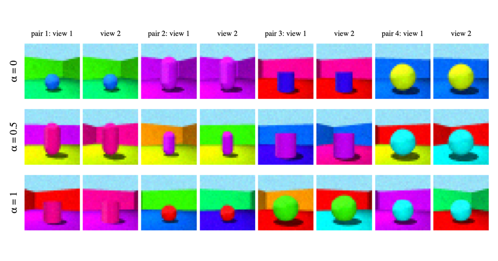
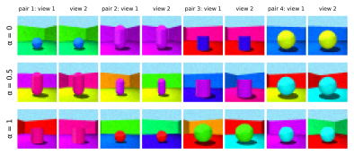
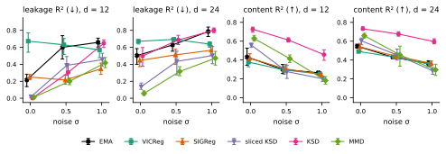
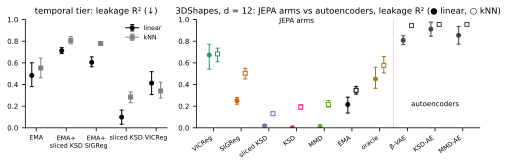

Self-supervised image encoders keep some detail they were meant to ignore; on rendered images where that detail is known, the amount is set mainly by how hard the anti-collapse regulariser pushes and by the embedding width, not by which target distribution it pushes toward.

Anyone who has trained a contrastive or predictive encoder has written an augmentation pipeline: crop, flip, recolour. The pipeline encodes a wish: whatever it changes, the encoder should ignore. The training loss never checks the wish. On photographs it cannot be checked, because nobody has a list of everything that differs between two views. A rendered dataset with known generating factors supplies that list and turns the wish into a number.

Three ideas carry the results:

1. **Leakage**: how well a simple probe reads the ignored factors back out of the embedding. Known factors make it measurable.
2. **Regulariser strength**, not the target law, controls leakage.
3. **Embedding width** is a better nuisance filter than injected noise here.

An AI agent (Claude) ran the experiments unattended and drafted the text. Every number below comes from the study's result files through its report script, and a separate review pass recomputed them from the raw runs.

## Joint-embedding prediction

A joint-embedding predictive architecture (JEPA; Assran et al. 2023) learns from pairs of views of one scene.

- An **encoder** maps an image to an embedding of $d$ numbers.
- A small **predictor** maps view 1's embedding to a guess at view 2's embedding.
- Training lowers the prediction error, in both directions.

The loss has a trivial minimum: map every image to the same vector and the error is zero. This is **collapse**. Every JEPA needs a second ingredient to stop it. The study compares eight:

- **EMA target**: view 2's embedding comes from a slowly updated copy of the encoder, and no gradient flows through it.
- **VICReg** (Bardes et al. 2022): penalises embedding dimensions whose spread is too small, and correlations between dimensions. It names no target distribution.
- **SIGReg** (Balestriero & LeCun 2025): pushes random one-dimensional projections of the batch toward a standard normal.
- **KSD**: the kernel Stein discrepancy (Liu et al. 2016) measures how far a batch is from a target density using only the gradient of the target's log-density. Here the kernel is inverse multiquadric (Gorham & Mackey 2017) and the target is $N(0, I)$.
- **Sliced KSD** (Gong et al. 2021): KSD along random directions.
- **MMD**: compares the batch with a fresh sample from $N(0, I)$ through kernel averages.
- **Oracle**: KSD toward a target that knows the content dimension $k = 6$: six full-size dimensions, the rest shrunk.
- **None**: no regulariser. It collapses in 100% of seeds.

All regularised arms add one term, weighted by $\lambda$, to the prediction loss. SIGReg, KSD, sliced KSD and MMD all aim at an isotropic Gaussian.

## Data

### 3DShapes

- **Source.** 3DShapes (Burgess & Kim 2018) is a DeepMind dataset of 480,000 rendered 64×64 images. Each shows one object in a room, at every combination of six factors: floor hue, wall hue, object hue, object scale, object shape and orientation.
- **Motive.** It was built to test whether a model recovers known generating factors.
- **Use here.** The six factors split into two groups:
  - **content**, shared by both views: object hue, scale and shape, coded as $k = 6$ numbers;
  - **nuisance**, which may differ between views: floor hue, wall hue and orientation.
- **Views.** Two images share content. Each nuisance factor is redrawn with probability $\alpha$, and light pixel noise is added. At $\alpha = 0$ the views differ only by pixel noise.
- **Why the method fits.** All six factors are recorded for every image, so a probe can be aimed at the nuisance and nothing else.
- **Cost of a wrong answer.** A practitioner who blames the target distribution for leakage would swap regularisers when the fix is a weight or a width.

{#fig-views}

### Other tiers

- **Temporal clips.** Three-frame 3DShapes clips in which nuisance factors drift one step per frame with probability $\alpha$. The model predicts frame 3's embedding from frames 1 and 2.
- **Autoencoders.** A β-VAE (Higgins et al. 2017) and KSD and MMD autoencoders at the same $d$. They reconstruct pixels, so they serve as a reference for models that must keep everything.
- **CIFAR-10.** CIFAR-10 (Krizhevsky 2009) is 60,000 labelled 32×32 photographs in 10 classes, built as a classification benchmark. Its nuisance is the augmentation parameters (crop box, flip, colour jitter), known because the pipeline draws them.

## Leakage

Leakage asks whether the ignored factors can still be read off the trained embedding:

- Freeze the encoder.
- Embed 10,000 training-split images and fit a linear regression from embedding to nuisance factors.
- Score $R^2$ on 5,000 images from a held-out 10% of factor combinations.

That $R^2$ is the **leakage**. Zero means the nuisance is not linearly readable; one means it is fully readable. The same probe aimed at the content factors gives **content $R^2$**. A good encoder has high content $R^2$ and low leakage.

A k-nearest-neighbour probe (10 neighbours) gives a second, nonlinear leakage score. On photographs neither probe has a target, because the list of what differs between two views is unknown.

## Protocol

- **Encoder.** A small convolutional network with no normalisation layers, $d \in \{3, 6, 12, 24\}$. The base setting is $d = 12$, $\sigma = 0$, $\alpha = 1$.
- **Training.** 2000 steps, batch of 256 pairs.
- **Tuning.** Every arm gets three levels of $\lambda$ (×1/5, ×1, ×5 around a pilot value), or three EMA decay rates. The level with the highest content $R^2$ on two tuning seeds wins. Leakage never enters the choice.
- **Evaluation.** 5 fresh seeds per configuration, 95% bootstrap intervals over seeds.
- **Size.** 495 held-out runs, 747 runs in total including tuning.

## Regulariser strength

The first hypothesis was about the target law. A regulariser that pushes toward an isotropic Gaussian must spread variance over all $d$ dimensions; with $d > k$, the spare dimensions have nothing to hold but nuisance. So Gaussian-target arms should leak more than VICReg and EMA.

At the tuned $\lambda$ and $d = 12$, the opposite holds. Linear leakage, mean [95% interval]:

- VICReg: 0.673 [0.542, 0.772]
- SIGReg: 0.250 [0.218, 0.281]
- EMA: 0.215 [0.137, 0.283]
- sliced KSD: 0.019 [0.008, 0.029]
- MMD: 0.012 [0.000, 0.026]
- KSD: 0.002 [−0.001, 0.005]

At $d = 12$ and $d = 24$, 8 of 8 Gaussian-arm minus VICReg contrasts are negative with intervals that exclude zero.

The ranking does not survive a change of $\lambda$. Rerunning every regulariser at all three of its levels on the held-out seeds gives leakage at the highest $\lambda$ minus leakage at the lowest:

- VICReg: +0.499 [0.349, 0.596]
- SIGReg: +0.370 [0.272, 0.467]
- sliced KSD: +0.522 [0.427, 0.588]
- KSD: +0.532 [0.458, 0.602]
- MMD: +0.333 [0.215, 0.449]
- oracle: +0.493 [0.382, 0.575]

What the six contrasts show:

- All six are positive, with intervals that exclude zero.
- VICReg names no target distribution and still follows the pattern.
- At five times its tuned $\lambda$, KSD leaks more than VICReg at VICReg's least-leaky level (+0.210 [0.146, 0.266]).
- Pushing harder costs content: KSD's content $R^2$ falls from 0.727 at its tuned $\lambda$ to 0.340 at 25 times it.
- The VICReg baseline itself depends on the choice. Tuning picked VICReg's middle level, which leaks as much as its highest (0.673 against 0.671, and 0.172 at the lowest); against VICReg's least-leaky level, the tuned SIGReg leaks more (+0.078 [0.032, 0.120]), which is the direction the hypothesis predicted.

More distributional pressure buys more leakage, whatever the target. Tuning for content picked low-pressure levels for the KSD family and a high-leakage level for VICReg, and those choices, not the Gaussian target, decide the comparison.

### λ explorer

The chart shows linear leakage and linear content $R^2$ on the held-out seeds against $\lambda$ divided by the tuned $\lambda$ (log scale; dotted line = tuned). Bars are 95% intervals.

- Compare each arm's lowest and highest $\lambda$: leakage is higher at the highest for every arm.
- Content at the highest $\lambda$ is lower than at the tuned $\lambda$ for every arm.
- KSD and sliced KSD were tuned at the bottom of their grids, so their curves start at 1.

::: {#widget-lambda}
:::

## Embedding width and noise

There are two obvious ways to squeeze an embedding so it cannot carry everything:

- **Width**: give it fewer dimensions, a lower $d$.
- **Information bottleneck**: add Gaussian noise of size $\sigma$ to the embedding before the predictor sees it, which limits how much detail gets through. The noise is scaled to the batch spread of the embedding, so the encoder cannot escape it by growing its outputs. Probes read the clean embedding.

The hypothesis was that noise removes nuisance where width does not. The data say the reverse. Contrasts at $\alpha = 1$, mean [95% interval]:

| Arm | Leakage, $d$ 6 − 24 | Content, $d$ 6 − 24 | Leakage, $\sigma$ 1 − 0 ($d$ 12) | Content, $\sigma$ 1 − 0 ($d$ 12) |
|---|---|---|---|---|
| EMA | −0.433 [−0.539, −0.322] | −0.165 [−0.211, −0.120] | +0.443 [0.355, 0.538] | −0.167 [−0.259, −0.080] |
| VICReg | −0.177 [−0.338, −0.012] | −0.226 [−0.267, −0.184] | −0.103 [−0.243, 0.050] | −0.125 [−0.168, −0.070] |
| SIGReg | −0.396 [−0.465, −0.318] | −0.200 [−0.253, −0.145] | +0.097 [0.026, 0.168] | −0.171 [−0.221, −0.119] |
| sliced KSD | −0.135 [−0.180, −0.104] | −0.109 [−0.162, −0.058] | +0.437 [0.363, 0.511] | −0.357 [−0.393, −0.322] |
| KSD | −0.499 [−0.599, −0.396] | −0.181 [−0.264, −0.094] | +0.646 [0.596, 0.687] | −0.270 [−0.332, −0.210] |
| MMD | −0.049 [−0.081, −0.020] | −0.304 [−0.353, −0.254] | +0.405 [0.347, 0.469] | −0.445 [−0.494, −0.396] |

: Width and noise contrasts on 3DShapes. Negative leakage is good; negative content is bad. {#tbl-width-noise}

- Narrowing $d$ from 24 to 6 lowers linear leakage for all six arms.
- Narrowing $d$ also lowers content $R^2$ for all six. Width is a trade, not a free filter.
- Raising $\sigma$ from 0 to 1 lowers content for all six, and raises leakage for all except VICReg, whose change is not distinguishable from zero.
- EMA's kNN leakage does fall with noise (−0.107 [−0.153, −0.060]), but its content falls with it. Its embedding is degrading, not filtering.

Shrinking spare dimensions is not the same as removing them. The oracle arm squeezes its $d - k$ spare dimensions toward zero, yet leaks 0.451 at $d = 12$ and 0.685 at $d = 24$. The probe standardises every dimension first, so a small dimension reads as clearly as a large one.

{#fig-sigma}

### Configuration explorer

The chart shows linear leakage and content $R^2$ (mean, 95% interval over 5 seeds) at the tuned $\lambda$. The study ran three slices through the base setting, not a full grid:

- $d \in \{3, 6, 12, 24\}$ at $\sigma = 0$, $\alpha = 1$, all eight arms;
- $\sigma \in \{0, 0.5, 1\}$ at $d \in \{12, 24\}$, $\alpha = 1$, six arms (no oracle, no "none");
- $\alpha \in \{0, 0.5, 1\}$ at $d = 12$, $\sigma = 0$, the same six arms.

Other combinations show "not run". Nothing is interpolated.

Things to try:

- Set $\sigma = 0$, $\alpha = 1$ and compare $d = 3$ with $d = 24$: linear leakage is higher at $d = 24$ for every arm except the collapsed "none" baseline. EMA and MMD collapsed in some seeds at $d = 3$, so part of their low leakage there is collapse; the table counts the seeds.
- Set $\alpha = 1$ and $d = 12$ or $d = 24$, then compare $\sigma = 0$ with $\sigma = 1$: leakage is higher at $\sigma = 1$ for every arm except VICReg, and content is lower for every arm.
- Set $d = 12$, $\sigma = 0$ and compare $\alpha = 0$ with $\alpha = 1$: leakage is lower at $\alpha = 1$ for every arm, though VICReg's change is not distinguishable from zero. When the nuisance never changes between views, nothing pushes the encoder to drop it.
- Turn on kNN leakage at the base setting: KSD, sliced KSD and MMD hold nuisance a linear probe cannot read.

::: {#widget-explorer}
:::

```{=html}
<script src="widget-data/data.js"></script>
<script src="model.js"></script>
<script src="widgets.js"></script>
```

## Other results

- **Matched priors** (identifiability = how well a rotation and scaling of the embedding recovers the content factors). When the content factors follow a non-Gaussian law, KSD toward a matched prior does not beat KSD toward $N(0, I)$.
  - Uniform law: matched 0.554 [0.501, 0.598] vs Gaussian target 0.576 [0.543, 0.595].
  - Laplace law: matched 0.276 [0.235, 0.317] vs Gaussian target 0.772 [0.717, 0.813].
- **EMA under nuisance.** EMA's leakage falls with $\alpha$, as every regulariser's does. The size of its drop matches KSD's (difference: −0.048 [−0.161, 0.055]) and sliced KSD's, and is larger than VICReg's (−0.417 [−0.563, −0.260]), SIGReg's and MMD's. Its geometry differs: effective rank (roughly, how many dimensions the embedding uses) is 4.0 for EMA against 11.0 for SIGReg.
- **Temporal clips.** EMA alone leaks 0.484 [0.381, 0.601], sliced KSD alone 0.098 [0.033, 0.164]. Adding sliced KSD to EMA raises leakage by +0.229 [0.110, 0.337].
- **Autoencoders.** β-VAE, KSD-AE and MMD-AE leak 0.809, 0.912 and 0.855. 21 of 21 autoencoder minus JEPA contrasts are positive; the smallest is β-VAE − VICReg, +0.136 [0.028, 0.267].
- **CIFAR-10.** Augmentation leakage is small for every arm, from 0.018 (KSD) to 0.049 (EMA). KSD has the best linear class accuracy, 0.357 [0.350, 0.365].

{#fig-temporal-ae}

## Constraints

- **One small rendered world.** A small convolutional encoder, 2000 steps, rendered scenes downsampled to 32×32. Large encoders on photographs may behave differently; the CIFAR-10 tier is a single slice.
- **λ tuned once.** Levels were chosen at the base setting and reused for the $d$, $\sigma$ and $\alpha$ slices, so part of the width and noise effects may come from a $\lambda$ that is no longer the best there. Several arms, KSD and sliced KSD included, were tuned at the lowest $\lambda$ of their grids.
- **Linear leakage is the headline.** Low linear leakage is not absence of nuisance: KSD's kNN leakage at the base setting is 0.191 [0.172, 0.213] against linear 0.002, and SIGReg's kNN leakage exceeds EMA's (+0.158 [0.094, 0.217]).
- **One kind of noise.** $\sigma$ is noise on the predictor input. Other information bottlenecks were not tested.
- **Collapse at $d = 3$.** EMA and MMD collapsed in some seeds at $d = 3$; the explorer table lists the count.
- **Five seeds.** Intervals are percentile bootstraps over 5 unpaired seeds. Read intervals that just touch zero as weak.

Pressure. Buys. Leakage. Width. Filters. Nuisance. Noise. Hurts. Targets. Matter. Less.

## References

- Assran, M. et al. (2023). Self-Supervised Learning From Images With a Joint-Embedding Predictive Architecture. CVPR, pp. 15619–15629.
- Balestriero, R. & LeCun, Y. (2025). LeJEPA: Provable and Scalable Self-Supervised Learning Without the Heuristics. <https://arxiv.org/abs/2511.08544>
- Bardes, A., Ponce, J. & LeCun, Y. (2022). VICReg: Variance-Invariance-Covariance Regularization for Self-Supervised Learning. ICLR. <https://arxiv.org/abs/2105.04906>
- Burgess, C. & Kim, H. (2018). 3D Shapes Dataset. DeepMind. <https://github.com/deepmind/3dshapes-dataset/>
- Gong, W., Li, Y. & Hernández-Lobato, J. M. (2021). Sliced Kernelized Stein Discrepancy. ICLR. <https://arxiv.org/abs/2006.16531>
- Gorham, J. & Mackey, L. (2017). Measuring Sample Quality with Kernels. ICML. <https://proceedings.mlr.press/v70/gorham17a.html>
- Higgins, I. et al. (2017). β-VAE: Learning Basic Visual Concepts with a Constrained Variational Framework. ICLR. <https://openreview.net/pdf?id=Sy2fzU9gl>
- Krizhevsky, A. (2009). Learning Multiple Layers of Features from Tiny Images. Technical report. <https://www.cs.toronto.edu/~kriz/cifar.html>
- Liu, Q., Lee, J. & Jordan, M. (2016). A Kernelized Stein Discrepancy for Goodness-of-fit Tests. ICML. <https://proceedings.mlr.press/v48/liub16.html>
