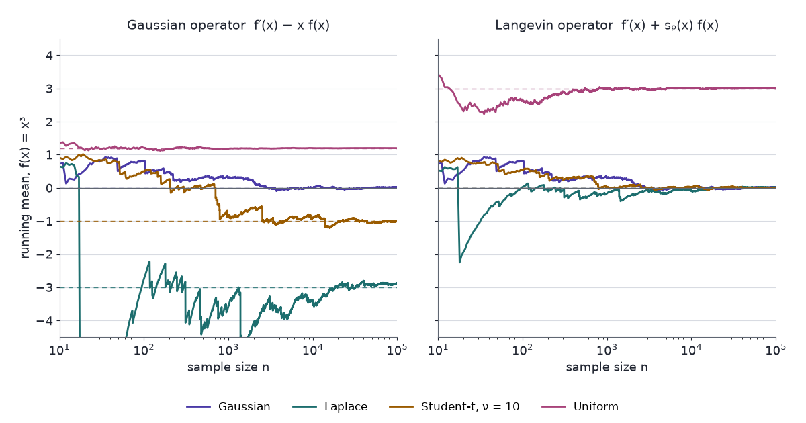

Stein's lemma characterises the standard normal by one expectation identity that must hold for every test function in a class, instead of by a list of moments. Rewritten for any smooth density, the identity needs only the derivative of the log-density, so it still works when the density's normalising constant is unknown.

Checking whether data look normal usually means a histogram, a QQ plot, or the first few moments. Moments are a weak check. After standardising, the uniform, the Laplace and the normal share their mean and variance, and no finite list of matched moments pins a law down. Stein's lemma replaces the list with one identity required of a whole class of test functions. Each $f$ contributes one equation, and the class as a whole leaves only the normal standing. The general-density version is what makes the idea useful beyond normality: it tests a sample against a density whose integral nobody can compute.

This is the first of seven parts. [Part 2](../steins-method-normal-approximation/) turns the identity into a bound on the distance between a sum and the normal. [Part 3](../kernel-stein-discrepancy-and-svgd/) makes that distance computable from samples and uses it to move particles toward a target. [Part 4](../stein-and-unnormalised-models/) fits models whose normalising constant is unknown. [Part 5](../steins-method-for-mcmc/) gives the bias and variance of MCMC samplers. [Part 6](../steins-method-in-neural-networks/) applies the identity to neural networks. [Part 7](../kernel-stein-discrepancy-as-a-regulariser/) uses the discrepancy built from it as a training regulariser.

An AI agent (Claude) drafted the text and the interactive chart. Separate review passes checked each derivation numerically and each reference against its source.

Three ideas carry the post:

1. **Stein's identity.** $\mathbb{E}[f'(Z)] = \mathbb{E}[Zf(Z)]$ holds for every suitable $f$ when $Z\sim N(0,1)$, and for no other law.
2. **The Langevin Stein operator.** The same construction for a density $p$ uses $p$ only through its score $(\log p)'$, so an unknown normalising constant drops out.
3. **Stein's unbiased risk estimate (SURE).** For a Gaussian observation, the identity turns an estimator's expected squared error, which depends on the unknown mean, into a quantity computed from the data.

## Notation

- $Z\sim N(0,1)$: a standard normal variable. $\varphi(x) = e^{-x^2/2}/\sqrt{2\pi}$ is its density and $\Phi$ its distribution function.
- $W$: a random variable being compared with $Z$.
- $p$: a density, positive on an interval $(a,b)$ with $-\infty\le a<b\le\infty$.
- $\tilde p = \mathcal{Z}\,p$: an unnormalised version of $p$, with normalising constant $\mathcal{Z} = \int\tilde p > 0$. The calligraphic $\mathcal{Z}$ keeps $Z$ free for the normal variable.
- $s_p = (\log p)' = p'/p$: the **score function** of $p$, the derivative of the log-density in $x$. It is not a scoring rule.
- $\mathcal{A}_p$: the Stein operator of $p$ (@sec-langevin).
- $\lVert g\rVert = \sup_x\lvert g(x)\rvert$ for a function $g$; $\lVert v\rVert$ is the Euclidean norm for a vector $v$.
- A function $f$ is **absolutely continuous** if $f(y)-f(x) = \int_x^y f'(t)\,dt$ for all $x<y$. Every continuously differentiable $f$ is, and so is a continuous $f$ with finitely many kinks.

## Stein's identity for the standard normal {#sec-identity}

The normal density satisfies $\varphi'(x) = -x\varphi(x)$, and it is the only density that does. Integrating $f'\varphi$ by parts moves the derivative onto $\varphi$, and that equation turns the result into an expectation of $Zf(Z)$:

$$
\begin{aligned}
\int f'(x)\varphi(x)\,dx &= \big[f\varphi\big]_{-\infty}^{\infty} - \int f(x)\varphi'(x)\,dx \\[6pt]
&= \big[f\varphi\big]_{-\infty}^{\infty} + \int xf(x)\varphi(x)\,dx.
\end{aligned}
$$

The content of the lemma is the conditions under which both integrals exist and the boundary term is zero.

::: {.callout-important title="Lemma 1 — Stein's identity (Ross 2011, Lemma 2.1)"}
Let $Z\sim N(0,1)$ and let $f:\mathbb{R}\to\mathbb{R}$ be absolutely continuous with $\mathbb{E}\lvert f'(Z)\rvert<\infty$. Then $\mathbb{E}\lvert Zf(Z)\rvert<\infty$ and

$$
\mathbb{E}[f'(Z)] = \mathbb{E}[Zf(Z)].
$$ {#eq-stein-identity}
:::

**Proof.** Two facts about $\varphi$ carry the proof: $\varphi'(x) = -x\varphi(x)$, and its integrated forms $\int_t^\infty x\varphi(x)\,dx = \varphi(t)$ and $\int_{-\infty}^t \lvert x\rvert\varphi(x)\,dx = \varphi(t)$ for $t\le0$.

1. **$Zf(Z)$ is integrable.** For $x\ge0$, $\lvert f(x)\rvert\le\lvert f(0)\rvert+\int_0^x\lvert f'(t)\rvert\,dt$. Multiply by $x\varphi(x)$, integrate over $x\ge0$, and swap the order of integration (Tonelli's theorem; every term is nonnegative):

   $$
   \begin{aligned}
   \int_0^\infty x\lvert f(x)\rvert\varphi(x)\,dx &\le \lvert f(0)\rvert\varphi(0) + \int_0^\infty\lvert f'(t)\rvert\int_t^\infty x\varphi(x)\,dx\,dt \\[6pt]
   &= \lvert f(0)\rvert\varphi(0) + \int_0^\infty\lvert f'(t)\rvert\varphi(t)\,dt.
   \end{aligned}
   $$

   The same bound holds on $x\le0$. Adding the two, $\mathbb{E}\lvert Zf(Z)\rvert\le2\lvert f(0)\rvert\varphi(0)+\mathbb{E}\lvert f'(Z)\rvert<\infty$.

2. **Integrate by parts on a finite interval.** On $[a,b]$ the product $f\varphi$ is absolutely continuous, with $(f\varphi)' = f'\varphi - xf\varphi$ almost everywhere. So

   $$
   \int_a^b f'(x)\varphi(x)\,dx - \int_a^b xf(x)\varphi(x)\,dx = f(b)\varphi(b) - f(a)\varphi(a).
   $$

3. **The boundary terms vanish.** For $b>0$,

   $$
   \lvert f(b)\rvert\varphi(b) \le \lvert f(0)\rvert\varphi(b) + \int_0^b\lvert f'(t)\rvert\varphi(t)\,\frac{\varphi(b)}{\varphi(t)}\,dt.
   $$

   The first term goes to 0 as $b\to\infty$. In the integral, the ratio $\varphi(b)/\varphi(t) = e^{-(b^2-t^2)/2}$ is at most 1 on $0\le t\le b$ and tends to 0 for each fixed $t$, while $\lvert f'\rvert\varphi$ is integrable. Dominated convergence sends the integral to 0. The same argument gives $f(a)\varphi(a)\to0$ as $a\to-\infty$.

4. **Pass to the limit.** Both integrands in step 2 are integrable over $\mathbb{R}$, by hypothesis and by step 1. Letting $a\to-\infty$ and $b\to\infty$ gives @eq-stein-identity. $\blacksquare$

Step 3 is where normality enters a second time. The Gaussian tail falls faster than any $f$ with $\mathbb{E}\lvert f'(Z)\rvert<\infty$ can grow. @sec-four-laws shows a density for which the boundary term survives.

### Polynomial test functions

Polynomials give the smallest instances:

- $f(x)=1$: $0 = \mathbb{E}Z$.
- $f(x)=x$: $1 = \mathbb{E}Z^2$.
- $f(x)=x^k$: $k\,\mathbb{E}Z^{k-1} = \mathbb{E}Z^{k+1}$, so $\mathbb{E}Z^4 = 3$, $\mathbb{E}Z^6 = 15$, and every moment follows from the first two.

One test function checks one equation. With $f(x)=x$, every law with $\mathbb{E}X^2=1$ passes, so every standardised law does. With $f(x)=x^3$, the identity reads $\mathbb{E}[3X^2-X^4] = 0$, which every standardised law with fourth moment 3 passes, normal or not. A characterisation needs a class of $f$ large enough to see the distribution function.

## The converse {#sec-converse}

The class that suffices is bounded, piecewise smooth $f$. For each $z$, the proof picks the $f$ that turns $\mathbb{E}[f'(W)-Wf(W)]$ into $P(W\le z)-\Phi(z)$.

::: {.callout-important title="Lemma 2 — the identity characterises the normal"}
Let $W$ be a random variable. Suppose $\mathbb{E}[f'(W)] = \mathbb{E}[Wf(W)]$ for every continuous $f$ that is continuously differentiable except at finitely many points, none of them an atom of $W$, with $f$, $f'$ and $x\mapsto xf(x)$ bounded. Then $W\sim N(0,1)$.
:::

Every $f$ in this class is absolutely continuous with bounded $f'$, so Lemma 1 applies to it: the normal satisfies the hypothesis. Lemmas 1 and 2 together say that the identity holds over this class for the normal and for no other law.

**The Stein equation for an indicator.** Fix $z\in\mathbb{R}$ and look for $f_z$ with

$$
f_z'(w) - wf_z(w) = \mathbb{1}\{w\le z\} - \Phi(z), \qquad w\ne z.
$$ {#eq-stein-equation-indicator}

At $w=W$, the left side has expectation 0 by hypothesis, and the right side has expectation $P(W\le z)-\Phi(z)$. Stein (1972) built his method on this equation with a general right side $h(w)-\mathbb{E}h(Z)$, which Part 2 solves; here a direct check of one candidate suffices:

$$
f_z(w) = \begin{cases}
\sqrt{2\pi}\,e^{w^2/2}\,\Phi(w)\,\big(1-\Phi(z)\big), & w\le z,\\[2pt]
\sqrt{2\pi}\,e^{w^2/2}\,\Phi(z)\,\big(1-\Phi(w)\big), & w>z.
\end{cases}
$$

**Proof of Lemma 2.**

1. **$f_z$ solves @eq-stein-equation-indicator.** Since $\sqrt{2\pi}\,e^{w^2/2}\varphi(w) = 1$,

   $$
   \begin{aligned}
   \frac{d}{dw}\Big[\sqrt{2\pi}\,e^{w^2/2}\Phi(w)\Big] &= w\sqrt{2\pi}\,e^{w^2/2}\Phi(w) + 1, \\[6pt]
   \frac{d}{dw}\Big[\sqrt{2\pi}\,e^{w^2/2}\big(1-\Phi(w)\big)\Big] &= w\sqrt{2\pi}\,e^{w^2/2}\big(1-\Phi(w)\big) - 1.
   \end{aligned}
   $$

   For $w<z$ this gives $f_z' = wf_z + 1 - \Phi(z)$; for $w>z$ it gives $f_z' = wf_z - \Phi(z)$. Both are @eq-stein-equation-indicator. The two branches agree at $w=z$, so $f_z$ is continuous, and it is continuously differentiable except at $z$.

2. **$\lvert wf_z(w)\rvert\le1$.** The Mills-ratio bound $1-\Phi(u)\le\varphi(u)/u$ for $u>0$ follows from $\int_u^\infty\varphi(x)\,dx\le\int_u^\infty(x/u)\,\varphi(x)\,dx = \varphi(u)/u$. It gives $\sqrt{2\pi}\,e^{u^2/2}(1-\Phi(u))\le1/u$ for $u>0$, and by symmetry $\sqrt{2\pi}\,e^{u^2/2}\Phi(u)\le1/\lvert u\rvert$ for $u<0$. Four cases:
   - $w\le z$, $w<0$: $\lvert wf_z(w)\rvert\le\lvert w\rvert\cdot\big(1/\lvert w\rvert\big)\cdot(1-\Phi(z))\le1$.
   - $0\le w\le z$: $1-\Phi(z)\le1-\Phi(w)$ and $\Phi(w)\le1$, so $wf_z(w)\le w\sqrt{2\pi}\,e^{w^2/2}(1-\Phi(w))\le1$.
   - $w>z$, $w>0$: $wf_z(w)\le w\sqrt{2\pi}\,e^{w^2/2}(1-\Phi(w))\le1$.
   - $z<w\le0$: $\Phi(z)\le\Phi(w)$ and $1-\Phi(w)\le1$, so $\lvert wf_z(w)\rvert\le\lvert w\rvert\sqrt{2\pi}\,e^{w^2/2}\Phi(w)\le1$.

3. **$f_z$ and $f_z'$ are bounded.** $f_z>0$. For $\lvert w\rvert\ge1$, $f_z(w)\le\lvert wf_z(w)\rvert\le1$; for $\lvert w\rvert<1$, $f_z(w)\le\sqrt{2\pi}\,e^{1/2}$. From the equation, $\lvert f_z'(w)\rvert\le\lvert wf_z(w)\rvert+1\le2$. The proof needs only that these bounds are finite, not their values. So $f_z$ is in the class of Lemma 2 for every $z$ that is not an atom of $W$.

4. **Conclude.** For such $z$, $W\ne z$ almost surely, so taking expectations in @eq-stein-equation-indicator at $w=W$ gives

   $$
   0 = \mathbb{E}\big[f_z'(W) - Wf_z(W)\big] = P(W\le z) - \Phi(z).
   $$

   A distribution function has at most countably many atoms, so $P(W\le z)=\Phi(z)$ for a dense set of $z$. Both sides are right-continuous, so they agree for every $z$. $\blacksquare$

Step 4 holds for every $W$, normal or not, and every non-atom $z$:

$$
P(W\le z) - \Phi(z) = \mathbb{E}\big[f_z'(W) - Wf_z(W)\big].
$$

A small right side means a small error in the distribution function. Part 2 builds its bounds on this equality.

## Gaussian integration by parts in $d$ dimensions {#sec-multivariate}

The one-dimensional proof used $\varphi'=-x\varphi$. The $N(\mu,\Sigma)$ density satisfies the vector version, $\nabla\varphi_{\mu,\Sigma}(x) = -\Sigma^{-1}(x-\mu)\,\varphi_{\mu,\Sigma}(x)$, and the identity carries over.

::: {.callout-important title="Proposition 3 — Gaussian integration by parts"}
Let $X\sim N(\mu,\Sigma)$ with $\Sigma$ positive definite, and let $f:\mathbb{R}^d\to\mathbb{R}$ be continuously differentiable with $\mathbb{E}\lVert\nabla f(X)\rVert<\infty$ and $\mathbb{E}\big[\lVert X-\mu\rVert\,\lvert f(X)\rvert\big]<\infty$. Then

$$
\mathbb{E}\big[(X-\mu)f(X)\big] = \Sigma\,\mathbb{E}\big[\nabla f(X)\big],
$$ {#eq-gaussian-ibp}

equivalently $\mathbb{E}[\nabla f(X)] = \Sigma^{-1}\,\mathbb{E}[(X-\mu)f(X)]$.
:::

**Proof.**

1. **Reduce to the standard normal.** Choose an invertible $A$ with $AA^\top=\Sigma$, write $X=\mu+AZ$ with $Z\sim N(0,I_d)$, and set $g(z)=f(\mu+Az)$. Then $\nabla g(z) = A^\top\nabla f(\mu+Az)$.
2. **One coordinate at a time.** Fix $i$ and condition on $Z_{-i}$, the coordinates other than $i$, which are independent of $Z_i$. The section $t\mapsto g(t,Z_{-i})$ is continuously differentiable. Since $\mathbb{E}\lvert\partial_ig(Z)\rvert\le\lVert A\rVert\,\mathbb{E}\lVert\nabla f(X)\rVert<\infty$, Fubini's theorem gives $\mathbb{E}[\lvert\partial_ig(Z)\rvert\mid Z_{-i}]<\infty$ almost surely. Lemma 1 applied to the section gives $\mathbb{E}[Z_ig(Z)\mid Z_{-i}] = \mathbb{E}[\partial_ig(Z)\mid Z_{-i}]$ almost surely.
3. **Take expectations.** $\mathbb{E}\lvert Z_ig(Z)\rvert\le\lVert A^{-1}\rVert\,\mathbb{E}\big[\lVert X-\mu\rVert\,\lvert f(X)\rvert\big]<\infty$, so both sides of step 2 are integrable and $\mathbb{E}[Z_ig(Z)] = \mathbb{E}[\partial_ig(Z)]$. Stacking the coordinates, $\mathbb{E}[Zg(Z)] = A^\top\mathbb{E}[\nabla f(X)]$.
4. **Undo the change of variables.** Multiply on the left by $A$. Since $AZ = X-\mu$ and $AA^\top=\Sigma$, the result is @eq-gaussian-ibp. $\blacksquare$

In one dimension, Lemma 1 derived the integrability of $Zf(Z)$ from that of $f'(Z)$. Proposition 3 assumes it instead, which avoids a detour through the integrability of $f$ on coordinate hyperplanes.

With $\Sigma=\sigma^2I$, take $A=\sigma I$. The sections in step 2 are then lines parallel to the axes, so the proof needs $f$ only to be absolutely continuous along almost every such line, with partial derivatives that exist almost everywhere and are locally integrable, which $\mathbb{E}\lVert\nabla f(X)\rVert<\infty$ guarantees. Such functions are *weakly differentiable*. In that form, coordinate $i$ of @eq-gaussian-ibp reads

$$
\mathbb{E}\big[(X_i-\mu_i)f(X)\big] = \sigma^2\,\mathbb{E}\big[\partial_if(X)\big].
$$ {#eq-gaussian-ibp-coord}

@sec-sure uses this form, because its estimators have a singular point.

The smallest instances are the first two moments. $f(x)=1$ gives $\mathbb{E}[X-\mu]=0$. $f(x)=x_j$ gives $\mathbb{E}[(X-\mu)X_j] = \Sigma e_j$, the $j$-th column of the covariance.

Combining @eq-gaussian-ibp with the chain rule gives a result known as Price's theorem (Price 1958). For $X\sim N(0,\Sigma)$, $g$ twice continuously differentiable with bounded second derivatives, and $i\ne j$, treating $\Sigma_{ij}=\Sigma_{ji}$ as one variable:

$$
\frac{\partial}{\partial\Sigma_{ij}}\,\mathbb{E}\,g(X) = \mathbb{E}\big[\partial_i\partial_jg(X)\big].
$$

The derivation takes three steps.

1. **Move $\Sigma$ along a covariance.** Take $B$ positive definite and $Y\sim N(0,B)$ independent of $X$, so that $X+\sqrt t\,Y\sim N(0,\Sigma+tB)$. For $t>0$ the chain rule gives $(d/dt)\,\mathbb{E}\,g(X+\sqrt t\,Y) =\mathbb{E}\big[\nabla g(X+\sqrt t\,Y)^\top Y\big]/(2\sqrt t)$.
2. **Integrate by parts in $Y$.** Apply @eq-gaussian-ibp to $Y$ with $X$ held fixed. The derivative becomes $\tfrac12\,\mathbb{E}\big[\operatorname{tr}\big(B\,\nabla^2g(X+\sqrt t\,Y)\big)\big]$, which is continuous down to $t=0$ because $\nabla^2g$ is bounded and continuous. So the derivative of $\Sigma\mapsto\mathbb{E}\,g(X)$ in the direction $B$ is $\tfrac12\operatorname{tr}\big(B\,\mathbb{E}[\nabla^2g(X)]\big)$.
3. **Polarise.** Moving $\Sigma_{ij}$ and $\Sigma_{ji}$ together is the direction $E_{ij}+E_{ji}$, where $E_{ij}$ is the matrix with a single 1 in place $(i,j)$. Its eigenvalues include $\pm1$, so it is not a covariance. It is, however, the difference of $B_\pm = I\pm\tfrac12(E_{ij}+E_{ji})$, whose eigenvalues lie in $[\tfrac12,\tfrac32]$. Writing $X=\Sigma^{1/2}Z$ and differentiating under the expectation shows that $\mathbb{E}\,g(X)$ is continuously differentiable in $\Sigma$, so its derivative is linear in the direction. Step 2 for $B_+$ minus step 2 for $B_-$ gives $\tfrac12\operatorname{tr}\big((E_{ij}+E_{ji})\,\mathbb{E}[\nabla^2g(X)]\big) = \mathbb{E}[\partial_i\partial_jg(X)]$.

## The Langevin Stein operator {#sec-langevin}

Lemma 1's proof used one property of $\varphi$: the ratio $\varphi'/\varphi = -x$. Any positive, differentiable density $p$ has such a ratio, its score $s_p = p'/p$. The same integration by parts goes through with $s_p$ in place of $-x$. The product rule gives $(fp)' = f'p + fp' = p\,(f'+s_pf)$, which defines the operator:

$$
(\mathcal{A}_pf)(x) = f'(x) + s_p(x)\,f(x) = \frac{(fp)'(x)}{p(x)}.
$$ {#eq-langevin-operator}

Gorham & Mackey (2017) call $\mathcal{A}_p$ the **Langevin Stein operator**. The name comes from the Langevin diffusion $dX_t = s_p(X_t)\,dt+\sqrt2\,dB_t$, which has $p$ as its stationary law (Gorham & Mackey 2015). Its generator applied to $g$ is $g''+s_pg' = \mathcal{A}_p(g')$. For $p=\varphi$, $\mathcal{A}_\varphi f = f'-xf$, the operator of Lemma 1.

::: {.callout-important title="Proposition 4 — the identity for a general density"}
Let $p$ be a density that is positive and absolutely continuous on $(a,b)$, with score $s_p = p'/p$ defined almost everywhere. Let $f$ be absolutely continuous on every closed subinterval of $(a,b)$, with $\mathbb{E}_p\lvert(\mathcal{A}_pf)(X)\rvert<\infty$. Then the limits $L_a=\lim_{x\downarrow a}f(x)p(x)$ and $L_b=\lim_{x\uparrow b}f(x)p(x)$ exist, and

$$
\mathbb{E}_p\big[(\mathcal{A}_pf)(X)\big] = L_b - L_a.
$$ {#eq-langevin-boundary}

At an infinite end, the limit is 0 whenever $\mathbb{E}_p\lvert f(X)\rvert<\infty$.
:::

**Proof.**

1. On each $[c,x]\subset(a,b)$ the product $fp$ is absolutely continuous, with derivative $p\,\mathcal{A}_pf$ almost everywhere. So $f(x)p(x) = f(c)p(c)+\int_c^xp(t)(\mathcal{A}_pf)(t)\,dt$.
2. The integrand is integrable on $(a,b)$ by hypothesis, so dominated convergence makes the right side converge as $x\uparrow b$ and as $x\downarrow a$. Both limits exist.
3. Taking both limits, $\int_a^bp\,\mathcal{A}_pf = L_b-L_a$, which is @eq-langevin-boundary.
4. Let $b=\infty$ and suppose $L_b\ne0$. Then $\lvert f\rvert p\ge\lvert L_b\rvert/2$ on some $[x_0,\infty)$, so $\int\lvert f\rvert p=\infty$. Hence $\mathbb{E}_p\lvert f\rvert<\infty$ forces $L_b=0$; the same holds at $a=-\infty$. $\blacksquare$

The **Stein class** of $p$ is the set of $f$ for which @eq-langevin-boundary is zero. On the whole line, it contains every $f$ with $\mathbb{E}_p\lvert f\rvert$ and $\mathbb{E}_p\lvert\mathcal{A}_pf\rvert$ finite. On a bounded interval, it contains the $f$ for which $fp$ vanishes at both ends. Ley, Reinert & Swan (2017) build Stein operators for general univariate laws this way.

In $d$ dimensions, $f:\mathbb{R}^d\to\mathbb{R}^d$ is a vector field and

$$
\begin{gathered}
(\mathcal{A}_pf)(x) = \nabla\!\cdot f(x) + s_p(x)^\top f(x) = \frac{\nabla\!\cdot\big(f\,p\big)(x)}{p(x)}, \\[4pt]
s_p = \nabla\log p.
\end{gathered}
$$

The expectation is zero when $fp$ decays fast enough for the boundary flux in the divergence theorem to vanish. Part 3 proves this and builds on it.

### Unnormalised densities {#sec-normalising}

Suppose $p$ is known only up to a constant: $\tilde p=\mathcal{Z}p$ can be evaluated at any $x$, but $\mathcal{Z}=\int\tilde p$ cannot be computed. Bayesian posteriors are the standard case. The prior times the likelihood is known pointwise, and its integral, the evidence, is not. The score does not see the constant:

$$
s_{\tilde p}(x) = \frac{d}{dx}\Big[\log\mathcal{Z} + \log p(x)\Big] = s_p(x).
$$

So $\mathcal{A}_{\tilde p}=\mathcal{A}_p$. Anyone who can evaluate $\tilde p'/\tilde p$ can evaluate $\mathbb{E}_q[\mathcal{A}_pf]$ for a sample from some $q$ and check how far it is from zero. Part 3's sample-quality measure and Part 4's estimators rest on $s_{\tilde p}=s_p$.

Smallest instance: $\tilde p(x)=e^{-x^2/2}$ with $\mathcal{Z}=\sqrt{2\pi}$. Its score is $-x$, and the $\sqrt{2\pi}$ never appears.

### Four laws {#sec-four-laws}

All four laws are standardised to mean 0 and variance 1. The Student-$t$ is rescaled by $\sqrt{(\nu-2)/\nu}$, which needs $\nu>2$.

| Law | Density $p(x)$ | Score $s_p(x)$ | $\mathbb{E}_p[\mathcal{A}_pf]$ |
|---|---|---|---|
| Gaussian | $\varphi(x)$ | $-x$ | $0$ |
| Laplace, scale $1/\sqrt2$ | $\tfrac{1}{\sqrt2}\,e^{-\sqrt2\lvert x\rvert}$ | $-\sqrt2\,\operatorname{sign}(x)$ | $0$ |
| Student-$t_\nu$, rescaled | $\propto\big(1+\tfrac{x^2}{\nu-2}\big)^{-(\nu+1)/2}$ | $-\dfrac{(\nu+1)\,x}{\nu-2+x^2}$ | $0$ |
| Uniform on $(-\sqrt3,\sqrt3)$ | $\tfrac{1}{2\sqrt3}$ | $0$ | $\dfrac{f(\sqrt3)-f(-\sqrt3)}{2\sqrt3}$ |

The last column assumes $\mathbb{E}_p\lvert f\rvert$ and $\mathbb{E}_p\lvert\mathcal{A}_pf\rvert$ are finite.

- **Laplace.** $p$ has a kink at 0 but is absolutely continuous, which is all Proposition 4 needs.
- **Uniform.** The score is 0, so $\mathcal{A}_pf=f'$, and @eq-langevin-boundary gives $\mathbb{E}[f'(U)] = (f(\sqrt3)-f(-\sqrt3))/(2\sqrt3)$. For $f(x)=x^3$ that is $3$, not 0: the density does not decay at the ends of its support, so the boundary term survives. Restricting to $f$ that vanish at $\pm\sqrt3$, such as $f(x)=(3-x^2)\,g(x)$, restores the identity.
- **Student-$t$, $f(x)=x^3$.** $\mathcal{A}_pf = 3x^2-(\nu+1)x^4/(\nu-2+x^2)$ behaves like $-(\nu-2)x^2$ in the tails, so its mean exists for every $\nu>2$. It is 0 because $x^3p(x)\sim x^{2-\nu}\to0$ at both ends; for $2<\nu\le3$, where $\mathbb{E}\lvert X\rvert^3=\infty$, that limit replaces the condition under the table. Its variance is finite only for $\nu>4$. The Gaussian operator gives $\mathbb{E}[3X^2-X^4] = 3-\mathbb{E}X^4 = -6/(\nu-4)$, which needs $\nu>4$ to exist at all.

### Testing the identity by simulation

The draws are synthetic: seeded pseudo-random samples from the four laws in the table. Standardising them removes location and scale, so any difference between them is shape. They stand in for a sample whose law is in question. A wrong conclusion would mean accepting a non-normal law as normal on the strength of a check that cannot tell them apart, such as matching the mean and variance.

The chart shows the running mean of $(\mathcal{A}f)(X_i)$ over $n$ draws, a band of $\pm2$ standard errors, and a dashed line at the exact expectation, computed in closed form or by quadrature. The operator toggle switches between the Gaussian operator $f'-xf$ and the Langevin operator $\mathcal{A}_pf$ of the chosen law.

::: {#widget-stein-identity}
:::

```{=html}
<script src="model.js"></script>
<script src="widgets.js"></script>
```

Things to try:

1. Keep the Gaussian law and the Gaussian operator, and step through $\sin x$, $\tanh x$ and $x^3$. The exact value is 0 for all three. Over eight seeds, the $\sin x$ estimate at $n=100{,}000$ lies in $[-0.0064, 0.0066]$.
2. Keep the Gaussian operator, choose **custom** and type `x`. Every law gives 0, because $\mathbb{E}[1-X^2]=0$ only says the variance is 1.
3. Choose the Laplace law with $x^3$. The estimate settles near $-3 = 3-\mathbb{E}X^4$, since the Laplace fourth moment is 6. With $\sin x$ the gap is smaller, $0.222$, and still well clear of the band.
4. Choose the uniform law with $x^3$: the Gaussian operator gives $1.2$. Switch to the Langevin operator. The estimate moves to $3$, the boundary term, not to 0. Type the custom $f$ `(3-x^2)*x^3`, which vanishes at $\pm\sqrt3$, and the expectation returns to 0.
5. Choose Student-$t$ with $x^3$ and the Gaussian operator, then lower $\nu$ from 30 toward 4.5. The exact value $-6/(\nu-4)$ goes from $-0.23$ to $-12$. At $\nu\le4$ the expectation does not exist, and the running mean does not settle: at $\nu=3$ its value at $n=100{,}000$ ranges from $-28$ to $-857$ over eight seeds. Switch to the Langevin operator. The exact value is 0 for every $\nu$ on the slider; at $\nu=3$ the estimates lie in $[-0.08, 0.05]$, and the chart drops the band because the variance is infinite.
6. With the Langevin operator, every law on the whole line gives 0 for all three test functions. Only the uniform does not.

{fig-alt="Two panels of running-mean curves against sample size on a log axis. Left panel: Gaussian converges to 0, Laplace to minus 3, Student-t with 10 degrees of freedom to minus 1, uniform to 1.2. Right panel: Gaussian, Laplace and Student-t converge to 0; uniform converges to 3."}

## Stein's unbiased risk estimate {#sec-sure}

The Gaussian identity also has a use that tests no distribution. Suppose we estimate a normal mean from one noisy observation. The estimator's error depends on the unknown mean, so it cannot be computed from the data. Stein (1981) used @eq-gaussian-ibp-coord to remove that dependence.

- **Observation.** $y\sim N(\mu,\sigma^2I_d)$, with $\sigma^2$ known and $\mu$ unknown.
- **Estimator.** $\hat\mu(y) = y+g(y)$ for a correction $g:\mathbb{R}^d\to\mathbb{R}^d$; $g=0$ is the maximum-likelihood estimate $\hat\mu=y$.
- **Risk.** $R(\mu) = \mathbb{E}\lVert\hat\mu(y)-\mu\rVert^2$, a function of the unknown $\mu$.

::: {.callout-important title="Proposition 5 — SURE (identity due to Stein 1981)"}
Let each coordinate $g_i$ be absolutely continuous along almost every line parallel to the $i$-th axis, with $\mathbb{E}\lvert\partial_ig_i(y)\rvert$, $\mathbb{E}\lvert(y_i-\mu_i)\,g_i(y)\rvert$ and $\mathbb{E}\lVert g(y)\rVert^2$ finite. Then

$$
\begin{aligned}
\mathbb{E}\lVert\hat\mu(y)-\mu\rVert^2 &= \mathbb{E}\big[\mathrm{SURE}(y)\big], \\[6pt]
\mathrm{SURE}(y) &= d\sigma^2 + \lVert g(y)\rVert^2 + 2\sigma^2\,\nabla\!\cdot g(y).
\end{aligned}
$$ {#eq-sure}
:::

The conditions are the ones the proof uses.

**Proof.**

1. Expand: $\lVert y+g(y)-\mu\rVert^2 = \lVert y-\mu\rVert^2 + 2(y-\mu)^\top g(y) + \lVert g(y)\rVert^2$.
2. $\mathbb{E}\lVert y-\mu\rVert^2 = d\sigma^2$.
3. Apply @eq-gaussian-ibp-coord to $g_i$ for each $i$: $\mathbb{E}[(y_i-\mu_i)g_i(y)] = \sigma^2\,\mathbb{E}[\partial_ig_i(y)]$. Summing over $i$, $\mathbb{E}[(y-\mu)^\top g(y)] = \sigma^2\,\mathbb{E}[\nabla\!\cdot g(y)]$.
4. Take expectations in step 1 and substitute steps 2 and 3. $\blacksquare$

$\mathrm{SURE}(y)$ contains no $\mu$, so it is computed from the observation alone. Its expectation equals the risk at every $\mu$. Part 4 trains denoisers by minimising it and uses it to choose a regularisation strength.

### James–Stein shrinkage

$g=0$ gives $\mathrm{SURE}=d\sigma^2$, the risk of $\hat\mu=y$. The James–Stein estimator (James & Stein 1961) shrinks $y$ toward the origin:

$$
\begin{aligned}
\hat\mu_{\mathrm{JS}}(y) &= \Big(1-\frac{(d-2)\sigma^2}{\lVert y\rVert^2}\Big)\,y, \\[6pt]
g(y) &= -\frac{(d-2)\sigma^2}{\lVert y\rVert^2}\,y.
\end{aligned}
$$

1. $\lVert g(y)\rVert^2 = (d-2)^2\sigma^4/\lVert y\rVert^2$.
2. $\partial_ig_i(y) = -(d-2)\sigma^2\,\big(\lVert y\rVert^2-2y_i^2\big)/\lVert y\rVert^4$, so $\nabla\!\cdot g(y) = -(d-2)^2\sigma^2/\lVert y\rVert^2$.
3. Substituting into @eq-sure:

   $$
   \begin{aligned}
   \mathrm{SURE}(y) &= d\sigma^2 + \frac{(d-2)^2\sigma^4}{\lVert y\rVert^2} - \frac{2(d-2)^2\sigma^4}{\lVert y\rVert^2} \\[6pt]
   &= d\sigma^2 - \frac{(d-2)^2\sigma^4}{\lVert y\rVert^2}.
   \end{aligned}
   $$

4. **Conditions.** $g$ is smooth except at $y=0$, where $\lvert\partial_ig_i\rvert\le(d-2)\sigma^2/\lVert y\rVert^2$ and $\lvert(y_i-\mu_i)g_i\rvert\le(d-2)\sigma^2\lvert y_i-\mu_i\rvert/\lVert y\rVert$. All three integrability conditions hold when $\mathbb{E}\lVert y\rVert^{-2}<\infty$. For the second, Cauchy–Schwarz gives $\mathbb{E}\big[\lvert y_i-\mu_i\rvert/\lVert y\rVert\big]\le\sigma\,(\mathbb{E}\lVert y\rVert^{-2})^{1/2}$. That is the case for $d\ge3$, where the singularity at 0 is integrable.
5. **Risk.** $R_{\mathrm{JS}}(\mu) = d\sigma^2-(d-2)^2\sigma^4\,\mathbb{E}\lVert y\rVert^{-2} < d\sigma^2$ for every $\mu$. At $\mu=0$, $\lVert y\rVert^2/\sigma^2\sim\chi^2_d$ and $\mathbb{E}[1/\chi^2_d] = 1/(d-2)$, so $R_{\mathrm{JS}}(0) = 2\sigma^2$. In $d=10$, that is $2\sigma^2$ against $10\sigma^2$.

For $d\ge3$, the observation $y$ itself, the maximum-likelihood estimate, has strictly higher risk than $\hat\mu_{\mathrm{JS}}$ at every $\mu$. The proof is four lines of @eq-sure.

## Constraints

- **Boundary terms.** The identity needs the boundary term $L_b-L_a$ to vanish. On the whole line, $\mathbb{E}_p\lvert f\rvert<\infty$ is enough. A density that stays positive at an end of a bounded support, as for the uniform or a truncated normal, breaks it unless $fp$ takes the same value at both ends, for instance because $f$ vanishes there. The uniform with $f(x)=x^3$ gives 3, not 0.
- **Integrability.** $\mathbb{E}_p\lvert\mathcal{A}_pf\rvert<\infty$ binds for heavy tails. Under Student-$t$, $f(x)=x^3$ needs $\nu>2$ for the Langevin operator and $\nu>4$ for the Gaussian one, and Monte Carlo error bars need $\nu>4$ and $\nu>8$ respectively.
- **One test function is one equation.** A characterisation needs a class rich enough to see the distribution function; Lemma 2's class is one, because it contains the indicator solutions $f_z$. With $f(x)=x$ alone, every standardised law passes.
- **Densities only.** The score needs $p$ absolutely continuous on its support. A law with atoms has no score; Stein operators for discrete laws use differences instead (Ley, Reinert & Swan 2017).
- **SURE's assumptions.** SURE needs Gaussian noise, a known $\sigma^2$, and a weakly differentiable estimator. Hard thresholding jumps, so its divergence has a point mass that @eq-sure leaves out.

## Next in the series

- [Part 2](../steins-method-normal-approximation/): Lemma 2's proof solved the Stein equation for one indicator. Solving it for every test function in a class turns a small $\mathbb{E}[f'(W)-Wf(W)]$ into a bound on a distance between $W$ and $Z$, with explicit constants, and gives the central limit theorem with a rate.
- [Part 3](../kernel-stein-discrepancy-and-svgd/): the $d$-dimensional Langevin operator, with $f$ ranging over a kernel space, gives a discrepancy that is computed from a sample and the score, with no normalising constant.
- [Part 4](../stein-and-unnormalised-models/): SURE returns as a training loss, and the score's blindness to $\mathcal{Z}$ becomes the main tool for fitting unnormalised models.
- [Part 5](../steins-method-for-mcmc/): the Langevin operator applied to gradients is the generator of the Langevin diffusion, and its Stein equation gives the bias of unadjusted Langevin and the variance of exact samplers.
- [Part 6](../steins-method-in-neural-networks/): Proposition 3 and Price's theorem bound how far a random network is from a Gaussian process, give its limit kernels, and recover a hidden direction from input–output pairs.
- [Part 7](../kernel-stein-discrepancy-as-a-regulariser/): the identity, tested on a batch of codes over a class of functions, becomes a training loss. Over affine functions it is the moment penalty of self-supervised learning.

One. Identity. Pins. Normals. Scores. Ignore. Constants. Boundaries. Decide.

## References

- Gorham, J. & Mackey, L. (2015). [Measuring sample quality with Stein's method](https://proceedings.neurips.cc/paper/2015/hash/698d51a19d8a121ce581499d7b701668-Abstract.html). *Advances in Neural Information Processing Systems* 28.
- Gorham, J. & Mackey, L. (2017). [Measuring sample quality with kernels](https://proceedings.mlr.press/v70/gorham17a.html). *Proceedings of the 34th International Conference on Machine Learning*, PMLR 70, 1292–1301.
- James, W. & Stein, C. (1961). [Estimation with quadratic loss](https://projecteuclid.org/euclid.bsmsp/1200512173). *Proceedings of the Fourth Berkeley Symposium on Mathematical Statistics and Probability* 1, 361–379.
- Ley, C., Reinert, G. & Swan, Y. (2017). [Stein's method for comparison of univariate distributions](https://doi.org/10.1214/16-PS278). *Probability Surveys* 14, 1–52.
- Price, R. (1958). [A useful theorem for nonlinear devices having Gaussian inputs](https://doi.org/10.1109/TIT.1958.1057444). *IRE Transactions on Information Theory* 4(2), 69–72.
- Ross, N. (2011). [Fundamentals of Stein's method](https://doi.org/10.1214/11-PS182). *Probability Surveys* 8, 210–293.
- Stein, C. (1972). [A bound for the error in the normal approximation to the distribution of a sum of dependent random variables](https://doi.org/10.1525/9780520423671-036). *Proceedings of the Sixth Berkeley Symposium on Mathematical Statistics and Probability* 2, 583–602.
- Stein, C. M. (1981). [Estimation of the mean of a multivariate normal distribution](https://doi.org/10.1214/aos/1176345632). *Annals of Statistics* 9(6), 1135–1151.
- [Stein's Method, Part 2: Normal Approximation](../steins-method-normal-approximation/) — the Stein equation, bounds on its solution, and a Wasserstein bound for sums.
- [Stein's Method, Part 3: Kernel Stein Discrepancy and SVGD](../kernel-stein-discrepancy-and-svgd/) — the $d$-dimensional operator with kernels, and sampling by particles.
- [Stein's Method, Part 4: Models Without Normalising Constants](../stein-and-unnormalised-models/) — score matching and Stein-based training losses.
- [Stein's Method, Part 5: Markov Chain Monte Carlo](../steins-method-for-mcmc/) — the Poisson equation, the bias of unadjusted Langevin and zero-variance control variates.
- [Stein's Method, Part 6: Neural Networks and Machine Learning](../steins-method-in-neural-networks/) — wide random networks, hidden directions, and a map of the series in machine learning.
- [Stein's Method, Part 7: Kernel Stein Discrepancy as a Regulariser](../kernel-stein-discrepancy-as-a-regulariser/) — KSD as a training loss, what its kernel lets it see, and a VAE and a JEPA on CIFAR-10.
