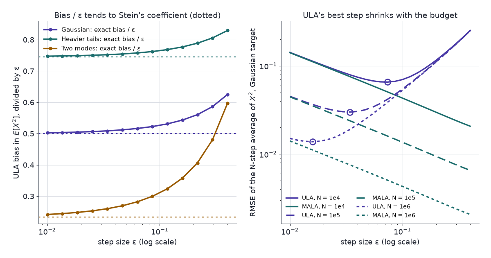

A Markov chain built to sample a density $p$ comes with its own Stein operator, and the Stein equation for that operator is the chain's Poisson equation. One solution of it gives the bias of an approximate sampler such as unadjusted Langevin, the variance of an exact sampler's averages, and the control variate that would remove that variance.

Every MCMC run fixes a step size and a number of iterations, and both trade accuracy for cost in ways a trace plot does not show. A larger step lowers the autocorrelation. In a sampler without a Metropolis correction it also moves the chain's long-run distribution away from the target, and no between-chain diagnostic sees that shift, because every chain shifts the same way. [Part 3](../kernel-stein-discrepancy-and-svgd/) measured the shift after the run with a kernel Stein discrepancy. [Part 2](../steins-method-normal-approximation/) had a sharper tool in reserve: the Stein equation, whose solution converts a difference of expectations into an expectation under one law. For a Markov chain the same equation sizes the bias and the variance at once.

[Part 1](../steins-lemma/) built the Langevin Stein operator. [Part 2](../steins-method-normal-approximation/) solved the Stein equation and noted Barbour's generator approach in one line; this part runs it. [Part 3](../kernel-stein-discrepancy-and-svgd/) audited MCMC output with the kernel Stein discrepancy and built Stein control variates for independent samples. [Part 4](../stein-and-unnormalised-models/) fitted unnormalised models. [Part 6](../steins-method-in-neural-networks/) turns to neural networks.

An AI agent (Claude) drafted the text and the interactive charts. Separate review passes checked each derivation numerically and each reference against its source.

Three ideas carry the post:

1. **Markov kernels are Stein operators.** If a kernel $P$ leaves $p$ invariant, $\mathbb{E}_p[Pu-u]=0$ for every integrable $u$. The generator of the Langevin diffusion is the Langevin Stein operator applied to gradients, and the Stein equation becomes the Poisson equation.
2. **Bias is a mismatch of operators.** An unadjusted sampler's stationary law satisfies its own kernel's identity, not the target's. Evaluating the difference on the Poisson solution gives the bias, first order in the step size for unadjusted Langevin.
3. **Variance comes from the same solution.** The Poisson solution sets the asymptotic variance of an exact sampler, and subtracting the generator applied to an approximation of it is a zero-variance control variate.

## Notation

- $p$: the target density on $\mathbb{R}^d$, positive and smooth; $s_p=\nabla\log p$ its score; $\tilde p$ an unnormalised version.
- $X_0,X_1,\dots$: a Markov chain with transition kernel $P$, acting on functions by $(Pu)(x)=\mathbb{E}[u(X_1)\mid X_0=x]$.
- $p$ is **invariant** for $P$ if $X_0\sim p$ implies $X_1\sim p$.
- **Langevin diffusion**: $dX_t = s_p(X_t)\,dt+\sqrt2\,dB_t$, with $B$ a standard Brownian motion. Its generator is $\mathcal{L}u=\Delta u+s_p^\top\nabla u$.
- **ULA** (unadjusted Langevin algorithm): $x' = x+\epsilon\,s_p(x)+\sqrt{2\epsilon}\,\xi$ with $\xi\sim N(0,I)$ and step size $\epsilon$. Its kernel is $P_\epsilon$ and its stationary law $\pi_\epsilon$.
- **MALA** (Metropolis-adjusted Langevin algorithm): the ULA move as a proposal, accepted with the Metropolis–Hastings probability.
- $h$: a test function; $\bar h = h-\mathbb{E}_ph$.
- $\hat\mu_N=(1/N)\sum_{t=1}^Nh(X_t)$: the MCMC estimate of $\mathbb{E}_ph$.
- $\sigma^2(h)$: the asymptotic variance, the limit of $N\operatorname{Var}(\hat\mu_N)$.
- $f_h$: the solution of the Stein equation, as in Part 2.

## Markov kernels as Stein operators {#sec-operators}

Part 1 built a Stein operator by integration by parts. A second construction needs no calculus.

::: {.callout-important title="Proposition 1 — a kernel's Stein identity"}
Let $p$ be invariant for $P$, and let $\mathbb{E}_p\lvert u\rvert<\infty$. Then

$$
\mathbb{E}_p\big[(Pu)(X)-u(X)\big]=0.
$$ {#eq-kernel-identity}
:::

**Proof.** $\mathbb{E}_p\lvert Pu\rvert\le\mathbb{E}_p[P\lvert u\rvert]=\mathbb{E}_p\lvert u\rvert$, so both terms are finite. With $X_0\sim p$, $\mathbb{E}_p[Pu]=\mathbb{E}[u(X_1)]=\mathbb{E}_p[u]$ by invariance. $\blacksquare$

- **The operator.** $\mathcal{A}=P-I$ is a Stein operator for $p$: its outputs have mean zero under $p$.
- **The Stein equation.** For a test function $h$ it reads $Pu-u=\bar h$. With $\hat u=-u$ this is $\hat u-P\hat u=\bar h$, the **Poisson equation** of the chain.
- **No normalising constant.** A Metropolis–Hastings kernel uses $p$ only through ratios $p(y)/p(x)$, so the operator never sees $\mathcal{Z}$, like the Langevin operator of Part 1.

Smallest instance: an independence sampler that ignores the current state and draws $X_1\sim p$. Then $Pu=\mathbb{E}_pu$ for every $x$, and @eq-kernel-identity is $\mathbb{E}_pu-\mathbb{E}_pu=0$.

### The Langevin generator

In continuous time the kernel becomes a generator, $\mathcal{L}u=\lim_{t\to0}(P_tu-u)/t$, where $P_t$ moves the diffusion forward by time $t$. By Itô's formula the Langevin diffusion has generator $\mathcal{L}u=\Delta u+s_p^\top\nabla u$.

::: {.callout-important title="Proposition 2 — the generator and the Poisson equation"}
Let $p$ be positive and continuously differentiable, and let $u$ be twice continuously differentiable. Then

$$
\begin{aligned}
\mathcal{L}u &= \nabla\!\cdot(\nabla u)+s_p^\top\nabla u\\[4pt]
&= \mathcal{A}_p(\nabla u)\\[4pt]
&= \frac{1}{p}\,\nabla\!\cdot\big(p\,\nabla u\big).
\end{aligned}
$$ {#eq-generator}

In one dimension, let $\mathbb{E}_p\lvert h\rvert<\infty$. Every solution of $\mathcal{L}u=\bar h$ with $p(x)u'(x)\to0$ as $x\to-\infty$ has $u'=f_h$, where

$$
f_h(x) = \frac{1}{p(x)}\int_{-\infty}^{x}\bar h(t)\,p(t)\,dt.
$$ {#eq-poisson-1d}
:::

**Proof.**

1. **Operator.** $\Delta u=\nabla\!\cdot(\nabla u)$, so $\mathcal{L}u$ is the Langevin operator $\mathcal{A}_pf=\nabla\!\cdot f+s_p^\top f$ at $f=\nabla u$. The product rule and $\nabla p=p\,s_p$ give $\nabla\!\cdot(p\nabla u)=p\,\Delta u+p\,s_p^\top\nabla u$.
2. **One dimension.** $\mathcal{L}u=\bar h$ reads $(pu')'=p\,\bar h$. Integrating from $-\infty$, where $pu'\to0$, gives $p(x)u'(x)=\int_{-\infty}^x\bar hp$. $\blacksquare$

- **The name.** The Langevin Stein operator of Part 1 is the generator of the Langevin diffusion acting on gradient fields. Barbour's generator approach (Part 2) picks a process with stationary law $p$ and uses its generator as the Stein operator.
- **Part 2 is the Gaussian case.** For $p=N(0,1)$ the diffusion is the Ornstein–Uhlenbeck process, $\mathcal{L}u=u''-xu'$. With $f=u'$, the Poisson equation is Part 2's Stein equation $f'-xf=\bar h$, and @eq-poisson-1d is Part 2's solution with the integrating factor $e^{-x^2/2}$ replaced by $p$.

Smallest instance: $p=N(0,1)$ and $h(x)=x^2$. Then $f_h(x)=-x$, so $u(x)=-x^2/2$, and $\mathcal{L}u=-1+x^2=\bar h$.

## The bias of unadjusted Langevin {#sec-bias}

ULA is the Euler discretisation of the Langevin diffusion. It has no accept step. When it is ergodic its kernel $P_\epsilon$ leaves a law $\pi_\epsilon$ invariant, and $\pi_\epsilon\ne p$; for some targets whose score grows faster than linearly it is not ergodic at all (Roberts & Tweedie 1996). The long-run average $\hat\mu_N$ converges to $\mathbb{E}_{\pi_\epsilon}h$, not to $\mathbb{E}_ph$. Stein's method compares the two operators.

::: {.callout-important title="Proposition 3 — bias as a mismatch of operators"}
Let $P_\epsilon$ have invariant law $\pi_\epsilon$, and let $u$ solve $\mathcal{L}u=\bar h$ with $\mathbb{E}_{\pi_\epsilon}\lvert u\rvert$ and $\mathbb{E}_{\pi_\epsilon}\lvert\mathcal{L}u\rvert$ finite. Then

$$
\mathbb{E}_{\pi_\epsilon}h-\mathbb{E}_ph = \mathbb{E}_{\pi_\epsilon}\Big[\mathcal{L}u-\tfrac1\epsilon\big(P_\epsilon u-u\big)\Big].
$$ {#eq-bias-identity}
:::

**Proof.**

1. **Evaluate the Poisson equation under $\pi_\epsilon$.** $\mathbb{E}_{\pi_\epsilon}[\mathcal{L}u]=\mathbb{E}_{\pi_\epsilon}[\bar h]=\mathbb{E}_{\pi_\epsilon}h-\mathbb{E}_ph$.
2. **Subtract a zero.** Proposition 1 for $P_\epsilon$ and $\pi_\epsilon$ gives $\mathbb{E}_{\pi_\epsilon}[P_\epsilon u-u]=0$. Subtract $1/\epsilon$ times it. $\blacksquare$

The structure is Part 2's. There, $\mathbb{E}h(W)-\mathbb{E}h(Z)$ became an expectation under $W$ of the target's Stein operator applied to the Stein solution. Here $W\sim\pi_\epsilon$, and the sampler's law satisfies its own kernel's identity exactly, so only the difference of the two operators survives.

Smallest instance: $p=N(0,1)$ and $h(x)=x^2$, so $u=-x^2/2$. ULA is the autoregression $x'=(1-\epsilon)x+\sqrt{2\epsilon}\,\xi$, and

$$
\begin{aligned}
P_\epsilon u(x) &= -\tfrac12\big((1-\epsilon)^2x^2+2\epsilon\big),\\[4pt]
\mathcal{L}u-\tfrac1\epsilon(P_\epsilon u-u) &= \tfrac\epsilon2\,x^2.
\end{aligned}
$$

@eq-bias-identity becomes $v-1=(\epsilon/2)\,v$ for the stationary variance $v=\mathbb{E}_{\pi_\epsilon}X^2$, so $v=1/(1-\epsilon/2)$ and the bias is $\epsilon/(2-\epsilon)$, exactly.

### First order in the step size

In general $P_\epsilon u$ has no closed form, but a Taylor expansion in $\epsilon$ does.

::: {.callout-important title="Theorem 4 — first-order bias of ULA in one dimension"}
Let $p$ be positive on $\mathbb{R}$ with a score that is three times continuously differentiable, and let $h$ be such that the Taylor expansion and the integrations by parts in the derivation are justified, with remainders $O(\epsilon^2)$. Then

$$
\begin{aligned}
\mathbb{E}_{\pi_\epsilon}h-\mathbb{E}_ph &= \frac\epsilon2\,\mathbb{E}_p\big[s_p'(X)\,f_h'(X)\big]+O(\epsilon^2)\\[4pt]
&= \frac\epsilon2\operatorname{Cov}_p\big(h,\ \psi_p\big)+O(\epsilon^2),\\[6pt]
\psi_p &= s_p'+\tfrac12s_p^2.
\end{aligned}
$$ {#eq-ula-bias}
:::

**Derivation.**

1. **Expand the kernel.** One ULA step moves $x$ by $\delta=\epsilon s_p(x)+\sqrt{2\epsilon}\,\xi$, with $\mathbb{E}\delta=\epsilon s_p$, $\mathbb{E}\delta^2=2\epsilon+\epsilon^2s_p^2$, $\mathbb{E}\delta^3=6\epsilon^2s_p+O(\epsilon^3)$ and $\mathbb{E}\delta^4=12\epsilon^2+O(\epsilon^3)$. Taylor's theorem gives

   $$
   \tfrac1\epsilon(P_\epsilon u-u) = \mathcal{L}u+\epsilon\Big(\tfrac12s_p^2u''+s_pu'''+\tfrac12u''''\Big)+O(\epsilon^2).
   $$

2. **Insert into @eq-bias-identity.** The bias is $-\epsilon\,\mathbb{E}_{\pi_\epsilon}\big[\tfrac12s_p^2u''+s_pu'''+\tfrac12u''''\big]+O(\epsilon^2)$. Since $\pi_\epsilon=p+O(\epsilon)$, the expectation can be taken under $p$ at the same order.
3. **Remove the higher derivatives.** Write $f=u'=f_h$. Part 1's identity $\mathbb{E}_p[g'+s_pg]=0$ with $g=f''$ gives $\mathbb{E}_p[f''']=-\mathbb{E}_p[s_pf'']$. With $g=s_pf'$ it gives $\mathbb{E}_p[s_p^2f']=-\mathbb{E}_p[s_p'f']-\mathbb{E}_p[s_pf'']$. Substituting both, $\mathbb{E}_p[s_p^2f'+2s_pf''+f''']=-\mathbb{E}_p[s_p'f']$, which is the first form.
4. **Remove $f_h$.** The Stein equation gives $f'=\bar h-s_pf$, so $\mathbb{E}_p[s_p'f']=\mathbb{E}_p[s_p'\bar h]-\mathbb{E}_p[s_ps_p'f]$. Part 1's identity with $g=\frac12s_p^2f$ gives

   $$
   \mathbb{E}_p[s_ps_p'f]=-\tfrac12\mathbb{E}_p\big[s_p^2(f'+s_pf)\big]=-\tfrac12\mathbb{E}_p\big[s_p^2\bar h\big].
   $$

   So $\mathbb{E}_p[s_p'f']=\mathbb{E}_p[\bar h\,(s_p'+\frac12s_p^2)]$, the second form.

The $O(\epsilon)$ order of the bias for smooth $h$ goes back to the expansion of Talay & Tubaro (1990) (Durmus & Moulines 2017, Remark 11), and Mattingly, Stuart & Tretyakov (2010) make Poisson-equation arguments of this kind rigorous for time averages of SDE discretisations on the torus. The derivation here is the formal version, checked numerically in @sec-chart-bias.

Three readings:

- **The density.** @eq-ula-bias holds for every $h$, so to first order $\pi_\epsilon = p\,\big(1+(\epsilon/2)(\psi_p-\mathbb{E}_p\psi_p)\big)$. ULA over-weights wherever $\psi_p=s_p'+\frac12s_p^2$ is large. For a log-concave target with a Lipschitz score that is the tails, where $\lvert s_p\rvert$ is large, so ULA's stationary law is too wide.
- **Smallest instance.** For $p=N(0,1)$, $\psi_p=-1+\frac12x^2$, and $\operatorname{Cov}(x^2,\frac12x^2)=1$, so the bias in $\mathbb{E}X^2$ is $\epsilon/2+O(\epsilon^2)$, the first term of $\epsilon/(2-\epsilon)$.
- **$d$ dimensions.** The same expansion gives $\psi_p=\nabla\!\cdot s_p+\frac12\lVert s_p\rVert^2$. For $p\propto e^{-V}$ that is $2\big(\frac14\lVert\nabla V\rVert^2-\frac12\Delta V\big)$, the first-order correction to the Euler–Maruyama invariant density that Leimkuhler, Matthews & Stoltz (2016, Theorem 2.10) derive on the torus. For $N(0,I_d)$ the bias in $\mathbb{E}\lVert X\rVert^2$ is $d\epsilon/2$, or $\epsilon/2$ per coordinate.

MALA removes the bias. Its accept step makes $P$ satisfy detailed balance with $p$, so $p$ is invariant and Proposition 3 gives zero. The price is rejections, which can raise the variance at large steps. Within the chart's range only the two-mode target shows it: at $\epsilon=0.4$ MALA accepts 83% of proposals, and its asymptotic variance for the mean is 1.8 times ULA's.

### Bias against variance

An average over $N$ ULA steps has mean squared error $\big(\mathbb{E}_{\pi_\epsilon}h-\mathbb{E}_ph\big)^2+\sigma^2_\epsilon(h)/N$ for large $N$.

- **Bias** grows like $c\,\epsilon$, with $c=\frac12\operatorname{Cov}_p(h,\psi_p)$ from @eq-ula-bias.
- **Variance.** $N$ steps of size $\epsilon$ cover diffusion time $N\epsilon$, so $\sigma^2_\epsilon(h)\approx V/\epsilon$, where $V$ is the diffusion's asymptotic variance (@sec-variance).
- **Optimum.** $c^2\epsilon^2+V/(N\epsilon)$ is smallest at $\epsilon^*=\big(V/(2c^2N)\big)^{1/3}$. There the mean squared error is $3c^2\epsilon^{*2}$, which falls like $N^{-2/3}$.

So the root mean squared error of a tuned ULA average falls like $N^{-1/3}$, against $N^{-1/2}$ for an exact sampler. Teh, Thiery & Vollmer (2016) prove the same $N^{-2/3}$ rate for the mean squared error of stochastic-gradient Langevin dynamics with decreasing step sizes, by a Poisson-equation argument. <!-- codespell:ignore teh -->

### ULA and MALA on three targets {#sec-chart-bias}

The targets are synthetic one-dimensional densities. Each stands in for a posterior shape:

- **Gaussian:** $N(0,1)$, the large-sample posterior of a regular model. Every quantity has a closed form.
- **Heavier tails:** $\log\tilde p(x)=-\sqrt{1+x^2}$, Gaussian near the centre with exponential tails, like a robust-regression posterior.
- **Two modes:** $0.6\,N(-1.2,0.6^2)+0.4\,N(1.3,0.9^2)$, like a posterior with two explanations of the data.

A wrong answer here means a posterior summary that is off by more than its Monte Carlo error suggests.

The chart computes everything without simulation. Each sampler's transition kernel is discretised on a grid of 241 points, so its stationary law is a left eigenvector and its asymptotic variance the solution of the discrete Poisson equation $(I-P)\hat u=\bar h$ (@sec-variance). Both come from one LU factorisation. A grid of 481 points changes no nonzero bias by more than 0.04%. An independent numpy implementation of the same computation draws @fig-ula.

The chart shows ULA's stationary density minus the target density, and the error of an $N$-step average against step size for both samplers.

::: {#widget-ula}
:::

Things to try:

1. **Defaults** (Gaussian, second moment, $\epsilon=0.1$, $N=10^4$). ULA's bias is 0.0526, the exact $\epsilon/(2-\epsilon)$, and Stein's first-order prediction is 0.0500. In the left panel ULA's density minus the target's is negative at the centre and positive in both tails, so its stationary law is too wide, and the dashed first-order prediction sits almost on it.
2. **Shrink the step.** At $\epsilon=0.01$ the bias is 0.00503 against a prediction of 0.00500, a ratio of 1.005. At $\epsilon=0.4$ the ratio is 1.25: the prediction is first order only.
3. **Raise the budget.** ULA's best step, circled on its curve, is 0.148 at $N=10^3$, 0.070 at $10^4$, 0.033 at $10^5$ and 0.016 at $10^6$. Each tenfold increase in $N$ shrinks it by about 2.1 and its error by 2.17 to 2.22, close to $10^{1/3}=2.15$. MALA's best step stays at the slider's end, 0.4, for every target and estimate, and its error falls by $\sqrt{10}$ per decade. At $N=10^6$ the error at each best step is 0.0138 for ULA and 0.00207 for MALA.
4. **Two modes, mean.** Stein's coefficient is $c=0.248$. The ratio of exact bias to prediction is 1.033 at $\epsilon=0.01$, 1.33 at 0.1 and 2.43 at 0.4. Between the modes $s_p'$ rises to $+4.2$, where $\log p$ is convex, so the expansion needs a smaller step than on the Gaussian.
5. **Tail probability.** On the Gaussian, $P(X>2)=0.0228$ and $c=0.0270$. At $\epsilon=0.1$ ULA's bias is 0.00288, so it reports 0.0257, 13% too high, because $\psi_p$ is largest in the tails. An indicator is not smooth enough for the derivation of Theorem 4, but the grid confirms its covariance form: the ratio is 1.006 at $\epsilon=0.01$.
6. **Mean on a symmetric target.** On the Gaussian and the heavier-tailed target the bias in the mean is zero at every step, because the target is symmetric and ULA's step preserves the symmetry. $\psi_p$ is even, so Stein's coefficient is zero too. Only the variance term remains, and both samplers' errors fall as the step grows.

{#fig-ula fig-alt="Left: three curves of bias over step size on a log step axis, each flattening onto its dotted Stein coefficient as the step shrinks: 0.75 for heavier tails, 0.5 for the Gaussian, 0.23 for two modes, with the two-mode curve bending up most at large steps. Right: on log-log axes, ULA's error curves are U-shaped with minima moving left as the budget grows from ten thousand to a million, while MALA's error lines fall steadily with the step size and sit below ULA's at every budget."}

## The variance of an exact sampler {#sec-variance}

MALA has no bias, so its error is variance alone. The variance of a Markov chain average is not $\operatorname{Var}_p(h)/N$: neighbouring states are correlated. The Poisson solution measures how much.

**Discrete time.** For an ergodic chain started at $p$,

$$
\sigma^2(h)=\operatorname{Var}_p(h)+2\sum_{k\ge1}\operatorname{Cov}_p\big(h(X_0),h(X_k)\big).
$$

The series $\hat u=\sum_{k\ge0}P^k\bar h$, when it converges, solves $\hat u-P\hat u=\bar h$, and

$$
\sigma^2(h) = 2\,\mathbb{E}_p\big[\bar h\,\hat u\big]-\mathbb{E}_p\big[\bar h^2\big].
$$ {#eq-avar-discrete}

The chart computes this for both samplers.

**Continuous time.** For the Langevin diffusion the same quantity has a cleaner form.

::: {.callout-important title="Proposition 5 — asymptotic variance from the Poisson solution"}
Let the Langevin diffusion be started at $p$, let $u_h$ solve $\mathcal{L}u_h=\bar h$, and assume $\int_0^\infty\lvert\mathbb{E}_p[\bar h\,P_t\bar h]\rvert\,dt<\infty$, $P_tu_h\to\mathbb{E}_pu_h$, and boundary terms that vanish. Then

$$
\lim_{T\to\infty}T\operatorname{Var}\Big(\frac1T\int_0^Th(X_t)\,dt\Big) = 2\,\mathbb{E}_p\big\lVert\nabla u_h(X)\big\rVert^2.
$$ {#eq-avar}

In one dimension this is $2\,\mathbb{E}_p[f_h^2]$: twice the mean square of the Stein solution.
:::

**Derivation.**

1. **Covariances.** The limit is

   $$
   2\int_0^\infty\operatorname{Cov}_p\big(h(X_0),h(X_t)\big)\,dt=2\int_0^\infty\mathbb{E}_p\big[\bar h\,P_t\bar h\big]\,dt.
   $$

2. **Integrate the semigroup.** $(d/dt)\,P_tu_h=P_t\mathcal{L}u_h=P_t\bar h$, so $\int_0^\infty P_t\bar h\,dt=\mathbb{E}_pu_h-u_h$. The limit is $-2\,\mathbb{E}_p[\bar h\,u_h]$, since $\mathbb{E}_p\bar h=0$.
3. **Integrate by parts.** By @eq-generator, $p\,\bar h=p\,\mathcal{L}u_h=\nabla\!\cdot(p\nabla u_h)$, so

   $$
   -\mathbb{E}_p[u_h\bar h]=-\int u_h\,\nabla\!\cdot(p\nabla u_h)=\int p\,\lVert\nabla u_h\rVert^2. \qquad\blacksquare
   $$

- **Smallest instance.** $p=N(0,1)$ and $h(x)=x$: $f_h=-1$, so the limit is 2. Directly, the Ornstein–Uhlenbeck autocorrelation is $e^{-t}$, and $2\int_0^\infty e^{-t}\,dt=2$.
- **Steps of size $\epsilon$.** $N$ steps cover time $N\epsilon$, so a Langevin-type chain has $\sigma^2(h)\approx2\,\mathbb{E}_p[f_h^2]/\epsilon$ for small $\epsilon$. On the chart's grid at $\epsilon=0.01$, @eq-avar-discrete is within 1.1% of it for both samplers, every target and every estimate.
- **Slow mixing is a large Stein solution.** For the mean, $2\,\mathbb{E}_p[f_h^2]$ is 2.0 for the Gaussian, 11.7 for the two-mode target and 16.2 for the heavier tails. Part 2 bounded the size of the Stein solution to bound a distance; here its size is the variance.

### Zero-variance control variates {#sec-zv}

Proposition 2 makes $\mathcal{L}v=\mathcal{A}_p(\nabla v)$ a function with mean zero under $p$ for any suitable $v$. Subtracting it from $h$ leaves the mean unchanged. With $v=u_h$ it leaves the constant $\mathbb{E}_ph$: an estimate with zero variance. Assaraf & Caffarel (1999) introduced this zero-variance principle in quantum Monte Carlo, and Mira, Solgi & Imparato (2013) brought it to Bayesian MCMC.

::: {.callout-important title="Proposition 6 — what a control variate leaves"}
Under the conditions of Proposition 5 for $u_h$ and for $u_h-v$,

$$
\sigma^2_{\mathrm{diff}}\big(h-\mathcal{L}v\big) = 2\,\mathbb{E}_p\big\lVert\nabla u_h-\nabla v\big\rVert^2,
$$

where $\sigma^2_{\mathrm{diff}}$ is the limit in @eq-avar.
:::

**Proof.** $\mathbb{E}_p[\mathcal{L}v]=0$, so $h-\mathcal{L}v$ has mean $\mathbb{E}_ph$, and its centred version is $\bar h-\mathcal{L}v=\mathcal{L}(u_h-v)$. Its Poisson solution is $u_h-v$. Apply Proposition 5. $\blacksquare$

A control variate for MCMC is therefore an approximate solution of the Stein equation, scored by the error in its gradient.

- **Polynomials.** Mira et al. take $v$ to be a polynomial of degree 1 or 2. Degree 1, $v=a^\top x$, gives $\mathcal{L}v=a^\top s_p$: the score itself. Degree 2 adds $\mathcal{L}(x_ix_j)=\delta_{ij}\cdot2+x_js_{p,i}+x_is_{p,j}$, so a $d$-dimensional target has $d+d(d+1)/2$ control variates.
- **Fitting.** Mira et al. fit the coefficients by least squares, as in Part 3's Proposition 4. These are Part 3's Stein control variates restricted to gradient fields $f=\nabla v$. Least squares minimises $\operatorname{Var}_p(h-\mathcal{L}v)$, the variance for independent draws, not Proposition 6's $2\,\mathbb{E}_p\lVert\nabla(u_h-v)\rVert^2$; Dellaportas & Kontoyiannis (2012) estimate coefficients aimed at the asymptotic variance instead.
- **Smallest instance.** For $p=N(\mu,\Sigma)$, $s_p(x)=-\Sigma^{-1}(x-\mu)$. With $h(x)=x_1$, the linear $u_h(x)=-e_1^\top\Sigma x$ has $\mathcal{L}u_h=-e_1^\top\Sigma\,s_p(x)=x_1-\mu_1$, so $h-\mathcal{L}u_h=\mu_1$ exactly. Degree 1 removes all the variance of a Gaussian posterior mean, and degree 2 that of a second moment, since $u_h=-x^2/2$ for $h=x^2$ under $N(0,1)$.
- **Without the score.** Dellaportas & Kontoyiannis (2012) use $Pv-v$ from Proposition 1 in place of $\mathcal{L}v$. That needs $Pv$ in closed form, as in many Gibbs samplers, and no score.

### Control variates on a logistic-regression posterior {#sec-chart-zv}

The data are synthetic: 30 points with features $x_i\sim N(0,I_2)$ and labels $y_i\sim\mathrm{Bernoulli}\big(\sigma(x_i^\top\theta^*)\big)$ for $\theta^*=(1,-0.5)$, seeded, of which 17 are ones. The model is logistic regression with a $N(0,3^2I)$ prior. It stands in for a small study whose posterior mean and tail probability get reported, where a few hundred extra iterations cost little but a wrong second decimal changes a conclusion. The posterior is mildly skewed, so the polynomial control variates are good but not exact.

MALA with step 0.15 samples it, accepting about 76% of proposals. The reference values come from quadrature on a $401\times401$ grid: $\mathbb{E}[\theta_1]=0.7249$, $\mathbb{E}[\theta_1^2]=0.7655$ and $P(\theta_1>1)=0.2686$. The chart's score is $-\theta/9+\sum_i\big(y_i-\sigma(x_i^\top\theta)\big)x_i$, and the evidence never appears.

The chart shows the posterior with one chain's recent states, and that chain's running estimates with and without control variates.

::: {#widget-zv}
:::

```{=html}
<script src="model.js"></script>
<script src="widgets.js"></script>
```

Things to try:

1. **Defaults** (posterior mean of $\theta_1$, $n=5000$). The degree-2 line sits on the dashed reference almost from the first checkpoint, while the plain average wanders. Over eight sets of 20 chains of length 5,000, degree 1 cuts the mean squared error by a factor of 11.6 to 29.9 and degree 2 by 183 to 473. **New chain** draws another set.
2. **Second moment.** Choose $\mathbb{E}[\theta_1^2]$. Degree 1 helps less, by 2.0 to 5.5 times, because the Poisson solution for a second moment is at least quadratic. Degree 2 gives 35.6 to 96.8.
3. **Tail probability.** Choose $P(\theta_1>1)$. The reductions fall to 1.5 to 3.9 for degree 1 and 2.7 to 9.5 for degree 2. The gradient of an indicator's Poisson solution has a kink at the threshold that no low-degree polynomial follows, and by Proposition 6 the gradient error is what remains.
4. **Chain length.** At $n=1000$ the degree-2 factor for the mean is 169 to 641 across the eight sets; at $n=20{,}000$ it is 148 to 676. The factor does not grow with $n$, because the residual $2\,\mathbb{E}_p\lVert\nabla(u_h-v)\rVert^2$ does not depend on it.

## Constraints

- **First order only.** @eq-ula-bias is accurate when $\epsilon\lvert s_p'\rvert$ is small. On the two-mode target, where $\lvert s_p'\rvert$ reaches 4.2, the exact bias is 1.33 times the prediction at $\epsilon=0.1$.
- **Expectations under $p$.** The bias coefficient $\frac12\operatorname{Cov}_p(h,\psi_p)$ and the variance $2\,\mathbb{E}_p\lVert\nabla u_h\rVert^2$ are expectations under the target, which is what the sampler is for. They explain the size, sign and scaling of the errors; computing them exactly needs the one-dimensional grid of the chart.
- **One dimension in the theorem.** Theorem 4 is derived in one dimension. The $d$-dimensional form is quoted, not derived. The chart's exact computation also needs a grid, which only works in low dimension.
- **Dimension.** For $N(0,I_d)$, ULA's bias is $\epsilon/2$ per coordinate in $\mathbb{E}X_i^2$ whatever $d$ is, but $d\epsilon/2$ in $\mathbb{E}\lVert X\rVert^2$. A statistic summed over coordinates, or the joint law, needs a step that shrinks with $d$.
- **Polynomial control variates.** They help much less for non-smooth $h$ (item 3). Degree 2 needs $O(d^2)$ coefficients fitted from the chain; South et al. (2023) regularise that fit for high dimensions. Fitting the coefficients on the same chain adds a small bias.
- **Minibatch gradients.** Stochastic-gradient Langevin dynamics adds gradient noise to ULA's discretisation error. With a fixed step its kernel has a stationary law and Proposition 3 applies to it. Teh, Thiery & Vollmer (2016) analyse decreasing steps, which have no stationary law, with Poisson-equation arguments of the same kind. <!-- codespell:ignore teh -->
- **The grid.** The chart is exact up to its 241-point grid and its truncation of the line to $[-7,7]$ or $[-18,18]$. A 481-point grid moves no nonzero bias by more than 0.04%.

## Next in the series

- [Part 6](../steins-method-in-neural-networks/): Part 2's normal approximation bounds how far a random neural network is from its Gaussian-process limit, and Part 1's Gaussian integration by parts explains which directions one gradient step can find.

Chains. Are. Operators. Their. Mismatch. Is. Bias. Their. Solution. Is. Variance.

## References

- Assaraf, R. & Caffarel, M. (1999). [Zero-variance principle for Monte Carlo algorithms](https://doi.org/10.1103/PhysRevLett.83.4682). *Physical Review Letters* 83(23), 4682–4685.
- Dellaportas, P. & Kontoyiannis, I. (2012). [Control variates for estimation based on reversible Markov chain Monte Carlo samplers](https://doi.org/10.1111/j.1467-9868.2011.01000.x). *Journal of the Royal Statistical Society: Series B* 74(1), 133–161.
- Durmus, A. & Moulines, É. (2017). [Nonasymptotic convergence analysis for the unadjusted Langevin algorithm](https://doi.org/10.1214/16-AAP1238). *Annals of Applied Probability* 27(3), 1551–1587.
- Leimkuhler, B., Matthews, C. & Stoltz, G. (2016). [The computation of averages from equilibrium and nonequilibrium Langevin molecular dynamics](https://doi.org/10.1093/imanum/dru056). *IMA Journal of Numerical Analysis* 36(1), 13–79.
- Mattingly, J. C., Stuart, A. M. & Tretyakov, M. V. (2010). [Convergence of numerical time-averaging and stationary measures via Poisson equations](https://doi.org/10.1137/090770527). *SIAM Journal on Numerical Analysis* 48(2), 552–577.
- Mira, A., Solgi, R. & Imparato, D. (2013). [Zero variance Markov chain Monte Carlo for Bayesian estimators](https://doi.org/10.1007/s11222-012-9344-6). *Statistics and Computing* 23(5), 653–662.
- Roberts, G. O. & Tweedie, R. L. (1996). [Exponential convergence of Langevin distributions and their discrete approximations](https://doi.org/10.2307/3318418). *Bernoulli* 2(4), 341–363.
- South, L. F., Oates, C. J., Mira, A. & Drovandi, C. (2023). [Regularized zero-variance control variates](https://doi.org/10.1214/22-BA1328). *Bayesian Analysis* 18(3), 865–888.
- Talay, D. & Tubaro, L. (1990). [Expansion of the global error for numerical schemes solving stochastic differential equations](https://doi.org/10.1080/07362999008809220). *Stochastic Analysis and Applications* 8(4), 483–509.
- Teh, Y. W., Thiery, A. H. & Vollmer, S. J. (2016). [Consistency and fluctuations for stochastic gradient Langevin dynamics](https://jmlr.org/papers/v17/teh16a.html). *Journal of Machine Learning Research* 17(7), 1–33. <!-- codespell:ignore teh -->
- [Stein's Method, Part 1: Stein's Lemma](../steins-lemma/) — the identity and the Langevin operator.
- [Stein's Method, Part 2: Normal Approximation](../steins-method-normal-approximation/) — the Stein equation, its solution, and the generator approach.
- [Stein's Method, Part 3: Kernel Stein Discrepancy and SVGD](../kernel-stein-discrepancy-and-svgd/) — KSD on MCMC output, Stein thinning and Stein control variates.
- [Stein's Method, Part 4: Models Without Normalising Constants](../stein-and-unnormalised-models/) — score matching and Stein-based training losses.
- [Stein's Method, Part 6: Neural Networks and Machine Learning](../steins-method-in-neural-networks/) — wide random networks, hidden directions, and a map of the series in machine learning.
