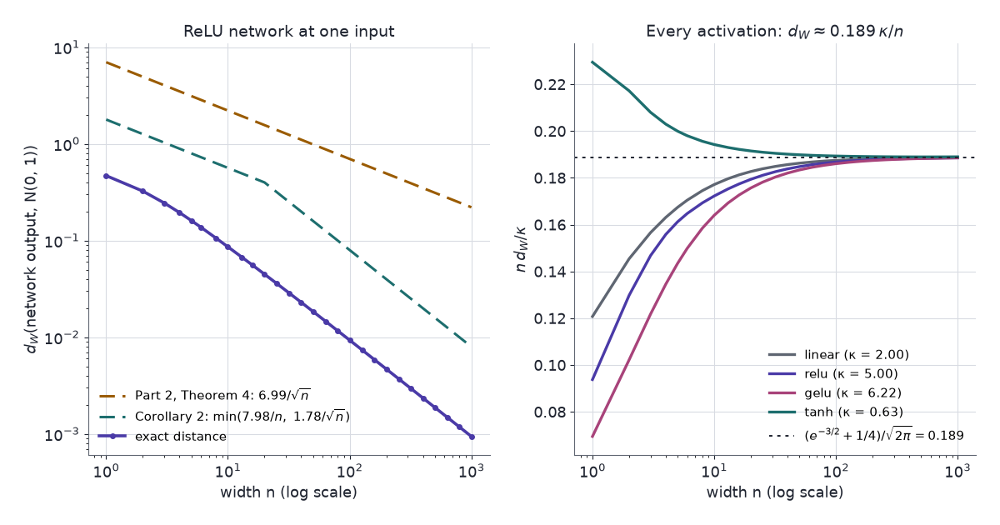

Stein's lemma puts numbers on two facts about neural networks that are usually stated without them: how far a random network of finite width is from its Gaussian-process limit, and which directions in the input a network's first gradient step can find.

Two statements about neural networks get quoted without a size attached. A randomly initialised network becomes a Gaussian process as its width grows, but nothing in that limit says whether 100 hidden units are close or far. Gradient descent learns features of the input, but nothing in that slogan says which features a single step can see. Both questions are about expectations of functions of Gaussian variables, which is the setting Part 1's identity was built for. A random network's output is a sum over hidden units, and Part 2 bounded how far a sum is from the normal. A network's gradient at initialisation is an average of the label times a function of a Gaussian input, and Part 1 turned such averages into averages of derivatives.

[Part 1](../steins-lemma/) proved Stein's identity and Gaussian integration by parts. [Part 2](../steins-method-normal-approximation/) turned it into a Wasserstein bound for sums. [Part 3](../kernel-stein-discrepancy-and-svgd/) and [Part 4](../stein-and-unnormalised-models/) used the Langevin operator for sampling and model fitting, and [Part 5](../steins-method-for-mcmc/) for Markov chains. [Part 7](../kernel-stein-discrepancy-as-a-regulariser/) puts the kernel Stein discrepancy into training losses.

An AI agent (Claude) drafted the text and the interactive charts. Separate review passes checked each derivation numerically and each reference against its source.

Two ideas carry the post:

1. **A random network is a Gaussian scale mixture.** With Gaussian output weights, the output at one input is exactly normal once the hidden layer is fixed, with a random variance $V$. Stein's lemma applied conditionally bounds the Wasserstein distance from $N(0,1)$ by a constant times $\operatorname{Var}(V)$, which is of order $1/n$ in the width $n$: an order better than Part 2's $n^{-1/2}$.
2. **Stein's lemma reads derivatives off data.** Under Gaussian inputs, $\mathbb{E}[y\,x]$ and $\mathbb{E}[y\,(xx^\top-I)]$ are the average gradient and average Hessian of the regression function. For a target that depends on one hidden direction, they point along it exactly when the link's first or second Hermite coefficient is nonzero, and a network's first gradient step from zero computes the first of them.

A closing section maps where the earlier parts' tools appear in machine learning.

## Notation

- $Z\sim N(0,1)$; $\varphi$ and $\Phi$ its density and distribution function.
- $\sigma$: an activation function; $c_\sigma=\mathbb{E}\,\sigma(Z)^2$.
- $\kappa_\sigma=\operatorname{Var}\big(\sigma(Z)^2\big)/c_\sigma^2$: the relative fluctuation of the squared activation.
- $n$: the width of a hidden layer. $d$: the input dimension.
- $d_W$: the Wasserstein-1 distance of Part 2. $d_W(W,Z)$ is the supremum of $\lvert\mathbb{E}h(W)-\mathbb{E}h(Z)\rvert$ over $h$ with $\lVert h'\rVert\le1$.
- $He_k$: the probabilists' Hermite polynomials, $He_1(t)=t$, $He_2(t)=t^2-1$, $He_3(t)=t^3-3t$, defined by $He_k(t)\varphi(t)=(-1)^k\varphi^{(k)}(t)$.
- $x\in\mathbb{R}^d$: an input; $y$: a label; $w$: a unit vector, the hidden direction.

## Wide random networks {#sec-wide}

Take a network with one hidden layer of width $n$, evaluated at a single input $x$ with $\lVert x\rVert^2=d$:

$$
f(x) = \frac{1}{\sqrt{n\,c_\sigma}}\sum_{i=1}^n v_i\,\sigma\big(w_i^\top x\big),
\qquad w_i\sim N(0,I_d/d),\quad v_i\sim N(0,1),
$$

all independent. Then $g_i=w_i^\top x\sim N(0,1)$, and the scaling gives $\operatorname{Var}f(x)=1$. Neal (1996) showed that as $n\to\infty$ the network converges to a Gaussian process, by the central limit theorem over hidden units. The question is how far it is at finite $n$.

### Part 2's bound

The terms $X_i=v_i\sigma(g_i)/\sqrt{c_\sigma}$ are independent with mean 0 and variance 1, so Part 2's Theorem 4 applies to $W=f(x)$:

$$
d_W(W,Z)\le\frac{C_\sigma}{\sqrt n},\qquad C_\sigma=\mathbb{E}\lvert X\rvert^3+\sqrt{2/\pi}\,\sqrt{\mathbb{E}X^4}.
$$

For ReLU, $c_\sigma=\frac12$, $\mathbb{E}\,\mathrm{ReLU}(Z)^3=\sqrt{2/\pi}$ and $\mathbb{E}\,\mathrm{ReLU}(Z)^4=\frac32$, so $\mathbb{E}\lvert X\rvert^3=8\sqrt2/\pi$, $\mathbb{E}X^4=18$ and $C_\sigma=6.99$. At $n=100$ the bound is 0.699. The exact distance is 0.00934.

### Conditional Gaussianity

The bound ignores structure. Fix the hidden layer, $g=(g_1,\dots,g_n)$. The output is then a linear combination of independent normals $v_i$, so it is exactly normal:

$$
W\mid g\ \sim\ N(0,V),\qquad V=\frac1n\sum_{i=1}^n\frac{\sigma(g_i)^2}{c_\sigma}.
$$

So $W=\sqrt V\,Z$ with $Z$ independent of $V$: a **Gaussian scale mixture**. All of $W$'s distance from the normal comes from $V$ not being exactly 1.

::: {.callout-important title="Proposition 1 — Gaussian scale mixtures"}
Let $V\ge0$ with $\mathbb{E}V^2<\infty$, let $Z\sim N(0,1)$ be independent of $V$, and let $W=\sqrt V\,Z$. Then

$$
d_W(W,Z)\le\sqrt{2/\pi}\,\mathbb{E}\lvert1-V\rvert
\qquad\text{and}\qquad
d_W(W,Z)\le\sqrt{2/\pi}\,\Big(\lvert1-\mathbb{E}V\rvert+2\,\mathbb{E}(1-V)^2\Big).
$$ {#eq-mixture-bound}
:::

**Proof.**

1. **Stein's equation.** $\mathbb{E}\lvert W\rvert<\infty$, so by Part 2's Corollary 2 and Lemma 3, $d_W(W,Z)$ is at most the supremum of $\lvert\mathbb{E}[f'(W)-Wf(W)]\rvert$ over $f$ with $\lVert f'\rVert\le\sqrt{2/\pi}$ and $\lVert f''\rVert\le2$.
2. **Integrate by parts given $V$.** Given $V$, $W\sim N(0,V)$, and Part 1's Proposition 3 with $\Sigma=V$ (trivially when $V=0$) gives $\mathbb{E}[Wf(W)\mid V]=V\,\mathbb{E}[f'(W)\mid V]$. So

   $$
   \mathbb{E}[f'(W)-Wf(W)]=\mathbb{E}\big[(1-V)\,f'(\sqrt V\,Z)\big].
   $$

3. **First bound.** $\lvert f'\rvert\le\sqrt{2/\pi}$ gives $\sqrt{2/\pi}\,\mathbb{E}\lvert1-V\rvert$.
4. **Second bound.** Split

   $$
   \mathbb{E}\big[(1-V)f'(\sqrt VZ)\big]=\mathbb{E}(1-V)\,\mathbb{E}f'(Z)+\mathbb{E}\Big[(1-V)\big(f'(\sqrt VZ)-f'(Z)\big)\Big],
   $$

   using independence in the first term, which is at most $\sqrt{2/\pi}\,\lvert1-\mathbb{E}V\rvert$. In the second, $\lVert f''\rVert\le2$ gives $\lvert f'(\sqrt VZ)-f'(Z)\rvert\le2\lvert Z\rvert\,\lvert\sqrt V-1\rvert$, and $\lvert\sqrt V-1\rvert\le\lvert V-1\rvert$ because $\sqrt V+1\ge1$. Independence again bounds it by $2\,\mathbb{E}\lvert Z\rvert\,\mathbb{E}(1-V)^2$, which is $2\sqrt{2/\pi}\,\mathbb{E}(1-V)^2$. $\blacksquare$

The second bound is quadratic in $1-V$ when $\mathbb{E}V=1$. That is the gain: the first-order term cancels because the mixture has the right variance on average.

::: {.callout-important title="Corollary 2 — one hidden layer"}
For the network at one input, $\mathbb{E}V=1$ and $\operatorname{Var}V=\kappa_\sigma/n$, so

$$
d_W\big(f(x),Z\big)\le\min\Big(\frac{2\sqrt{2/\pi}\,\kappa_\sigma}{n},\ \sqrt{2/\pi}\,\sqrt{\frac{\kappa_\sigma}{n}}\Big).
$$ {#eq-width-bound}
:::

**Proof.** $V$ is an average of $n$ independent copies of $\sigma(Z)^2/c_\sigma$, which has mean 1 and variance $\kappa_\sigma$. Insert into @eq-mixture-bound, using $\mathbb{E}\lvert1-V\rvert\le\sqrt{\operatorname{Var}V}$ for the first form. $\blacksquare$

| activation | $c_\sigma$ | $\kappa_\sigma$ | Theorem 4 constant | @eq-width-bound, $1/n$ constant |
|---|---|---|---|---|
| linear | 1 | 2 | 4.94 | 3.19 |
| ReLU | 0.5 | 5 | 6.99 | 7.98 |
| GELU | 0.425 | 6.22 | 7.61 | 9.92 |
| tanh | 0.394 | 0.627 | 3.75 | 1.00 |
| sign | 1 | 0 | 2.98 | 0 |

Smallest instances:

- **Sign.** $\sigma(Z)^2=1$, so $V=1$ and the output is exactly $N(0,1)$ at every width. Part 2's bound still reads $2.98/\sqrt n$.
- **Linear.** $V=\chi^2_n/n$. At $n=1$ the output is a product of two independent normals, at distance 0.241 from $N(0,1)$.

### Rate and constant

The order cannot improve. The test function $h(w)=\lvert w\rvert$ gives $d_W\ge\sqrt{2/\pi}\,(1-\mathbb{E}\sqrt V)$, and $1-\mathbb{E}\sqrt V\approx\operatorname{Var}(V)/8=\kappa_\sigma/(8n)$, of order $1/n$.

The constant can be found too. Expanding $F_W(w)=\mathbb{E}\,\Phi(w/\sqrt V)$ to second order in $V-1$:

$$
F_W(w)-\Phi(w)\approx\frac{\operatorname{Var}V}{8}\,w(3-w^2)\,\varphi(w)
\quad\Longrightarrow\quad
n\,d_W\to\frac{\kappa_\sigma}{8}\,\mathbb{E}\lvert He_3(Z)\rvert=\frac{e^{-3/2}+\tfrac14}{\sqrt{2\pi}}\,\kappa_\sigma=0.189\,\kappa_\sigma.
$$

The first-order term vanishes because $\mathbb{E}V=1$, and $\int\lvert w^3-3w\rvert\varphi(w)\,dw=8\varphi(\sqrt3)+2\varphi(0)$ gives the closed form. @eq-width-bound's constant $2\sqrt{2/\pi}=1.60$ is 8.5 times the true $0.189$: Proposition 1 gets the order and the dependence on $\kappa_\sigma$ right, and loses a constant factor in the Taylor step.

### Deeper networks

Given the last hidden layer, a deep network's output is again exactly $N(0,V)$, so Proposition 1 applies unchanged. What changes is $V$: its terms share the earlier layers, so they are dependent, and $\mathbb{E}V$ equals the limiting variance only up to $O(1/n)$. Favaro, Hanin, Marinucci, Nourdin & Peccati (2025) prove that one output of a network of any fixed depth, with Gaussian weights and biases, is within $C/n$ of a Gaussian in both Wasserstein and total-variation distance, with lower bounds of the same order against a Gaussian of the same variance. Their key step is Proposition 1's: Gaussian integration by parts given the previous layer. Balasubramanian, Goldstein, Ross & Salim (2024) use Stein's method for the whole random field on the input sphere, at a slower rate in width.

### Random networks of five activations {#sec-chart-width}

The networks are simulated from their initialisation distribution, not trained: the chart samples 4,000 independent networks of the chosen width and evaluates each at one input. Nothing else is involved. A wrong answer here would be treating a finite network as a Gaussian process, for a prior or a kernel, at a width where it is not one.

The chart shows a histogram of the 4,000 outputs with the exact density, and the exact distance from $N(0,1)$ against width with both bounds. The exact laws come from the representation $W=\sqrt VZ$: $nV$ is $\chi^2_n$ for the linear network, a binomial mixture of $\chi^2$ laws for ReLU, and a numerical convolution for GELU and tanh.

::: {#widget-width}
:::

Things to try:

1. **Defaults** (ReLU, $n=10$). The histogram is too peaked, with heavier tails than $N(0,1)$. The exact distance is 0.0861, Part 2's bound 2.21 and @eq-width-bound's 0.564.
2. **Width.** Drag $n$ to 1000. The exact distance is 0.000943, so $n\,d_W=0.943$, against the limit $0.189\times5=0.944$. Part 2's bound is 0.221, 234 times too large, and @eq-width-bound's is 0.00798, 8.5 times. From $n\approx20$ on, the exact curve falls a factor of ten per decade of width, parallel to @eq-width-bound and steeper than Theorem 4.
3. **One unit.** Set $n=1$. Half of ReLU's units are inactive at any input, so with one unit the output is exactly 0 with probability 0.5, an atom the chart draws as a spike. At $n=2$ the atom has mass 0.25, at $n=5$ 0.031.
4. **tanh.** Its $\kappa_\sigma$ is 0.627, eight times smaller than ReLU's. At $n=10$ the distance is 0.0122, against 0.0861 for ReLU. A bounded activation fluctuates less in square.
5. **sign.** The distance is 0 at every width, because $V=1$. Part 2's bound still reads 0.942 at $n=10$: it sees only the moments of each term, not the conditional Gaussianity.
6. **GELU.** $\kappa_\sigma=6.22$, the largest of the five, and at $n=10$ the distance is 0.102.

{#fig-width fig-alt="Left: on log-log axes, the exact distance falls as a straight line of slope minus one from about 0.47 at width one to about 0.001 at width one thousand; Theorem 4's bound is a shallower line from 7 to 0.22, and Corollary 2's bound bends from slope minus one half to slope minus one at width twenty and ends near 0.008. Right: four curves of n times distance over kappa, starting between 0.07 and 0.23 at width one and all flattening onto a dotted line at 0.189 by width one hundred."}

### Kernels of the limit

The infinite-width limit is a Gaussian process, fixed by its covariance between two inputs. Take $x,x'$ with $\lVert x\rVert^2=\lVert x'\rVert^2=d$ and $x^\top x'/d=\rho$. Then $(g,g')=(w^\top x,w^\top x')$ is standard bivariate normal with correlation $\rho$, and the limit has covariance

$$
K(\rho)=\frac{\mathbb{E}\big[\sigma(g)\,\sigma(g')\big]}{c_\sigma}.
$$

Part 1's Price theorem, $\partial_{\Sigma_{12}}\mathbb{E}\,G(X)=\mathbb{E}\,\partial_1\partial_2G(X)$, applied to $G(g,g')=\sigma(g)\sigma(g')$, differentiates it:

$$
K'(\rho)=\frac{\mathbb{E}\big[\sigma'(g)\,\sigma'(g')\big]}{c_\sigma}.
$$

That derivative kernel is the one in the neural tangent kernel (Jacot, Gabriel & Hongler 2018). Write $w_i=\tilde w_i/\sqrt d$ with $\tilde w_i\sim N(0,I_d)$, the parametrisation Jacot et al. use. The inner product of the output's gradients at $x$ and $x'$, with respect to all $v_i$ and $\tilde w_i$, converges to

$$
\Theta(\rho)=K(\rho)+\rho\,K'(\rho)=\frac{d}{d\rho}\big[\rho\,K(\rho)\big].
$$

The first term comes from the output weights and the second from the input weights, whose gradients carry $x$ and $x'$ and so contribute their inner product $x^\top x'/d=\rho$.

Smallest instance: ReLU. With $\theta=\arccos\rho$,

$$
K(\rho)=\frac{\sin\theta+(\pi-\theta)\cos\theta}{\pi},
\qquad
K'(\rho)=\frac{\pi-\theta}{\pi}=2\,P(g>0,\,g'>0),
$$

the arc-cosine kernels of degrees 1 and 0 of Cho & Saul (2009) for inputs of equal length. Part 1's version of Price's theorem needs bounded second derivatives, which covers the linear and tanh activations but not ReLU or GELU; for ReLU, differentiating the closed form confirms $K'$ directly. At $\rho=0$, $K=1/\pi$ and $K'=\frac12$.

## Hidden directions {#sec-directions}

A linear probe, or logistic regression, fits a linear model to data that are not linear, and the fitted coefficients often still point the right way. Stein's lemma says when and why.

::: {.callout-important title="Proposition 3 — average derivatives"}
Let $x$ have a positive, continuously differentiable density $p$ on $\mathbb{R}^d$ with score $s_p$, and let $\mathbb{E}[y\mid x]=g(x)$ for a continuously differentiable $g$. Assume $\mathbb{E}\lvert g(x)\rvert$, $\mathbb{E}\lVert\nabla g(x)\rVert$ and $\mathbb{E}\big[\lvert y\rvert\,\lVert s_p(x)\rVert\big]$ are finite. Then

$$
\mathbb{E}\big[\nabla g(x)\big]=-\,\mathbb{E}\big[y\,s_p(x)\big].
$$ {#eq-average-derivative}

For $x\sim N(0,I_d)$, $s_p(x)=-x$, so $\mathbb{E}[\nabla g(x)]=\mathbb{E}[y\,x]$.
:::

**Proof.** By the tower property, $\mathbb{E}[y\,s_p(x)]=\mathbb{E}[g(x)\,s_p(x)]$. For each coordinate $j$, the field $f=g\,e_j$ satisfies the conditions of Part 3's Proposition 1, which gives $\mathbb{E}[\partial_jg+s_{p,j}\,g]=0$. $\blacksquare$

The left side is a property of the unknown regression function; the right side is an average over data. When the input density is unknown, $s_p$ has to be estimated first.

### Single-index models

Suppose $g$ depends on $x$ through one direction only: $g(x)=\ell(w^\top x)$ with $\lVert w\rVert=1$, a **single-index model**. With Gaussian inputs, @eq-average-derivative and one more application of Stein's lemma give the first two moments:

$$
\mathbb{E}[y\,x]=c_1\,w,
\qquad
\mathbb{E}\big[y\,(xx^\top-I)\big]=c_2\,ww^\top,
\qquad
c_k=\mathbb{E}\big[\ell^{(k)}(Z)\big].
$$ {#eq-single-index}

- **First moment.** $\nabla g(x)=\ell'(w^\top x)\,w$, and $w^\top x\sim N(0,1)$.
- **Second moment.** Apply Stein's lemma to $x_j\,g(x)$ in coordinate $i$: $\mathbb{E}[x_ix_jg]=\delta_{ij}\,\mathbb{E}g+\mathbb{E}[\partial_i\partial_jg]$, and $\nabla^2g=\ell''(w^\top x)\,ww^\top$.
- **Least squares.** With $\mathbb{E}[xx^\top]=I$, ordinary least squares converges to $\mathbb{E}[y\,x]=c_1w$. It recovers the direction of a model it does not fit, up to the scale $c_1$ (Brillinger 1983). Li & Duan (1989) extend this beyond Gaussian inputs.
- **Principal Hessian directions.** The eigenvectors of $\mathbb{E}[y\,(xx^\top-I)]$ estimate the directions of the average Hessian (Li 1992, subtitled "another application of Stein's lemma").

Iterating the lemma $k$ times, with $He_k\varphi=(-1)^k\varphi^{(k)}$, gives $\mathbb{E}[\ell(Z)\,He_k(Z)]=\mathbb{E}[\ell^{(k)}(Z)]=c_k$: the coefficient of $He_k$ in the link's Hermite expansion is $c_k/k!$. For a link with a kink, such as ReLU or $\lvert t\rvert$, read $c_k$ as $\mathbb{E}[\ell(Z)\,He_k(Z)]$, since $\ell''$ is then a point mass. The first $k$ with $c_k\ne0$ is the link's **information exponent** (Ben Arous, Gheissari & Jagannath 2021). For links standardised to mean 0 and variance 1:

| link $\ell(t)$ | $c_1$ | $c_2$ | $c_3$ | information exponent |
|---|---|---|---|---|
| $t$ | 1 | 0 | 0 | 1 |
| $\tanh t$ | 0.965 | 0 | −0.579 | 1 |
| ReLU | 0.856 | 0.683 | 0 | 1 |
| $\lvert t\rvert$ | 0 | 1.324 | 0 | 2 |
| $t^2-1$ | 0 | 1.414 | 0 | 2 |
| $t^3-3t$ | 0 | 0 | 2.449 | 3 |

Smallest instance: $\ell(t)=t^2$, phase retrieval. $c_1=\mathbb{E}[2Z]=0$, so $\mathbb{E}[yx]=0$ and least squares learns nothing; $c_2=2$, so $\mathbb{E}[y(xx^\top-I)]=2ww^\top$ and its top eigenvector is $\pm w$.

- **Odd links** have $c_2=0$ and **even links** $c_1=0$, so each moment estimator is blind to one family.
- **Information exponent 3**, as for $t^3-3t$, defeats both: the first nonzero moment is a third-order tensor, $\mathbb{E}[y\,He_3(x)]=c_3\,w^{\otimes3}$ in the multivariate Hermite basis. Ben Arous et al. (2021) show that online SGD from a random start then needs a number of samples growing like $d^{k-1}$, up to logarithmic factors, for information exponent $k\ge3$, against $d$ for $k=1$.

### One gradient step

Train $F(x)=\sum_{j=1}^ma_j\,\sigma(u_j^\top x)$ on squared loss, with the first-layer weights $u_j$ started at zero. At $u_j=0$, $F$ is the constant $\sigma(0)\sum_ja_j$, so $\mathbb{E}[F(x)\,x]=0$, and the gradient of $\frac12\mathbb{E}(y-F(x))^2$ in $u_j$ is

$$
-a_j\,\sigma'(0)\,\mathbb{E}\big[(y-F(x))\,x\big]=-a_j\,\sigma'(0)\,\mathbb{E}[y\,x]=-a_j\,\sigma'(0)\,c_1\,w.
$$

One step of gradient descent moves every hidden unit along $\pm w$. With $n$ samples it moves them along $\frac1n\sum_iy_ix_i$, the first-order Stein estimate. When $c_1=0$ the step moves the units along noise, and the direction can only enter through higher-order terms: from a small random start $u_j$, the next term of $\sigma'(u_j^\top x)$ brings in $\sigma''(0)\,\mathbb{E}[y\,xx^\top]\,u_j$, the second moment of @eq-single-index acting on $u_j$ (for centred $y$). Ba et al. (2022) show that one gradient step from a random start adds a rank-one spike along the target direction to the first-layer weights, with a size set by the linear (first Hermite) components of the target and the activation. Damian, Lee & Soltanolkotabi (2022) remove the linear part of $y$ first; their first step is then driven by the second-order term and recovers the subspace the target depends on.

### Two estimators on synthetic data {#sec-chart-direction}

The data are synthetic. Inputs are $x\sim N(0,I_d)$, the hidden direction is a fixed unit vector $w$, and $y$ is the link $\ell(w^\top x)$, standardised to mean 0 and variance 1, plus $N(0,\sigma^2)$ noise. The setting stands in for a regression whose target depends on one unknown combination of many features, the simplest case of feature learning. A wrong answer is a probe that reports no linear signal in a feature that the target depends on.

The chart shows the link's Hermite coefficients and, against sample size, the overlap $\lvert\cos\rvert$ between $w$ and two estimates: the first-order $\frac1n\sum_iy_ix_i$, and the top eigenvector (largest absolute eigenvalue) of $\frac1n\sum_iy_i(x_ix_i^\top-I)$. Lines are means over six data sets and bands their range.

::: {#widget-direction}
:::

```{=html}
<script src="widget-data/data.js"></script>
<script src="model.js"></script>
<script src="widgets.js"></script>
```

Things to try:

1. **Defaults** (ReLU, $d=20$, $\sigma=0.5$, $n=400$). Both coefficients are nonzero, and both estimates find $w$: overlaps 0.96 and 0.88. Over 30 data sets the first-order estimate passes 0.9 at $n=200$ and the second-order one at $n=800$.
2. **tanh.** $c_2=0$. The first-order overlap reaches 0.99 by $n=1600$. The second-order one stays between 0.27 and 0.37 at every $n$ from 25 to 12,800, averaged over 30 data sets; in the chart it wanders between about 0.24 and 0.43 and never rises. Its population matrix is zero, so it estimates noise.
3. **$\lvert t\rvert$ or $t^2-1$.** Now $c_1=0$. The roles swap: the second-order overlap reaches 0.98 to 0.99 by $n=1600$, and the first-order one, averaged over 30 data sets, stays between 0.20 and 0.33 at every $n$ (the chart's six data sets dip to 0.16).
4. **Dimension.** For ReLU, averaged over 30 data sets, the $n$ at which the first-order overlap passes 0.9 is 100, 200 and 400 at $d=10$, 20 and 40, and for the second-order estimate 400, 800 and 1600. Both scale linearly in $d$, with the second order needing four times as many samples.
5. **Noise.** Over the slider's range, label noise adds no more error than the randomness of $x$ itself; at $\sigma=1$ the two contribute equally. For ReLU at $d=20$ and $n=100$, averaged over 30 data sets, the first-order overlap is 0.90 at $\sigma=0$ and 0.82 at $\sigma=1$. The chart's first six data sets read 0.89 and 0.85.
6. **The floor.** A blind estimate need not sit at $1/\sqrt d$, the dashed line, which is the root-mean-square overlap of a uniformly random direction. For the linear link at $d=20$ the second-order overlap, averaged over 30 data sets, levels off between 0.46 and 0.55 from $n=100$ on (the chart reads 0.44 to 0.56), against $1/\sqrt{20}=0.22$. Its noise is not isotropic: with $y=w^\top x$ and $\sigma=0$, the off-diagonal entries in the row and column of $w$ are $\sqrt3$ times noisier than the rest, and the diagonal entry at $w$ is $\sqrt5$ times noisier than the other diagonal entries, so even a zero-mean estimate leans toward $w$. It never approaches 1.

## The series in machine learning {#sec-map}

Each tool in the series has an established use in machine learning. Each row names the part that derives the tool and cites a paper that introduced or analysed the use; the two rows about this part point to its sections.

| Part | Tool | Use in machine learning |
|---|---|---|
| 1 | Gaussian integration by parts | The gradient of a Gaussian-smoothed objective is an average of function values, $\nabla_\theta\mathbb{E}\,F(\theta+\nu\varepsilon)=\nu^{-1}\mathbb{E}[F(\theta+\nu\varepsilon)\,\varepsilon]$ for $\varepsilon\sim N(0,I)$: the evolution-strategies estimator used to train neural-network policies without backpropagation (Salimans et al. 2017). Part 4 gave the score-function and reparameterisation version for policy gradients. |
| 1, 4 | SURE | Training denoisers without clean data (Soltanayev & Chun 2018, in Part 4). Its Bayesian counterpart, Tweedie's formula $\mathbb{E}[\mu\mid y]=y+\sigma^2\frac{d}{dy}\log f(y)$ for $y\sim N(\mu,\sigma^2)$ with marginal density $f$, links denoising to the score (Efron 2011). |
| 2, 6 | Normal approximation | Width corrections to the Gaussian-process limit of random networks (@sec-wide). |
| 3 | Kernel Stein discrepancy | Goodness-of-fit tests against an unnormalised model (Liu, Lee & Jordan 2016; Chwialkowski, Strathmann & Gretton 2016) and sample-quality checks; the anti-collapse regulariser of [Nuisance Leakage in JEPA Embeddings](../stein-jepa-nuisance-leakage/), and a training regulariser in general ([Part 7](../kernel-stein-discrepancy-as-a-regulariser/)). |
| 3 | SVGD | Posterior inference for Bayesian neural networks (Liu & Wang 2016), policy exploration (Liu et al. 2017), and ensembles with a kernel repulsion between members (D'Angelo & Fortuin 2021). |
| 4 | Score matching | Denoising score matching (Vincent 2011), the training objective of score-based diffusion models (Song & Ermon 2019). |
| 5 | Poisson equation | The bias and fluctuations of stochastic-gradient Langevin dynamics (Teh, Thiery & Vollmer 2016), and zero-variance control variates for posterior expectations (Mira, Solgi & Imparato 2013). <!-- codespell:ignore teh --> |
| 6 | Hermite coefficients | Which directions gradient descent can learn, and how many samples it needs (@sec-directions). |

## Constraints

- **One input, one hidden layer.** Corollary 2 is for one output at one input of a one-hidden-layer network. Two inputs need a multivariate normal approximation, and deeper networks need control of the dependent terms in $V$, which the cited papers supply.
- **Gaussian output weights.** With Rademacher output weights the output is not a Gaussian scale mixture, and Proposition 1 does not apply. Part 2's Theorem 4 still does.
- **Constants.** @eq-width-bound is 8.5 times the true large-width distance for every activation. The rate and the dependence on $\kappa_\sigma$ are right; the factor is lost in the Taylor step of Proposition 1.
- **Gaussian inputs.** @eq-single-index needs Gaussian $x$. Other input laws need the score $s_p$ in @eq-average-derivative, which has to be known or estimated, for example by Part 4's score matching.
- **Blind spots.** Moment estimators of order 1 and 2 cannot see a link of information exponent 3 or more, and their noise floors need not sit at $1/\sqrt d$ (item 6).
- **One step.** @sec-directions describes the first gradient step, not training. Later steps change the network's output, so $\mathbb{E}[F(x)\,x]$ no longer vanishes.

Widths. Set. Gaussianity. Hermite. Coefficients. Set. Directions. Stein. Measures. Both.

## References

- Ba, J., Erdogdu, M. A., Suzuki, T., Wang, Z., Wu, D. & Yang, G. (2022). [High-dimensional asymptotics of feature learning: how one gradient step improves the representation](https://proceedings.neurips.cc/paper_files/paper/2022/hash/f7e7fabd73b3df96c54a320862afcb78-Abstract-Conference.html). *Advances in Neural Information Processing Systems* 35, 37932–37946.
- Balasubramanian, K., Goldstein, L., Ross, N. & Salim, A. (2024). [Gaussian random field approximation via Stein's method with applications to wide random neural networks](https://doi.org/10.1016/j.acha.2024.101668). *Applied and Computational Harmonic Analysis* 72, 101668.
- Ben Arous, G., Gheissari, R. & Jagannath, A. (2021). [Online stochastic gradient descent on non-convex losses from high-dimensional inference](https://jmlr.org/papers/v22/20-1288.html). *Journal of Machine Learning Research* 22(106), 1–51.
- Brillinger, D. R. (1983). A generalized linear model with "Gaussian" regressor variables. In P. J. Bickel, K. A. Doksum & J. L. Hodges (eds.), *A Festschrift for Erich L. Lehmann*, 97–114. Wadsworth. Reprinted in [*Selected Works of David Brillinger*](https://doi.org/10.1007/978-1-4614-1344-8_34), Springer (2012), 589–606.
- Cho, Y. & Saul, L. K. (2009). [Kernel methods for deep learning](https://proceedings.neurips.cc/paper/2009/hash/5751ec3e9a4feab575962e78e006250d-Abstract.html). *Advances in Neural Information Processing Systems* 22.
- Chwialkowski, K., Strathmann, H. & Gretton, A. (2016). [A kernel test of goodness of fit](https://proceedings.mlr.press/v48/chwialkowski16.html). *Proceedings of the 33rd International Conference on Machine Learning*, PMLR 48, 2606–2615.
- D'Angelo, F. & Fortuin, V. (2021). [Repulsive deep ensembles are Bayesian](https://proceedings.neurips.cc/paper/2021/hash/1c63926ebcabda26b5cdb31b5cc91efb-Abstract.html). *Advances in Neural Information Processing Systems* 34, 3451–3465.
- Damian, A., Lee, J. D. & Soltanolkotabi, M. (2022). [Neural networks can learn representations with gradient descent](https://proceedings.mlr.press/v178/damian22a.html). *Proceedings of the 35th Conference on Learning Theory*, PMLR 178, 5413–5452.
- Efron, B. (2011). [Tweedie's formula and selection bias](https://doi.org/10.1198/jasa.2011.tm11181). *Journal of the American Statistical Association* 106(496), 1602–1614.
- Favaro, S., Hanin, B., Marinucci, D., Nourdin, I. & Peccati, G. (2025). [Quantitative CLTs in deep neural networks](https://doi.org/10.1007/s00440-025-01360-1). *Probability Theory and Related Fields* 191(3–4), 933–977.
- Jacot, A., Gabriel, F. & Hongler, C. (2018). [Neural tangent kernel: convergence and generalization in neural networks](https://proceedings.neurips.cc/paper/2018/hash/5a4be1fa34e62bb8a6ec6b91d2462f5a-Abstract.html). *Advances in Neural Information Processing Systems* 31.
- Li, K.-C. (1992). [On principal Hessian directions for data visualization and dimension reduction: another application of Stein's lemma](https://doi.org/10.1080/01621459.1992.10476258). *Journal of the American Statistical Association* 87(420), 1025–1039.
- Li, K.-C. & Duan, N. (1989). [Regression analysis under link violation](https://doi.org/10.1214/aos/1176347254). *Annals of Statistics* 17(3), 1009–1052.
- Liu, Q., Lee, J. & Jordan, M. (2016). [A kernelized Stein discrepancy for goodness-of-fit tests](https://proceedings.mlr.press/v48/liub16.html). *Proceedings of the 33rd International Conference on Machine Learning*, PMLR 48, 276–284.
- Liu, Q. & Wang, D. (2016). [Stein variational gradient descent: a general purpose Bayesian inference algorithm](https://proceedings.neurips.cc/paper/2016/hash/b3ba8f1bee1238a2f37603d90b58898d-Abstract.html). *Advances in Neural Information Processing Systems* 29.
- Liu, Y., Ramachandran, P., Liu, Q. & Peng, J. (2017). [Stein variational policy gradient](http://auai.org/uai2017/proceedings/papers/239.pdf). *Proceedings of the 33rd Conference on Uncertainty in Artificial Intelligence*.
- Mira, A., Solgi, R. & Imparato, D. (2013). [Zero variance Markov chain Monte Carlo for Bayesian estimators](https://doi.org/10.1007/s11222-012-9344-6). *Statistics and Computing* 23(5), 653–662.
- Neal, R. M. (1996). [Bayesian Learning for Neural Networks](https://doi.org/10.1007/978-1-4612-0745-0). *Lecture Notes in Statistics* 118. Springer, New York.
- Salimans, T., Ho, J., Chen, X., Sidor, S. & Sutskever, I. (2017). [Evolution strategies as a scalable alternative to reinforcement learning](https://arxiv.org/abs/1703.03864). arXiv:1703.03864.
- Soltanayev, S. & Chun, S. Y. (2018). [Training deep learning based denoisers without ground truth data](https://proceedings.neurips.cc/paper/2018/hash/c0560792e4a3c79e62f76cbf9fb277dd-Abstract.html). *Advances in Neural Information Processing Systems* 31.
- Song, Y. & Ermon, S. (2019). [Generative modeling by estimating gradients of the data distribution](https://proceedings.neurips.cc/paper/2019/hash/3001ef257407d5a371a96dcd947c7d93-Abstract.html). *Advances in Neural Information Processing Systems* 32.
- Teh, Y. W., Thiery, A. H. & Vollmer, S. J. (2016). [Consistency and fluctuations for stochastic gradient Langevin dynamics](https://jmlr.org/papers/v17/teh16a.html). *Journal of Machine Learning Research* 17(7), 1–33. <!-- codespell:ignore teh -->
- Vincent, P. (2011). [A connection between score matching and denoising autoencoders](https://doi.org/10.1162/NECO_a_00142). *Neural Computation* 23(7), 1661–1674.
- [Stein's Method, Part 1: Stein's Lemma](../steins-lemma/) — the identity, Gaussian integration by parts and Price's theorem.
- [Stein's Method, Part 2: Normal Approximation](../steins-method-normal-approximation/) — the Stein equation, bounds on its solution, and the Wasserstein bound for sums.
- [Stein's Method, Part 3: Kernel Stein Discrepancy and SVGD](../kernel-stein-discrepancy-and-svgd/) — the Langevin identity in $d$ dimensions, KSD and SVGD.
- [Stein's Method, Part 4: Models Without Normalising Constants](../stein-and-unnormalised-models/) — score matching, SURE losses and Stein control variates for policy gradients.
- [Stein's Method, Part 5: Markov Chain Monte Carlo](../steins-method-for-mcmc/) — the Poisson equation, the bias of unadjusted Langevin and zero-variance control variates.
- [Stein's Method, Part 7: Kernel Stein Discrepancy as a Regulariser](../kernel-stein-discrepancy-as-a-regulariser/) — KSD as a training loss, what its kernel lets it see, and a VAE and a JEPA on CIFAR-10.
- [Nuisance Leakage in JEPA Embeddings Is Set by Regulariser Strength and Width](../stein-jepa-nuisance-leakage/) — KSD as an anti-collapse regulariser.
