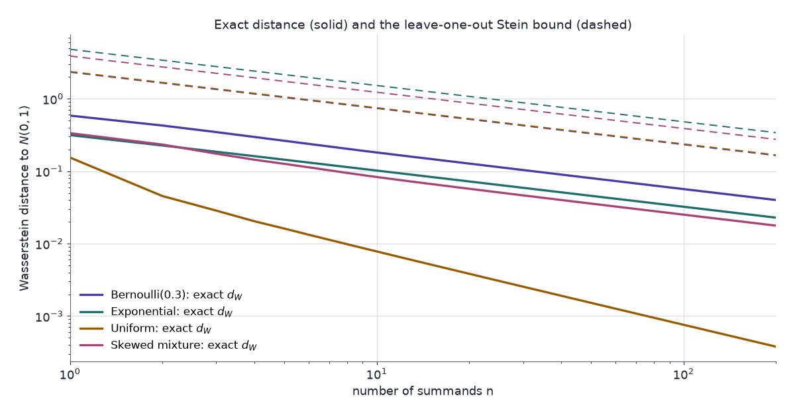

Stein's method bounds the distance between a random variable's law and the normal by solving one differential equation per test function. For a normalised sum of $n$ independent terms it gives a Wasserstein distance of order $n^{-1/2}$, with explicit constants.

Normal approximations are usually justified by the central limit theorem and a rule of thumb such as $n\ge30$. The theorem is a limit statement: it says the error goes to zero, not how large it is at the $n$ in hand. Thirty summands are plenty for a uniform, whose standardised sum is then $0.0025$ from the normal in Wasserstein distance. They are nowhere near enough for a Bernoulli with $p=0.05$, where the distance at $n=30$ is $0.255$. Berry–Esseen-type theorems give a rate. Stein's method proves one in a page, with constants that can be computed, and the same template extends to dependent terms and to other limit laws.

[Part 1](../steins-lemma/) showed that $\mathbb{E}[f'(W)-Wf(W)]=0$ over a rich class of $f$ characterises the standard normal, and that its proof writes $P(W\le z)-\Phi(z)$ as an expectation of that form. This part makes that equality quantitative. [Part 3](../kernel-stein-discrepancy-and-svgd/) makes the resulting discrepancy computable from samples, [Part 4](../stein-and-unnormalised-models/) uses it to fit models, [Part 5](../steins-method-for-mcmc/) runs the generator approach on MCMC samplers, and [Part 6](../steins-method-in-neural-networks/) applies Theorem 4 and its refinements to random neural networks.

An AI agent (Claude) drafted the text and the interactive chart. Separate review passes checked each derivation numerically and each reference against its source.

Three ideas carry the post:

1. **The Stein equation.** For a test function $h$, the solution $f_h$ of $f'(w)-wf(w)=h(w)-\mathbb{E}h(Z)$ converts the error $\mathbb{E}h(W)-\mathbb{E}h(Z)$ into $\mathbb{E}[f_h'(W)-Wf_h(W)]$, an expectation under $W$ alone.
2. **Bounds on the solution.** For Lipschitz $h$, $f_h$ and its first two derivatives are bounded by constant multiples of $\lVert h'\rVert$. A bound on $\mathbb{E}[f'(W)-Wf(W)]$ that holds uniformly over that small class of $f$ therefore bounds the Wasserstein distance.
3. **Leave one out.** For a sum of independent terms, removing one term at a time and expanding to second order gives that uniform bound. The third and fourth moments of the terms supply the constants.

## Notation

- $Z\sim N(0,1)$, with density $\varphi$ and distribution function $\Phi$.
- $W$: the random variable compared with $Z$. In @sec-sums, $W = n^{-1/2}\sum_{i=1}^nX_i$.
- $h$: a test function; $\mathcal{H}$: a class of test functions.
- $\lVert g\rVert=\sup_x\lvert g(x)\rvert$. For an absolutely continuous $h$, $h'$ is its derivative where it exists, and $\lVert h'\rVert$ is its Lipschitz constant.
- $f_h$: the solution of the Stein equation for $h$ (@sec-stein-equation).
- $\Psi(w) = w\Phi(w)+\varphi(w)$: the antiderivative of $\Phi$, with $\int_{-\infty}^w\Phi = \Psi(w)$ and $\int_w^\infty(1-\Phi) = \Psi(-w)$.
- $p$, $s_p$, $\mathcal{A}_p$: a target density, its score, and its Langevin Stein operator, as in Part 1. They appear only in @sec-discrepancy.

## Integral probability metrics {#sec-ipm}

A distance between laws can be defined by how differently they integrate a set of test functions.

::: {.callout-note title="Definition — integral probability metric"}
For a class $\mathcal{H}$ of functions $h:\mathbb{R}\to\mathbb{R}$,

$$
d_{\mathcal{H}}(W,Z) = \sup_{h\in\mathcal{H}}\big\lvert\mathbb{E}h(W)-\mathbb{E}h(Z)\big\rvert.
$$
:::

Two classes matter here:

- **Wasserstein**, $d_W$: $\mathcal{H}_W$ is the set of 1-Lipschitz functions, $\lvert h(x)-h(y)\rvert\le\lvert x-y\rvert$. On the line, $d_W(W,Z) = \int_{-\infty}^\infty\lvert F_W(x)-\Phi(x)\rvert\,dx$, the area between the two distribution functions. The chart in @sec-chart computes it that way.
- **Kolmogorov**, $d_K$: $\mathcal{H}_K$ is the set of indicators $\mathbb{1}_{(-\infty,z]}$, so $d_K(W,Z) = \sup_z\lvert P(W\le z)-\Phi(z)\rvert$. The classical Berry–Esseen theorem is stated in this metric.

Ross (2011, Proposition 1.2) shows $d_K(W,Z)\le\sqrt{2C\,d_W(W,Z)}$ whenever $Z$ has a density bounded by $C$. For the normal, $C=1/\sqrt{2\pi}$, so $d_K(W,Z)\le(2/\pi)^{1/4}\sqrt{d_W(W,Z)}$. A Wasserstein rate of $n^{-1/2}$ therefore gives a Kolmogorov rate of $n^{-1/4}$ with no further work. The sharper $n^{-1/2}$ in Kolmogorov distance needs the non-smooth solutions $f_z$ of Part 1 and more work (Chen, Goldstein & Shao 2011).

Smallest instance: a Rademacher variable, $W=\pm1$ with probability $\tfrac12$ each. Then $d_K(W,Z) = \Phi(1)-\tfrac12 = 0.341$ and $d_W(W,Z) = 0.535$.

## The Stein equation {#sec-stein-equation}

Part 1 needed one function $f_z$ per point $z$. The same move works for any test function $h$: find $f$ with

$$
f'(w) - wf(w) = h(w) - \mathbb{E}h(Z),
$$ {#eq-stein-equation}

evaluate it at $W$, and take expectations.

::: {.callout-important title="Proposition 1 — solution of the Stein equation"}
Let $h$ be measurable with $\mathbb{E}\lvert h(Z)\rvert<\infty$. Then

$$
\begin{aligned}
f_h(w) &= e^{w^2/2}\int_{-\infty}^{w}\big(h(x)-\mathbb{E}h(Z)\big)\,e^{-x^2/2}\,dx \\[6pt]
&=-e^{w^2/2}\int_{w}^{\infty}\big(h(x)-\mathbb{E}h(Z)\big)\,e^{-x^2/2}\,dx
\end{aligned}
$$ {#eq-stein-solution}

is absolutely continuous and satisfies @eq-stein-equation at every continuity point of $h$. It is the only solution with $e^{-w^2/2}f(w)\to0$ as $w\to\pm\infty$.
:::

**Proof.**

1. **Integrating factor.** For absolutely continuous $f$, $(d/dw)\big[e^{-w^2/2}f(w)\big] = e^{-w^2/2}\big(f'(w)-wf(w)\big)$. So @eq-stein-equation is equivalent to $(d/dw)\big[e^{-w^2/2}f(w)\big] =\big(h(w)-\mathbb{E}h(Z)\big)e^{-w^2/2}$.
2. **Integrate from $-\infty$.** The integrand is integrable on the whole line because $\mathbb{E}\lvert h(Z)\rvert<\infty$. So $e^{-w^2/2}f(w) = C+\int_{-\infty}^w\big(h(x)-\mathbb{E}h(Z)\big)e^{-x^2/2}\,dx$ for a constant $C$, and the derivative of the integral equals the integrand at every continuity point of $h$.
3. **Fix the constant.** As $w\to-\infty$ the integral tends to 0, so $e^{-w^2/2}f(w)\to C$. The condition at $-\infty$ forces $C=0$, which gives the first form.
4. **Second form.** $\int_{-\infty}^{\infty}\big(h(x)-\mathbb{E}h(Z)\big)e^{-x^2/2}\,dx = \sqrt{2\pi}\,\big(\mathbb{E}h(Z)-\mathbb{E}h(Z)\big)=0$, so $\int_{-\infty}^w=-\int_w^\infty$. In this form, $e^{-w^2/2}f_h(w)\to0$ as $w\to+\infty$.
5. **Uniqueness.** Two solutions differ by a solution of $f'=wf$, which is $Ce^{w^2/2}$. That violates the boundary condition unless $C=0$. $\blacksquare$

Evaluating @eq-stein-equation at $W$ and taking expectations, whenever they exist:

$$
\mathbb{E}h(W)-\mathbb{E}h(Z) = \mathbb{E}\big[f_h'(W)-Wf_h(W)\big].
$$ {#eq-stein-error}

The left side compares two laws. The right side involves $W$ alone.

::: {.callout-important title="Corollary 2 — from identity to distance"}
Let $\mathcal{F}$ be a class of functions that contains $f_h$ for every $h\in\mathcal{H}$, and suppose @eq-stein-error holds for each such $h$ (it does for every $h\in\mathcal{H}_W$ when $\mathbb{E}\lvert W\rvert<\infty$). Then

$$
d_{\mathcal{H}}(W,Z) \le \sup_{f\in\mathcal{F}}\big\lvert\mathbb{E}[f'(W)-Wf(W)]\big\rvert.
$$
:::

**Proof.** Take absolute values in @eq-stein-error, bound the right side by the supremum over $\mathcal{F}$, and take the supremum over $h\in\mathcal{H}$ on the left. $\blacksquare$

The work now splits in two:

- **Properties of the solution:** show that $f_h$ lies in a small class $\mathcal{F}$ (@sec-bounds).
- **Properties of $W$:** bound $\mathbb{E}[f'(W)-Wf(W)]$ uniformly over that class (@sec-sums).

Smallest instances:

- $h(w)=w$: $\mathbb{E}h(Z)=0$, and $f_h=-1$ solves $f'-wf=w$. @eq-stein-error reads $\mathbb{E}W = \mathbb{E}W$.
- $h(w)=w^2$: $\mathbb{E}h(Z)=1$, and $f_h(w)=-w$ solves $f'-wf = w^2-1$. @eq-stein-error reads $\mathbb{E}W^2-1 = \mathbb{E}[W^2-1]$.

Both are exact and empty. The method is needed when $h$ is a general Lipschitz function and only bounds on $f_h$ are available.

## Bounds on the solution {#sec-bounds}

::: {.callout-important title="Lemma 3 — bounds on the solution (Ross 2011, Lemma 2.5)"}
Let $h$ be absolutely continuous with $\lVert h'\rVert<\infty$. Then

$$
\begin{aligned}
\lVert f_h\rVert &\le 2\lVert h'\rVert, \\[4pt]
\lVert f_h'\rVert &\le \sqrt{2/\pi}\,\lVert h'\rVert, \\[4pt]
\lVert f_h''\rVert &\le 2\lVert h'\rVert.
\end{aligned}
$$
:::

The proofs below also show that $f_h'$ is absolutely continuous, so $f_h''$ exists almost everywhere. Theorem 4 uses the second and third bounds, and both are proved in full. The proof of the second gives $\lVert f_h\rVert\le\lVert h'\rVert$ along the way, which is sharper than the first. The $\lVert f_h'\rVert$ proof uses a representation of $f_h$ through Gaussian smoothing; the $\lVert f_h''\rVert$ proof uses an explicit formula.

### First derivative, by Gaussian smoothing

For $s\ge0$ write $a=e^{-s}$, $b=\sqrt{1-e^{-2s}}$ and

$$
(P_sh)(w) = \mathbb{E}\,h(aw+bZ).
$$

$P_0h=h$, and $P_sh(w)\to\mathbb{E}h(Z)$ as $s\to\infty$ by dominated convergence. $P_s$ is the transition operator of the Ornstein–Uhlenbeck process, whose stationary law is $N(0,1)$.

**Proof of $\lVert f_h\rVert\le\lVert h'\rVert$ and $\lVert f_h'\rVert\le\sqrt{2/\pi}\,\lVert h'\rVert$.**

1. **Derivatives in $w$.** Write $\mathbb{E}\,k(aw+bZ) = b^{-1}\int k(u)\,\varphi\big((u-aw)/b\big)\,du$ for bounded measurable $k$, and differentiate the Gaussian density:

   $$
   \frac{d}{dw}\,\mathbb{E}\,k(aw+bZ) = \frac{a}{b}\,\mathbb{E}\big[Z\,k(aw+bZ)\big].
   $$

   With $k=h$ (directly, using $h'$) and with $k=h'$:

   $$
   \begin{aligned}
   (P_sh)'(w) &= a\,\mathbb{E}\,h'(aw+bZ), \\[6pt]
   (P_sh)''(w) &= \frac{a^2}{b}\,\mathbb{E}\big[Z\,h'(aw+bZ)\big].
   \end{aligned}
   $$

2. **Derivative in $s$.** Using $da/ds=-a$ and $db/ds=a^2/b$,

   $$
   \begin{aligned}
   \partial_s(P_sh)(w) &= \mathbb{E}\Big[h'(aw+bZ)\Big(-aw+\frac{a^2}{b}Z\Big)\Big] \\[6pt]
   &= (P_sh)''(w) - w\,(P_sh)'(w).
   \end{aligned}
   $$

3. **Integrate in $s$.** Define $F(w) = -\int_0^\infty(P_sh)'(w)\,ds$. Then

   $$
   \begin{aligned}
   F'(w)-wF(w) &= -\int_0^\infty\Big[(P_sh)''(w)-w(P_sh)'(w)\Big]\,ds \\[6pt]
   &= -\int_0^\infty\partial_s(P_sh)(w)\,ds \\[6pt]
   &= h(w)-\mathbb{E}h(Z).
   \end{aligned}
   $$

   Differentiating under the integral is allowed because $\lvert(P_sh)''\rvert\le(a^2/b)\,\lVert h'\rVert\,\mathbb{E}\lvert Z\rvert$, which is integrable in $s$ (step 5).

4. **Identify $F$ with $f_h$.** $\lvert F(w)\rvert\le\lVert h'\rVert\int_0^\infty e^{-s}\,ds=\lVert h'\rVert$. So $F$ is bounded and satisfies the boundary condition of Proposition 1. By uniqueness, $F=f_h$ and $\lVert f_h\rVert\le\lVert h'\rVert$.

5. **Bound $f_h'$.** $f_h' = F' = -\int_0^\infty(P_sh)''\,ds$, and $\mathbb{E}\lvert Z\rvert=\sqrt{2/\pi}$, so

   $$
   \lvert f_h'(w)\rvert \le \sqrt{2/\pi}\,\lVert h'\rVert\int_0^\infty\frac{e^{-2s}}{\sqrt{1-e^{-2s}}}\,ds = \sqrt{2/\pi}\,\lVert h'\rVert.
   $$

   The substitution $v=e^{-2s}$ turns the integral into $\tfrac12\int_0^1(1-v)^{-1/2}\,dv=1$. $\blacksquare$

The smoothing route is an instance of the generator approach of Barbour (1988, 1990). The Ornstein–Uhlenbeck generator is $g''-wg'$, and the Stein equation is the generator equation $g''-wg'=h-\mathbb{E}h(Z)$ with $f=g'$.

The same route fails for $f_h''$. Differentiating once more puts $(a^3/b^2)\,\mathbb{E}[(Z^2-1)h'(\cdot)]$ under the integral, and $a^3/b^2\sim1/(2s)$ is not integrable at $s=0$. The second derivative needs the explicit formula.

### Second derivative, by the explicit formula

**Proof of $\lVert f_h''\rVert\le2\lVert h'\rVert$.**

1. **Write $h$ through $h'$.** By Fubini's theorem,

   $$
   \begin{aligned}
   h(x)-\mathbb{E}h(Z) &= \int\big(h(x)-h(t)\big)\varphi(t)\,dt \\[6pt]
   &= \underbrace{\int_{-\infty}^xh'(t)\Phi(t)\,dt}_{A(x)} - \underbrace{\int_x^\infty h'(t)\big(1-\Phi(t)\big)\,dt}_{B(x)}.
   \end{aligned}
   $$

   $A$ and $B$ are absolutely continuous, with $A'=h'\Phi$ and $B'=-h'(1-\Phi)$.

2. **A closed form for $f_h$.** Let $R=\Phi/\varphi$ and $Q=(1-\Phi)/\varphi$, so $Q(w)=R(-w)$, $R'=wR+1$, $Q'=wQ-1$ and $Q\Phi=R(1-\Phi)$. Set $f = -QA-RB$. Differentiating, the $h'$ terms cancel because $Q\Phi = R(1-\Phi)$:

   $$
   f' = (1-wQ)A-(1+wR)B = wf + A - B,
   $$

   so $f$ solves @eq-stein-equation. $e^{-w^2/2}f(w) = -\sqrt{2\pi}\big[(1-\Phi)A+\Phi B\big]\to0$ at both ends, since $\lvert A(w)\rvert$ grows at most linearly and $B(w)\to0$ as $w\to\infty$, and symmetrically at $-\infty$. By uniqueness, $f=f_h$.

3. **Differentiate again.** Using $Q+wQ' = (1+w^2)Q-w$ and $R+wR' = (1+w^2)R+w$:

   $$
   \begin{aligned}
   f_h'' &= h'\,\big[(1-wQ)\Phi+(1+wR)(1-\Phi)\big] - c_1A - c_2B, \\[6pt]
   c_1 &= (1+w^2)Q-w, \\[4pt]
   c_2 &= (1+w^2)R+w.
   \end{aligned}
   $$

   The bracket equals $1+w\big(R(1-\Phi)-Q\Phi\big)=1$.

4. **Signs.** $c_2(w)=c_1(-w)$, so it is enough to show $c_1\ge0$. For $w\le0$ both terms of $c_1$ are nonnegative. For $w>0$, $c_1\ge0$ is the inequality $g(w)=(1+w^2)(1-\Phi(w))-w\varphi(w)\ge0$. Here $g(\infty)=0$ and $g'(w) = 2\big[w(1-\Phi(w))-\varphi(w)\big]\le0$ by the Mills-ratio bound of Part 1, so $g$ decreases to 0 and stays nonnegative.

5. **Bound $A$ and $B$.** $\lvert A(w)\rvert\le\lVert h'\rVert\Psi(w)$ and $\lvert B(w)\rvert\le\lVert h'\rVert\Psi(-w)$.

6. **The weights sum to one.** Substituting $Q=(1-\Phi)/\varphi$ and $R=\Phi/\varphi$, the terms in $w\Phi(1-\Phi)/\varphi$ cancel, as do the terms $-w\varphi$ and $+w\varphi$, and

   $$
   \begin{aligned}
   c_1(w)\Psi(w)+c_2(w)\Psi(-w) &= (1+w^2)(1-\Phi)+(1+w^2)\Phi - w^2\Phi - w^2(1-\Phi) \\[6pt]
   &= 1.
   \end{aligned}
   $$

   Hence $\lvert f_h''(w)\rvert\le\lVert h'\rVert\,\big(1+c_1\Psi(w)+c_2\Psi(-w)\big) = 2\lVert h'\rVert$ wherever $h'$ exists. $\blacksquare$

A numerical check of all three bounds, for six Lipschitz $h$ including $\lvert w\rvert$ and $\min(w,1)$, gives largest values $\lVert f_h\rVert=1.00$ (at $h(w)=w$), $\lVert f_h'\rVert=0.798$ (at $h(w)=\lvert w\rvert$) and $\lVert f_h''\rVert=1.23$ (at $h(w)=\lvert w-0.7\rvert$). The $\lVert f_h'\rVert$ bound and the sharper $\lVert f_h\rVert\le\lVert h'\rVert$ from its proof are attained; the $\lVert f_h''\rVert$ bound is not (1.23 against 2).

## Sums of independent terms {#sec-sums}

Lemma 3 places every $f_h$ with $h\in\mathcal{H}_W$ in the class

$$
\mathcal{F}_W = \Big\{f:\ \lVert f'\rVert\le\sqrt{2/\pi},\ \lVert f''\rVert\le2\Big\}.
$$

By Corollary 2, any bound on $\lvert\mathbb{E}[f'(W)-Wf(W)]\rvert$ that is uniform over $\mathcal{F}_W$ bounds $d_W(W,Z)$. For a sum of independent terms, such a bound comes from removing one term at a time.

::: {.callout-important title="Theorem 4 — Wasserstein bound for sums (Ross 2011, Theorem 3.2)"}
Let $X_1,\dots,X_n$ be independent with $\mathbb{E}X_i=0$, $\mathbb{E}X_i^2=1$ and $\mathbb{E}X_i^4<\infty$, and let $W=n^{-1/2}\sum_{i=1}^nX_i$. Then

$$
d_W(W,Z)\le\frac{1}{n^{3/2}}\sum_{i=1}^n\mathbb{E}\lvert X_i\rvert^3 + \frac{\sqrt2}{\sqrt\pi\,n}\sqrt{\sum_{i=1}^n\mathbb{E}X_i^4}.
$$ {#eq-ross-bound}
:::

**Proof.** Fix $f\in\mathcal{F}_W$.

1. **Leave one out.** Let $W_i = W-X_i/\sqrt n$. It is independent of $X_i$, so $\mathbb{E}[X_if(W_i)] = \mathbb{E}X_i\cdot\mathbb{E}f(W_i) = 0$. Hence

   $$
   \mathbb{E}[Wf(W)] = \frac{1}{\sqrt n}\sum_i\mathbb{E}\big[X_i\big(f(W)-f(W_i)\big)\big].
   $$

2. **Add and subtract a first-order term.** Since $W-W_i=X_i/\sqrt n$, $n^{-1/2}\sum_i\mathbb{E}\big[X_i(W-W_i)f'(W)\big] = \mathbb{E}\big[f'(W)\cdot n^{-1}\sum_iX_i^2\big]$. So

   $$
   \begin{aligned}
   \mathbb{E}[f'(W)-Wf(W)] &= \mathbb{E}\Big[f'(W)\Big(1-\frac1n\sum_iX_i^2\Big)\Big] \\[6pt]
   &\quad - \frac{1}{\sqrt n}\sum_i\mathbb{E}\Big[X_i\big(f(W)-f(W_i)-(W-W_i)f'(W)\big)\Big].
   \end{aligned}
   $$

3. **Second-order remainder.** By Taylor's theorem with $f'$ absolutely continuous, $\lvert f(W_i)-f(W)-(W_i-W)f'(W)\rvert\le\tfrac12\lVert f''\rVert\,(W-W_i)^2 = \tfrac12\lVert f''\rVert\,X_i^2/n$. With $\lVert f''\rVert\le2$, the second term of step 2 is at most $n^{-3/2}\sum_i\mathbb{E}\lvert X_i\rvert^3$.

4. **Variance term.** $n^{-1}\sum_iX_i^2$ has mean 1. By Cauchy–Schwarz and independence,

   $$
   \begin{aligned}
   \mathbb{E}\Big\lvert1-\frac1n\sum_iX_i^2\Big\rvert &\le \sqrt{\operatorname{Var}\Big(\frac1n\sum_iX_i^2\Big)} \\[6pt]
   &= \frac1n\sqrt{\sum_i\operatorname{Var}(X_i^2)} \\[6pt]
   &\le \frac1n\sqrt{\sum_i\mathbb{E}X_i^4}.
   \end{aligned}
   $$

   With $\lVert f'\rVert\le\sqrt{2/\pi}$, the first term of step 2 is at most $\big(\sqrt2/(\sqrt\pi\,n)\big)\sqrt{\textstyle\sum_i\mathbb{E}X_i^4}$.

5. **Conclude.** The bound holds for every $f\in\mathcal{F}_W$. Corollary 2 with $\mathcal{F}=\mathcal{F}_W$ gives @eq-ross-bound. $\blacksquare$

For identically distributed terms, @eq-ross-bound becomes

$$
\begin{aligned}
d_W(W,Z) &\le \frac{C}{\sqrt n}, \\[6pt]
C &= \mathbb{E}\lvert X\rvert^3+\sqrt{2/\pi}\,\sqrt{\mathbb{E}X^4}.
\end{aligned}
$$

Smallest instance: one Rademacher term ($n=1$, $X=\pm1$) gives $C = 1+\sqrt{2/\pi} = 1.80$, against the exact $d_W=0.535$.

The fourth moment enters only through step 4, and Ross notes that a small change to the argument needs only third moments. Goldstein (2010, Theorem 1.1) proves $d_W(W,Z)\le n^{-3/2}\sum_i\mathbb{E}\lvert X_i\rvert^3$ under third moments alone, with constant 1, using the zero-bias coupling of Goldstein & Reinert (1997). For exponential summands that is $2.41/\sqrt n$, against $4.81/\sqrt n$ from Theorem 4.

### The bound against exact distances {#sec-chart}

The summands are synthetic. Four laws, each standardised to mean 0 and variance 1, cover the cases the theorem treats differently. Each stands in for a quantity averaged over $n$ independent units:

- **Bernoulli($p$):** a yes/no outcome, lattice-valued and skewed unless $p=\tfrac12$.
- **Exponential:** a waiting time, continuous and skewed.
- **Uniform:** a rounding error, continuous and symmetric.
- **Skewed mixture:** a cost with a minority of large values. Each draw comes from $N(0,0.6^2)$ with probability 0.85 and from $N(3,1)$ with probability 0.15.

A wrong answer here means trusting a normal approximation, such as a $z$-interval for a mean, at an $n$ where it is further off than the analysis allows. The exact distances are computed without simulation:

- the binomial distribution function, step by step, for the Bernoulli;
- the incomplete gamma function for the exponential;
- the Irwin–Hall distribution function (the law of a sum of uniforms), on a fine grid, for the uniform;
- a binomial mixture of normals for the mixture.

| Law | $\mathbb{E}\lvert X\rvert^3$ | $\mathbb{E}X^4$ | $C$ | $d_W$, $n=30$ | bound, $n=30$ | $d_W$, $n=200$ | bound ÷ $d_W$, $n=200$ |
|---|---|---|---|---|---|---|---|
| Bernoulli(0.05) | 4.152 | 18.05 | 7.54 | 0.255 | 1.38 | 0.0945 | 5.6 |
| Bernoulli(0.5) | 1 | 1 | 1.80 | 0.0915 | 0.328 | 0.0354 | 3.6 |
| Exponential | 2.415 | 9 | 4.81 | 0.0589 | 0.878 | 0.0228 | 14.9 |
| Uniform | 1.299 | 1.8 | 2.37 | 0.0025 | 0.433 | 0.00038 | 443 |
| Skewed mixture | 2.062 | 5.204 | 3.88 | 0.0463 | 0.709 | 0.0177 | 15.5 |

- **The bound holds everywhere.** Over $n=1,\dots,200$, all four laws and every $p$ on the slider, the smallest ratio of bound to exact distance is 3.36, at $n=1$ with $p=\tfrac12$.
- **The order is right for skewed and lattice laws.** For $n$ from 50 to 200, the log–log slope of the exact $d_W$ is $-0.50$ to $-0.51$ for the exponential, the mixture and every Bernoulli: $n^{-1/2}$ is the true rate there.
- **The order is wrong for continuous symmetric laws.** The uniform's slope is $-1.00$. With a zero third moment and a density (so no lattice), the error is of order $1/n$, and at $n=200$ the bound is 443 times the distance. The Bernoulli($\tfrac12$) is symmetric too, but it lives on a lattice of spacing $2/\sqrt n$, and its distance stays at $0.50/\sqrt n$.
- **The constant is not sharp.** For the laws with rate $n^{-1/2}$, the bound is 3.6 to 15.5 times the exact distance at $n=200$. The method gives the order and a computable constant, not the best constant.

The chart shows the standardised sum for the chosen law and $n$ against the $N(0,1)$ density, and the exact $d_W$ for $n=1$ to 200 against the bound, on log scales.

::: {#widget-clt-rate}
:::

```{=html}
<script src="widget-data/data.js"></script>
<script src="model.js"></script>
<script src="widgets.js"></script>
```

Things to try:

1. Choose the exponential and move $n$ from 1 to 200. The histogram's right skew shrinks. The exact $d_W$ falls from 0.314 to 0.0228, and the bound from 4.81 to 0.340.
2. Choose the uniform. The solid line falls with slope $-1$, twice as steep as the dashed bound; at $n=200$ the bound ÷ $d_W$ tile reads 443.1×.
3. Choose Bernoulli with $p=0.5$ and $n=1$: the tile reads 3.4×, the tightest point anywhere on the chart. Move $p$ to 0.05 and $n$ to 30. The histogram is still lumpy and skewed, and $d_W=0.255$.
4. Step through every law and several values of $p$. The tile "Bound ≥ d_W for n = 1…200" reads yes every time.

{fig-alt="Log-log plot of distance against number of summands. Four solid curves fall with slope minus one half, except the uniform, which falls with slope minus one; four dashed bound lines with slope minus one half sit above each solid curve."}

## Other couplings and operators {#sec-tour}

Leave-one-out needs independence. The same Stein equation and the same bounds on $f_h$ support other ways of controlling $\mathbb{E}[f'(W)-Wf(W)]$. All four need posts of their own, so here they get one line each.

- **Exchangeable pairs** (Stein 1986): build $W'$ with $(W,W')$ exchangeable and $\mathbb{E}[W'-W\mid W]=-\lambda W$, then expand $\mathbb{E}[(W'-W)(f(W')+f(W))]=0$. This handles statistics of a whole dependent system, such as the anti-voter model (Ross 2011, §3.3.1); local dependence is usually handled with dependency neighbourhoods instead (Ross 2011, §3.2).
- **Zero-bias couplings** (Goldstein & Reinert 1997; Goldstein 2010): build $W^*$ with $\mathbb{E}[Wf(W)] = \mathbb{E}[f'(W^*)]$. Then $\mathbb{E}[f'(W)-Wf(W)] = \mathbb{E}[f'(W)-f'(W^*)]$, which is at most $\lVert f''\rVert\,\mathbb{E}\lvert W-W^*\rvert$. By Part 1, the normal is the only law with $W^*\stackrel{d}{=}W$.
- **Chen–Stein Poisson approximation** (Chen 1975): the Poisson($\lambda$) law has its own operator, $\lambda f(k+1)-kf(k)$, and the same template bounds the distance from a count of rare, weakly dependent events to the Poisson.
- **The generator approach** (Barbour 1988, 1990): choose a Markov process whose stationary law is the target. Its generator is a Stein operator. For the Ornstein–Uhlenbeck process, @sec-bounds shows its semigroup $P_s$ solving the Stein equation.

## The Stein discrepancy {#sec-discrepancy}

Replace $\varphi$ by a density $p$ on $\mathbb{R}^d$ and the Gaussian operator by the Langevin operator $\mathcal{A}_pf = \nabla\!\cdot f+s_p^\top f$ of Part 1. Replace $W$ by a sample from a law $q$. The supremum in Corollary 2 becomes the **Stein discrepancy** (Gorham & Mackey 2015), with $\mathcal{F}$ called the Stein set:

$$
\mathcal{S}(q,\mathcal{A}_p,\mathcal{F}) = \sup_{f\in\mathcal{F}}\big\lvert\mathbb{E}_q[(\mathcal{A}_pf)(X)]\big\rvert.
$$ {#eq-stein-discrepancy}

- **What it needs.** Samples from $q$, to estimate $\mathbb{E}_q$, and the score $s_p$. It does not need $p$'s normalising constant, since $s_p=\nabla\log\tilde p$ ([Part 1](../steins-lemma/#sec-normalising)). It does not need samples from $p$.
- **Why it measures distance.** If $\mathcal{F}$ contains a solution of $\mathcal{A}_pf = h-\mathbb{E}_ph$ for every $h\in\mathcal{H}$, the argument of Corollary 2 gives $d_{\mathcal{H}}(q,p)\le\mathcal{S}(q,\mathcal{A}_p,\mathcal{F})$. Bounding those solutions for a non-Gaussian $p$ plays the role of Lemma 3, and is harder.
- **Why it is hard to compute.** The supremum is an optimisation over functions. Gorham & Mackey (2015) solve it as a linear program over a graph built on the sample points.

Smallest instance: $p=\varphi$ in one dimension and $\mathcal{F}=\{f_h:h\in\mathcal{H}_W\}$. By @eq-stein-error, $\mathcal{S}=d_W$ exactly.

## Constraints

- **Moments.** Theorem 4 needs $\mathbb{E}X_i^4<\infty$; the zero-bias route needs third moments. Heavier tails fall outside both.
- **Independence.** Step 1 of the proof uses $\mathbb{E}[X_if(W_i)]=0$, which fails under dependence. Exchangeable pairs and couplings (@sec-tour) are the replacements.
- **Wasserstein, not Kolmogorov.** Converting through $d_K\le(2/\pi)^{1/4}\sqrt{d_W}$ halves the rate to $n^{-1/4}$. A direct $n^{-1/2}$ Kolmogorov bound needs the non-smooth $f_z$.
- **Constants.** The bound exceeds the exact distance by 3.6 to 15.5 times at $n=200$ for the Bernoulli, exponential and mixture laws in the chart, and by 443 times for the uniform, whose true rate is $1/n$.

## Next in the series

- [Part 3](../kernel-stein-discrepancy-and-svgd/): with $\mathcal{F}$ the unit ball of a reproducing kernel Hilbert space of vector fields, @eq-stein-discrepancy becomes a double expectation of a kernel. It is computed from $n$ samples in $O(n^2)$ time, and its steepest-descent direction moves particles toward $p$.
- [Part 4](../stein-and-unnormalised-models/): with $\mathcal{F}$ a ball in $L^2(q)$, the same discrepancy becomes the Fisher divergence that score matching minimises, up to a square or a constant.
- [Part 5](../steins-method-for-mcmc/): the generator approach of @sec-tour, run for the Langevin diffusion. Its Stein equation is the Poisson equation, whose solution gives the bias of unadjusted Langevin and the variance of MCMC averages.
- [Part 6](../steins-method-in-neural-networks/): Theorem 4 applies to a random network's output, a sum over hidden units. Conditioning on the hidden layer improves its $n^{-1/2}$ to $1/n$.

Solve. Stein's. Equation. Bound. Solutions. Leave. One. Out. Rates. Follow.

## References

- Barbour, A. D. (1988). [Stein's method and Poisson process convergence](https://doi.org/10.2307/3214155). *Journal of Applied Probability* 25(A), 175–184.
- Barbour, A. D. (1990). [Stein's method for diffusion approximations](https://doi.org/10.1007/BF01197887). *Probability Theory and Related Fields* 84(3), 297–322.
- Chen, L. H. Y. (1975). [Poisson approximation for dependent trials](https://doi.org/10.1214/aop/1176996359). *Annals of Probability* 3(3), 534–545.
- Chen, L. H. Y., Goldstein, L. & Shao, Q.-M. (2011). [Normal approximation by Stein's method](https://doi.org/10.1007/978-3-642-15007-4). *Probability and Its Applications*. Springer, Berlin.
- Goldstein, L. (2010). [Bounds on the constant in the mean central limit theorem](https://doi.org/10.1214/10-AOP527). *Annals of Probability* 38(4), 1672–1689.
- Goldstein, L. & Reinert, G. (1997). [Stein's method and the zero bias transformation with application to simple random sampling](https://doi.org/10.1214/aoap/1043862419). *Annals of Applied Probability* 7(4), 935–952.
- Gorham, J. & Mackey, L. (2015). [Measuring sample quality with Stein's method](https://proceedings.neurips.cc/paper/2015/hash/698d51a19d8a121ce581499d7b701668-Abstract.html). *Advances in Neural Information Processing Systems* 28.
- Ross, N. (2011). [Fundamentals of Stein's method](https://doi.org/10.1214/11-PS182). *Probability Surveys* 8, 210–293.
- Stein, C. (1986). [Approximate computation of expectations](https://doi.org/10.1214/lnms/1215466568). *IMS Lecture Notes–Monograph Series* 7. Institute of Mathematical Statistics, Hayward, CA.
- [Stein's Method, Part 1: Stein's Lemma](../steins-lemma/) — the identity, its converse, and the Langevin operator.
- [Stein's Method, Part 3: Kernel Stein Discrepancy and SVGD](../kernel-stein-discrepancy-and-svgd/) — a closed-form Stein discrepancy and sampling by particles.
- [Stein's Method, Part 4: Models Without Normalising Constants](../stein-and-unnormalised-models/) — score matching and Stein-based training losses.
- [Stein's Method, Part 5: Markov Chain Monte Carlo](../steins-method-for-mcmc/) — the Poisson equation, the bias of unadjusted Langevin and zero-variance control variates.
- [Stein's Method, Part 6: Neural Networks and Machine Learning](../steins-method-in-neural-networks/) — wide random networks, hidden directions, and a map of the series in machine learning.
