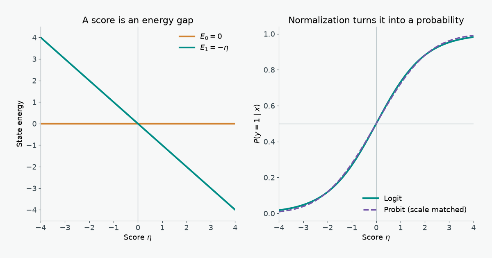

A binary classifier's probability can be derived from an energy gap, fitted by an information cost, or obtained by adding noise to a threshold. These three descriptions agree for logistic regression, while the choice of latent noise explains where probit regression differs.

## Physics: a two-state energy model

Fix an input $x\in\mathbb R^d$ and a label $y\in\{0,1\}$. Let $\eta(x)=w^\mathsf{T}x+b$. Give the two states dimensionless energies

$$
E(y,x)=-y\eta(x),\qquad E(0,x)=0,\qquad E(1,x)=-\eta(x).
$$

Only their difference affects the probabilities. In the chosen energy gauge,

$$
\Delta E(x)=E(0,x)-E(1,x)=\eta(x).
$$

At inverse temperature $\beta=1$, the partition function sums the two Boltzmann weights:

$$
Z(x)=\sum_{y=0}^{1}e^{-E(y,x)}=1+e^{\eta(x)}.
$$

Normalizing the weight of state 1 gives the logistic sigmoid, step by step:

$$
\begin{aligned}
P(y=1\mid x)
&=\frac{e^{-E(1,x)}}{Z(x)}\\
&=\frac{e^{\eta(x)}}{1+e^{\eta(x)}}\\
&=\frac{1}{1+e^{-\eta(x)}}
=\sigma\!\left(\eta(x)\right).
\end{aligned}
$$

Thus $P(1\mid x)/P(0\mid x)=e^{\Delta E(x)}$: the linear score is the **log odds** and the energy gap. If we restore $\beta=(k_\mathrm{B}T)^{-1}$, the sigmoid takes $\beta\Delta E$ as its argument. Temperature rescales the coefficients; ordinary logistic regression fixes that scale at one.

{fig-alt="Two-panel plot: class-zero energy stays at zero while class-one energy falls linearly with the score; logistic and scale-matched probit probabilities rise from zero to one."}

The conditional Helmholtz free energy in these units is $F(x)=-\log Z(x)=-\log(1+e^{\eta(x)})$. The zero of energy is arbitrary: adding the same $c(x)$ to both state energies changes $F$ by $c(x)$ but leaves the energy gap and probabilities fixed. [Statistical mechanics derives these relations from the canonical ensemble](https://www.physics.rutgers.edu/~coleman/611/lectures/chapter3.pdf).

The two states are the possible **labels at one fixed input**, not two positions that $x$ moves between. A physical counterpart is a spin that can point in two directions while an external field is held fixed: the field changes the energy gap, and thermal equilibrium favors the lower-energy direction. Here $x$ sets the field through $\eta(x)$, and choosing a label corresponds to choosing a spin direction. No motion between states or heat flow is modeled. The classifier's energies are dimensionless scores unless a physical system supplies an energy scale and temperature; $\beta=1$ alone does not measure a real temperature.

### An energy surface to adjust

The display uses ten **synthetic** feature pairs, chosen to put both labels on either side of a linear boundary. They stand in for two standardized measurements in a binary classification task; no observed population or sampling claim is attached. A wrong classification would assign high probability to the opposite state, and the two-state model is a useful controlled example because its energy gap is visible directly.

The colored plane is $E(1,x_1,x_2)=-(w_1x_1+w_2x_2+b)$; the faint horizontal plane is $E(0,x_1,x_2)=0$. Teal points have observed label 1 and sit on the colored plane. Amber points have observed label 0 and sit on the zero-energy plane. Thin stems connect each observed state to its alternative. Lower energy means higher Boltzmann probability. A linear plane has lower-energy **regions**, not local wells or peaks.

1. Increase $w_1$: the colored plane tilts down as $x_1$ increases, lowering the class-1 energy there.
2. Increase $b$: the entire class-1 plane drops while the class-0 plane stays at zero; $P(1\mid x)$ rises at every point.
3. Drag to orbit. The intersection of the two planes is the $P(1\mid x)=0.5$ boundary.

```{=html}
<style>
  #thermo-scene { --panel:#101923; --ink:#e7eff4; --muted:#a8b9c5; --teal:#54d4c5; --amber:#ffbf69; --rule:#334655; color:var(--ink); background:var(--panel); border:1px solid var(--rule); border-radius:12px; padding:1rem; margin:1.3rem 0; }
  #thermo-scene .thermo-layout { display:grid; grid-template-columns:minmax(0, 1fr) 12rem; gap:1rem; }
  #thermo-scene .thermo-canvas { height:420px; min-width:0; border-radius:8px; overflow:hidden; background:#101923; touch-action:none; }
  #thermo-scene .thermo-controls { display:grid; align-content:start; gap:1rem; }
  #thermo-scene label { display:grid; gap:.3rem; font-size:.9rem; }
  #thermo-scene label span { display:flex; justify-content:space-between; }
  #thermo-scene input { width:100%; accent-color:var(--teal); }
  #thermo-scene .thermo-key { color:var(--muted); font-size:.83rem; line-height:1.5; }
  #thermo-scene .thermo-key i { display:inline-block; width:.7rem; height:.7rem; border-radius:50%; margin-right:.4rem; }
  #thermo-scene .thermo-output { color:var(--muted); font-variant-numeric:tabular-nums; font-size:.85rem; margin-top:.6rem; }
  @media (max-width:700px) { #thermo-scene .thermo-layout { grid-template-columns:1fr; } #thermo-scene .thermo-canvas { height:340px; } #thermo-scene .thermo-controls { grid-template-columns:repeat(3,minmax(0,1fr)); gap:.6rem; } #thermo-scene .thermo-key { grid-column:1/-1; } }
</style>
<div id="thermo-scene" role="group" aria-label="Interactive three-dimensional binary energy surface">
  <div class="thermo-layout">
    <div class="thermo-canvas" aria-label="Orbitable energy surface; use sliders to change weights and bias"></div>
    <div class="thermo-controls">
      <label><span><span>w₁</span><output id="thermo-w1-value">0.80</output></span><input id="thermo-w1" type="range" min="-1.5" max="1.5" step="0.05" value="0.8"></label>
      <label><span><span>w₂</span><output id="thermo-w2-value">-0.65</output></span><input id="thermo-w2" type="range" min="-1.5" max="1.5" step="0.05" value="-0.65"></label>
      <label><span><span>b</span><output id="thermo-b-value">0.20</output></span><input id="thermo-b" type="range" min="-1.5" max="1.5" step="0.05" value="0.2"></label>
      <div class="thermo-key"><div><i style="background:#54d4c5"></i>Observed y = 1, on E₁</div><div><i style="background:#ffbf69"></i>Observed y = 0, on E₀</div><div>Gray plane: E₀ = 0</div></div>
    </div>
  </div>
  <div class="thermo-output" id="thermo-readout" aria-live="polite"></div>
</div>
<script type="importmap">{"imports":{"three":"https://cdn.jsdelivr.net/npm/three@0.160.1/build/three.module.js"}}</script>
<script type="module">
import * as THREE from 'https://cdn.jsdelivr.net/npm/three@0.160.1/build/three.module.js';
import { OrbitControls } from 'https://cdn.jsdelivr.net/npm/three@0.160.1/examples/jsm/controls/OrbitControls.js';

const root = document.getElementById('thermo-scene');
const mount = root.querySelector('.thermo-canvas');
const ids = ['w1', 'w2', 'b'];
const sliders = Object.fromEntries(ids.map(k => [k, root.querySelector('#thermo-' + k)]));
const values = Object.fromEntries(ids.map(k => [k, root.querySelector('#thermo-' + k + '-value')]));
const readout = root.querySelector('#thermo-readout');
const samples = [
  [-1.55,-1.15,0],[-1.2,.6,0],[-.75,1.35,0],[-.35,-.6,0],[.15,1.55,0],
  [.55,-1.25,1],[1.15,-.6,1],[1.65,.15,1],[.95,1.35,1],[-.55,-1.65,1]
];
const renderer = new THREE.WebGLRenderer({antialias:true, alpha:true});
renderer.setPixelRatio(Math.min(window.devicePixelRatio || 1, 2));
mount.appendChild(renderer.domElement);
const scene = new THREE.Scene();
const camera = new THREE.PerspectiveCamera(42, 1, .1, 100);
camera.position.set(6.7, 5.5, 7.2);
const orbit = new OrbitControls(camera, renderer.domElement);
orbit.enableDamping = true;
orbit.target.set(0, 0, 0);
orbit.minDistance = 5;
orbit.maxDistance = 20;
const axes = new THREE.AxesHelper(2.6);
axes.material.transparent = true;
axes.material.opacity = .55;
scene.add(axes);
const ground = new THREE.GridHelper(4.8, 12, 0x526171, 0x344656);
ground.position.y = 0;
scene.add(ground);
const zero = new THREE.Mesh(new THREE.PlaneGeometry(4.8, 4.8), new THREE.MeshBasicMaterial({color:0x93a6b5, transparent:true, opacity:.12, side:THREE.DoubleSide, depthWrite:false}));
zero.rotation.x = -Math.PI/2;
scene.add(zero);
const planeGeometry = new THREE.PlaneGeometry(4.8, 4.8, 16, 16);
planeGeometry.rotateX(-Math.PI/2);
const surface = new THREE.Mesh(planeGeometry, new THREE.MeshBasicMaterial({color:0x54d4c5, transparent:true, opacity:.25, side:THREE.DoubleSide, depthWrite:false}));
scene.add(surface);
const gridLines = new THREE.Group();
scene.add(gridLines);
const gridObjects=[];
for (let k=-2.4;k<=2.401;k+=.6) {
  for (const alongX of [true,false]) {
    const coords=[];
    for (let j=-2.4;j<=2.401;j+=.3) coords.push([alongX ? j:k,alongX ? k:j]);
    const points=coords.map(([x,z]) => new THREE.Vector3(x,0,z));
    const line=new THREE.Line(new THREE.BufferGeometry().setFromPoints(points),new THREE.LineBasicMaterial({color:0x69e5d4,transparent:true,opacity:.58}));
    gridLines.add(line);
    gridObjects.push({line,coords});
  }
}
const pointGeometry = new THREE.SphereGeometry(.085, 12, 10);
const pointObjects = samples.map(([x1,x2,y]) => {
  const marker = new THREE.Mesh(pointGeometry, new THREE.MeshBasicMaterial({color:y ? 0x54d4c5 : 0xffbf69}));
  const stemGeometry = new THREE.BufferGeometry().setFromPoints([new THREE.Vector3(), new THREE.Vector3()]);
  const stem = new THREE.Line(stemGeometry, new THREE.LineBasicMaterial({color:y ? 0x54d4c5 : 0xffbf69, transparent:true, opacity:.55}));
  scene.add(marker, stem);
  return {x1,x2,y,marker,stem};
});
let current = {w1:.8,w2:-.65,b:.2};
let target = {...current};
const energy = (x1,x2,p) => -(p.w1*x1 + p.w2*x2 + p.b);
function redraw(p) {
  const pos = planeGeometry.attributes.position;
  for (let i=0; i<pos.count; i++) pos.setY(i, energy(pos.getX(i),pos.getZ(i),p));
  pos.needsUpdate = true;
  for (const {line,coords} of gridObjects) {
    const vertices=line.geometry.attributes.position;
    coords.forEach(([x,z],i) => vertices.setY(i,energy(x,z,p)));
    vertices.needsUpdate=true;
  }
  for (const o of pointObjects) {
    const e=energy(o.x1,o.x2,p);
    o.marker.position.set(o.x1,o.y ? e : 0,o.x2);
    const stem=o.stem.geometry.attributes.position;
    stem.setXYZ(0,o.x1,0,o.x2);
    stem.setXYZ(1,o.x1,e,o.x2);
    stem.needsUpdate=true;
  }
}
function updateTargets() {
  for (const k of ids) { target[k]=Number(sliders[k].value); values[k].value=target[k].toFixed(2); }
  const eta=target.b, probability=1/(1+Math.exp(-eta));
  readout.textContent=`At x₁ = x₂ = 0: ΔE = ${eta.toFixed(2)}, P(y = 1 | x) = ${probability.toFixed(3)}.`;
}
ids.forEach(k => sliders[k].addEventListener('input',updateTargets));
updateTargets();
function resize() {
  const width=mount.clientWidth, height=mount.clientHeight;
  if (width===0 || height===0) return;
  renderer.setSize(width,height);
  camera.aspect=width/height;
  camera.updateProjectionMatrix();
}
const observer=new ResizeObserver(resize);
observer.observe(mount);
resize();
function animate() {
  requestAnimationFrame(animate);
  for (const k of ids) current[k]+=(target[k]-current[k])*.12;
  redraw(current);
  orbit.update();
  renderer.render(scene,camera);
}
animate();
</script>
```

## Information: likelihood, surprise, and cross-entropy

The Boltzmann probability becomes a training rule when we observe labeled pairs $(x_i,y_i)$. Write $\eta_i=w^\mathsf{T}x_i+b$ and $p_i=\sigma(\eta_i)$. Conditional independence gives the Bernoulli likelihood

$$
L(w,b)=\prod_{i=1}^{n}p_i^{y_i}(1-p_i)^{1-y_i}.
$$

Taking logs turns the product into a sum. Maximum likelihood therefore minimizes the average negative log-likelihood:

$$
\begin{aligned}
-\frac1n\log L(w,b)
&=-\frac1n\sum_{i=1}^{n}\left[y_i\log p_i+(1-y_i)\log(1-p_i)\right]\\
&=\frac1n\sum_{i=1}^{n}\left[\log(1+e^{\eta_i})-y_i\eta_i\right]\\
&=\frac1n\sum_{i=1}^{n}\left[E(y_i,x_i)+\log Z(x_i)\right].
\end{aligned}
$$

The first line is **binary cross-entropy** (BCE). The per-example value $-\log P(y_i\mid x_i)$ is the observed label's **surprisal**, measured in nats. The last line shows the physical terms: lower observed-state energy helps, while the log partition function charges for assigning weight to both possible states. [The standard log-loss definition](https://scikit-learn.org/stable/modules/generated/sklearn.metrics.log_loss.html) is this negative log-likelihood.

The KL statement needs its empirical distribution stated. For a particular training pair, let $q_i(y)=\mathbf 1\{y=y_i\}$, a point mass on the observed label. Since $H(q_i)=0$,

$$
\operatorname{KL}\!\left(q_i\middle\|P_{w,b}(\cdot\mid x_i)\right)
=-\log P_{w,b}(y_i\mid x_i)
=\operatorname{BCE}(y_i,p_i).
$$

If an input $x$ has repeated observations and an empirical class frequency $q(1\mid x)$, then $H(q,P)=H(q)+\operatorname{KL}(q\|P)$. Its entropy $H(q)$ does not depend on $w,b$, so minimizing cross-entropy and KL still gives the same fit. This is a statement about the observed conditional frequencies; it does not say that an arbitrary finite sample recovers the population distribution.

Training adjusts the gap $\Delta E(x)$ so observed labels occupy lower-energy states more often. The resulting change in $F(x)=-\log Z(x)$ follows from the normalization.

### Joint distribution of inputs and labels

The energy calculation normalizes over $y$ **at fixed $x$**. BCE likewise scores labels conditional on the observed inputs. Logistic regression therefore specifies $P(y\mid x)$, but leaves the distribution of inputs unspecified. If we separately choose a marginal density or mass function $q(x)$, then

$$
p(x,y)=q(x)P(y\mid x)
=q(x)\frac{e^{-E(y,x)}}{Z(x)}.
$$

Different choices of $q$ give the same logistic conditional probabilities but different joint distributions, and can change the class balance $P(y=1)$ and feature distributions within each class $p(x\mid y)$. In particular, logistic $P(y\mid x)$ does not imply Gaussian $p(x\mid y)$; a generative model such as Gaussian discriminant analysis adds assumptions about the feature distributions. [Stanford's CS229 notes distinguish these directions](https://see.stanford.edu/materials/aimlcs229/cs229-notes2.pdf).

This also limits the physical picture. $Z(x)$ is a **conditional** partition function, not a normalizer over all $(x,y)$. A joint Boltzmann model needs an input measure or reference energy. If the raw weights $e^{-E(y,x)}$ were integrable over $x$, they would imply a feature marginal proportional to $Z(x)$; with the chosen gauge $E(0,x)=0$ on $\mathbb R^d$, the integral is infinite. The plotted planes compare labels at each input, not the frequency or physical energy of input locations. A population average of BCE weights conditional errors by how often $x$ occurs, but fitting BCE does not fit that input distribution.

## Statistics: latent noise and the probit link

The same classifier can be built as a noisy threshold. Let

$$
y^*=\eta(x)+\epsilon,\qquad y=\mathbf 1\{y^*>0\}.
$$

For a symmetric error distribution with cumulative distribution function $G$,

$$
P(y=1\mid x)=P(\epsilon>-\eta)=G(\eta).
$$

- **Logit:** $\epsilon$ has a standard logistic distribution, $G(z)=\sigma(z)$. An equivalent random-utility construction adds independent Gumbel errors to the two state utilities and compares them; their difference is logistic. [A derivation of the Gumbel difference](https://cs.stanford.edu/~ermon/papers/ICML_MIPS_Gumbel.pdf) gives the same choice probability.
- **Probit:** $\epsilon\sim\mathcal N(0,1)$, so $G(z)=\Phi(z)$, the standard normal CDF. This is the [probit link](https://www.statsmodels.org/devel/generated/statsmodels.genmod.families.links.Probit.html). With a normal error of standard deviation $s$, the argument is $\eta/s$.

The normal density can be written as $\phi(t)\propto e^{-E(t)}$ with harmonic potential $E(t)=t^2/2$. This potential belongs to the **latent noise**, not to the two-label energy surface in the first section. Probit and logit share a linear decision boundary at $\eta=0$, but their probability tails differ:

$$
1-\sigma(z)\sim e^{-z},\qquad
1-\Phi(z)\sim\frac{e^{-z^2/2}}{z\sqrt{2\pi}}
\quad(z\to+\infty).
$$

The logistic tail is heavier than the Gaussian tail; both decay faster than any power law. Coefficient scales must be matched before comparing curves, since standard logistic noise has variance $\pi^2/3$ and standard normal noise has variance $1$.

### Tail decay and optimization

For a positive observation, the derivative of negative log-likelihood with respect to the score is

$$
\frac{d\ell_{\mathrm{logit}}}{d\eta}=\sigma(\eta)-1,
\qquad
\frac{d\ell_{\mathrm{probit}}}{d\eta}=-\frac{\phi(\eta)}{\Phi(\eta)}.
$$

When $\eta\to+\infty$, both gradients vanish, but the probit gradient vanishes on a Gaussian scale. When a positive label is assigned a large **negative** score, the logit gradient approaches $-1$, while the probit gradient grows approximately as $-\eta$. A confidently wrong or mislabeled example can therefore exert more gradient pressure under probit; logit's bounded score gradient can be less sensitive to such extremes. This comparison concerns the gradient with respect to $\eta$; the parameter gradient also multiplies $x$, so neither model is automatically robust to high-leverage feature outliers.

## Concept map

| Physics | Information theory | Binary classification |
|---|---|---|
| Energy gap $E_0-E_1=\eta$ | Log odds $\log(P_1/P_0)$ | Linear score $w^\mathsf{T}x+b$ |
| Boltzmann weight $e^{-E_y}$ | Probability assigned to a state | Bernoulli class probability |
| Partition function $Z=1+e^\eta$ | Normalization inside surprisal | Log-sum-exp term in BCE |
| $E_y+\log Z$ | Surprisal $-\log P_y$ | Per-example negative log-likelihood |
| Changing the energy gap | Reducing conditional cross-entropy and KL | Fitting $w,b$ by maximum likelihood |
| Holding $x$ fixed | BCE scores $P(y\mid x)$ | A joint $p(x,y)$ also needs a marginal $q(x)$ |
| Harmonic energy of Gaussian latent noise | Faster tail decay | Probit probability $\Phi(\eta)$ |

Energies. Normalize. Probabilities. Observe. Surprise. Fit. Noise. Changes. Tails. Matter.

## References

- [Rutgers University, *Statistical Mechanics*, chapter 3](https://www.physics.rutgers.edu/~coleman/611/lectures/chapter3.pdf) — canonical probabilities, partition functions, and free energy.
- [Scikit-learn, *log_loss* documentation](https://scikit-learn.org/stable/modules/generated/sklearn.metrics.log_loss.html) — Bernoulli negative log-likelihood and cross-entropy.
- [Stanford, *Learning and Inference via Maximum Inner Product Search*](https://cs.stanford.edu/~ermon/papers/ICML_MIPS_Gumbel.pdf) — Gumbel noise differences and logistic choice probabilities.
- [Statsmodels, *Probit link* documentation](https://www.statsmodels.org/devel/generated/statsmodels.genmod.families.links.Probit.html) — the normal-CDF response function.
- [Stanford CS229, *Generative Learning Algorithms*](https://see.stanford.edu/materials/aimlcs229/cs229-notes2.pdf) — discriminative and generative models and the limits of the logistic conditional form.
