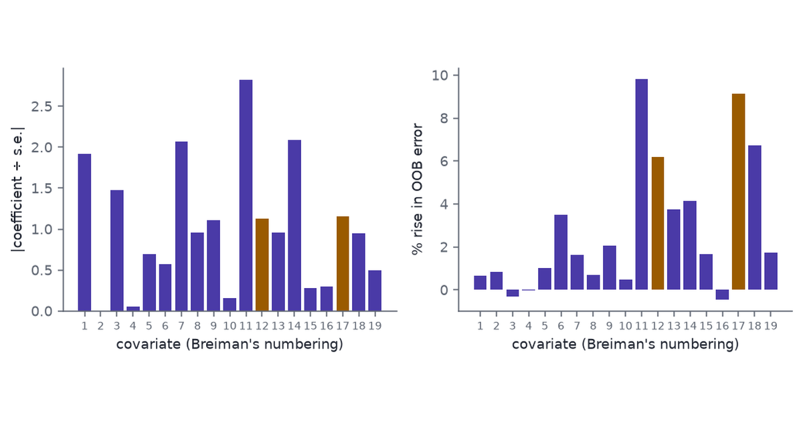

A random forest cannot be read the way a regression can, and Breiman's section 11 argues that it can still say more reliably which inputs matter.

The usual objection to a black box is the one Breiman quotes from his biostatistician friends: doctors can interpret logistic regression (p. 209). His reply turns the objection round. A model's coefficients are information only if the model fits nature, and a logistic regression that barely beats guessing is reporting on itself. A more accurate model, even an opaque one, is closer to nature's box, so the variables it relies on are better evidence. He puts it in one line: "The goal is not interpretability, but accurate information." (p. 210).

[Part 2](../two-cultures-rashomon/) found that the hepatitis variables ascites and albumin swap places in trees and in selected logistic models. This part re-runs the three analyses of Breiman's section 11 and then tests the tool he uses for all of them, permutation importance. [Part 5](../two-cultures-pushback-and-causality/) asks what "important" can mean for a decision.

This part covers two ideas:

- **Importance from accuracy.** Permute one input among cases the model did not train on and measure how much worse it predicts. The measure needs no coefficients, so it works for any model.
- **Its fragility.** When inputs are correlated, permuting one of them creates cases that do not exist, and the measure splits credit between surrogates in ways that depend on the model and the sample.

```{python}
#| label: setup
#| echo: false
import collections
import json
import sys
from pathlib import Path

sys.path.insert(0, str(Path("../two-cultures-breiman-2001/src").resolve()))

import matplotlib.pyplot as plt
import numpy as np
import pandas as pd
from scipy.cluster.hierarchy import fcluster, linkage
from sklearn.cluster import KMeans, SpectralClustering
from scipy.spatial.distance import squareform
from sklearn.ensemble import RandomForestRegressor
from sklearn.impute import SimpleImputer
from statsmodels.nonparametric.smoothers_lowess import lowess
from twocultures import blackbox as B
from twocultures import cache, data
from twocultures.style import AMBER, BLUE, INK, MUTED, PINK, PURPLE, RULE, TEAL, md, setup

setup()
X, y, names = data.hepatitis()
Xi = SimpleImputer(strategy="median").fit_transform(X)
ASC, ALB = names.index("ASCITES"), names.index("ALBUMIN")
```

## Data {#sec-data}

All three data sets are the ones Breiman used, or as close as can be found.

- **Hepatitis.** 155 patients, 19 covariates, survival or death. Donated to the UCI repository by Gail Gong, from Peter Gregory's study at Stanford Medical School; earlier analyses by Gong (1982 thesis), Diaconis and Efron (1983) and Cestnik, Kononenko and Bratko (1987). The clinical aim was to know which findings predict death, so a wrong variable list misleads the next physician who uses it. 75 patients have at least one missing value (prothrombin time is missing for 67); every model here fills them with training-set medians, since the paper does not say how they were handled.
- **Bupa liver disorders.** 345 men, five blood tests and a count of daily drinks, from BUPA Medical Research, via UCI. Breiman treats the seventh column as the class, severity of liver malfunction. @sec-bupa shows it is not.
- **Lymphoma.** Breiman's own file: 81 samples, 4,682 genes, three classes, taken from an archived copy of his random-forests web page, where his example program reads it. The samples are from Alizadeh et al. (2000) as prepared by Dudoit, Fridlyand and Speed (2002). The file carries no gene names and no class names; class counts of 29, 43 and 9 match Dudoit et al.'s B-CLL, DLBCL and FL, which is how the labels are inferred.

Sources, access dates, licences and checksums are in the series' [`data/README.md`](https://github.com/project-delphi/ml-blog/tree/main/posts/two-cultures-breiman-2001/data).

## Hepatitis {#sec-hepatitis}

### Which variable is which {#sec-numbering}

Breiman refers to covariates by number. The UCI documentation counts the class as attribute 1, so its numbers are one higher. Efron's comment settles which convention Breiman used: Breiman's variables 12 or 17 are "13 or 18 in Efron and Gong's numbering" (p. 219). Breiman counts covariates only.

```{python}
#| label: tbl-mapping
#| tbl-cap: "Hepatitis covariates in Breiman's numbering, the UCI hepatitis.names numbering (class = 1), and missing values in the 155 patients."
miss = np.isnan(X).sum(0)
roles = {6: "Gregory", 7: "LR top |z| (Breiman)", 11: "LR top |z| (Breiman)", 12: "RF top (Breiman)",
         14: "Gregory", 17: "RF top (Breiman)", 19: "Gregory"}
mapping = pd.DataFrame({"Breiman": range(1, 20), "UCI .names": range(2, 21), "Covariate": names,
                        "Missing": miss,
                        "Named in the paper as": [roles.get(k, "") for k in range(1, 20)]})
md(mapping)
```

Two checks support the mapping beyond Efron's sentence. Breiman says 12 and 17 are highly correlated (p. 212): in these data ascites and albumin are each other's strongest correlate. And his single-variable logistic errors, 15.7% for 12 and 19.3% for 17 (p. 212), are close to the 16.1% and 19.7% re-computed in @tbl-hep-errors. Gregory's variables 6, 12, 14 and 19 (p. 210) are malaise, ascites, bilirubin and histology.

The documentation lists each clinical finding's values as "no, yes" but does not give their numeric codes. The data do. Of the `{python} int((X[:, ASC] == 1).sum())` patients coded 1 for ascites, `{python} f"{y[X[:, ASC] == 1].mean():.0%}"` died, against `{python} f"{y[X[:, ASC] == 2].mean():.0%}"` of the `{python} int((X[:, ASC] == 2).sum())` coded 2, and their mean albumin is `{python} f"{np.nanmean(X[X[:, ASC] == 1, ALB]):.1f}"` against `{python} f"{np.nanmean(X[X[:, ASC] == 2, ALB]):.1f}"`. Fluid in the abdomen and low blood albumin go together in failing livers, so code 1 means present.

### Errors {#sec-hep-errors}

The protocol is Breiman's: 100 repetitions, each holding out a random 10% of patients, the same splits for every model.

```{python}
#| label: tbl-hep-errors
#| tbl-cap: "Hepatitis misclassification over 100 random 10% holdouts. Breiman's figures are from pp. 210–213."
z = B.standardized_coefficients(X, y)
top2 = list(np.argsort(-np.abs(z))[:2])


def cols(js):
    return lambda Xm: Xm[:, js]


def run_errors():
    specs = {
        "lr_all": (list(range(19)), "lr"), "rf_all": (list(range(19)), "rf"),
        "lr_top2": (top2, "lr"), "lr_12": ([ASC], "lr"), "lr_17": ([ALB], "lr"),
        "rf_12": ([ASC], "rf"), "rf_17": ([ALB], "rf"), "rf_12_17": ([ASC, ALB], "rf"),
        "lr_no12": ([j for j in range(19) if j != ASC], "lr"),
        "lr_no17": ([j for j in range(19) if j != ALB], "lr"),
    }
    out = {}
    for k, (js, kind) in specs.items():
        make = (lambda r: B.logit()) if kind == "lr" else (lambda r: B.rf(r))
        out[k] = B.holdout({k: make}, X[:, js], y)[k].to_numpy()
    return pd.DataFrame(out)


hep = cache.frame("hep_errors_v1", run_errors)
e = hep.mean()
base = float(y.mean())
rows = [
    ("Call every patient a survivor", "—", "20.6", f"{base:.1%}"),
    ("Logistic regression, all 19", "—", "17.4", f"{e['lr_all']:.1%}"),
    ("Random forest, all 19", "—", "12.3", f"{e['rf_all']:.1%}"),
    ("Logistic, top two by |coef/se|", f"{top2[0] + 1}, {top2[1] + 1}", "22.9 (on 7, 11)", f"{e['lr_top2']:.1%}"),
    ("Logistic, ascites only", "12", "15.7", f"{e['lr_12']:.1%}"),
    ("Logistic, albumin only", "17", "19.3", f"{e['lr_17']:.1%}"),
    ("Forest, ascites only", "12", "14.3", f"{e['rf_12']:.1%}"),
    ("Forest, albumin only", "17", "14.3", f"{e['rf_17']:.1%}"),
    ("Forest, ascites and albumin", "12, 17", "no better than one", f"{e['rf_12_17']:.1%}"),
    ("Logistic, all but ascites", "—", "little change", f"{e['lr_no12']:.1%}"),
    ("Logistic, all but albumin", "—", "little change", f"{e['lr_no17']:.1%}"),
]
tab = pd.DataFrame(rows, columns=["Model", "Variables", "Breiman (%)", "Here"])
md(tab)
```


- **The forest beats logistic regression,** `{python} f"{e['rf_all']:.1%}"` against `{python} f"{e['lr_all']:.1%}"`, but by less than Breiman's 12.3% against 17.4%. His forest's 30% reduction is `{python} f"{1 - e['rf_all'] / e['lr_all']:.0%}"` here.
- **The top two coefficients are not the top two variables.** The two largest standardised coefficients here are `{python} names[top2[0]].lower()` (`{python} top2[0] + 1`) and `{python} names[top2[1]].lower()` (`{python} top2[1] + 1`); Breiman's were 7 and 11. A logistic model on those two alone does `{python} "worse" if e['lr_top2'] > e['lr_all'] else "no worse"` than the full model, `{python} f"{e['lr_top2']:.1%}"`, as his did.
- **Either surrogate alone does most of the work.** Ascites alone in a logistic model gives `{python} f"{e['lr_12']:.1%}"`, level with all 19 variables together.

### Which variables matter {#sec-hep-importance}

Breiman's two figures put the methods side by side: standardised logistic coefficients (his Fig. 1) and the forest's permutation importance (Fig. 2). The importance here is the average over five forests of 1,000 trees, computed on each tree's out-of-bag patients as Breiman describes (p. 211).

```{python}
#| label: hep-importance
def run_importance():
    out = []
    for s in range(5):
        f = B.OOBForest(n_trees=1000, seed=s).fit(Xi, y)
        imp = f.permutation_importance(seed=s)
        out.append({"seed": s, "oob_error": f.oob_error(), **{names[j]: imp[j] for j in range(19)}})
    return pd.DataFrame(out)


imp = cache.frame("hep_importance_v1", run_importance)
imp_mean = imp[names].mean()
imp_rank = imp_mean.sort_values(ascending=False)
lr_perm = cache.obj("lr_perm_v1", lambda: {"v": B.logit_test_permutation(X, y).tolist()})["v"]
lr_top3 = [names[j] for j in np.argsort(lr_perm)[::-1][:3]]
oob_lo, oob_hi = imp["oob_error"].min(), imp["oob_error"].max()
```

```{python}
#| label: fig-hep-importance
#| fig-cap: "Hepatitis, two readings of which covariate matters, numbered as in Breiman's paper. Left: logistic regression coefficients divided by their standard errors (the reading behind Breiman's Fig. 1). Right: rise in the forest's out-of-bag error when the covariate is permuted, mean of five forests (Breiman's Fig. 2). Ascites (12) and albumin (17) are highlighted."
#| fig-alt: "Two bar charts over the 19 covariates. The logistic coefficients are largest for spiders, bilirubin and anorexia. The forest's importance is largest for spiders and albumin, with prothrombin time and ascites next."
fig, axes = plt.subplots(1, 2, figsize=(7.5, 2.9), sharex=True)
hl = [AMBER if j in (ASC, ALB) else PURPLE for j in range(19)]
axes[0].bar(range(1, 20), np.abs(z), color=hl)
axes[0].set_ylabel("|coefficient ÷ s.e.|")
axes[1].bar(range(1, 20), imp_mean.to_numpy(), color=hl)
axes[1].set_ylabel("% rise in OOB error")
for ax in axes:
    ax.set_xticks(range(1, 20))
    ax.tick_params(axis="x", labelsize=7)
    ax.set_xlabel("covariate (Breiman's numbering)")
fig.tight_layout()
plt.show()
```

- **The forest's list.** `{python} ", ".join(f"{v.title()} ({names.index(v) + 1})" for v in imp_rank.index[:4])`, in that order. Breiman's forest singled out 12 and 17. Here albumin is in the top two and ascites is fourth; spiders, which also tops the logistic list, comes first.
- **Logistic regression's permutation importance,** computed the same way on the held-out 10% of each repetition, ranks `{python} ", ".join(v.lower() for v in lr_top3)` as its top three. As in Breiman's check (p. 212), neither 12 nor 17 is among them.
- **The forest's out-of-bag error** is `{python} f"{oob_lo:.1%}"` to `{python} f"{oob_hi:.1%}"` over the five seeds.

### Two surrogates {#sec-surrogates}

Breiman's explanation of the Diaconis–Efron finding (p. 212): 12 and 17 are surrogates, so a model built on a bootstrap sample needs only one of them, and each one's selection frequency is pushed below 50%. He notes that one or the other appears in seven of the ten bootstrap selections Diaconis and Efron list. Efron's comment adds the full figure from Efron and Gong (1983): 12 or 17 in 60% of bootstrap samples, against 59% for histology (19), the most for any single variable (p. 219).

The selection procedure Gregory used is described only as informal screening followed by an unnamed formal procedure. A forward stepwise logistic regression, adding the variable with the smallest likelihood-ratio p-value while it is below 0.05, stands in for it.

```{python}
#| label: hep-bootstrap
fwd = cache.obj("forward_boot_v1", lambda: {"picks": B.bootstrap_forward(X, y, boots=500)})["picks"]
fwd_full = B.forward_stepwise_logit(X, y)
f_freq = pd.Series(collections.Counter(j for p in fwd for j in p)).reindex(range(19), fill_value=0) / len(fwd)
f_either = float(np.mean([(ASC in p) or (ALB in p) for p in fwd]))
f_both = float(np.mean([(ASC in p) and (ALB in p) for p in fwd]))
f_sizes = pd.Series([len(p) for p in fwd])
f_top = f_freq.sort_values(ascending=False)
```

- **On all 155 patients** forward selection picks `{python} ", ".join(f"{names[j].lower()} ({j + 1})" for j in fwd_full)`.
- **Over 500 bootstrap resamples** it picks between `{python} f_sizes.min()` and `{python} f_sizes.max()` variables, with median `{python} int(f_sizes.median())`. The most frequent picks are `{python} ", ".join(f"{names[j].lower()} ({j + 1}) {f_top[j]:.0%}" for j in f_top.index[:4])`.
- **Ascites or albumin** is picked in `{python} f"{f_either:.0%}"` of resamples, both in `{python} f"{f_both:.0%}"`. Histology (19) is picked in `{python} f"{f_freq[18]:.0%}"`.

The pattern Efron reports holds: the pair together is picked far more often than either member, because a resample rarely needs both. Two numbers differ from his. Histology is picked far less often, and sex far more: all `{python} int((X[:, 1] == 2).sum())` women in the data survived, so in many resamples sex nearly separates the outcome and the likelihood-ratio test reads that as strong evidence. Cox's comment warns about exactly this, that near-complete separation looks stable when it is not (p. 218).

```{python}
#| label: fig-surrogate
#| fig-cap: "Hepatitis: the forest's out-of-bag probability of death against each surrogate, standardised, with a lowess smooth; amber points are patients who died. Ascites is binary, coded 1 = present, so present is on the left; its points are jittered."
#| fig-alt: "Left, two jittered columns of points for ascites, with deaths concentrated in the ascites-present column. Right, a scatter of probability of death against standardised albumin, with a smooth line falling from about 0.6 at low albumin to near 0.1 at high albumin."
f0 = B.OOBForest(n_trees=1000, seed=0).fit(Xi, y)
p_die = f0.oob_proba()[:, 1]
fig, axes = plt.subplots(1, 2, figsize=(7.5, 2.9), sharey=True)
for ax, j, title in [(axes[0], ASC, "ascites (12)"), (axes[1], ALB, "albumin (17)")]:
    v = (Xi[:, j] - Xi[:, j].mean()) / Xi[:, j].std()
    jit = np.random.default_rng(j).uniform(-0.08, 0.08, len(v)) if j == ASC else 0
    ax.scatter(v + jit, p_die, s=10, color=np.where(y == 1, AMBER, TEAL), alpha=0.7, lw=0)
    sm_ = lowess(p_die, v, frac=0.6)
    ax.plot(sm_[:, 0], sm_[:, 1], color=INK, lw=1.6)
    ax.set_xlabel(f"{title}, standardised")
axes[0].set_ylabel("OOB probability of death")
fig.tight_layout()
plt.show()
```

## How far to trust permutation importance {#sec-fragility}

Breiman admitted in the rejoinder that importance has no satisfactory theoretical definition and depends on the dependence among the inputs (p. 230). Three later results make that concrete.

1. **Impurity importance is biased toward variables with many split points.** The forest's other built-in measure, total impurity decrease (mean decrease in Gini), credits a continuous or many-category variable for splits that fit noise (Strobl et al. 2007).
2. **Permutation importance shares credit between correlated inputs unevenly.** Permuting one input breaks its correlation with the others, so the model is queried at points it never saw. Strobl et al. (2008) propose permuting within strata of the correlated variables instead.
3. **Permuting forces extrapolation.** Hooker, Mentch and Zhou (2021) show that the permuted cases fall where there are no data, so the measure reports how the model behaves off the data, not how the data behave. They recommend refitting the model without the variable, or permuting conditionally.

### Design {#sec-fragility-design}

- **Data.** Hepatitis, with two pure-noise columns added: one continuous Gaussian, one binary coded 1/2 like the clinical findings.
- **Measures, each from a forest of 500 trees:**
  - *impurity* (mean decrease in Gini);
  - *permutation*, Breiman's out-of-bag measure;
  - *conditional permutation* of albumin, permuted only among patients with the same ascites value;
  - *joint permutation* of ascites and albumin together.
- **Replicates.** The full data plus 30 bootstrap resamples, each with its own forest.

```{python}
#| label: fragility
reps = cache.frame("importance_reps_v2", lambda: B.importance_replicates(boots=30))
full = reps[reps["boot"] == 0].set_index("var")
mdi_rank = full["mdi"].dropna().rank(ascending=False)
perm_rank = full["perm"].drop("ASCITES+ALBUMIN").rank(ascending=False)
noise_mdi_rank = int(mdi_rank["NOISE_CONT"])
noise_perm = float(full.loc["NOISE_CONT", "perm"])
bin_perm = float(full.loc["NOISE_BIN", "perm"])
bin_mdi_rank = int(mdi_rank["NOISE_BIN"])
alb_perm, alb_cond = float(full.loc["ALBUMIN", "perm"]), float(full.loc["ALBUMIN", "cond"])
asc_perm, pair = float(full.loc["ASCITES", "perm"]), float(full.loc["ASCITES+ALBUMIN", "perm"])
boot = reps[reps["boot"] > 0]
perm_wide = boot[boot["j"] >= 0].pivot(index="boot", columns="var", values="perm")
boot_rank = perm_wide[names].rank(axis=1, ascending=False)
alb_rank_boot, asc_rank_boot = boot_rank["ALBUMIN"], boot_rank["ASCITES"]
# The widget's ranking: all 21 columns, 1 + the number of columns strictly above.
w_rank = perm_wide.rank(axis=1, ascending=False, method="min")
n_swap = int((w_rank["ALBUMIN"] > w_rank["ASCITES"]).sum())
n_split5 = int(((w_rank["ALBUMIN"] <= 5) != (w_rank["ASCITES"] <= 5)).sum())
# Extrapolation: where do permuted albumin values land relative to the real ascites-yes patients?
yes = Xi[:, ASC] == 1
alb_yes_hi = np.quantile(Xi[yes, ALB], 0.9)
perm_alb = np.random.default_rng(0).permutation(Xi[:, ALB])
share_off = float(np.mean(perm_alb[yes] > alb_yes_hi))
```

### Result {#sec-fragility-result}

- **Impurity bias.** On the full data the continuous noise column ranks `{python} noise_mdi_rank` of 21 by impurity importance, above most of the clinical findings; the binary noise column ranks `{python} bin_mdi_rank`. Their permutation importances are `{python} f"{noise_perm:.1f}"`% and `{python} f"{bin_perm:.1f}"`% (continuous, binary), near zero, as they should be.
- **Conditional permutation.** Permuting albumin freely raises the out-of-bag error by `{python} f"{alb_perm:.1f}"`%; permuting it only within ascites groups raises it by `{python} f"{alb_cond:.1f}"`%. The difference is credit albumin borrows from ascites when the two are pulled apart.
- **The pair.** Permuting ascites and albumin together raises the error by `{python} f"{pair:.1f}"`%, against `{python} f"{asc_perm:.1f}"`% and `{python} f"{alb_perm:.1f}"`% separately. This is Breiman's own point in the rejoinder: delete one of two correlated variables and little changes, delete both and a lot does (p. 230).
- **Resampling.** Over 30 bootstrap resamples albumin's permutation rank among the 19 clinical variables runs from `{python} int(alb_rank_boot.min())` to `{python} int(alb_rank_boot.max())`, and ascites' from `{python} int(asc_rank_boot.min())` to `{python} int(asc_rank_boot.max())`. In a resample, out-of-bag means no copy of the patient is in the tree's bag, so no tree is scored on a patient it was trained on.
- **Extrapolation.** Among patients with ascites present, the 90th percentile of albumin is `{python} f"{alb_yes_hi:.1f}"`. After one free permutation of albumin, `{python} f"{share_off:.0%}"` of those patients are assigned a value above it: ascites with normal albumin, a combination the data contain few of. The permuted forest is being asked about patients who barely exist.

::: {#widget-importance}
:::

```{=html}
<script src="widget-data/data.js"></script>
<script src="widgets.js"></script>
```

1. With **permutation** and resample 0 (the full data), albumin ranks 2 and ascites 3, and the continuous noise column N1 ranks 17 of 21.
2. Switch to **impurity**. N1 moves up to 7th, above most of the clinical findings.
3. Back on **permutation**, step through resamples 1 to 30. Albumin falls below ascites in `{python} n_swap` of the 30, and in `{python} n_split5` one of them is in the top five while the other is not.

## Bupa liver disorders {#sec-bupa}

### The class is a train/test flag {#sec-bupa-selector}

Breiman describes the 345 patients as classified into two classes by severity of liver malfunction (p. 212). The current UCI page says the seventh field, "selector", has been widely misread as a disease label: BUPA's researchers created it as a train/test selector. McDermott and Forsyth (2016) document the error across hundreds of papers that use the data set as a benchmark, and suggest dichotomising `drinks` as the target instead.

The paper's analysis is therefore of the selector. It is re-run here because that is what reproducing it means, and because the result says something about the split.

```{python}
#| label: bupa
bupa = data.bupa()
Xb = bupa[B.BUPA_COLS].to_numpy(float)
yb = bupa["selector"].to_numpy()


def run_bupa():
    out = []
    for s in range(5):
        f = B.OOBForest(n_trees=1000, seed=s).fit(Xb, yb)
        imp = f.permutation_importance(seed=s)
        out.append({"seed": s, "oob_error": f.oob_error(), **{B.BUPA_COLS[j]: imp[j] for j in range(6)}})
    return pd.DataFrame(out)


bres = cache.frame("bupa_v1", run_bupa)
b_err_lo, b_err_hi = bres["oob_error"].min(), bres["oob_error"].max()
b_imp = bres[B.BUPA_COLS].mean().sort_values(ascending=False)
b_base = float(min(np.mean(yb == 1), np.mean(yb == 2)))
fb = B.OOBForest(n_trees=1000, seed=0).fit(Xb, yb)
P = B.proximity(fb, Xb[yb == 2])
D = squareform(1 - P, checks=False)
# Breiman's forests turn proximities into "scaling coordinates" (classical
# multidimensional scaling of 1 - proximity); cluster those with k-means.
nP = len(P)
J = np.eye(nP) - 1 / nP
w_, v_ = np.linalg.eigh(-0.5 * J @ ((1 - P) ** 2) @ J)
coords = v_[:, -3:] * np.sqrt(np.maximum(w_[-3:], 0))
cl = KMeans(2, n_init=10, random_state=0).fit_predict(coords) + 1
other = {"Ward linkage": fcluster(linkage(D, "ward"), 2, "maxclust"),
         "spectral clustering": SpectralClustering(2, affinity="precomputed", random_state=0).fit_predict(P),
         "average linkage": fcluster(linkage(D, "average"), 2, "maxclust")}
other_sizes = {k: sorted(pd.Series(v).value_counts().tolist(), reverse=True) for k, v in other.items()}
Zb = (Xb - Xb.mean(0)) / Xb.std(0)
cmeans = pd.DataFrame(Zb[yb == 2], columns=B.BUPA_COLS).groupby(cl).mean()
csize = pd.Series(cl).value_counts().sort_index()
rfr = RandomForestRegressor(n_estimators=1000, oob_score=True, random_state=0, min_samples_leaf=5)
rfr.fit(Xb[:, :5], bupa["drinks"].to_numpy(float))
drinks_r2 = float(rfr.oob_score_)
```

- **Error.** The forest's out-of-bag error for the selector is `{python} f"{b_err_lo:.1%}"` to `{python} f"{b_err_hi:.1%}"` over five seeds, against Breiman's 28%. Guessing the larger group errs on `{python} f"{b_base:.1%}"`.
- **Importance.** `{python} ", ".join(f"{v} {b_imp[v]:.1f}%" for v in b_imp.index[:4])`. Breiman found blood tests 3 and 5 (sgpt, gammagt) most important, then 4 (sgot) (p. 213); the order here is the same.
- **What that means.** The blood tests predict which patients BUPA put in which half of its split, so the split was not random with respect to them. Breiman's forest found real structure; it was structure in how the data were divided, not in liver disease.
- **The suggested target.** A forest predicting `drinks` from the five blood tests has an out-of-bag $R^2$ of `{python} f"{drinks_r2:.2f}"`.

### Clusters within selector 2 {#sec-bupa-clusters}

Breiman clustered the class-two patients using the forest's proximities, the share of trees in which two patients land in the same leaf, and found two groups: one high on tests 3, 4 and 5, one low (p. 213). The paper does not say how the clusters were formed. Here the `{python} int((yb == 2).sum())` selector-2 patients are placed by classical scaling of $1 - \text{proximity}$, the route Breiman's forest software used for its "scaling coordinates", and split in two by k-means: groups of `{python} int(csize.iloc[0])` and `{python} int(csize.iloc[1])`. Ward linkage (`{python} other_sizes['Ward linkage'][0]` and `{python} other_sizes['Ward linkage'][1]`) and spectral clustering (`{python} other_sizes['spectral clustering'][0]` and `{python} other_sizes['spectral clustering'][1]`) give similar splits on the same variables. Average linkage does not: it splits off `{python} other_sizes['average linkage'][1]` patient and leaves `{python} other_sizes['average linkage'][0]` together.

```{python}
#| label: fig-bupa
#| fig-cap: "Bupa, selector-2 patients split into two clusters by forest proximity: mean of each standardised variable per cluster, the analogue of Breiman's Fig. 5."
#| fig-alt: "Grouped bar chart of six variables for two clusters. One cluster sits well above average on sgpt, sgot and gammagt; the other sits slightly below average on all three."
fig, ax = plt.subplots(figsize=(7.5, 2.6))
w = 0.38
for k, (c, col) in enumerate(zip(cmeans.index, [PURPLE, TEAL])):
    ax.bar(np.arange(6) + (k - 0.5) * w, cmeans.loc[c].to_numpy(), w, color=col,
           label=f"cluster {k + 1} (n = {int(csize.loc[c])})")
ax.axhline(0, color=MUTED, lw=0.7)
ax.set_xticks(range(6), [f"{j + 1} {c}" for j, c in enumerate(B.BUPA_COLS)])
ax.set_ylabel("mean, standardised")
ax.legend()
fig.tight_layout()
plt.show()
```

The two groups separate on tests 3, 4 and 5, as Breiman's did. With the selector understood, the finding is that the patients BUPA put in one half of its split are a mixture of two blood-test profiles.

## Lymphoma {#sec-lymphoma}

Breiman ran a forest on 81 samples with 4,682 genes and no variable selection, and reported that the error rate was low, without a figure (p. 213). The point was that a forest needs no pre-screening of genes and still ranks them.

```{python}
#| label: lymphoma
Xl, yl = data.lymphoma()


def run_lymph():
    f = B.OOBForest(n_trees=2000, seed=0).fit(Xl, yl)
    imp = f.permutation_importance(seed=0)
    ho = B.holdout({"rf": lambda r: B.rf(r)}, Xl, yl, reps=100)["rf"]
    return {"oob_error": f.oob_error(), "imp": [imp[j] for j in range(Xl.shape[1])],
            "holdout": float(ho.mean()), "holdout_wrong": float((ho > 0).mean())}


lym = cache.obj("lymphoma_v1", run_lymph)
limp = np.array(lym["imp"])
n_pos = int((limp > 0).sum())
top_genes = np.argsort(-limp)[:10] + 1
```

- **Error.** Out-of-bag, `{python} f"{lym['oob_error']:.1%}"` (one sample of 81). Over 100 random 10% holdouts, `{python} f"{lym['holdout']:.1%}"`; `{python} f"{lym['holdout_wrong']:.0%}"` of holdouts contain any error at all.
- **Importance.** `{python} f"{n_pos:,}"` of 4,682 genes have positive importance. The ten largest are columns `{python} ", ".join(str(g) for g in top_genes)`. Several are adjacent columns, which suggests the file orders genes by some grouping; without gene identifiers that cannot be checked.

```{python}
#| label: fig-lymphoma
#| fig-cap: "Lymphoma microarray: permutation importance of each of the 4,682 genes in a forest of 2,000 trees, in file order, the analogue of Breiman's Fig. 6."
#| fig-alt: "A spike plot over 4,682 genes; most importances are at or near zero, with a handful of tall spikes, several of them in a cluster of adjacent columns in the 600s."
fig, ax = plt.subplots(figsize=(7.5, 2.4))
ax.vlines(np.arange(1, len(limp) + 1), 0, limp, color=PURPLE, lw=0.6)
ax.set_xlabel("gene (column in Breiman's file)")
ax.set_ylabel("% rise in OOB error")
fig.tight_layout()
plt.show()
```

## What the examples show {#sec-reading}

Breiman drew two conclusions (p. 214): higher predictive accuracy goes with more reliable information about the mechanism, and algorithmic models can give both. The re-runs bear on each.

- **Accuracy as a guard.** Hepatitis logistic regression improves on the all-survivor baseline by `{python} f"{100 * (base - e['lr_all']):.1f}"` percentage points here, and its coefficient ranking does not survive resampling. That supports his warning: a model this weak should not be read.
- **The forest's information.** The forest's ranking is not one answer either. On the full data it puts albumin and ascites near the top, but across resamples albumin's rank drops as low as `{python} int(alb_rank_boot.max())` of 19 and ascites' as low as `{python} int(asc_rank_boot.max())`, and the two share credit in proportions that move with the sample and the measure.
- **What no accuracy reveals.** The Bupa forest was accurate about the selector. Accuracy could not reveal that the selector was not the outcome. Cox's point about knowing what the data mean (Part 5) applies.

## Constraints {#sec-constraints}

- **Missing values.** Breiman does not say how he handled the hepatitis gaps; median imputation inside each training set is one choice, and prothrombin time (67 missing) is the variable it affects most.
- **Forest settings.** $\sqrt{p}$ split candidates and 500–2,000 trees. Breiman's forest code differed in details (for instance its own missing-value scheme), which may explain part of the smaller gap over logistic regression.
- **Forward selection stands in for Gregory's procedure,** which the sources do not specify.
- **Lymphoma labels are inferred** from class counts.

## Reproduction status {#sec-status}

::: {.table-responsive}

| Experiment | Paper's data | Data used here | Paper's result | Our result | Notes |
|---|---|---|---|---|---|
| Hepatitis errors (§11.1) | UCI hepatitis | same | LR 17.4%, RF 12.3%, baseline 20.6% | LR `{python} f"{e['lr_all']:.1%}"`, RF `{python} f"{e['rf_all']:.1%}"`, baseline `{python} f"{base:.1%}"` | smaller gap; imputation unspecified |
| Hepatitis single variables (§11.1) | same | same | LR 12: 15.7%, LR 17: 19.3%; RF 12 or 17: 14.3% | LR `{python} f"{e['lr_12']:.1%}"`, `{python} f"{e['lr_17']:.1%}"`; RF `{python} f"{e['rf_12']:.1%}"`, `{python} f"{e['rf_17']:.1%}"` | numbering confirmed |
| Hepatitis importance (§11.1) | same | same | RF: 12 and 17; LR coefficients: 7 and 11 | RF: `{python} ", ".join(str(names.index(v) + 1) for v in imp_rank.index[:4])`; LR: `{python} top2[0] + 1`, `{python} top2[1] + 1` | partly reproduced |
| Surrogates in bootstrap (§11.1, Efron) | Diaconis–Efron bootstraps | 500 forward-selection bootstraps | 12 or 17 in 60%, 19 in 59% | 12 or 17 in `{python} f"{f_either:.0%}"`, 19 in `{python} f"{f_freq[18]:.0%}"` | procedure differs |
| Bupa (§11.2) | UCI Bupa | same | RF error 28%; tests 3, 5, then 4; two clusters | RF `{python} f"{b_err_lo:.0%}"`–`{python} f"{b_err_hi:.0%}"`; same ranking; two clusters (three of four methods) | the class is a train/test selector |
| Lymphoma (§11.3) | 81 × 4,682, 3 classes | Breiman's own file | low error; importance plot | OOB `{python} f"{lym['oob_error']:.1%}"`; `{python} f"{n_pos:,}"` genes with positive importance | no gene identifiers |

: Part 4's rows of the series reproduction table. {#tbl-status}

:::

Accuracy. Earns. Attention. Correlation. Splits. Credit. Permutation. Invents. Patients.

```{python}
#| label: export-status
#| include: false
# The numbers Part 5's series table quotes from this part (twocultures/status.py).
from twocultures import status

status.export(
    lr_all=e["lr_all"], rf_all=e["rf_all"],
    rf_rank_albumin=list(imp_rank.index).index("ALBUMIN") + 1,
    rf_rank_ascites=list(imp_rank.index).index("ASCITES") + 1,
    boot_rank_albumin_lo=alb_rank_boot.min(), boot_rank_albumin_hi=alb_rank_boot.max(),
    boot_rank_ascites_lo=asc_rank_boot.min(), boot_rank_ascites_hi=asc_rank_boot.max(),
    bupa_lo=b_err_lo, bupa_hi=b_err_hi, lymphoma_oob=lym["oob_error"])
```

## References {#sec-references}

- Alizadeh, A. A. et al. (2000). [Distinct types of diffuse large B-cell lymphoma identified by gene expression profiling](https://doi.org/10.1038/35000501). *Nature* 403(6769), 503–511.
- Breiman, L. (2001). [Random forests](https://doi.org/10.1023/A:1010933404324). *Machine Learning* 45, 5–32.
- Breiman, L. (2001). [Statistical modeling: the two cultures (with comments and a rejoinder)](https://doi.org/10.1214/ss/1009213726). *Statistical Science* 16(3), 199–231.
- Diaconis, P. & Efron, B. (1983). [Computer-intensive methods in statistics](https://doi.org/10.1038/scientificamerican0583-116). *Scientific American* 248(5), 116–130.
- Dudoit, S., Fridlyand, J. & Speed, T. P. (2002). [Comparison of discrimination methods for the classification of tumors using gene expression data](https://doi.org/10.1198/016214502753479248). *Journal of the American Statistical Association* 97(457), 77–87.
- Efron, B. & Gong, G. (1983). [A leisurely look at the bootstrap, the jackknife, and cross-validation](https://doi.org/10.1080/00031305.1983.10483087). *The American Statistician* 37(1), 36–48.
- Hooker, G., Mentch, L. & Zhou, S. (2021). [Unrestricted permutation forces extrapolation: variable importance requires at least one more model, or there is no free variable importance](https://doi.org/10.1007/s11222-021-10057-z). *Statistics and Computing* 31(6), 82.
- McDermott, J. & Forsyth, R. S. (2016). [Diagnosing a disorder in a classification benchmark](https://doi.org/10.1016/j.patrec.2016.01.004). *Pattern Recognition Letters* 73, 41–43.
- Strobl, C., Boulesteix, A.-L., Zeileis, A. & Hothorn, T. (2007). [Bias in random forest variable importance measures: illustrations, sources and a solution](https://doi.org/10.1186/1471-2105-8-25). *BMC Bioinformatics* 8, 25.
- Strobl, C., Boulesteix, A.-L., Kneib, T., Augustin, T. & Zeileis, A. (2008). [Conditional variable importance for random forests](https://doi.org/10.1186/1471-2105-9-307). *BMC Bioinformatics* 9, 307.
- UCI Machine Learning Repository. [Hepatitis](https://archive.ics.uci.edu/dataset/46/hepatitis) and [Liver Disorders](https://archive.ics.uci.edu/dataset/60/liver+disorders). CC BY 4.0.
- [The Two Cultures, Part 2: Rashomon](../two-cultures-rashomon/) — ascites and albumin in perturbed trees and selected models.
- [The Two Cultures, Part 5: The pushback](../two-cultures-pushback-and-causality/) — what importance can mean for a decision.
