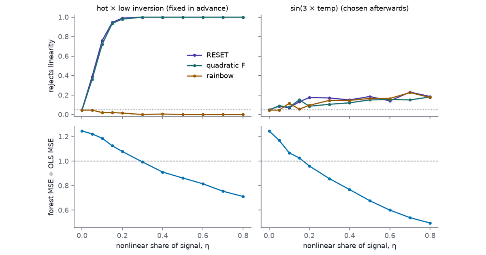

Leo Breiman's *Statistical Modeling: The Two Cultures* (2001) argued that statistics was checking its models with the wrong test, and this series re-runs as much of the paper's evidence as public data allow.

Anyone who has fitted a regression knows the routine. Fit the model, read $R^2$, glance at a residual plot, and if nothing looks alarming, read the coefficients as facts about the world: this variable matters, that one does not. Breiman's complaint was that nothing in the routine checks the assumption the reading depends on, that the fitted equation works the way nature does. His alternative was blunt: hold some data back and see whether the model predicts it. A quarter of a century later the paper is still the usual citation for the split between statistics and machine learning, and its claims can now be tested with tools he did not have.

This is the first of five parts.

1. **Two ways to fill a black box** (this part): the paper's two goals and two cultures, the consulting projects behind them, the ozone forecast re-run on 1976 Los Angeles and ten years of New Delhi, and the question of how a model should be checked.
2. [**Rashomon**](../two-cultures-rashomon/): many different models fit about equally well.
3. [**Occam and Bellman**](../two-cultures-occam-and-bellman/): forests against single trees on Breiman's ten benchmark sets, and whether more features help.
4. [**Information from a black box**](../two-cultures-black-box-information/): the hepatitis, liver and lymphoma analyses, and what variable importance can and cannot say.
5. [**The pushback, and what prediction cannot tell you**](../two-cultures-pushback-and-causality/): Cox, Efron, Hoadley, Parzen, Breiman's reply, causality, and the full reproduction table.

This part covers two ideas:

- **Two cultures.** A *data model* assumes the mechanism inside the box and estimates its parameters; an *algorithmic model* treats the mechanism as unknown and looks for a function that predicts.
- **Two kinds of check.** A goodness-of-fit test asks whether the data contradict the assumed model; a held-out test asks whether the model predicts new cases. The second section of experiments asks when these two checks disagree.

```{python}
#| label: setup
#| echo: false
import sys
from pathlib import Path

sys.path.insert(0, str(Path("src").resolve()))

import matplotlib.dates as mdates
import matplotlib.pyplot as plt
import numpy as np
import pandas as pd
from twocultures import cache, gof, ozone
from twocultures.style import AMBER, BLUE, INK, MUTED, PURPLE, RULE, TEAL, md, setup

setup()
```

## The paper {#sec-paper}

*Statistical Science* published the paper in August 2001 (volume 16, number 3, pages 199–231) with four invited comments and a rejoinder. All page numbers in this series are journal pages.

- **Author.** Breiman spent seven years as an academic probabilist, then thirteen as a freelance consultant, and joined the Berkeley statistics department in 1980 (p. 200). He co-wrote the CART book (1984) and introduced bagging (1996) and random forests (2001).
- **Discussants.** D. R. Cox, Brad Efron, Bruce Hoadley and Emanuel Parzen. [Part 5](../two-cultures-pushback-and-causality/) sets out each comment.
- **Structure.** Sections 3–7 explain how his view formed and what he saw wrong with data models. Sections 8–10 give three lessons from machine learning, named after a film, a friar and a mathematician: Rashomon, Occam and Bellman. Section 11 claims an algorithmic model can say *more* about the mechanism than a data model can.

## Two goals, two cultures {#sec-cultures}

Breiman starts from a picture. Inputs $x$ go into a box, responses $y$ come out, and nature does something inside (p. 199).

```{mermaid}
%%| fig-cap: "Breiman's starting picture (p. 199): the data come from a box whose inside is nature's business."
flowchart LR
  X["x: inputs"] --> N["nature"] --> Y["y: responses"]
```

The analyst can want two things from the box (p. 199):

1. **Prediction**: what $y$ will be for future inputs.
2. **Information**: how nature associates $y$ with $x$.

The two cultures differ in what they put inside the box.

::: {.table-responsive}

| | Data modeling culture | Algorithmic modeling culture |
|---|---|---|
| Inside the box | an assumed stochastic model, e.g. $y = f(x, \text{noise}, \text{parameters})$ | unknown and possibly unknowable |
| Typical fillings | linear regression, logistic regression, the Cox model | decision trees, neural networks, later forests and SVMs |
| Fitted object | parameter estimates, read as facts about nature | a function $f(x)$ that predicts $y$ |
| Validation | yes–no goodness-of-fit tests and residual checks | predictive accuracy on data not used to fit |
| Assumption in the theory | the model is true, up to parameters | the data are i.i.d. draws from some distribution |
| Breiman's head count | 98% of all statisticians | 2% of statisticians, many people in other fields |

: The two cultures as Breiman describes them (pp. 199, 205). The head counts are his estimates. {#tbl-cultures}

:::

The head count drew the most direct responses. Cox called the paper's picture of mainstream statistics partly "a caricature" (p. 216). Efron said the prediction culture at Stanford alone was larger than 2% (p. 219). Breiman replied that the dispute was over the word "mainstream": count the people running canned regression packages, not the people writing journal papers, and his version wins by at least 100 to 1 (p. 228).

## Where the view came from {#sec-projects}

Breiman says his views formed on consulting projects (p. 200). He describes two in detail.

### Ozone, Los Angeles, mid-1970s {#sec-ozone-history}

- **Problem.** Smog alerts were issued in the morning, too late to change commuting; the EPA funded an effort to forecast ozone 12 hours ahead (p. 200).
- **Data.** Over 450 meteorological variables, hourly and daily, from stations as far away as Oregon and Arizona, for seven years, with predictors reaching several days back (p. 201).
- **Validation.** First five years to train, last two to test (p. 201).
- **Method.** Large linear regressions with variable selection, then quadratic terms and interactions of the retained variables, then selection again (p. 201).
- **Outcome.** A failure: the false-alarm rate was too high. Breiman regretted not being able to revisit it with modern tools (p. 201).

### Chlorine from mass spectra {#sec-chlorine}

- **Problem.** Predict whether a compound contains chlorine from its mass spectrum, to triage the EPA's toxicity screening (p. 201).
- **Data.** Known structures and spectra for 30,000 compounds, split 25,000 / 5,000 at random (p. 201).
- **Method.** Linear and quadratic discriminant analysis struggled because a spectrum's length varies with molecular weight. A decision tree over 1,500 yes–no questions, designed with chemists' knowledge of chlorine signatures, reached 95% accuracy on both classes (p. 201).

The chlorine data were never released, so that project is described here and not reproduced.

### What he took away {#sec-perceptions}

Breiman lists five lessons (p. 201):

1. Focus on finding a good solution.
2. Live with the data before modeling.
3. Search for a model that solves the problem, algorithmic or data.
4. Predictive accuracy on test sets is the criterion of a good model.
5. Computers are indispensable.

Item 4 is the one the rest of the paper defends.

## Data: the 1976 Los Angeles ozone record {#sec-data}

The project's seven-year, 450-variable database is not public. The closest public record is one year of the same kind of data from the same basin, which Breiman and Friedman (1985) used to introduce their ACE transformation method.

- **Source.** `mlbench::Ozone` (366 days of 1976, missing values kept) and `faraway::ozone` (330 complete days), both copied from the R packages' data files. Download dates, licences and checksums are in the series' [`data/README.md`](https://github.com/project-delphi/ml-blog/tree/main/posts/two-cultures-breiman-2001/data).
- **Variables.** The daily maximum one-hour-average ozone reading, and eight meteorological readings: 500 millibar pressure height at Vandenberg AFB, wind speed and humidity at LAX, temperature at Sandburg, inversion base height and temperature at LAX, the LAX–Daggett pressure gradient, and visibility at LAX. `mlbench` also has a second temperature, at El Monte, missing on 139 days and left out here. Neither package documents the ozone units or station clearly (`faraway` says ppm, which cannot be right for readings from 1 to 38), so ozone is quoted in the data's own units.
- **Who collected it and why.** Routine air-quality and weather monitoring in the Basin, collected for the smog alerts and weather forecasting the ozone project served.
- **What this post asks of it.** Whether a forest predicts next-day ozone better than the selected linear regressions of the 1970s project, under a time-ordered split.
- **Cost of a wrong answer.** A missed alert leaves children on playgrounds on a smog day; a false alarm keeps government workers home for nothing (p. 200). Breiman's project failed on false alarms.
- **Why these methods.** They are the two the paper compares: the project's own procedure, and the forest he wished he had had. @sec-ozone-modern adds three the paper does not run: the lasso, gradient boosting and a pretrained forecasting model. @sec-delhi runs all of them on ten years of New Delhi air.
- **What it is not.** One year against seven, nine variables against 450, one station against dozens. It is a stand-in; @sec-delhi has the length and not the variables.

Two quirks decided which copy to use. `faraway::ozone` labels each row with a `doy` field, but it repeats at month boundaries (two rows each for days 61, 121, 181, …) and runs to 390, so it cannot pair a day with the next one. `mlbench::Ozone` carries month and day of month, so the next-day design uses it, keeping only rows where all the needed days are present.

```{python}
#| label: ozone-design
df = ozone.design()
Xtr, ytr, Xte, yte = ozone.split(df)
n_pairs, n_tr, n_te = len(df), len(ytr), len(yte)
alert_tr, alert_te = int((ytr >= ozone.ALERT).sum()), int((yte >= ozone.ALERT).sum())
```

## The ozone project, re-run {#sec-ozone}

The design follows the project's description as closely as nine variables allow.

- **Target.** Day $t+1$'s maximum ozone.
- **Alert.** A forecast of 20 or more counts as an alert. The training months reach 20 on `{python} f"{alert_tr / n_tr:.0%}"` of days. Because the units are undocumented this is a relative threshold, not the legal alert level.
- **Predictors.** Days $t$, $t-1$ and $t-2$ of the eight meteorological readings and of ozone itself (27 columns), plus season (sine and cosine of day of year) and whether day $t+1$ is a weekend: 30 candidates. The project included pollutant readings and days back, so ozone and its lags are fair inputs.
- **Split.** By the day the forecast is made: train on pairs made January–August (`{python} n_tr` day pairs, the last forecasting 1 September), test on pairs made September–December (`{python} n_te`). The project's split was also by time, but its five training years covered every season; here the test months are autumn and winter, which the training months only partly cover.
- **Linear route.** Forward selection on the 30 columns; then squares and pairwise products of the retained columns, and forward selection again. Each step's size is chosen by five-fold time-ordered cross-validation inside the training months.
- **Forest route.** A random forest of 500 regression trees, one third of the columns tried at each split (Breiman's default for regression), no tuning, five seeds.
- **Baseline.** Persistence: tomorrow's ozone equals today's.

```{python}
#| label: tbl-ozone
#| tbl-cap: "Next-day ozone forecast from days in September–December 1976, in the data's units. An alert is a forecast of 20 or more."
lin = ozone.linear_route(Xtr, ytr, Xte)
rf_preds = [ozone.forest_route(Xtr, ytr, Xte, seed=s)[0] for s in range(5)]
persist = Xte["ozone_lag0"].to_numpy()

rows = [("Persistence (today's ozone)", ozone.scores(persist, yte)),
        ("Linear, selected", ozone.scores(lin["stage1_pred"], yte)),
        ("Linear, selected + squares and products", ozone.scores(lin["stage2_pred"], yte))]
rf_scores = [ozone.scores(p, yte) for p in rf_preds]
rf_rmse = [s["rmse"] for s in rf_scores]
rows.append(("Random forest, seed 0", rf_scores[0]))
tab = pd.DataFrame([{"Model": name, "Test RMSE": f"{s['rmse']:.2f}",
                     "Test R²": f"{s['r2']:.2f}", "Alerts issued": s["alerts_issued"],
                     "Hits": s["hits"], "False alarms": s["false_alarms"]}
                    for name, s in rows])
rmse = dict(zip(["persist", "linear", "quad"], [s["rmse"] for _, s in rows[:3]]))
n_terms1, n_terms2 = len(lin["stage1_terms"]), len(lin["stage2_terms"])
rf_lo, rf_hi = min(rf_rmse), max(rf_rmse)
md(tab)
```


- The first selection kept `{python} n_terms1` of the 30 columns; the second kept `{python} n_terms2` terms, most of them products.
- The forest's test RMSE is `{python} f"{rf_lo:.2f}"` to `{python} f"{rf_hi:.2f}"` over five seeds, against `{python} f"{rmse['quad']:.2f}"` for the selected quadratic regression and `{python} f"{rmse['linear']:.2f}"` for the selected linear one. The forest is better on these days, by less than the gap between either and persistence (`{python} f"{rmse['persist']:.2f}"`). @sec-ozone-modern finds the margin over the quadratic regression inside the noise of `{python} n_te` test days.
- The alert columns rest on `{python} alert_te` alert days, too few to rank the methods. Every method issued false alarms, which is how the project failed.

```{python}
#| label: fig-ozone
#| fig-cap: "Next-day ozone in the test months against the forest (seed 0) and the selected quadratic regression. The dashed line is the alert threshold of 20."
#| fig-alt: "Line chart of daily maximum ozone from September to December 1976 with two forecast lines; both forecasts follow the autumn decline and fall short of the highest peaks in September and October."
# Rows are indexed by day t; the target is day t + 1 (day of year d is 1 Jan + d - 1).
days = pd.to_datetime("1976-01-01") + pd.to_timedelta(Xte.index.to_numpy(), unit="D")
fig, ax = plt.subplots(figsize=(7.5, 3.2))
ax.plot(days, yte, color=INK, lw=1.4, label="observed")
ax.plot(days, rf_preds[0], color=PURPLE, lw=1.2, label="random forest")
ax.plot(days, lin["stage2_pred"], color=AMBER, lw=1.2, label="selected regression")
ax.axhline(ozone.ALERT, color=MUTED, ls="--", lw=0.8)
ax.set_ylabel("next-day max ozone")
ax.legend(loc="lower center", bbox_to_anchor=(0.5, 1.0), ncol=3)
ax.xaxis.set_major_locator(mdates.MonthLocator())
ax.xaxis.set_major_formatter(mdates.DateFormatter("%b"))
fig.tight_layout()
plt.show()
```

Both forecasts track the autumn decline and both fall short of the highest peaks in September and October. A forest is no cure for a short, single-year record.

### Models the paper does not run {#sec-ozone-modern}

In 2001 the forest was the newest tool in the comparison. Three kinds of model that the paper does not run are now standard first tries for a forecast like this one. The lasso and gradient boosting were published within five years of the paper, Chronos-2 in 2025.

- **Lasso** (Tibshirani 1996): a linear regression on all 30 candidates whose coefficients are shrunk toward zero, many of them to zero. It selects variables in one fit, where the 1970s route searched.
- **Gradient boosting** (Friedman 2001): a sum of small trees, each fitted to the errors left by the trees before it. The version here is scikit-learn's `HistGradientBoostingRegressor`, which bins every input before searching for splits, the method LightGBM made standard (Ke et al. 2017).
- **Chronos-2** (Ansari et al. 2025): a transformer pretrained on a large collection of time series, which forecasts a new series from its own history with no training on it. It runs twice: on the ozone record alone, and with the eight meteorological series as covariates and the next day's weekend flag as a known future input. A forecast made on day $t$ sees every day from 1 January to day $t$, gaps included; the trained models choose their inputs from days $t$, $t-1$ and $t-2$.

Tuning needs data that the test months do not touch, so the training months are split again by forecast day.

```{python}
#| label: ozone-modern-split
from twocultures import modern

tr_m, dv_m, _ = modern.masks(df)
n_trm, n_dev = int(tr_m.sum()), int(dv_m.sum())
```

- **Train.** Pairs made January–June (`{python} n_trm` day pairs).
- **Dev.** Pairs made July–August (`{python} n_dev`). The lasso's penalty, the forest's split and leaf settings, and boosting's learning rate, tree size, leaf size, penalty and number of trees are each chosen by dev RMSE from a fixed grid (`twocultures/modern.py`).
- **Test.** September–December, as before. Every tuned model is refit on January–August before it is scored.
- **Chronos-2 is not tuned or trained**, so its dev score is a report, not a choice.
- **Uncertainty.** The forest, the tuned forest and boosting run with five seeds. The interval on each model's test RMSE minus the untuned forest's is a 95% circular moving-block bootstrap: 4,000 resamples of runs of seven consecutive test forecasts, a precaution in case errors persist from one day to the next. Days with missing data are already out of the design, so a run can span more than a week.

```{python}
#| label: tbl-ozone-modern
#| tbl-cap: "Next-day ozone, tuned on July–August and scored on September–December, in the data's units. Test RMSE is the range over five seeds for the seeded models. The interval is on test RMSE minus the untuned forest's; below zero means better than the forest. Dev RMSE, the interval and the alert columns are for seed 0."
mod = pd.concat([cache.frame(modern.CACHE_TAG, modern.run), modern.chronos()],
                ignore_index=True)
mod["y"] = df["target"].loc[mod["doy"]].to_numpy()


def pick(model, split, seed=0):
    return mod[(mod["model"] == model) & (mod["split"] == split) & (mod["seed"] == seed)]


# The forest and the selected regression here are the rows of the first table.
assert np.allclose(pick("forest", "test")["pred"], rf_preds[0])
assert np.allclose(pick("linear_quad", "test")["pred"], lin["stage2_pred"])

names = {"persistence": "Persistence (today's ozone)",
         "linear_quad": "Linear, selected + squares and products",
         "forest": "Random forest, untuned", "lasso": "Lasso",
         "forest_tuned": "Random forest, tuned", "boosting": "Gradient boosting",
         "chronos_ozone": "Chronos-2, ozone only",
         "chronos_weather": "Chronos-2, ozone + meteorology"}
ref = pick("forest", "test")
dev_rmse, test_rng, ci, rows_m = {}, {}, {}, []
for key, label in names.items():
    d, t = pick(key, "dev"), pick(key, "test")
    # The bootstrap pairs rows by position, so every model must cover the same days in order.
    assert (t["doy"].to_numpy() == ref["doy"].to_numpy()).all()
    dev_rmse[key] = modern.rmse(d["pred"], d["y"])
    seeds = sorted(mod.loc[mod["model"] == key, "seed"].unique())
    r = [modern.rmse(g["pred"], g["y"]) for g in (pick(key, "test", s) for s in seeds)]
    test_rng[key] = (min(r), max(r))
    ci[key] = modern.block_bootstrap(t["pred"], ref["pred"], t["y"])
    s = ozone.scores(t["pred"].to_numpy(), t["y"].to_numpy())
    rows_m.append({
        "Model": label, "Dev RMSE": f"{dev_rmse[key]:.2f}",
        "Test RMSE": (f"{r[0]:.2f}" if len(r) == 1 else f"{min(r):.2f}–{max(r):.2f}"),
        "Test − forest, 95% interval": ("—" if key == "forest"
                                         else f"{ci[key][0]:+.2f} to {ci[key][1]:+.2f}"),
        "Alerts issued": s["alerts_issued"], "Hits": s["hits"],
        "False alarms": s["false_alarms"]})

dev_order = sorted(dev_rmse, key=dev_rmse.get)
trained = ["linear_quad", "forest", "lasso", "forest_tuned", "boosting"]
worse_than_forest = [k for k in names if k != "forest" and ci[k][0] > 0]
assert worse_than_forest == ["persistence"]
assert not any(ci[k][1] < 0 for k in names if k != "forest")
# The same verdict seed by seed: each seeded model against the forest of that seed.
for k in ["forest_tuned", "boosting"]:
    for s in modern.SEEDS:
        a, b = pick(k, "test", s), pick("forest", "test", s)
        lo_s, hi_s = modern.block_bootstrap(a["pred"], b["pred"], a["y"])
        assert lo_s < 0 < hi_s, (k, s, lo_s, hi_s)
assert dev_order[0] == "persistence" and set(dev_order[1:3]) == {"chronos_ozone", "chronos_weather"}
lo = {k: v[0] for k, v in test_rng.items()}
assert min(lo, key=lo.get) == "boosting" and max(lo, key=lo.get) == "persistence"
assert lo["forest"] < lo["lasso"] < lo["linear_quad"]
assert min(lo["chronos_ozone"], lo["chronos_weather"]) > max(lo[k] for k in trained)
tuned_mf = pick("forest_tuned", "test")["params"].iloc[0]
assert tuned_mf.startswith("max_features=1.0,")
assert all(r["False alarms"] > 0 for r in rows_m)
cover = {k: float(((pick(k, "test")["q10"] <= pick(k, "test")["y"])
                   & (pick(k, "test")["y"] <= pick(k, "test")["q90"])).mean())
         for k in ["chronos_ozone", "chronos_weather"]}
# The equal average dropped from the table (see Constraints); seed 0 of each part.
avg = np.mean([pick(k, "test")["pred"].to_numpy()
               for k in ["forest_tuned", "boosting", "chronos_weather"]], axis=0)
avg_rmse = modern.rmse(avg, ref["y"])
assert test_rng["boosting"][0] <= avg_rmse <= test_rng["forest"][1]
md(pd.DataFrame(rows_m))
```

- **No model separates from the untuned forest on the test months.** Only persistence's interval lies wholly above zero; every other interval includes zero, and for the tuned forest and boosting it does so on all five seeds. Boosting has the lowest error in the table, `{python} f"{test_rng['boosting'][0]:.2f}"`–`{python} f"{test_rng['boosting'][1]:.2f}"` over five seeds, against `{python} f"{test_rng['forest'][0]:.2f}"`–`{python} f"{test_rng['forest'][1]:.2f}"` for the forest.
- **The lasso does as well as the 1970s search, in one fit.** It scores `{python} f"{test_rng['lasso'][0]:.2f}"`, between the forest and the selected quadratic regression (`{python} f"{test_rng['linear_quad'][0]:.2f}"`).
- **Tuning bought nothing.** The tuned forest settled on `{python} tuned_mf` and scored `{python} f"{test_rng['forest_tuned'][0]:.2f}"`–`{python} f"{test_rng['forest_tuned'][1]:.2f}"`. With `max_features=1.0` it tries every column at every split, which makes it bagged trees rather than a forest.
- **The dev months rank the models almost in reverse.** On July–August persistence is best (`{python} f"{dev_rmse['persistence']:.2f}"`), the two Chronos-2 runs come next, and every trained model is worse than all three. On the test months persistence is last. A dev set drawn from summer is a poor sample of autumn, the same limit Hoadley raises against test sets in @sec-accuracy.
- **Chronos-2, with no training on this record, lands between persistence and the trained models.** It brings the error from `{python} f"{rmse['persist']:.2f}"` to `{python} f"{test_rng['chronos_ozone'][0]:.2f}"` on ozone alone and to `{python} f"{test_rng['chronos_weather'][0]:.2f}"` with the meteorology. It is also the only model here that gives a forecast interval: its nominal 80% intervals held the next day's ozone on `{python} f"{cover['chronos_ozone']:.0%}"` of test days on ozone alone and `{python} f"{cover['chronos_weather']:.0%}"` with the meteorology.
- **Alerts still cannot rank them.** The test months hold `{python} alert_te` alert days, and every model issued false alarms.

On `{python} n_te` autumn days the gap between a selected regression and a model that assumes nothing cannot be resolved, and the models now standard for the job do not resolve it either.

## Ten years of New Delhi PM2.5 {#sec-delhi}

The 1976 comparison ends in a tie on `{python} n_te` test days, a single autumn. Breiman's project had seven years and tested on the last two. A public record longer than the project's now exists for one of the most polluted cities in the world, and the same models can be run on it with only the data changed.

### Data {#sec-delhi-data}

```{python}
#| label: delhi-design
from twocultures import delhi

dd = delhi.daily()
ddf = delhi.design()
tr_d, dv_d, te_d = delhi.masks(ddf)
yd = ddf["target"]
n_days, n_pm = len(dd), int(dd["pm25"].notna().sum())
n_trd, n_dvd, n_ted = int(tr_d.sum()), int(dv_d.sum()), int(te_d.sum())
sev_tr, sev_te = int((yd[tr_d | dv_d] >= delhi.ALERT).sum()), int((yd[te_d] >= delhi.ALERT).sum())
assert n_days == 3652
```

- **Source.** Hourly PM2.5 from the US Embassy monitor in New Delhi, as archived by OpenAQ, averaged to 24-hour means; and ERA5 reanalysis weather (Hersbach et al. 2020) at the monitor's coordinates, from the Open-Meteo archive. Both are open and need no key. `src/fetch_delhi.py` downloads them and writes the two daily files. Access date, cleaning rules and checksums are in [`data/README.md`](https://github.com/project-delphi/ml-blog/tree/main/posts/two-cultures-breiman-2001/data), section 8.
- **Span.** `{python} f"{n_days:,}"` days, 1 November 2016 to 31 October 2026, ten years that each run November to October and so hold one winter. A day has a mean when at least 18 of its hours are valid: `{python} f"{n_pm:,}"` days (`{python} f"{n_pm / n_days:.0%}"`). The longest gap is 135 days in mid-2022.
- **Variables.** The target is the next day's 24-hour mean PM2.5, in µg/m³. The eight weather readings are daily maximum and minimum temperature, mean humidity, mean surface pressure, total rainfall, mean wind speed, and the mean east–west and north–south wind components. ERA5 also gives boundary-layer height, the closest match to Los Angeles's inversion base height, but it is missing from the archive for January–June 2024, so it is left out.
- **Who collected it and why.** The US State Department runs the monitor to tell embassy staff and US citizens in the city how polluted the air is, and reports it to AirNow, which labels the data provisional. ERA5 is the European Centre for Medium-Range Weather Forecasts' reconstruction of past weather, made by fitting a weather model to the observations of the time.
- **What this section asks of it.** Whether the 1976 tie survives a test period ten times as long.
- **Cost of a wrong answer.** India's air quality index calls a 24-hour PM2.5 mean of 250 µg/m³ or more "Severe" (CPCB 2014). Delhi's Graded Response Action Plan steps up restrictions on construction and traffic as the index worsens (CAQM). A missed Severe day starts the restrictions late; a false alarm halts work for nothing.
- **Why these methods.** They are @sec-ozone-modern's, with the same grids, so a difference in verdict comes from the data.
- **What it is not.** PM2.5, not ozone: fine particles are what drive Delhi's winter alerts. One monitor, against the project's dozens of stations, and reanalysis weather at a grid point about 13 km from it.

### Design {#sec-delhi-design}

The design copies @sec-ozone and @sec-ozone-modern; only these points differ.

- **Target and alert.** Day $t+1$'s 24-hour mean PM2.5. An alert is a forecast of 250 or more, the Severe band, which the training and dev years reach on `{python} f"{sev_tr / (n_trd + n_dvd):.0%}"` of days.
- **Predictors.** Days $t$, $t-1$ and $t-2$ of PM2.5 and the eight weather readings (27 columns), plus season and whether day $t+1$ is a weekend: 30 candidates, as for ozone.
- **Split.** By the day the forecast is made. Train: November 2016 to October 2022 (`{python} f"{n_trd:,}"` day pairs). Dev: November 2022 to October 2023 (`{python} n_dvd`). Test: November 2023 to October 2026 (`{python} n_ted`), three winters with `{python} sev_te` Severe days. As in the project, the split is by time and every season appears on both sides of it.
- **Chronos-2** sees the daily record from 1 November 2016 to day $t$, gaps included, once on PM2.5 alone and once with the eight weather series as covariates.

### Result {#sec-delhi-result}

```{python}
#| label: tbl-delhi
#| tbl-cap: "Next-day PM2.5 in New Delhi, tuned on November 2022 – October 2023 and scored on November 2023 – October 2026, in µg/m³. An alert is a forecast of 250 or more. Test RMSE is the range over five seeds for the seeded models. The interval is on test RMSE minus the untuned forest's; above zero means worse than the forest. Dev RMSE, the interval and the alert columns are for seed 0."
dmod = pd.concat([cache.frame(delhi.CACHE_TAG, delhi.run), delhi.chronos()],
                 ignore_index=True)
dmod["y"] = yd.loc[dmod["day"]].to_numpy()


def dpick(model, split, seed=0):
    return dmod[(dmod["model"] == model) & (dmod["split"] == split) & (dmod["seed"] == seed)]


dnames = {**{k: v for k, v in names.items() if not k.startswith("chronos")},
          "persistence": "Persistence (today's PM2.5)",
          "chronos_pm25": "Chronos-2, PM2.5 only",
          "chronos_weather": "Chronos-2, PM2.5 + weather"}
dref = dpick("forest", "test")
d_dev, d_rng, d_ci, d_sc, rows_d = {}, {}, {}, {}, []
for key, label in dnames.items():
    d, t = dpick(key, "dev"), dpick(key, "test")
    assert (t["day"].to_numpy() == dref["day"].to_numpy()).all()
    d_dev[key] = modern.rmse(d["pred"], d["y"])
    seeds = sorted(dmod.loc[dmod["model"] == key, "seed"].unique())
    r = [modern.rmse(g["pred"], g["y"]) for g in (dpick(key, "test", s) for s in seeds)]
    d_rng[key] = (min(r), max(r))
    d_ci[key] = modern.block_bootstrap(t["pred"], dref["pred"], t["y"])
    d_sc[key] = ozone.scores(t["pred"].to_numpy(), t["y"].to_numpy(), alert=delhi.ALERT)
    rows_d.append({
        "Model": label, "Dev RMSE": f"{d_dev[key]:.1f}",
        "Test RMSE": (f"{r[0]:.1f}" if len(r) == 1 else f"{min(r):.1f}–{max(r):.1f}"),
        "Test − forest, 95% interval": ("—" if key == "forest"
                                         else f"{d_ci[key][0]:+.1f} to {d_ci[key][1]:+.1f}"),
        "Alerts issued": d_sc[key]["alerts_issued"], "Hits": d_sc[key]["hits"],
        "False alarms": d_sc[key]["false_alarms"]})

trees = ["forest", "forest_tuned", "boosting"]
others = [k for k in dnames if k not in trees]
# Lower ends of each other model's interval against the forest, one per forest seed.
lows = {k: [modern.block_bootstrap(dpick(k, "test")["pred"],
                                   dpick("forest", "test", s)["pred"], dref["y"])[0]
            for s in modern.SEEDS] for k in others}
worse_on = {k: sum(lo > 0 for lo in v) for k, v in lows.items()}
assert all(worse_on[k] == 5 for k in ["persistence", "linear_quad", "lasso"]), worse_on
assert all(1 <= worse_on[k] < 5 for k in ["chronos_pm25", "chronos_weather"]), worse_on
quad_low = min(lows["linear_quad"])
ch_neg = [lo for k in ["chronos_pm25", "chronos_weather"] for lo in lows[k] if lo <= 0]
ch_neg_lo, ch_neg_hi = (f"{x:+.2f}".replace("-0.00", "0.00") for x in (min(ch_neg), max(ch_neg)))
assert all(d_ci[k][0] > 0 for k in others)
# The tuned forest and boosting tie with the forest on at least four seeds of five.
for k in ["forest_tuned", "boosting"]:
    ties = [modern.block_bootstrap(dpick(k, "test", s)["pred"], dpick("forest", "test", s)["pred"],
                                   dref["y"]) for s in modern.SEEDS]
    assert sum(lo < 0 < hi for lo, hi in ties) >= 4, (k, ties)
    assert not any(hi < 0 for _, hi in ties)
d_lo = {k: v[0] for k, v in d_rng.items()}
assert max(d_lo, key=d_lo.get) == "persistence"
assert max(d_lo[k] for k in trees) < min(d_lo[k] for k in others)
# Chronos-2 on PM2.5 alone against the selected regression: inside the noise.
ch_quad = modern.block_bootstrap(dpick("chronos_pm25", "test")["pred"],
                                 dpick("linear_quad", "test")["pred"], dref["y"])
assert ch_quad[0] < 0 < ch_quad[1], ch_quad
assert d_lo["chronos_weather"] > d_lo["chronos_pm25"]
d_dev_order = sorted(d_dev, key=d_dev.get)
assert d_dev_order[0] == "boosting" and d_dev_order[-1] == "persistence"
# The forest's gain, as a range over its five seeds.


def gain(base):
    lo, hi = 1 - d_rng["forest"][1] / d_lo[base], 1 - d_rng["forest"][0] / d_lo[base]
    a, b = round(100 * lo), round(100 * hi)
    return f"{a}%" if a == b else f"{a}–{b}%"


gain_quad, gain_persist = gain("linear_quad"), gain("persistence")
sev_days = d_sc["forest"]["alert_days"]
assert sev_days == sev_te
assert all(s["hits"] < sev_days / 2 for k, s in d_sc.items() if k != "persistence")
hits_lo = min(s["hits"] for k, s in d_sc.items() if k != "persistence")
hits_hi = max(s["hits"] for k, s in d_sc.items() if k != "persistence")
assert max(d_sc, key=lambda k: d_sc[k]["hits"]) == "persistence"
assert max(d_sc, key=lambda k: d_sc[k]["false_alarms"]) == "persistence"
sev_mask = dref["y"].to_numpy() >= delhi.ALERT
sev_obs = float(np.median(dref["y"].to_numpy()[sev_mask]))
sev_rf = float(np.median(dref["pred"].to_numpy()[sev_mask]))
d_cover = {k: float(((dpick(k, "test")["q10"] <= dpick(k, "test")["y"])
                     & (dpick(k, "test")["y"] <= dpick(k, "test")["q90"])).mean())
           for k in ["chronos_pm25", "chronos_weather"]}
win = np.isin(delhi.dates(dref["day"].to_numpy() + 1).month, [11, 12, 1, 2])
win_rmse = modern.rmse(dref["pred"][win], dref["y"][win])
rest_rmse = modern.rmse(dref["pred"][~win], dref["y"][~win])
d_tuned = dpick("forest_tuned", "test")["params"].iloc[0]
r_today = float(np.corrcoef(dref["pred"], ddf["pm25_lag0"].loc[dref["day"]])[0, 1])
r_next = float(np.corrcoef(dref["pred"], dref["y"])[0, 1])
assert r_today > r_next
md(pd.DataFrame(rows_d))
```

- **The 1976 tie breaks.** On `{python} n_ted` test days the untuned forest scores `{python} f"{d_rng['forest'][0]:.1f}"`–`{python} f"{d_rng['forest'][1]:.1f}"` against `{python} f"{d_lo['linear_quad']:.1f}"` for the selected quadratic regression, and the interval on the difference lies wholly above zero on all five seeds of the forest; its lowest lower end is `{python} f"{quad_low:+.2f}"`. The same holds for the lasso and persistence. Chronos-2 is worse than the forest on `{python} worse_on["chronos_pm25"]` seeds of five on PM2.5 alone and on `{python} worse_on["chronos_weather"]` with the weather; on the other seeds the interval's lower end lies between `{python} ch_neg_lo` and `{python} ch_neg_hi`.
- **The gap is small.** Over its five seeds the forest's error is `{python} gain_quad` below the 1970s route's and `{python} gain_persist` below persistence's. Ten years resolve a difference that one autumn could not; they do not make it large.
- **The three tree ensembles tie.** Boosting (`{python} f"{d_rng['boosting'][0]:.1f}"`–`{python} f"{d_rng['boosting'][1]:.1f}"`) and the tuned forest (`{python} f"{d_rng['forest_tuned'][0]:.1f}"`–`{python} f"{d_rng['forest_tuned'][1]:.1f}"`, settled on `{python} d_tuned`) are inside the noise of the untuned forest on at least four seeds of five. Tuning again bought nothing.
- **The dev year agrees with the test years this time.** Persistence is worst on both. Boosting is best on November 2022 – October 2023, and on the test years it is one of the three tree ensembles that tie for best. A dev set that spans a full year samples every season the test set holds; @sec-ozone-modern's summer dev months did not.
- **Chronos-2 matches the 1970s route, with no training on this record.** It scores `{python} f"{d_lo['chronos_pm25']:.1f}"` on PM2.5 alone against `{python} f"{d_lo['linear_quad']:.1f}"` for the selected regression, a difference inside the noise (`{python} f"{ch_quad[0]:+.1f}"` to `{python} f"{ch_quad[1]:+.1f}"`), and `{python} f"{d_lo['chronos_weather']:.1f}"` with the weather added: the covariates did not help it. Its nominal 80% intervals held the next day's PM2.5 on `{python} f"{d_cover['chronos_pm25']:.0%}"` and `{python} f"{d_cover['chronos_weather']:.0%}"` of test days.
- **Winter carries the error.** For the forest, RMSE is `{python} f"{win_rmse:.0f}"` on forecasts of November–February days and `{python} f"{rest_rmse:.0f}"` on the rest of the year.
- **The failure has changed sides.** The test years hold `{python} sev_days` Severe days, enough to see a pattern. The trained models and Chronos-2 catch `{python} hits_lo` to `{python} hits_hi` of them, fewer than half. On Severe days the median observation is `{python} f"{sev_obs:.0f}"` and the forest's median forecast `{python} f"{sev_rf:.0f}"`: a forecast built to minimise squared error is pulled toward typical days. Persistence catches the most, and issues the most false alarms. Breiman's project failed on false alarms; at a threshold of 250 these models fail on misses, and lowering the threshold trades one for the other.

```{python}
#| label: fig-delhi
#| fig-cap: "Top: daily mean PM2.5 at the US Embassy, New Delhi, November 2016 – October 2026, with the dev year and the test years shaded; gaps are days without a 24-hour mean. Bottom: next-day PM2.5 in the winter of 2024–25 against the forest (seed 0) and Chronos-2 on PM2.5 alone, with Chronos-2's 80% interval. The dashed line is the Severe threshold of 250 µg/m³."
#| fig-alt: "Two-panel chart. The ten-year record peaks every November to January, above 600 micrograms per cubic metre at the highest, and falls below 50 in the monsoon. In the winter of 2024 to 2025 both forecasts follow the rise and fall of the smog episodes but fall short of the highest days, and the Chronos-2 interval widens on the peaks."
fig, (ax1, ax2) = plt.subplots(2, 1, figsize=(7.5, 5.2), height_ratios=[1, 1.15])
full = dd.set_index("date")["pm25"].asfreq("D")
ax1.plot(full.index, full.to_numpy(), color=INK, lw=0.6)
ax1.set_ylim(top=full.max() * 1.12)  # room for the split labels above the highest day
for lo, hi, lab in [(delhi.DEV_START, delhi.TEST_START, "dev"),
                    (delhi.TEST_START, pd.Timestamp("2026-10-31"), "test")]:
    ax1.axvspan(lo, hi, color=RULE, alpha=0.5 if lab == "dev" else 0.9, lw=0)
    ax1.text(lo + (hi - lo) / 2, 0.97, lab, ha="center", va="top", color=MUTED,
             transform=ax1.get_xaxis_transform())
ax1.axhline(delhi.ALERT, color=MUTED, ls="--", lw=0.8)
ax1.set_ylabel("PM2.5, µg/m³")
ax1.xaxis.set_major_locator(mdates.YearLocator())
ax1.xaxis.set_major_formatter(mdates.DateFormatter("%Y"))

wt = dref["day"].to_numpy()
tgt = pd.Series(delhi.dates(wt + 1))
sel = ((tgt >= "2024-11-01") & (tgt < "2025-03-01")).to_numpy()
ch = dpick("chronos_pm25", "test")
# Plot on a daily grid, so a missing day breaks each line rather than joining across it.
grid = pd.date_range("2024-11-01", "2025-02-28", freq="D")
def on_grid(v):
    return pd.Series(np.asarray(v)[sel], index=tgt[sel].to_numpy()).reindex(grid)
ax2.fill_between(grid, on_grid(ch["q10"]), on_grid(ch["q90"]), color=AMBER, alpha=0.18, lw=0)
ax2.plot(grid, on_grid(dref["y"]), color=INK, lw=1.4, label="observed")
ax2.plot(grid, on_grid(dref["pred"]), color=PURPLE, lw=1.2, label="random forest")
ax2.plot(grid, on_grid(ch["pred"]), color=AMBER, lw=1.2, label="Chronos-2, PM2.5 only")
ax2.axhline(delhi.ALERT, color=MUTED, ls="--", lw=0.8)
ax2.set_ylabel("next-day PM2.5, µg/m³")
ax2.legend(loc="lower center", bbox_to_anchor=(0.5, 1.0), ncol=3)
ax2.xaxis.set_major_locator(mdates.MonthLocator())
ax2.xaxis.set_major_formatter(mdates.DateFormatter("%b %Y"))
fig.tight_layout()
plt.show()
```

The forecasts in the lower panel rise and fall with each smog episode a day late and stop short of its peak. Over the test years the forest's forecast correlates `{python} f"{r_today:.2f}"` with today's PM2.5 and `{python} f"{r_next:.2f}"` with tomorrow's, the one it is meant to predict. With ten years of data the forest's advantage over a selected regression becomes measurable, and it is a few percent.

## Conclusions are about the model {#sec-model-not-nature}

Section 5 of the paper states the objection to data models in two lines (p. 202):

- Conclusions drawn from a fitted model are about the model's mechanism, not nature's.
- If the model emulates nature poorly, the conclusions may be wrong.

Nobody disputes either line. The dispute is over whether the standard checks catch a poor emulation. Breiman argued they do not: goodness-of-fit tests and residual plots give a yes–no answer, they lose power as dimension grows, and they are invalid once the model has been tinkered with on the same data (p. 203). He cited William Cleveland, one of the inventors of residual analysis, as saying it cannot find lack of fit beyond four or five dimensions (p. 203).

## Goodness-of-fit tests against held-out error {#sec-gof}

### Breiman's claim {#sec-gof-claim}

Breiman reports one experiment (p. 203): a simulated regression in seven dimensions with a controlled amount of nonlinearity, in which standard goodness-of-fit tests did not reject linearity until the nonlinearity was extreme. He gives no sample size, no form of nonlinearity and no names of tests. He also cites Bickel, Ritov and Stoker, then unpublished (published 2006), for the theory: a test has little power unless the direction of the alternative is specified, so omnibus tests have little power.

### Design {#sec-gof-design}

The experiment here asks a two-sided question: does the test reject *before* a flexible model gains anything out of sample, or only after?

- **Predictors.** Seven standardised meteorological columns of `faraway::ozone` (330 days): `vh`, `wind`, `humidity`, `temp`, `ibh`, `dpg`, `vis`. They are real data, so their correlations are those of the basin's weather, not of a convenient simulation.
- **Response (simulated).** $y = \sqrt{1-\eta}\,L + \sqrt{\eta}\,G + \varepsilon$, where $L$ is a fixed linear combination of the seven columns, $G$ a nonlinear term, both scaled to unit variance, and $\varepsilon \sim N(0, 0.5)$. The share $\eta$ of signal variance that is nonlinear runs from 0 to 0.8.
- **Nonlinear term, fixed in advance.** $G = \max(0, \text{temp}) \cdot \max(0, -\text{ibh})$: ozone builds when it is hot *and* the inversion base is low.
- **Tests on the OLS fit, at 5%.**
  - *RESET* (Ramsey): do squares and cubes of the fitted values improve the fit?
  - *Quadratic F test*: do all 35 squares and pairwise products of the inputs improve it? This is the omnibus test.
  - *Rainbow* (Utts): does a fit to the central half of the data predict the rest worse than chance allows?
- **Held-out comparison.** On a random two-thirds of the rows fit OLS and a random forest; score both on the remaining third. A ratio of forest to OLS test MSE below 1 means the forest predicts better.
- **Replicates.** 200 noise draws per level of $\eta$.

```{python}
#| label: gof-run
res = cache.frame("gof_v1", lambda: gof.run(reps=200))
res["ratio"] = res["mse_rf"] / res["mse_ols"]
summ = res.groupby(["shape", "eta"]).agg(
    reset=("p_reset", lambda p: (p < 0.05).mean()),
    quad=("p_quad", lambda p: (p < 0.05).mean()),
    rainbow=("p_rainbow", lambda p: (p < 0.05).mean()),
    ratio=("ratio", "median"),
).reset_index()


def at(shape, eta, col):
    return float(summ[(summ["shape"] == shape) & np.isclose(summ["eta"], eta)][col].iloc[0])


def first_eta(shape, cond):
    s = summ[summ["shape"] == shape]
    hit = s[cond(s)]
    return float(hit["eta"].min()) if len(hit) else float("nan")


reg_break_even = first_eta("regime", lambda s: s["ratio"] < 1)
wig_break_even = first_eta("wiggle", lambda s: s["ratio"] < 1)
wig_max_reject = float(summ[summ["shape"] == "wiggle"][["reset", "quad", "rainbow"]].max().max())
```

### Result for the design fixed in advance {#sec-gof-regime}

The result runs against Breiman's claim.

- At $\eta = 0.1$, RESET rejects linearity in `{python} f"{at('regime', 0.1, 'reset'):.0%}"` of replicates and the quadratic F test in `{python} f"{at('regime', 0.1, 'quad'):.0%}"`. The forest's test error is then `{python} f"{at('regime', 0.1, 'ratio'):.2f}"` times OLS's: it is *worse*.
- The forest first beats OLS at η = `{python} f"{reg_break_even:.1f}"`, where both directed tests reject in every replicate.
- The rainbow test never rises above its 5% false-alarm rate: its notion of misfit, curvature at the edges of the data, does not match this one.

On this design a statistician who ran RESET would learn of the nonlinearity well before a forest could use it.

### A second shape, chosen afterwards {#sec-gof-wiggle}

Bickel, Ritov and Stoker's point suggests why: the product term lies close to the squares-and-products directions that RESET and the quadratic test look in. A second nonlinear term was chosen *after* seeing the first result, to look for the case Breiman describes: $G = \sin(3 \cdot \text{temp})$, a wiggle that no low-order polynomial points at.

- No test rejects in more than `{python} f"{wig_max_reject:.0%}"` of replicates at any $\eta$ up to 0.8.
- The forest beats OLS from η = `{python} f"{wig_break_even:.1f}"`, and at $\eta = 0.5$ its test error is `{python} f"{at('wiggle', 0.5, 'ratio'):.2f}"` times OLS's.

This is Breiman's case: a linear fit that passes every test the analyst ran, with a test error half as large again as that of a model that assumed nothing.

```{python}
#| label: fig-gof
#| fig-cap: "Goodness-of-fit power against held-out gain, 200 replicates per point. Top: share of replicates in which each test rejects linearity at 5%. Bottom: median ratio of forest to OLS test MSE; below the line the forest predicts better. Left: the product term fixed in advance. Right: the sine term chosen afterwards."
#| fig-alt: "Four-panel chart. For the product term, RESET and the quadratic test reach full power by eta 0.2 while the forest only beats OLS from eta 0.3. For the sine term, no test exceeds about 25 percent power while the forest's error falls to half of OLS's."
fig, axes = plt.subplots(2, 2, figsize=(7.5, 4.8), sharex=True, sharey="row")
titles = {"regime": "hot × low inversion (fixed in advance)", "wiggle": "sin(3 × temp) (chosen afterwards)"}
for j, shape in enumerate(gof.SHAPES):
    s = summ[summ["shape"] == shape]
    ax = axes[0, j]
    for col, c, lab in [("reset", PURPLE, "RESET"), ("quad", TEAL, "quadratic F"), ("rainbow", AMBER, "rainbow")]:
        ax.plot(s["eta"], s[col], color=c, marker="o", ms=3, label=lab)
    ax.axhline(0.05, color=MUTED, ls=":", lw=0.8)
    ax.set_title(titles[shape])
    ax.set_ylim(-0.02, 1.02)
    ax = axes[1, j]
    ax.plot(s["eta"], s["ratio"], color=BLUE, marker="o", ms=3)
    ax.axhline(1, color=MUTED, ls="--", lw=0.8)
    ax.set_xlabel("nonlinear share of signal, η")
axes[0, 0].set_ylabel("rejects linearity")
axes[1, 0].set_ylabel("forest MSE ÷ OLS MSE")
axes[0, 0].legend(loc="center right")
fig.tight_layout()
plt.show()
```

The widget shows one replicate's residual plot next to the power curves.

::: {#widget-gof}
:::

```{=html}
<script src="widget-data/data.js"></script>
<script src="widgets.js"></script>
```

1. With the product term, drag $\eta$ to 0.10. RESET's tile reads `{python} f"{at('regime', 0.1, 'reset'):.0%}"` and the ratio tile `{python} f"{at('regime', 0.1, 'ratio'):.2f}"`: the test sees a nonlinearity that the forest cannot yet use.
2. Switch to the sine term and drag $\eta$ to 0.50. The ratio tile reads `{python} f"{at('wiggle', 0.5, 'ratio'):.2f}"`, and the three rejection tiles stay under 20%. The residuals against fitted values show no pattern.
3. Drag $\eta$ to 0.80 on the sine term. The OLS fit has lost most of its signal, the forest's error is half of OLS's, and the residual plot still looks like noise.

### What this shows {#sec-gof-reading}

- Whether a goodness-of-fit test notices a nonlinearity depends on whether it looks in that direction. That is Bickel, Ritov and Stoker's result, not a defect of one test.
- An analyst does not know in advance which direction nature chose. A held-out comparison does not need to know.
- The sine term would show at once in a plot of residuals against `temp`, one of seven such plots. A residual check works when the analyst knows where to look. With 450 variables, as in the ozone project, there are too many places to look.

## Predictive accuracy as the test {#sec-accuracy}

Breiman's remedy (p. 204) is to compare nature's box with the model's box directly: put the same $x$ into both and see how close the outputs are, using a test set or cross-validation so the comparison is not flattered by fitting. He cites Stone (1974) and Mosteller and Tukey (1977) as early advocates, and notes how rarely *JASA* papers reported predictive accuracy.

Two limits matter for the rest of the series.

- **Accuracy is measured on the population the test set came from.** Hoadley's comment (Part 5) points out that a test sample is a sample of the present, not the future (pp. 221–222).
- **Accuracy says nothing about interventions.** Cox's comment asks what would happen if medical X-ray use fell by 10% (p. 216), and no held-out set contains the answer. Breiman agreed (p. 227). [Part 5](../two-cultures-pushback-and-causality/) takes this up.

## Constraints {#sec-constraints}

- **The ozone stand-in is one year at one station.** The test months differ in season from the training months, and the alert comparison rests on `{python} alert_te` alert days.
- **The linear route is a re-enactment.** Breiman describes the 1970s procedure in one paragraph; the selection criterion, the candidate sets and the stopping rule here are choices, made before seeing the test months.
- **The dev months are `{python} n_dev` day pairs from one season.** Settings chosen on them are a guess about autumn made from summer. The grids and the split were set once and not revised after the test scores were seen. One model was dropped after them: an equal average of the tuned forest, boosting and Chronos-2 with meteorology, which scores `{python} f"{avg_rmse:.2f}"` on the test months, within the forest's and boosting's range.
- **Chronos-2's forecasts are read from a file.** `src/chronos_forecast.py` writes them with its own pinned venv (`src/requirements-chronos.txt`) and a pinned model revision, because the series' shared venv has no torch; the render does not run the model. Its pretraining corpus was not checked for this 1976 record.
- **The Delhi weather is a reanalysis.** ERA5 for day $t$ is a reconstruction made after the fact, at a grid point about 13 km from the monitor; a forecaster on day $t$ would have the station readings instead. Boundary-layer height, the variable most like the 1976 inversion base, is left out because the archive lacks it for half of 2024.
- **The Delhi record has holes.** `{python} f"{1 - n_pm / n_days:.0%}"` of days have no 24-hour mean, mostly in runs, and a forecast needs four complete days in a row, so `{python} f"{len(ddf):,}"` of `{python} f"{n_days - 3:,}"` possible day pairs are usable. The alert threshold is applied to a point forecast; @sec-delhi-result does not tune it.
- **LightGBM itself was not run.** Its macOS wheel needs a system OpenMP library; scikit-learn's histogram boosting uses the same binning idea.
- **The goodness-of-fit design is ours.** The paper does not describe its simulation. The product term was fixed before any result; the sine term was chosen after the first result was seen, which the text labels.
- **The forest and OLS are compared on one random split per replicate.** The median ratio over 200 replicates is stable; a single replicate's ratio is not.

## Reproduction status {#sec-status}

::: {.table-responsive}

| Experiment | Paper's data | Data used here | Paper's result | Our result | Notes |
|---|---|---|---|---|---|
| Ozone forecast (§3.1) | 7 years, 450+ variables, LA Basin | 1976 LA record (`mlbench::Ozone`), 30 candidate predictors | selected regression; false-alarm rate too high | forest RMSE `{python} f"{rf_lo:.2f}"`–`{python} f"{rf_hi:.2f}"` vs selected regression `{python} f"{rmse['quad']:.2f}"`; all methods issued false alarms; lasso, boosting and Chronos-2 within noise of the forest | stand-in; original data not public |
| Ozone forecast, long record (§3.1) | 7 years, 450+ variables, LA Basin | 10 years of New Delhi PM2.5 (US Embassy) and ERA5 weather, 30 candidate predictors | selected regression; false-alarm rate too high | forest RMSE `{python} f"{d_rng['forest'][0]:.1f}"`–`{python} f"{d_rng['forest'][1]:.1f}"` vs selected regression `{python} f"{d_lo['linear_quad']:.1f}"` µg/m³, separated on all five seeds; boosting ties the forest; Chronos-2 level with the regression; every model but persistence missed more than half the Severe days | different city and pollutant; same design |
| Chlorine (§3.2) | 30,000 mass spectra | none | tree on 1,500 questions, 95% accuracy | not attempted | data not public; not simulated |
| Goodness of fit (§5.2) | 7-D simulation, setup not given | 7 real meteorological columns, simulated response | tests did not reject until nonlinearity extreme | product term: tests reject before the forest gains; sine term: tests miss what the forest gains | outcome depends on the shape of the nonlinearity |

: Part 1's rows of the series reproduction table. [Part 5](../two-cultures-pushback-and-causality/) collects all five parts. {#tbl-status}

:::

Model. Inside. Or. Outside. Tests. See. Only. Where. They. Look.

```{python}
#| label: export-status
#| include: false
# The numbers Part 5's series table quotes from this part (twocultures/status.py).
from twocultures import status

status.export(
    reset_regime_01=at("regime", 0.1, "reset"), ratio_regime_01=at("regime", 0.1, "ratio"),
    gain_wiggle_05=1 - at("wiggle", 0.5, "ratio"),
    rf_rmse_lo=rf_lo, rf_rmse_hi=rf_hi, quad_rmse=rmse["quad"],
    min_false_alarms=min(min(s["false_alarms"] for _, s in rows),
                         min(s["false_alarms"] for s in rf_scores)))
```

## References {#sec-references}

- Ansari, A. F., Shchur, O., Küken, J., et al. (2025). [Chronos-2: from univariate to universal forecasting](https://arxiv.org/abs/2510.15821). arXiv:2510.15821. Run here as `amazon/chronos-2`, revision `29ec376`.
- AirNow. [AirNow](https://www.airnow.gov/), which publishes the US Department of State's embassy and consulate monitors. The New Delhi monitor is read here through OpenAQ.
- Bickel, P. J., Ritov, Y. & Stoker, T. M. (2006). [Tailor-made tests for goodness of fit to semiparametric hypotheses](https://doi.org/10.1214/009053606000000137). *Annals of Statistics* 34(2), 721–741. Cited by Breiman as a 2001 manuscript.
- Breiman, L. (2001). [Statistical modeling: the two cultures (with comments and a rejoinder)](https://doi.org/10.1214/ss/1009213726). *Statistical Science* 16(3), 199–231.
- Breiman, L. (2001). [Random forests](https://doi.org/10.1023/A:1010933404324). *Machine Learning* 45, 5–32.
- Breiman, L. & Friedman, J. H. (1985). [Estimating optimal transformations for multiple regression and correlation](https://doi.org/10.1080/01621459.1985.10478157). *Journal of the American Statistical Association* 80(391), 580–598. The source of the 1976 ozone data.
- Breiman, L., Friedman, J. H., Olshen, R. A. & Stone, C. J. (1984). *Classification and Regression Trees*. Wadsworth.
- Central Pollution Control Board (2014). *National Air Quality Index*. Ministry of Environment, Forests and Climate Change, Government of India. The PM2.5 band "Severe" is a 24-hour mean of 250+ µg/m³.
- Commission for Air Quality Management in NCR and Adjoining Areas. [Graded Response Action Plan](https://caqm.nic.in/).
- Faraway, J. *faraway: Functions and Datasets for Books by Julian Faraway*, R package 1.0.9 (`ozone`).
- Friedman, J. H. (2001). [Greedy function approximation: a gradient boosting machine](https://doi.org/10.1214/aos/1013203451). *Annals of Statistics* 29(5), 1189–1232.
- Hersbach, H., Bell, B., Berrisford, P., et al. (2020). [The ERA5 global reanalysis](https://doi.org/10.1002/qj.3803). *Quarterly Journal of the Royal Meteorological Society* 146(730), 1999–2049.
- Ke, G., Meng, Q., Finley, T., Wang, T., Chen, W., Ma, W., Ye, Q. & Liu, T.-Y. (2017). [LightGBM: a highly efficient gradient boosting decision tree](https://papers.nips.cc/paper_files/paper/2017/hash/6449f44a102fde848669bdd9eb6b76fa-Abstract.html). *Advances in Neural Information Processing Systems* 30.
- Leisch, F. & Dimitriadou, E. *mlbench: Machine Learning Benchmark Problems*, R package 2.1-11 (`Ozone`).
- Mosteller, F. & Tukey, J. W. (1977). *Data Analysis and Regression*. Addison-Wesley.
- OpenAQ. [Open air quality data archive](https://docs.openaq.org/), location 8118, "US Diplomatic Post: New Delhi".
- Open-Meteo. [Historical weather API](https://open-meteo.com/en/docs/historical-weather-api) (Zippenfenig 2023, [doi:10.5281/zenodo.7970649](https://doi.org/10.5281/zenodo.7970649)). ERA5 data, CC BY 4.0.
- Ramsey, J. B. (1969). [Tests for specification errors in classical linear least-squares regression analysis](https://doi.org/10.1111/j.2517-6161.1969.tb00796.x). *Journal of the Royal Statistical Society B* 31(2), 350–371.
- Stone, M. (1974). Cross-validatory choice and assessment of statistical predictions. *Journal of the Royal Statistical Society B* 36(2), 111–147.
- Tibshirani, R. (1996). [Regression shrinkage and selection via the lasso](https://doi.org/10.1111/j.2517-6161.1996.tb02080.x). *Journal of the Royal Statistical Society B* 58(1), 267–288.
- Utts, J. M. (1982). [The rainbow test for lack of fit in regression](https://doi.org/10.1080/03610928208828423). *Communications in Statistics: Theory and Methods* 11(24), 2801–2815.
- [The Two Cultures, Part 2: Rashomon](../two-cultures-rashomon/) — many equally good models.
- [The Two Cultures, Part 5: The pushback](../two-cultures-pushback-and-causality/) — the discussants, causality, and the full reproduction table.
