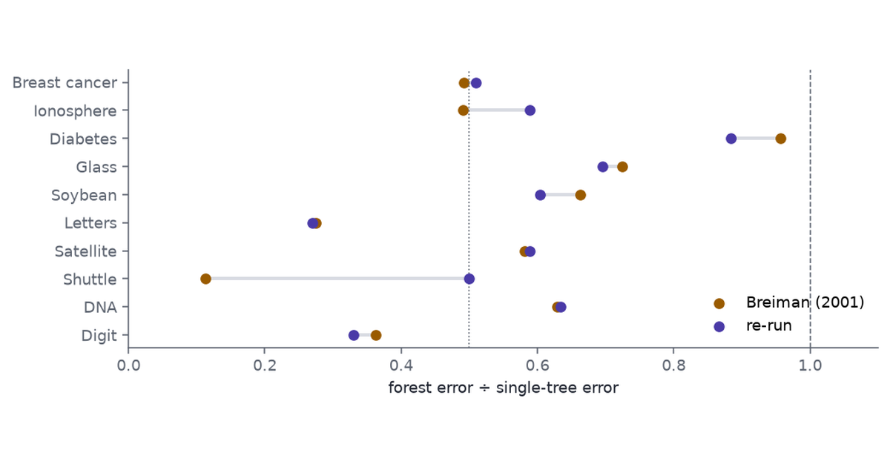

Breiman's second and third lessons say that the most accurate predictors are rarely the simplest, and that adding features, even thousands of them, can make a predictor better rather than worse.

Both run against things most analysts are taught. A model should be as simple as the data allow, and a regression with more variables than cases is a mistake. Yet the classifiers that won benchmark after benchmark in the 1990s were forests of hundreds of trees and support vector machines working in feature spaces of millions of dimensions. Breiman's sections 9 and 10 take the two observations at face value. This part re-runs his evidence on the same data and then tests the strongest objection to each lesson.

[Part 2](../two-cultures-rashomon/) covered the first lesson, Rashomon. [Part 4](../two-cultures-black-box-information/) asks what information can be extracted from the complex models this part defends.

This part covers two ideas:

- **Occam.** On interpretability a single tree rates an A+ and a forest an F; on prediction it is the other way round (pp. 207–208). The question is whether that trade is forced.
- **Bellman.** Instead of reducing dimensionality, increase it by adding many functions of the inputs (p. 208). The question is why that does not overfit.

```{python}
#| label: setup
#| echo: false
import sys
from pathlib import Path

sys.path.insert(0, str(Path("../two-cultures-breiman-2001/src").resolve()))

import matplotlib.pyplot as plt
import numpy as np
import pandas as pd
from twocultures import bellman, cache, occam
from twocultures.style import AMBER, BLUE, INK, MUTED, PINK, PURPLE, RULE, TEAL, md, setup

setup()
```

## Occam {#sec-occam}

### The name {#sec-occam-name}

William of Ockham (died 1347) was an English Franciscan friar and philosopher. "Occam's razor" is the principle of parsimony: do not posit more entities than the explanation needs. The phrase came centuries after him, and its best-known wording, "entities must not be multiplied beyond necessity", is not found in his writings; the idea is attached to him because he used it so often (*Simplicity*, Stanford Encyclopedia of Philosophy).

Breiman's version is about prediction, not ontology: simpler is usually taken to mean better, but in prediction accuracy and simplicity are in conflict (p. 206).

### Breiman's evidence {#sec-table2-claim}

Table 2 of the paper (p. 207) compares a single CART tree with a random forest on ten classification data sets, mostly from the UCI repository.

- **Five small sets** (breast cancer, ionosphere, diabetes, glass, soybean): leave out a random 10%, fit both on the other 90%, score the 10%, repeat 100 times, average.
- **Five large sets** (letters, satellite, shuttle, DNA, ZIP-code digits): their own separate test sets.

Breiman's summary: some errors are halved, others cut by a third (p. 207).

### Data {#sec-table2-data}

All ten sets were found in their original form; @tbl-table2 gives the sizes, which match Breiman's Table 1.

- **Breast cancer** (Wisconsin, Wolberg), **ionosphere** (Johns Hopkins radar returns), **glass** (forensic glass types), **soybean** (large soybean, 19 diseases), **letters** (letter images described by 16 statistics), **satellite** (Landsat pixels), **shuttle** (space-shuttle radiator states) and **DNA** (primate splice junctions): UCI originals; DNA from `mlbench`, whose row order keeps the original 2,000 / 1,186 split.
- **Diabetes** (Pima Indians): from the archived `mlbench` 2.1-9. UCI no longer distributes this data set, and `mlbench` dropped it in 2.1-10 following that removal; neither says why. It is used here only because it is in Breiman's table.
- **Digit**: the USPS ZIP-code data, 16 × 16 grey-scale images, from the *Elements of Statistical Learning* data page.

These are benchmark sets: their purpose was to compare classifiers, and a wrong ranking costs only a misleading table. They suit the comparison because they are the ones Breiman's readers knew.

### Implementation {#sec-table2-implementation}

- **Single tree.** CART grown to purity, then pruned by cost complexity with the size chosen by ten-fold cross-validation on the training data and the one-standard-error rule (Breiman et al. 1984).
- **Forest.** 500 trees, $\sqrt{p}$ variables tried at each split, no tuning.
- **Missing values** (breast cancer, soybean): training-median imputation inside each fit.
- **DNA** is coded as 180 binary indicators of the 60 nucleotides, as distributed. Breiman's Table 1 lists 60 variables.
- **Letters** has no designated split; the first 15,000 rows train, as the counts in Table 1 imply.

```{python}
#| label: tbl-table2
#| tbl-cap: "Test-set misclassification (%), Breiman's Table 2 against the re-run. The first five rows are means over 100 random 10% holdouts; the last five use the fixed test sets. Breiman printed the shuttle row multiplied by 10³; it is shown here unscaled."
small = cache.frame("table2_small_v1", lambda: occam.small(reps=100))
large = cache.frame("table2_large_v1", occam.large)
paper = {"Breast cancer": (2.9, 5.9), "Ionosphere": (5.5, 11.2), "Diabetes": (24.2, 25.3),
         "Glass": (22.0, 30.4), "Soybean": (5.7, 8.6), "Letters": (3.4, 12.4),
         "Satellite": (8.6, 14.8), "Shuttle": (0.007, 0.062), "DNA": (3.9, 6.2), "Digit": (6.2, 17.1)}
sizes = {"Breast cancer": "699 / —", "Ionosphere": "351 / —", "Diabetes": "768 / —",
         "Glass": "214 / —", "Soybean": "683 / —", "Letters": "15,000 / 5,000",
         "Satellite": "4,435 / 2,000", "Shuttle": "43,500 / 14,500", "DNA": "2,000 / 1,186",
         "Digit": "7,291 / 2,007"}
s_mean = small.groupby("dataset")[["forest", "tree"]].mean()
s_se = small.groupby("dataset")[["forest", "tree"]].std() / np.sqrt(small["rep"].nunique())
ours = {**{k: (100 * s_mean.loc[k, "forest"], 100 * s_mean.loc[k, "tree"]) for k in s_mean.index},
        **{r["dataset"]: (100 * r["forest"], 100 * r["tree"]) for _, r in large.iterrows()}}
order = list(paper)


def cell(v, k):
    return f"{v:.3f}" if k == "Shuttle" else f"{v:.1f}"


t2 = pd.DataFrame([{"Data set": k, "Train / test": sizes[k],
                    "Forest (Breiman)": cell(paper[k][0], k), "Forest (here)": cell(ours[k][0], k),
                    "Tree (Breiman)": cell(paper[k][1], k), "Tree (here)": cell(ours[k][1], k)}
                   for k in order])
ratio_ours = {k: ours[k][0] / ours[k][1] for k in order}
ratio_paper = {k: paper[k][0] / paper[k][1] for k in order}
shuttle_n = int(large.set_index("dataset").loc["Shuttle", "n_test"])
shuttle_err = {m: int(round(large.set_index("dataset").loc["Shuttle", m] * shuttle_n)) for m in ("forest", "tree")}
max_se = float(100 * s_se.max().max())
min_se = float(100 * s_se.min().min())
md(t2)
```


```{python}
#| label: fig-table2
#| fig-cap: "Forest error as a fraction of single-tree error on Breiman's ten data sets: his Table 2 against the re-run. Below 0.5 the forest halves the tree's error."
#| fig-alt: "Dot plot of ten data sets with two dots each. For most sets Breiman's ratio and the re-run's ratio are close, between about 0.3 and 0.7; diabetes is near 0.9 in both; shuttle differs most."
fig, ax = plt.subplots(figsize=(7.5, 3.0))
ypos = np.arange(len(order))[::-1]
for yy, k in zip(ypos, order):
    ax.plot([ratio_paper[k], ratio_ours[k]], [yy, yy], color=RULE, lw=2, zorder=1)
ax.scatter([ratio_paper[k] for k in order], ypos, color=AMBER, s=30, label="Breiman (2001)", zorder=2)
ax.scatter([ratio_ours[k] for k in order], ypos, color=PURPLE, s=30, label="re-run", zorder=3)
ax.axvline(0.5, color=MUTED, ls=":", lw=0.8)
ax.axvline(1.0, color=MUTED, ls="--", lw=0.8)
ax.set_yticks(ypos, order)
ax.set_xlabel("forest error ÷ single-tree error")
ax.set_xlim(0, 1.1)
ax.legend(loc="lower right")
fig.tight_layout()
plt.show()
```

### Reading the table {#sec-table2-reading}

- **The forest wins on all ten sets,** in Breiman's table and here.
- **Most numbers land within a point or two of his.** The holdout means here have standard errors of `{python} f"{min_se:.1f}"` to `{python} f"{max_se:.1f}"` points, and his would have had similar ones, so on the small sets a gap of a point between the two columns is within what two runs of the same method could give.
- **Two rows differ more.** DNA (`{python} cell(ours['DNA'][0], 'DNA')` and `{python} cell(ours['DNA'][1], 'DNA')` here, against 3.9 and 6.2) is coded as 180 binary indicators here, not as 60 four-valued variables, and that changes which splits a tree can make. Shuttle's errors are counts of a handful of cases: `{python} shuttle_err['forest']` and `{python} shuttle_err['tree']` of `{python} f"{shuttle_n:,}"` test cases here, against about 1 and 9 implied by his figures.
- **Not reproduced:** his ranking of the forest first on all four Statlog sets against the project's 18 classifiers (p. 208), which needs those classifiers.

### The dilemma, and an objection {#sec-occam-dilemma}

Breiman's conclusion (p. 208): accuracy generally requires more complex prediction methods, so go for accuracy first and try to understand why afterwards. He calls it the Occam dilemma, and later in the paper argues there is no dilemma, because the goal is accurate information rather than interpretability (Part 4).

Hoadley's comment disputes the premise from credit scoring (pp. 220–224). Fair, Isaac's segmented scorecards are additive models on binned, engineered characteristics. They are interpretable enough for regulators, and in his experience as accurate as anything else. His Fat Scorecard, a logistic regression on binned dummies of 27 characteristics, slightly beat a neural network with 2,000 weights and held up on test samples one, two and three years later (p. 222). His "Ping-Pong theorem" (p. 223) says a forest could beat any scorecard whose score it was shown, and a scorecard could then beat the forest. The data are proprietary. Rudin (2019) made the same argument general: for structured data with meaningful features, interpretable models that match black boxes usually exist, and high-stakes decisions should use them.

### A scorecard against a forest {#sec-credit}

#### Data {#sec-credit-data}

- **Source.** "Default of credit card clients", UCI repository, donated by Yeh and Lien (2009): 30,000 credit-card holders in Taiwan with six months of history, April to September 2005; 22% defaulted on the next payment.
- **Inputs.** Credit limit, demographics, and six months of repayment status, bill amounts and payment amounts: 23 columns.
- **Why this data.** It is the shape of Hoadley's example, monthly bills and payments over the last months with a default flag as the outcome (p. 220), in public form.
- **Cost of a wrong answer.** A bank lends to customers who will not repay, or refuses customers who would.

#### Models {#sec-credit-models}

1. **Logistic regression** on the 23 standardised raw columns.
2. **Pruned CART** on the raw columns, as in @tbl-table2.
3. **Random forest**, 500 trees, minimum leaf size 5, raw columns.
4. **Scorecard.** Ten characteristics of the kind Hoadley describes, built from the raw columns: last month's repayment status, the worst status and the number of late months over six, last-month and six-month utilisation (bill ÷ limit), last-month and six-month payment ratios, the trend in the bill, credit limit and age. Each continuous characteristic is cut into eight quantile bins, the status counts kept as categories, and a logistic regression fitted to the bin indicators.

Each model is fitted on a random two-thirds of clients and scored on the remaining third, for three different splits.

```{python}
#| label: tbl-credit
#| tbl-cap: "Taiwan credit-card default, held-out third of 30,000 clients over three random splits. Guessing 'no default' errs on 22.1%."
def run_credit():
    return pd.concat([bellman.credit_models(seed=s)[0].assign(seed=s) for s in (0, 1, 2)])


credit = cache.frame("credit_v1", run_credit)
cg = credit.groupby("model", sort=False).agg(auc_lo=("auc", "min"), auc_hi=("auc", "max"),
                                             err=("error", "mean"), params=("n_params", "median"))
ctab = pd.DataFrame({"Model": cg.index,
                     "Test AUC, three splits": [f"{a:.3f}–{b:.3f}" for a, b in zip(cg["auc_lo"], cg["auc_hi"])],
                     "Test error": [f"{v:.1%}" for v in cg["err"]],
                     "Size": [f"{int(p):,} leaves" if "tree" in m else
                              (f"{int(p):,} nodes" if "forest" in m else f"{int(p)} coefficients")
                              for m, p in zip(cg.index, cg["params"])]})
gap = (credit.pivot(index="seed", columns="model", values="auc")
       .pipe(lambda d: d["Random forest, raw inputs"] - d["Scorecard: logistic on binned characteristics"]))
md(ctab)
```


- **The scorecard matches the forest.** The forest's AUC minus the scorecard's is `{python} ", ".join(f"{v:+.3f}" for v in gap)` on the three splits.
- **Plain logistic regression is clearly worse,** and the pruned tree worse still: the one-standard-error rule cuts it to `{python} int(cg.loc['Pruned tree (CART), raw inputs', 'params'])` leaves, one split on whether last month's payment was two or more months late.
- **None of the four improves much on guessing in raw error,** because a 50% threshold is a poor rule when only 22% default; AUC, which ranks clients, is the measure that separates them.

The scorecard's advantage over plain logistic regression is in its characteristics. Hoadley's point was not that logistic regression is enough, but that a data-modeling tool with engineered, binned inputs, "linear in an exploded dimension" in his words (p. 221), can be both accurate and readable.

```{python}
#| label: fig-scorecard
#| fig-cap: "Two characteristics of the fitted scorecard (split 0): the logistic coefficient of each bin, relative to the first. Higher means more likely to default."
#| fig-alt: "Left, bars rising steeply from repayment status 0 or earlier to status 2 and above. Right, bars rising gently with six-month utilisation from the lowest to the highest bin."
sc = bellman.credit_scorecard(seed=0)
pre, lr = sc.steps[0][1], sc.steps[-1][1]
names_out = pre.get_feature_names_out()
coef = pd.Series(lr.coef_[0], index=names_out)
status = coef[[n for n in names_out if n.startswith("cats__status_last_")]]
util = coef[[n for n in names_out if n.startswith("bins__util_mean6_")]]
fig, axes = plt.subplots(1, 2, figsize=(7.5, 2.8))
axes[0].bar(range(len(status)), status - status.iloc[0], color=PURPLE)
axes[0].set_xticks(range(len(status)), [n.replace("cats__status_last_", "") for n in status.index], fontsize=7)
axes[0].set_xlabel("last month's repayment status (months late; ≤ 0 on time)")
axes[1].bar(range(len(util)), util - util.iloc[0], color=TEAL)
axes[1].set_xticks(range(len(util)), [str(i + 1) for i in range(len(util))])
axes[1].set_xlabel("six-month utilisation, bin (1 = lowest)")
axes[0].set_ylabel("score weight vs first bin")
fig.tight_layout()
plt.show()
```

## Bellman {#sec-bellman}

### The name {#sec-bellman-name}

"The curse of dimensionality" is Richard Bellman's phrase, usually credited to his *Dynamic Programming* (1957): the number of cells needed to cover a space grows exponentially with its dimension. Breiman's point is the standard advice it produced, reduce the inputs to a few features that "contain most of the information" (p. 208), and his proposal is the opposite: add many functions of the inputs, each carrying a little information, and let the algorithm assemble them.

### Breiman's evidence {#sec-bellman-claim}

1. **The Amit–Geman shape forest** (p. 208): thousands of geometric features, shallow trees choosing among 100 random features per node, over 1,000 trees; 0.7% test error on NIST digits with 100,000 training and 50,000 test images. Not reproduced: the feature hierarchy is not specified in enough detail, and the NIST split is not the public MNIST split.
2. **Support vector machines** (pp. 208–209): add all monomials of the inputs up to some degree until the two classes are separated by a hyperplane. On the ZIP-code data, separation came with fourth-degree monomials and a test error of 4.1%.

### Polynomial features on the ZIP-code digits {#sec-svm}

An SVM with the kernel $K(x, x') = (\gamma\, x^\top x' + 1)^d$ fits a hyperplane in the space of all monomials of the 256 pixels up to degree $d$, without forming them. Here $\gamma = 1/256$, the cost parameter is $10^6$ so the margin is effectively hard, and the ten classes are handled one pair at a time.

```{python}
#| label: tbl-svm
#| tbl-cap: "Polynomial-kernel SVMs on the USPS ZIP-code digits, 7,291 training and 2,007 test images. Features counts the monomials up to degree d (constant excluded) that the kernel implicitly uses."
svm = cache.frame("svm_v1", bellman.svm_degrees)
stab = pd.DataFrame({"Degree d": svm["degree"],
                     "Features": [f"{v:,}" for v in svm["n_features"]],
                     "Training error": [f"{v:.1%}" for v in svm["train_error"]],
                     "Test error": [f"{v:.1%}" for v in svm["test_error"]],
                     "Support vectors": [f"{v:,}" for v in svm["support_vectors"]],
                     "Support vectors ÷ (N − 1)": [f"{v / 7290:.1%}" for v in svm["support_vectors"]]})
svm4 = svm.set_index("degree").loc[4]
md(stab)
```

- **Every degree separates the training set,** including degree 1: with 256 pixels and a few hundred images per digit, each pair of digits is linearly separable. Breiman's "separation occurs with fourth degree monomials" (p. 209) does not hold here in the one-pair-at-a-time sense; he does not say how the multi-class problem was set up.
- **Test error falls with degree,** from `{python} f"{svm['test_error'].iloc[0]:.1%}"` at $d = 1$ to `{python} f"{svm4['test_error']:.1%}"` at $d = 4$, against his 4.1%. At $d = 4$ the hyperplane lives in a space of `{python} f"{int(svm4['n_features']):,}"` dimensions, fitted to 7,291 images.
- **Vapnik's bound** (p. 209) says the expected error is at most the expected number of support vectors divided by $N - 1$. Read loosely for the multi-class machine, that is about `{python} f"{svm4['support_vectors'] / 7290:.0%}"` at degree 4: true, and five times the observed error.

The bound grows with the number of support vectors, not with the dimension, which is why a space of 186 million dimensions need not overfit. It explains why the curse can be lifted; it does not predict the error.

### Past the interpolation threshold {#sec-double-descent}

Efron's comment asks where the bias went (p. 219): a model with more knobs than data points must be a biased estimator, or it could not predict. A later line of work gives one answer for least squares. Belkin, Hsu, Ma and Mandal (2019) showed that as a model's size passes the number of training points, test error first rises to a peak, where the model can just fit the data, and then falls again. Among the many fits that interpolate the data, the fitting procedure picks the one of smallest norm, and that choice is the bias Efron was looking for. They call the curve *double descent*.

#### Design {#sec-dd-design}

- **Data.** 1,000 USPS training digits drawn at random, the full 2,007-image test set.
- **Features.** $p$ random ReLU features of the 256 pixels, $\phi(x) = \max(0, W^\top x)$ with $W$ Gaussian, for $p$ from 10 to 20,000.
- **Fit.** Least squares from the features to one-hot digit labels; minimum-norm solution when $p \ge n$. A second series adds a small ridge penalty, $\lambda = 0.1$.
- **Replicates.** Five draws of the training digits and of $W$.

```{python}
#| label: dd
rf0 = cache.frame("randfeat_v1", lambda: bellman.random_features())
rf1 = cache.frame("randfeat_ridge_v1", lambda: bellman.random_features(ridge=1e-1))
c0 = rf0.groupby("width")[["train_error", "test_error"]].mean()
c1 = rf1.groupby("width")[["train_error", "test_error"]].mean()
classic = c0[c0.index < 1000]["test_error"]
classic_w, classic_e = int(classic.idxmin()), float(classic.min())
near = c0[(c0.index > 500) & (c0.index < 2000)]["test_error"]
peak_w, peak_e = int(near.idxmax()), float(near.max())
end_e = float(c0["test_error"].iloc[-1])
ridge_near = c1[(c1.index > 500) & (c1.index < 2000)]["test_error"]
ridge_peak, ridge_peak_w = float(ridge_near.max()), int(ridge_near.idxmax())
interp_w = int(c0[c0["train_error"] < 0.001].index.min())
```

```{python}
#| label: fig-dd
#| fig-cap: "Random ReLU features on 1,000 USPS training digits: test error (solid) and training error (dashed) against the number of features, means over five draws. Purple: minimum-norm least squares. Teal: with a small ridge penalty. The dotted line marks p = n."
#| fig-alt: "Test error falls to about 14 percent near 300 features, rises to a sharp peak of about 45 percent just past 1,000 features for minimum-norm least squares (about 22 percent with ridge), then falls to about 8 percent at 20,000 features. Training error falls below 0.1 percent by about 500 features and is exactly zero from just past 1,000."
fig, ax = plt.subplots(figsize=(7.5, 3.0))
for c, col, lab in [(c0, PURPLE, "minimum norm"), (c1, TEAL, "ridge λ = 0.1")]:
    ax.plot(c.index, c["test_error"], color=col, lw=1.8, label=f"test, {lab}")
    ax.plot(c.index, c["train_error"], color=col, lw=1.0, ls="--")
ax.axvline(1000, color=MUTED, ls=":", lw=0.8)
ax.set_xscale("log")
ax.set_xlabel("random features p")
ax.set_ylabel("misclassification")
ax.legend()
fig.tight_layout()
plt.show()
```

#### Result {#sec-dd-result}

- **The classical curve.** Test error falls to `{python} f"{classic_e:.1%}"` at `{python} classic_w` features and then rises, the textbook picture of overfitting.
- **The peak.** Training error is below 0.1% from `{python} interp_w` features on. Test error peaks at `{python} f"{peak_e:.1%}"` at `{python} f"{peak_w:,}"` features, just past $p = n$. There the features can only just fit the 1,000 labels, the coefficients needed to do it are large (their norm peaks near $p = n$), and the fit swings wildly between training points.
- **The second descent.** At 20,000 features test error is `{python} f"{end_e:.1%}"`, below the classical minimum.
- **Regularisation shrinks the peak.** With $\lambda = 0.1$ the highest test error near $p = n$ is `{python} f"{ridge_peak:.1%}"`, at `{python} f"{ridge_peak_w:,}"` features: still above the classical minimum, but about half the minimum-norm peak.

::: {#widget-dd}
:::

```{=html}
<script src="widget-data/data.js"></script>
<script src="widgets.js"></script>
```

1. The slider starts at `{python} classic_w` features, near the classical minimum: test error `{python} f"{classic_e:.1%}"`.
2. Move to `{python} f"{peak_w:,}"`. Training error is 0%; test error is `{python} f"{peak_e:.1%}"`.
3. Move to 20,000. Both curves are low: `{python} f"{end_e:.1%}"` test error with zero training error.
4. Switch to the ridge fit. At `{python} f"{peak_w:,}"` test error drops to `{python} f"{c1.loc[peak_w, 'test_error']:.1%}"`; the ridge curve's own high point is `{python} f"{ridge_peak:.1%}"`, at `{python} f"{ridge_peak_w:,}"`.

Breiman's Bellman lesson was empirical: more features helped. Double descent is one mechanism behind it, for one family of models. It does not cover forests, whose averaging is a different kind of regularisation (Breiman 2001).

## Constraints {#sec-constraints}

- **Implementations differ from 2001.** scikit-learn's CART pruning and forest are not Breiman's Fortran; the tree's pruning rule and the forest's settings are stated in @sec-table2-implementation and were not tuned to match his figures.
- **One scorecard, one data set.** The credit result supports Hoadley's existence claim, that an interpretable model can match a forest on some data; it does not show that one always exists.
- **The SVM setup is a choice.** $\gamma$, the cost and the one-pair-at-a-time scheme were fixed in advance. Tuning them on held-out folds would likely lower the error toward published figures near 4%, but that is a different experiment from Breiman's.
- **Double descent here is for least squares on random features.** It is a demonstration of a mechanism, not an account of why forests or SVMs generalise.

## Reproduction status {#sec-status}

::: {.table-responsive}

| Experiment | Paper's data | Data used here | Paper's result | Our result | Notes |
|---|---|---|---|---|---|
| Table 2, five small sets (§9.2) | UCI | same (Pima from archived `mlbench`) | forest beats tree on all five | forest beats tree on all five; @tbl-table2 | within ~1.5 points except where noted |
| Table 2, five large sets (§9.2) | UCI / Statlog / USPS | same | forest beats tree; some errors halved | same; DNA and shuttle differ most | DNA coding; shuttle error counts tiny |
| Statlog ranks (§9.3) | 18 classifiers | — | forest ranks 1, 1, 1, 1 | not attempted | needs the other classifiers |
| Fat Scorecard (Hoadley) | Fair, Isaac, proprietary | Taiwan credit default (UCI) | scorecard ≈ neural net | scorecard AUC within `{python} f"{gap.abs().max():.3f}"` of the forest | stand-in data |
| Shape forest (§10.2) | NIST, 100,000 / 50,000 | — | 0.7% | not attempted | features not specified |
| SVM, ZIP code (§10.3) | USPS | same | separation at degree 4; 4.1% | separation at every degree; `{python} f"{svm4['test_error']:.1%}"` at degree 4 | multi-class scheme unstated |
| Double descent (extension) | — | USPS, random features | — | peak `{python} f"{peak_e:.0%}"` at p ≈ n, `{python} f"{end_e:.1%}"` at 20,000 | Belkin et al. (2019) |

: Part 3's rows of the series reproduction table. {#tbl-status}

:::

Forests. Win. Scorecards. Tie. Dimensions. Help. When. Norms. Stay. Small.

```{python}
#| label: export-status
#| include: false
# The numbers Part 5's series table quotes from this part (twocultures/status.py).
from twocultures import status

status.export(
    forest_wins=sum(ours[k][0] < ours[k][1] for k in order), n_sets=len(order),
    within_1_5=sum(abs(ours[k][m] - paper[k][m]) <= 1.5 for k in order for m in (0, 1)),
    n_cells=2 * len(order), credit_gap=gap.abs().max(), svm4_error=svm4["test_error"])
```

## References {#sec-references}

- Amit, Y. & Geman, D. (1997). [Shape quantization and recognition with randomized trees](https://doi.org/10.1162/neco.1997.9.7.1545). *Neural Computation* 9(7), 1545–1588.
- [Simplicity](https://plato.stanford.edu/entries/simplicity/). *The Stanford Encyclopedia of Philosophy*.
- Belkin, M., Hsu, D., Ma, S. & Mandal, S. (2019). [Reconciling modern machine-learning practice and the classical bias–variance trade-off](https://doi.org/10.1073/pnas.1903070116). *PNAS* 116(32), 15849–15854.
- Bellman, R. (1957). *Dynamic Programming*. Princeton University Press.
- Breiman, L. (2001). [Random forests](https://doi.org/10.1023/A:1010933404324). *Machine Learning* 45, 5–32.
- Breiman, L. (2001). [Statistical modeling: the two cultures (with comments and a rejoinder)](https://doi.org/10.1214/ss/1009213726). *Statistical Science* 16(3), 199–231.
- Breiman, L., Friedman, J. H., Olshen, R. A. & Stone, C. J. (1984). *Classification and Regression Trees*. Wadsworth.
- Hastie, T., Tibshirani, R. & Friedman, J. (2009). *The Elements of Statistical Learning*, 2nd ed. Springer. Source of the USPS ZIP-code data files.
- Leisch, F. & Dimitriadou, E. *mlbench: Machine Learning Benchmark Problems*, R package, versions 2.1-9 (Pima) and 2.1-11 (DNA).
- Rudin, C. (2019). [Stop explaining black box machine learning models for high stakes decisions and use interpretable models instead](https://doi.org/10.1038/s42256-019-0048-x). *Nature Machine Intelligence* 1(5), 206–215.
- Vapnik, V. (1995). *The Nature of Statistical Learning Theory*. Springer.
- Yeh, I.-C. & Lien, C.-H. (2009). [The comparisons of data mining techniques for the predictive accuracy of probability of default of credit card clients](https://doi.org/10.1016/j.eswa.2007.12.020). *Expert Systems with Applications* 36(2), 2473–2480.
- [The Two Cultures, Part 2: Rashomon](../two-cultures-rashomon/) — Hoadley's Fat Scorecard as a Rashomon set.
- [The Two Cultures, Part 4: Information from a black box](../two-cultures-black-box-information/) — extracting information from the complex models.
