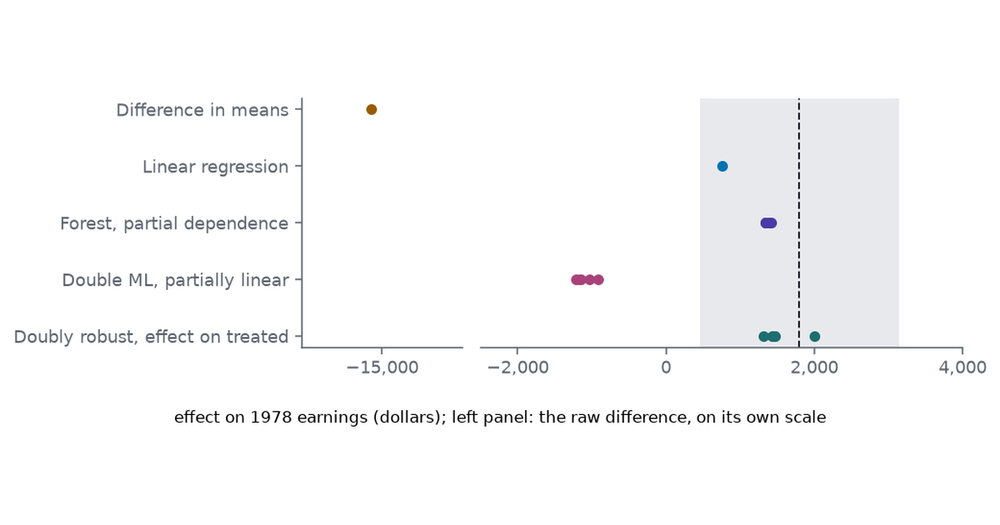

Breiman's paper was published with four comments and a reply, and the comment he answered with "I agree." raises the question predictive accuracy cannot settle: what happens if we change something.

Every predictive model invites the same misreading. A churn model ranks discount codes among its top features, a readmission model gives a drug a large importance score, and the next meeting asks what happens if the company sends more codes or the hospital prescribes more of the drug. The model was never asked that question. It learned which customers and which patients tend to have which outcomes, and the people who get discounts or drugs are not a random sample. Cox's comment makes this point in 2001, and it is the point Breiman conceded.

[Parts 1–4](../two-cultures-breiman-2001/) re-ran the paper's evidence. This part sets the discussants against those results and then takes up Cox's question with a widget and with data whose causal answer is known from an experiment.

This part covers two ideas:

- **The pushback.** Four statisticians answered Breiman in print; each comment, in its strongest form, survives some of the re-runs and is contradicted by others.
- **Prediction against intervention.** A model can predict an outcome well and still answer an intervention question wrongly, because the data record who was treated, not what treatment does.

```{python}
#| label: setup
#| echo: false
import platform
import sys
from importlib.metadata import version
from pathlib import Path

sys.path.insert(0, str(Path("../two-cultures-breiman-2001/src").resolve()))

import matplotlib.pyplot as plt
import numpy as np
import pandas as pd
from twocultures import cache, causal, status
from twocultures.style import AMBER, BLUE, INK, MUTED, PINK, PURPLE, RULE, TEAL, md, setup

setup()
# What Parts 1-4 wrote when they last executed (twocultures/status.py).
S1, S2, S3, S4 = (status.load(f"two-cultures-{s}") for s in
                  ("breiman-2001", "rashomon", "occam-and-bellman", "black-box-information"))
```

## The discussion {#sec-discussion}

*Statistical Science* printed the paper with four invited comments and Breiman's reply (pp. 216–231). Breiman sorted them himself in the rejoinder's first paragraph (p. 226).

| Discussant | In 2001 | Breiman's summary of the stance |
|---|---|---|
| D. R. Cox | Nuffield College, Oxford | downright disagreement |
| Brad Efron | Stanford | serious reservations |
| Bruce Hoadley | Fair, Isaac (credit scoring) | more or less in agreement |
| Emanuel Parzen | Texas A&M | more or less in agreement |

: The four discussants (pp. 216, 218, 220, 224, 226). {#tbl-discussants}

Each subsection states the comment in its strongest form, then what the re-runs in Parts 1–4 do to it.

### Cox: start from the question, and know what you are predicting {#sec-cox}

Cox grants more than his reputation for the opposing view suggests. He calls work without an explicit probability model a legitimate part of statistics, and he accepts that a purely empirical predictor sometimes wins; short-term economic forecasting and real-time flood forecasting are his examples (p. 216). His objections are four.

1. **The picture of mainstream practice is a caricature.** His word; he adds that good caricatures expose real weaknesses (p. 216). Journal papers illustrate technique, while live analyses that reach conclusions are reported in subject-matter journals and reports, so the journals Breiman read are the wrong sample (p. 217).
2. **Data have a meaning before they have a model.** What a variable measures, how the cases were ascertained, measurement error and why values are missing all bear on the answer, and he doubts these can be handled without some probabilistic model (p. 216).
3. **Much prediction worth doing is extrapolation.** His examples: the course of the vCJD epidemic in the UK, and the effect on US cancer incidence of cutting medical X-ray use by 10% (p. 216). Both ask what happens under conditions the data never showed, and the second asks what an intervention would do. A predictor validated on a random test set from the same population says nothing about either.
4. **A model should carry subject-matter meaning.** He lists Cox and Wermuth's requirements: connect to background knowledge, point toward a generating process, have parameters with a clear interpretation, specify the noise well enough to state precision, and fit adequately. Fit, which predictive accuracy measures, is last and is not the basis of choice (p. 217). The aim is descriptions that are potentially causal (p. 218).

Two smaller points land on specific results. Cox warns that complete separation, on which Breiman's SVM argument rests, is unstable, and that the bootstrap and cross-validation may give "a quite misleading illusion of stability" (p. 218). He also quotes an aphorism he attributes, tentatively, to Kelvin: a rough answer to the right question beats an exact answer to the wrong one (p. 218).

What the re-runs say:

- **Point 2 holds.** The Bupa "class" in Part 4 is a train/test selector created by the people who collected the data; a forest predicted it with 25% error and no amount of accuracy could reveal what it was. The hepatitis file's binary codes are documented only by the data themselves.
- **The separation warning holds.** In Part 4's forward-selection bootstrap, sex is chosen in 81% of resamples because no woman in the data died.
- **Point 3 is the one Breiman conceded,** and the subject of @sec-prediction.

### Efron: where did the bias go? {#sec-efron}

Efron reads the paper as a call for theory, not against it.

1. **Twentieth-century statistics was "100 years of unbiasedness"** (p. 218). Unbiased estimation needs a favourable ratio of sample size to parameters, and good design exists to secure it.
2. **Black boxes with many knobs must be biased estimators.** Regularisation, tree pruning and SVM margins all trade variance for bias somewhere, and there is little theory for heavily biased estimators (p. 219).
3. **Two rules of thumb about comparisons** (p. 219). New methods always look better than old ones, because honest simulation comparisons are hard and the old method rarely gets the same tuning effort. Complicated methods are harder to criticise than simple ones.
4. **Prediction is rarely enough.** The post office needs only addresses read correctly; Gregory studied the hepatitis data partly to understand the disease, and most surveys aim at causal factors (p. 219).
5. **The hepatitis variables.** From his fuller analysis with Gong (1983): variables 12 or 17 were selected in 60% of bootstrap samples, against 59% for variable 19 (p. 219). He asks in what sense a variable is important.

What the re-runs say:

- **Rule 1.** Every single tree in Part 3 was pruned by cross-validation inside its training data, and the forest was not tuned. The forest still won on all ten sets.
- **Point 2 has an answer for one model family.** In Part 3's double-descent curve the bias hides in which interpolating fit least squares picks: the one of smallest norm.
- **Point 5.** Part 4 found importance depends on the model, the measure and the correlation among inputs; Breiman's rejoinder says the same.

### Hoadley: an algorithmic culture inside the data-modeling toolbox {#sec-hoadley}

Hoadley wrote from Fair, Isaac, where credit scoring had been algorithmic since the 1960s (p. 220). He agrees with Breiman's direction and disputes the details.

1. **"Primitive" is wrong.** Fair, Isaac's segmented scorecards were built by engineers: thousands of derived characteristics, a shallow tree of segments, and a binned additive score in each leaf, about 10,000 features from 24 raw inputs, judged only on test samples (pp. 220–221).
2. **Accuracy and interpretability can coexist.** The Fat Scorecard, logistic regression on binned dummies, slightly beat a 2,000-weight neural network and held up on three later test samples (p. 222).
3. **The test sample is not the future.** It samples the current population; scorecards are rebuilt every 18–24 months (pp. 221–222). Tuning that peeks at the test sample biases the estimate (p. 223).
4. **Error rate is not the objective.** A fraud model is judged by dollars saved at a fixed review rate (p. 223).
5. **Importance is not a property of the variable.** If an equally accurate model exists without $x_1$, then $x_1$ is unimportant to that model (p. 223).

What the re-runs say:

- **Point 2 reproduces.** On Taiwan credit-card data in Part 3, a 78-coefficient scorecard matched a 500-tree forest in AUC on three splits.
- **Point 5 reproduces.** The 175 ozone regressions within 5% of the best in Part 2 use every one of the 30 candidate variables between them.

### Parzen: management and science {#sec-parzen}

1. **Two goals, renamed.** Prediction is "management" (short-run, profit, decisions); information is "science" (long-run truth and understanding) (p. 224).
2. **Wrong model, right arithmetic.** Fitting a model that misdescribes nature is the right answer to the wrong question, the error of the third kind (p. 224).
3. **Two checks to make routine.** Test whether inputs are dependent, since correlated inputs act as proxies and make equally good models disagree; and test for conditional clustering, where one class occupies two separate regions of input space (pp. 224–225).
4. **Many cultures, not two.** He offers his quantile-based approach and "statistical methods mining" as a synthesis (p. 225).

What the re-runs say: point 3 names both of Part 4's findings in advance. The first check is the ascites–albumin surrogate pair; the second is Breiman's Bupa clusters.

### Breiman's rejoinder {#sec-rejoinder}

1. **To Cox.** Data models are useful when the mechanism is well understood, or when data are too few and a policy decision is due anyway. On extrapolation and intervention he quotes Cox's v-CJD passage and replies "I agree." (p. 227). On the caricature he says the dispute is over the word "mainstream": counted by SAS licences and canned-package users, his version wins by at least 100 to 1 (p. 228).
2. **To Efron.** Science moves from simple models to complex ones; the job is to extract information from the most accurate model available (p. 229). A model barely better than the baseline cannot be trusted to identify causal factors (p. 229). Random forests have one tuning parameter (p. 230).
3. **On importance.** Importance has always been defined operationally, and his definition is predictive. It lacks a theoretical definition and depends on the dependence among inputs: "The problem begs for research." (p. 230).
4. **To Hoadley.** Models must be rebuilt with data from the new context, and Fair, Isaac is an exception on interpretability (pp. 230–231).
5. **To Parzen.** Two cultures, because the line is clear: is the analyst modeling the inside of the box or not (p. 231).

## Prediction and intervention {#sec-prediction}

### Three tasks {#sec-tasks}

Hernán, Hsu and Healy (2019) sort data-science work into three tasks:

1. **Description**: summarise the data (what fraction of patients were readmitted).
2. **Prediction**: map inputs to outputs (which patients will be readmitted).
3. **Counterfactual prediction**: what the outcome would be under a different action (how many would be readmitted if all got the drug).

Breiman's validation, held-out predictive accuracy, checks task 2. Cox's X-ray question is task 3. Pearl's "ladder of causation" (Pearl and Mackenzie 2018) draws the same line between seeing and doing; [an earlier post](../causality-from-toddlers-to-do-calculus/) works through it, and [another](../explainability-vs-causality/) separates attributing a model's output from explaining the world.

The two tasks agree only when the people who received the action are comparable to those who did not. When something drives both who gets the action and the outcome, a *confounder*, the association in the data mixes the action's effect with the confounder's.

### A confounder, in miniature {#sec-toy}

The widget is synthetic. It stands in for a clinical setting in which sicker patients get more of a treatment.

- **Severity** $S \sim N(0, 1)$.
- **Dose** $T = aS + \sqrt{1 - a^2}\,U_T$: sicker patients get more.
- **Outcome** $Y = \tau T + bS + 0.6\,U_Y$: severity hurts the outcome ($b < 0$) and the dose helps ($\tau > 0$).

A model that predicts $Y$ from $T$ learns the slope $\tau + ab$. Raising everyone's dose by one unit changes $Y$ by $\tau$, whatever $a$ and $b$ are.

::: {#widget-confound}
:::

```{=html}
<script src="model.js"></script>
<script src="widgets.js"></script>
```

1. At the starting setting ($a = 0.9$, $b = -1.6$, $\tau = 0.5$) the fit of outcome on dose has a slope of `−0.96` and an $R^2$ of `0.51`: a respectable predictive model that says more dose means a worse outcome. The causal effect is `+0.50`. Adjusting for severity gives a slope of `0.49`.
2. Drag "Severity → dose" to 0. The two lines nearly coincide: with no confounding the predictive slope estimates the causal one, and the $R^2$ drops, because dose no longer carries information about severity.
3. Press **New patients** a few times at the starting setting. The predictive slope stays between −1.0 and −0.8 over the first five draws: the error is not noise, and more data will not remove it.

The predictive model is not wrong. It answers the question it was trained on: among patients like these, who will do badly. The doctor's question is different.

### Lalonde: a predictive model against an experiment {#sec-lalonde}

#### Data {#sec-lalonde-data}

- **Source.** The National Supported Work (NSW) demonstration, a 1970s US job-training program that assigned applicants to training or control at random. LaLonde (1986) compared the experimental estimate of its effect on earnings with non-experimental estimates built from survey comparison groups. The version here is Dehejia and Wahba's (1999): 185 trained men and 260 controls from the experiment, and 2,490 men from the Panel Study of Income Dynamics (PSID) as a comparison group. Files from Dehejia's data page; provenance in the series' [`data/README.md`](https://github.com/project-delphi/ml-blog/tree/main/posts/two-cultures-breiman-2001/data).
- **Variables.** 1978 earnings (the outcome), training, age, education, race, marital status, whether a high-school degree, and 1974 and 1975 earnings.
- **Why this data.** The experiment gives the causal answer, so every observational method can be graded against it.
- **Cost of a wrong answer.** A policy funded or cut on the wrong sign.

The observational question replaces the experiment's controls with the PSID men, who are older, better paid and more likely to be married than the program's applicants.

```{python}
#| label: tbl-lalonde
#| tbl-cap: "Estimates of the effect of NSW training on 1978 earnings. All rows except the first use the 185 trained men and the 2,490 PSID men; the forests use 500 trees (300 for the nuisance models), minimum leaf size 5, five-fold cross-fitting."
L = cache.obj("lalonde_v1", causal.lalonde)


def usd(v):
    """Dollars for Markdown: escaped sign (so MathJax leaves it alone), true minus."""
    return ("−" if v < 0 else "") + f"\\${abs(v):,.0f}"


def rng(key):
    v = L[key]
    return f"{usd(min(v))} to {usd(max(v))}"


rows = [
    ("Experiment: treated minus experimental controls", f"{usd(L['experimental'])} (SE {usd(L['experimental_se'])})", "the benchmark"),
    ("Difference in means, treated vs PSID", usd(L["naive"]), "the raw association"),
    ("Linear regression on training and covariates", usd(L["ols"]), "adjusts linearly"),
    ("Random forest, read as partial dependence", rng("s_learner"), "five seeds"),
    ("Double ML, partially linear model", rng("dml_plr"), f"five seeds; SE about {usd(np.mean(L['dml_plr_se']))}"),
    ("Doubly robust effect on the treated", rng("aipw_att"), f"five seeds; SE about {usd(np.mean(L['aipw_att_se']))}"),
]
md(pd.DataFrame(rows, columns=["Estimate", "Effect of training on 1978 earnings", "Notes"]))
```


```{python}
#| label: fig-lalonde
#| fig-cap: "Estimates of the training effect on 1978 earnings from the observational comparison (trained men against PSID men), one point per seed for the forest-based methods, against the experimental estimate (dashed line, shaded ±2 standard errors)."
#| fig-alt: "Dot plot. The experimental benchmark is about 1,800 dollars. The raw difference in means sits far to the left at about minus 15,000. Linear regression, forest partial dependence and the doubly robust estimate cluster between about 750 and 2,000 dollars, inside or near the benchmark band; the partially linear double-ML estimates sit near minus 1,000."
est = [("Difference in means", [L["naive"]]), ("Linear regression", [L["ols"]]),
       ("Forest, partial dependence", L["s_learner"]), ("Double ML, partially linear", L["dml_plr"]),
       ("Doubly robust, effect on treated", L["aipw_att"])]
fig, axes = plt.subplots(1, 2, figsize=(7.5, 2.6), gridspec_kw={"width_ratios": [1, 3]}, sharey=True)
for ax in axes:
    ax.axvspan(L["experimental"] - 2 * L["experimental_se"], L["experimental"] + 2 * L["experimental_se"],
               color=RULE, alpha=0.6, lw=0)
    ax.axvline(L["experimental"], color=INK, ls="--", lw=1)
    for k, (name, vals) in enumerate(est):
        ax.scatter(vals, [len(est) - 1 - k] * len(vals), color=[AMBER, BLUE, PURPLE, PINK, TEAL][k], s=22, zorder=3)
axes[0].set_xlim(-16500, -13500)
axes[0].set_xticks([-15000], ["−15,000"])
axes[1].set_xlim(-2500, 4000)
axes[1].set_xticks([-2000, 0, 2000, 4000], ["−2,000", "0", "2,000", "4,000"])
axes[0].set_yticks(range(len(est))[::-1], [n for n, _ in est])
axes[0].spines["right"].set_visible(False)
axes[1].spines["left"].set_visible(False)
axes[1].tick_params(left=False)
fig.supxlabel("effect on 1978 earnings (dollars); left panel: the raw difference, on its own scale", fontsize=8.5)
fig.tight_layout()
plt.show()
```

- **The association is not the effect.** Trained men earned `{python} usd(-L["naive"])` less in 1978 than the PSID men. The program selected men with low earnings; that is the confounding.
- **The forest predicts earnings moderately well:** cross-validated $R^2$ of `{python} f"{np.mean(L['rf_r2']):.2f}"`.
- **Its partial dependence lands near the experiment.** Setting training to 1 and to 0 for every trained man and averaging the difference gives `{python} rng("s_learner")`. Because the forest sees the earnings history and demographics that drove selection, its comparison is between similar men.
- **The doubly robust estimate of the effect on the treated,** `{python} rng("aipw_att")` with a standard error near `{python} usd(np.mean(L["aipw_att_se"]))`, is consistent with the experiment.
- **The partially linear double-ML estimate is negative,** `{python} rng("dml_plr")`. It estimates a different quantity: an average of individual effects weighted by how uncertain each man's treatment status is given his covariates, which here means the minority of PSID men who resemble the trainees. `{python} f"{L['psid_share_low_propensity']:.0%}"` of the PSID men have a fitted probability of training below 1%, so the two targets weight very different men, and with effects that vary between men they need not agree.

The lesson differs from the widget's. Here the confounders were measured, and a flexible predictive model with all of them recovered roughly the right answer. But the estimates span a range of thousands of dollars, including both signs, depending on the target and the method. Without the experiment there would be no way to tell from the data which one to believe. Dehejia and Wahba (1999) made the same point with propensity scores: the estimates depend on whether the comparison group overlaps with the treated.

### A proxy outcome {#sec-obermeyer}

Obermeyer, Powers, Vogeli and Mullainathan (2019) studied a commercial algorithm used to refer US patients to care-management programs. It predicted future health-care costs well, and costs were used as a stand-in for health needs. Because less money was spent on Black patients than on white patients with the same needs, Black patients assigned the same risk score were sicker. The prediction was accurate; the question it answered, who will cost the most, was not the question the referral program asked, who needs help most. It is Parzen's error of the third kind and Cox's point about the meaning of the data, at national scale.

## Since 2001 {#sec-since}

The paper is still argued over. A few later lines, briefly:

- **To explain or to predict** (Shmueli 2010): explanatory and predictive modeling differ in goals, data, methods and validation, and conflating them misleads in both directions.
- **Prediction, estimation and attribution** (Efron 2020): prediction algorithms succeed by not committing to a model, which is why their output is hard to attribute to individual inputs; the scientific uses of statistics need the other two.
- **The Rashomon set** (Semenova, Rudin and Parr 2022; Fisher, Rudin and Dominici 2019): see [Part 2](../two-cultures-rashomon/).
- **Underspecification** (D'Amour et al. 2022): equally accurate models diverge under distribution shift, Hoadley's "the test sample is not the future" in deep learning.
- **Calibrated and conformal uncertainty.** Modern neural networks can be accurate and badly calibrated (Guo et al. 2017). Conformal prediction wraps any black box in prediction sets with guaranteed coverage under exchangeability (Angelopoulos and Bates 2023), one answer to Cox's demand for a statement of precision.
- **Twenty years on.** *Observational Studies* 7(1) (2021) reprinted the paper with new commentary from more than two dozen authors or teams (introduction by Mitra). Many titles alone show the drift: "A Melting Pot" (Tibshirani and Hastie), "From Two Cultures to One" (Neufeld and Witten), "You Don't Have to Choose Sides" (Miller, Foti and Fox), "Revisiting Rashomon" (D'Amour), and causal readings from Pearl and from Ogburn and Shpitser.

## An analogy from the schools {#sec-analogy}

This section is an analogy, not history: neither Ockham nor Aquinas had anything to say about regression.

- **Two views of universals.** Ockham was a nominalist: only individual things exist, and general terms are names or concepts that sort them. Aquinas held a moderate realism: the common natures of things are real, existing in the individuals, and the intellect abstracts them. The data-modeling culture resembles the realist, treating a parameter as a feature of nature to be estimated. The algorithmic culture resembles the nominalist, treating a model as a useful way of sorting cases with no claim about what is inside the box. Breiman named his second lesson after Ockham for the razor; the nominalism fits him better.
- **Two kinds of knowing.** Aquinas distinguishes demonstration *propter quid*, which reasons from a cause to its effect, from demonstration *quia*, which reasons from an effect, better known to us, back to the fact of its cause (*Summa Theologiae* I, q. 2, a. 2, following Aristotle's distinction between knowing that and knowing why in *Posterior Analytics* I.13). A predictive model gives knowledge *quia*, that the outcome follows these inputs. The intervention question asks for knowledge *propter quid*, what the dose does. The analogy's point is the old one: the first kind does not license the second.

## What held up {#sec-verdict}

- **Breiman was right that held-out accuracy should be reported.** It is now routine, and his Table 2 reproduces closely on the same data 25 years later (Part 3).
- **He was right that equally good models tell different stories** (Part 2), and that selecting one of them and reading its coefficients is unsafe.
- **He was partly right that an accurate black box gives better information.** The forest predicted hepatitis deaths a little better than logistic regression (`{python} f"{S4['rf_all']:.1%}"` against `{python} f"{S4['lr_all']:.1%}"` error), and best-subset logistic regression picked `{python} S2['bag_sets']` different variable sets in 500 resamples (Part 2). But the forest's own ranking was not steady either: over 30 bootstrap resamples albumin's rank among the 19 covariates ran from `{python} int(S4['boot_rank_albumin_lo'])` to `{python} int(S4['boot_rank_albumin_hi'])` and ascites' from `{python} int(S4['boot_rank_ascites_lo'])` to `{python} int(S4['boot_rank_ascites_hi'])`. Importance under correlation is fragile, as he admitted (Part 4).
- **The critics were right that a goodness-of-fit test is not always blind.** In Part 1 a directed test detected a nonlinearity well before a forest could use it; it failed when the nonlinearity lay where the test did not look.
- **Hoadley was right that accuracy does not force opacity,** at least on credit data (Part 3).
- **Cox was right about the question.** Accuracy on a random test set validates task 2. Policy, medicine and science usually ask task 3, and Breiman agreed.

## Reproduction status {#sec-status}

```{python}
#| label: tbl-status-all
#| tbl-cap: "The series' reproduction table: every experiment Breiman reports, what data were used here, and how close the re-run came. Numbers come from the status values Parts 1–4 write when they execute (cache/status.json in each post)."
status_rows = [
    ("1", "Ozone forecast (§3.1)", "7 years, 450+ variables", "1976 LA record", "selected regression failed on false alarms",
     f"forest RMSE {S1['rf_rmse_lo']:.2f}–{S1['rf_rmse_hi']:.2f} vs selected regression {S1['quad_rmse']:.2f}; false alarms for all", "stand-in"),
    ("1", "Chlorine (§3.2)", "30,000 spectra", "—", "tree, 95% accuracy", "—", "not attempted: data not public"),
    ("1", "Goodness of fit (§5.2)", "7-D simulation", "7 real meteorological columns", "tests miss nonlinearity until extreme",
     f"product term: RESET rejects {S1['reset_regime_01']:.0%} at η = 0.1 while the forest is worse; sine term: tests miss, forest gains {S1['gain_wiggle_05']:.0%}",
     "depends on the shape"),
    ("2", "Subsets (§8)", "30 variables", "30 ozone predictors", "many within 1% of best", f"{S2['within_1']} within 1%, {S2['within_5']} within 5%", "partly"),
    ("2", "Perturbed trees (§8)", "—", "hepatitis", "different tree, same error",
     f"no split {S2['tree_stumps']}, root ascites {S2['tree_root_ascites']}, albumin {S2['tree_root_albumin']} of {S2['tree_reps']}", "reproduced in kind"),
    ("2", "Network restarts (§8)", "3-D data", "3 ozone predictors", "32 minima", f"{S2['net_minima']} distinct functions", "reproduced in kind"),
    ("2", "Bagged logistic (§8)", "toxicity data", "hepatitis", "bagged more accurate",
     f"{S2['bag_single']:.1%} single vs {S2['bag_bagged']:.1%} bagged", "stand-in"),
    ("3", "Table 2 (§9.2)", "10 benchmark sets", "same 10 sets", "forest beats tree on all 10",
     f"forest beats tree on {S3['forest_wins']} of {S3['n_sets']}; {S3['within_1_5']} of {S3['n_cells']} errors within 1.5 points", "reproduced"),
    ("3", "Statlog ranks (§9.3)", "18 classifiers", "—", "forest ranks 1, 1, 1, 1", "—", "not attempted"),
    ("3", "Fat Scorecard (Hoadley)", "proprietary", "Taiwan credit default", "scorecard ≈ neural net",
     f"scorecard AUC within {S3['credit_gap']:.3f} of forest", "stand-in"),
    ("3", "Shape forest (§10.2)", "NIST", "—", "0.7%", "—", "not attempted"),
    ("3", "SVM on ZIP code (§10.3)", "USPS", "USPS", "4.1% at degree 4", f"{S3['svm4_error']:.1%} at degree 4", "partly"),
    ("4", "Hepatitis errors (§11.1)", "UCI", "UCI", "LR 17.4%, RF 12.3%", f"LR {S4['lr_all']:.1%}, RF {S4['rf_all']:.1%}", "partly: smaller gap"),
    ("4", "Hepatitis importance (§11.1)", "UCI", "UCI", "RF singles out 12 and 17",
     f"17 ranks {S4['rf_rank_albumin']}, 12 ranks {S4['rf_rank_ascites']}; resamples move both", "partly"),
    ("4", "Bupa (§11.2)", "UCI", "UCI", "28%; tests 3, 5, 4; two clusters",
     f"{S4['bupa_lo']:.0%}–{S4['bupa_hi']:.0%}; same ranking; two clusters", "reproduced; label is a selector"),
    ("4", "Lymphoma (§11.3)", "81 × 4,682", "Breiman's file", "low error", f"OOB {S4['lymphoma_oob']:.1%}", "reproduced"),
    ("5", "Lalonde (extension)", "—", "NSW + PSID", "—",
     f"partial dependence {rng('s_learner')}; experiment {usd(L['experimental'])}", "extension"),
]
md(pd.DataFrame(status_rows, columns=["Part", "Experiment", "Paper's data", "Data used", "Paper's result", "Our result", "Status"]))
```

Every part has its own table with the details; the code for every number is in its folded cells and in `posts/two-cultures-breiman-2001/src/`.

## Session {#sec-session}

```{python}
#| label: session
#| code-fold: false
pkgs = ["numpy", "pandas", "scipy", "scikit-learn", "statsmodels", "matplotlib"]
print(f"Python {platform.python_version()} on {platform.system()} {platform.machine()}")
print(", ".join(f"{p} {version(p)}" for p in pkgs))
```

The full pinned environment for the series is each post's `requirements.txt`.

Forests. Predict. Experiments. Decide. Cox. Asked. The. Question. Breiman. Agreed.

## References {#sec-references}

- Angelopoulos, A. N. & Bates, S. (2023). [Conformal prediction: a gentle introduction](https://doi.org/10.1561/2200000101). *Foundations and Trends in Machine Learning* 16(4), 494–591.
- Aquinas, T. *Summa Theologiae* I, q. 2, a. 2. [Notre Dame translation (A. J. Freddoso)](https://www3.nd.edu/~afreddos/summa-translation/Part%201/st1-ques02.pdf).
- Aristotle. *Posterior Analytics* I.13.
- Breiman, L. (2001). [Statistical modeling: the two cultures (with comments and a rejoinder)](https://doi.org/10.1214/ss/1009213726). *Statistical Science* 16(3), 199–231. Comments by D. R. Cox (216–218), B. Efron (218–219), B. Hoadley (220–224), E. Parzen (224–226); rejoinder (226–231).
- Chernozhukov, V., Chetverikov, D., Demirer, M., Duflo, E., Hansen, C., Newey, W. & Robins, J. (2018). [Double/debiased machine learning for treatment and structural parameters](https://doi.org/10.1111/ectj.12097). *The Econometrics Journal* 21(1), C1–C68.
- D'Amour, A. et al. (2022). [Underspecification presents challenges for credibility in modern machine learning](https://jmlr.org/papers/v23/20-1335.html). *Journal of Machine Learning Research* 23(226), 1–61.
- Dehejia, R. H. & Wahba, S. (1999). [Causal effects in nonexperimental studies: reevaluating the evaluation of training programs](https://doi.org/10.1080/01621459.1999.10473858). *Journal of the American Statistical Association* 94(448), 1053–1062.
- Efron, B. (2020). [Prediction, estimation, and attribution](https://doi.org/10.1080/01621459.2020.1762613). *Journal of the American Statistical Association* 115(530), 636–655.
- Efron, B. & Gong, G. (1983). [A leisurely look at the bootstrap, the jackknife, and cross-validation](https://doi.org/10.1080/00031305.1983.10483087). *The American Statistician* 37(1), 36–48.
- Fisher, A., Rudin, C. & Dominici, F. (2019). [All models are wrong, but many are useful](https://jmlr.org/papers/v20/18-760.html). *Journal of Machine Learning Research* 20(177).
- Guo, C., Pleiss, G., Sun, Y. & Weinberger, K. Q. (2017). [On calibration of modern neural networks](https://proceedings.mlr.press/v70/guo17a.html). *ICML*, PMLR 70, 1321–1330.
- Hernán, M. A., Hsu, J. & Healy, B. (2019). [A second chance to get causal inference right: a classification of data science tasks](https://doi.org/10.1080/09332480.2019.1579578). *CHANCE* 32(1), 42–49.
- LaLonde, R. J. (1986). [Evaluating the econometric evaluations of training programs with experimental data](https://www.jstor.org/stable/1806062). *American Economic Review* 76(4), 604–620.
- Mitra, N. (2021). [Introduction](https://doi.org/10.1353/obs.2021.0015). *Observational Studies* 7(1), 1–2. Special issue revisiting Breiman's paper.
- Obermeyer, Z., Powers, B., Vogeli, C. & Mullainathan, S. (2019). [Dissecting racial bias in an algorithm used to manage the health of populations](https://doi.org/10.1126/science.aax2342). *Science* 366(6464), 447–453.
- Pearl, J. & Mackenzie, D. (2018). *The Book of Why: The New Science of Cause and Effect*. Basic Books.
- Semenova, L., Rudin, C. & Parr, R. (2022). [On the existence of simpler machine learning models](https://doi.org/10.1145/3531146.3533232). *FAccT '22*, 1827–1858.
- Shmueli, G. (2010). [To explain or to predict?](https://doi.org/10.1214/10-STS330) *Statistical Science* 25(3), 289–310.
- Stanford Encyclopedia of Philosophy. [Simplicity](https://plato.stanford.edu/entries/simplicity/); [William of Ockham](https://plato.stanford.edu/entries/ockham/); [The Medieval Problem of Universals](https://plato.stanford.edu/entries/universals-medieval/).
- [The Two Cultures, Part 1: Two ways to fill a black box](../two-cultures-breiman-2001/) — the cultures, the ozone project and the goodness-of-fit simulation.
- [The Two Cultures, Part 2: Rashomon](../two-cultures-rashomon/) — many equally good models.
- [The Two Cultures, Part 3: Occam and Bellman](../two-cultures-occam-and-bellman/) — Table 2, the scorecard, polynomial SVMs and double descent.
- [The Two Cultures, Part 4: Information from a black box](../two-cultures-black-box-information/) — hepatitis, Bupa, lymphoma and importance.
