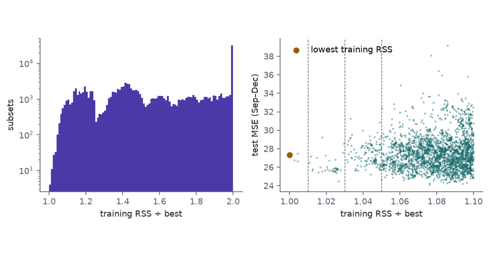

A fitted model that explains the data well is usually one of many that explain it about as well, and those models can disagree about which inputs matter.

Anyone who has run stepwise regression twice, on last year's data and then this year's, has seen this. The fit barely changes and the list of "significant" variables does. The usual reading is that the second run found the truth or the first one did. Breiman's reading, in section 8 of *The Two Cultures*, is that neither did: the data never picked one model, and the procedure picked one at random from a crowd.

[Part 1](../two-cultures-breiman-2001/) set out Breiman's two cultures and re-ran his ozone forecast. This part tests his first lesson from machine learning on data close to his own. [Part 3](../two-cultures-occam-and-bellman/) takes the second and third.

This part covers two ideas:

- **The Rashomon effect.** Many models with different structure have nearly the same error, and each tells a different story about the inputs.
- **Instability and its repair.** A procedure that picks one model from such a crowd jumps between them when the data change slightly. Averaging over the crowd (bagging) gives up the single story and recovers accuracy.

```{python}
#| label: setup
#| echo: false
import collections
import sys
from pathlib import Path

sys.path.insert(0, str(Path("../two-cultures-breiman-2001/src").resolve()))

import matplotlib.pyplot as plt
import numpy as np
import pandas as pd
from twocultures import cache, rashomon_exp
from twocultures.style import AMBER, BLUE, INK, MUTED, PINK, PURPLE, RULE, TEAL, md, setup

setup()


def nice(name):
    return name.replace("temp_sandburg", "temp").replace("_lag", " lag ")
```

## The name {#sec-name}

*Rashomon* is Akira Kurosawa's 1950 film, built from two stories by Ryūnosuke Akutagawa, "In a Grove" and "Rashōmon". In Breiman's summary, four witnesses to a death in a forest report the same facts and tell very different stories about what happened. His statistical version (p. 206): in a class of functions there is often a multitude of different descriptions, all with about the same minimum error.

He gives three examples:

1. **Subsets.** With 30 variables there are about 140,000 five-variable regressions, and generally many have residual sum of squares within 1% of the lowest. He prints three on disjoint variables, each telling a different story (p. 206).
2. **Trees.** Removing a random 2–3% of the training set can give a quite different tree with almost the same test error (p. 206).
3. **Networks.** A small net run 100 times on simple three-dimensional data from small random starting weights found 32 distinct minima, each a different picture, with about equal test error (p. 206).

The three equations he prints are illustrations, and the data behind all three examples are not given. Each is re-run here on public data close to his.

## Data {#sec-data}

- **1976 Los Angeles ozone** (`mlbench::Ozone`), as in Part 1: next-day maximum ozone from days $t$, $t-1$ and $t-2$ of eight meteorological readings and ozone, plus season and a weekend flag. That makes 30 candidate predictors, the count in Breiman's subset example. Training January–August (189 day pairs), test September–December (93). Ozone is a forecasting problem of the kind he worked on, and its predictors are correlated the way weather is, which is what makes many subsets compete.
- **Hepatitis** (UCI, contributed by Gail Gong): 155 patients, 19 covariates, 32 deaths. Breiman's own example in section 11; [Part 4](../two-cultures-black-box-information/) reproduces his analysis. Its small size and correlated laboratory values are the conditions under which a tree or a variable list is unstable, and its users wanted a short list of prognostic variables, which is the output that instability corrupts.

Sources, licences and checksums are in the series' [`data/README.md`](https://github.com/project-delphi/ml-blog/tree/main/posts/two-cultures-breiman-2001/data).

## Five-variable regressions {#sec-subsets}

### Every subset {#sec-subsets-all}

There are $\binom{30}{5} = 142{,}506$ five-variable regressions. Fitting them all takes a fraction of a second: each fit needs only a $5 \times 5$ block of the Gram matrix $X^\top X$, and the blocks are solved as one batch.

```{python}
#| label: subsets
names, fits = rashomon_exp.ozone_subsets()
ratio = fits["rss"] / fits["rss"].min()
test = fits["test_mse"]
counts = {t: int((ratio <= 1 + t).sum()) for t in (0.01, 0.02, 0.03, 0.05, 0.10)}
oz_in = names.index("ozone_lag0")
w5 = ratio <= 1.05
share_oz_5 = float(np.isin(fits["idx"][w5], [oz_in]).any(1).mean())
best = int(np.argmin(ratio))
best_test = int(np.argmin(test))
w3 = ratio <= 1.03
t3_lo, t3_hi = float(test[w3].min()), float(test[w3].max())
inc3 = np.array([np.isin(fits["idx"][w3], [j]).any(1).mean() for j in range(len(names))])
always3 = [names[j] for j in np.flatnonzero(inc3 == 1)]
rank_of_best_on_test = int((test < test[best]).sum()) + 1
```

- **Within 1% of the lowest training RSS:** `{python} counts[0.01]` models. Breiman says there are generally many; on 189 training days there are few.
- **Within 2%, 3%, 5% and 10%:** `{python} counts[0.02]`, `{python} counts[0.03]`, `{python} counts[0.05]` and `{python} f"{counts[0.10]:,}"` models.
- **Today's ozone** is in `{python} f"{share_oz_5:.0%}"` of the models within 5%. The disagreement is about the meteorology.
- **On the test months,** the models within 3% have test MSE from `{python} f"{t3_lo:.1f}"` to `{python} f"{t3_hi:.1f}"`. The model with the lowest training RSS ranks `{python} f"{rank_of_best_on_test:,}"` of 142,506 on test error.

```{python}
#| label: fig-subsets
#| fig-cap: "All 142,506 five-variable regressions of next-day ozone. Left: training RSS as a multiple of the best, log-scale counts, ratios above 2 pooled at 2. Right: training RSS ratio against test MSE for the 2,886 models within 10% of the best; the dashed lines mark 1%, 3% and 5%."
#| fig-alt: "Left, a right-skewed histogram with a thin left tail of near-best models. Right, a scatter in which models within a few percent of the best training RSS spread widely in test error, and the model with the lowest training RSS sits above many others on test error."
fig, axes = plt.subplots(1, 2, figsize=(7.5, 3.0))
ax = axes[0]
ax.hist(np.minimum(ratio, 2), bins=100, color=PURPLE, log=True)
ax.set_xlabel("training RSS ÷ best")
ax.set_ylabel("subsets")
ax = axes[1]
w10 = ratio <= 1.10
ax.scatter(ratio[w10], test[w10], s=4, color=TEAL, alpha=0.5, lw=0)
ax.scatter([ratio[best]], [test[best]], s=30, color=AMBER, zorder=3, label="lowest training RSS")
for t in (0.01, 0.03, 0.05):
    ax.axvline(1 + t, color=MUTED, ls="--", lw=0.7)
ax.set_xlabel("training RSS ÷ best")
ax.set_ylabel("test MSE (Sep–Dec)")
ax.legend(loc="upper left")
fig.tight_layout()
plt.show()
```

### Three pictures {#sec-pictures}

Breiman's three pictures share no variables. The three here are picked from the models within 5% so that each overlaps the others as little as possible. They cannot be disjoint, because all of them keep today's ozone.

```{python}
#| label: tbl-pictures
#| tbl-cap: "Three five-variable regressions within 5% of the best training RSS, chosen to overlap as little as possible. Coefficients are on the raw scales of the variables, to two significant figures; inversion base height is in feet, so its coefficient is small."
order = np.where(w5)[0][np.argsort(ratio[w5])]
picked = []
for _ in range(3):
    best_i, best_ov = None, 99
    for i in order:
        if i in picked:
            continue
        ov = sum(len(set(fits["idx"][i]) & set(fits["idx"][j])) for j in picked)
        if ov < best_ov:
            best_i, best_ov = i, ov
    picked.append(best_i)


def equation(i):
    terms = [f"{'+' if b >= 0 else '−'} {abs(b):.2g}·{nice(names[j])}" for j, b in zip(fits["idx"][i], fits["coef"][i])]
    return f"{fits['intercept'][i]:.1f} " + " ".join(terms)


pics = pd.DataFrame([{"Picture": k + 1, "RSS ÷ best": f"{ratio[i]:.3f}",
                      "Test MSE": f"{test[i]:.1f}", "Equation": equation(i)}
                     for k, i in enumerate(picked)])
pic_vars = [set(nice(names[j]) for j in fits["idx"][i]) for i in picked]
md(pics)
```

- **Picture 1** forecasts from the inversion layer: its height and temperature at LAX today, plus a pressure gradient and an older temperature.
- **Picture 2** forecasts from the season, the upper air (500 mb height) and today's pressure gradient, with no inversion height at all.
- **Picture 3** forecasts mostly from ozone itself, three days of it, plus today's temperature and an inversion temperature from two days back.

A meteorologist reading one picture would learn something different from one reading another. The data do not choose between them.

### Explorer {#sec-explorer}

::: {#widget-subsets}
:::

```{=html}
<script src="widget-data/data.js"></script>
<script src="widgets.js"></script>
```

1. At the starting tolerance of 1.0%, the tiles read `{python} counts[0.01]` models using 9 different variables.
2. Drag the tolerance to 3.0%. There are `{python} counts[0.03]` models, and between them they use all 30 variables. Their test MSE runs from `{python} f"{t3_lo:.1f}"` to `{python} f"{t3_hi:.1f}"`.
3. Drag it to 10%. The inclusion bars flatten: apart from today's ozone, no variable is in more than half the qualifying models.

## Trees {#sec-trees}

### Design {#sec-trees-design}

- **Data.** Hepatitis, with a fixed random 30% of patients held out for testing (46 patients, 10 deaths) and missing values filled with training medians.
- **Model.** CART with cost-complexity pruning, size chosen by ten-fold cross-validation with the one-standard-error rule, as in Breiman et al. (1984).
- **Perturbation.** Remove a random 3% of the 109 training patients (3 patients), refit, repeat 100 times.

```{python}
#| label: trees
tree_rows, tree_info = (lambda o: (o["rows"], o["info"]))(cache.obj(
    "trees_v2", lambda: dict(zip(["rows", "info"], rashomon_exp.tree_perturbations(reps=100)))))
tr = pd.DataFrame([{k: v for k, v in r.items() if k != "structure"} for r in tree_rows])
pert = tr[tr["rep"] > 0]
root_counts = pert["root"].value_counts()
sig_counts = pert["signature"].value_counts()
base_err = float(tr.loc[tr["rep"] == 0, "test_error"].iloc[0])
err_lo, err_hi = float(pert["test_error"].min()), float(pert["test_error"].max())
n_sig = int(pert["signature"].nunique())
n_stump = int(root_counts.get("leaf", 0))
split = pert[pert["root"] != "leaf"]
base_rate = tree_info["test_deaths"] / tree_info["n_test"]
split_lo, split_hi = float(split["test_error"].min()), float(split["test_error"].max())
```

### Result {#sec-trees-result}

- **No split at all.** The tree fitted to the full training set splits first on ascites. In `{python} n_stump` of the 100 perturbed fits the one-standard-error rule prunes the tree back to its root: on about 106 patients, predicting that everyone lives is within one standard error of the best cross-validated tree.
- **Root split, when there is one.** Ascites `{python} int(root_counts.get("ASCITES", 0))` times and albumin `{python} int(root_counts.get("ALBUMIN", 0))` times; the rest go to bilirubin or prothrombin time.
- **Structure.** Counting the root-only tree, the top two levels take `{python} n_sig` different forms.
- **Test error.** `{python} f"{base_err:.1%}"` for the unperturbed tree. The root-only trees all score `{python} f"{base_rate:.1%}"`, the share of the 46 test patients who died; trees with a split range from `{python} f"{split_lo:.1%}"` to `{python} f"{split_hi:.1%}"`. On 46 test patients one misclassification is 2.2 points: the best tree with a split gets `{python} round((base_rate - split_lo) * tree_info["n_test"])` more patients right than predicting survival for everyone, and the worst gets `{python} round((split_hi - base_rate) * tree_info["n_test"])` fewer.

```{python}
#| label: fig-trees
#| fig-cap: "Pruned CART on hepatitis after removing 3 of 109 training patients, 100 times. Left: the split variables of the top two levels (root first, then left and right child; 'leaf' means no further split, and 'root only' a tree with no split at all). Right: test error on the 46 held-out patients for each form."
#| fig-alt: "Left, a bar chart in which the root-only tree with no split is most common, followed by a one-split tree on ascites and trees rooted on albumin. Right, dot plots: every root-only tree scores about 22 percent, and the trees with splits spread between about 15 and 24 percent."
top = sig_counts.index[:7]
fig, axes = plt.subplots(1, 2, figsize=(7.5, 3.0), gridspec_kw={"width_ratios": [1.3, 1]})
ax = axes[0]
labels = ["root only" if s == "leaf" else s.replace("SPLEEN_PALPABLE", "SPLEEN").replace(" / ", " │ ")
          for s in top]
ax.barh(range(len(top))[::-1], sig_counts[top].to_numpy(), color=PURPLE)
ax.set_yticks(range(len(top))[::-1], labels, fontsize=7.5)
ax.set_xlabel("perturbed fits")
ax = axes[1]
for k, s in enumerate(top):
    e = pert.loc[pert["signature"] == s, "test_error"].to_numpy()
    jitter = np.random.default_rng(k).uniform(-0.15, 0.15, len(e))
    ax.scatter(100 * e, len(top) - 1 - k + jitter, s=8, color=TEAL, alpha=0.6, lw=0)
ax.set_yticks([])
ax.set_xlabel("test error (%)")
fig.tight_layout()
plt.show()
```

Breiman's point survives in a sharper form: removing three patients changes not just which variable a tree uses but whether it uses any. The swap between ascites and albumin is not noise in the tree algorithm. The two are each other's strongest correlate in these data, and Breiman's section 11 analysis finds them to be surrogates: either carries most of what the other does. A tree must pick one, and which one depends on three patients. Part 4 returns to the pair.

## Networks {#sec-nets}

### Design {#sec-nets-design}

- **Data.** The ozone training months, three predictors: today's temperature, inversion base height and pressure gradient. Three standardised inputs is the "simple three-dimensional data" of Breiman's account.
- **Model.** One hidden layer of 3 tanh units (16 weights), light weight decay ($\alpha = 0.01$), fitted to convergence by L-BFGS from scikit-learn's default random starting weights.
- **Restarts.** 100, identical in everything but the starting weights.
- **Distinct minima.** Two restarts count as the same minimum when their fitted values on the 189 training days differ by less than 0.1 ozone units (root mean square). Comparing functions rather than weights ignores the trivial symmetries: the hidden units can be relabelled, and each unit's signs flipped, without changing the function.

```{python}
#| label: nets
net_rows = cache.obj("nets_v2", lambda: {"rows": rashomon_exp.net_restarts(reps=100)})["rows"]
labels = {t: rashomon_exp.distinct_minima(net_rows, t) for t in (0.05, 0.1, 0.2)}
nets = pd.DataFrame([{"rep": r["rep"], "train_mse": r["train_mse"], "test_mse": r["test_mse"]}
                     for r in net_rows])
nets["group"] = labels[0.1]
n_groups = {t: int(v.max() + 1) for t, v in labels.items()}
g = nets.groupby("group").agg(k=("rep", "size"), train=("train_mse", "mean"), test=("test_mse", "mean"))
big = g.sort_values("k", ascending=False)
q10, q90 = nets["test_mse"].quantile([0.1, 0.9])
```

### Result {#sec-nets-result}

- **Distinct functions.** `{python} n_groups[0.1]` from 100 starts; the count is `{python} n_groups[0.05]` at a tolerance of 0.05 and `{python} n_groups[0.2]` at 0.2, so it does not hinge on the threshold. Breiman found 32 on his data; the count depends on the data, the width of the net and the weight decay, so the agreement in size means little.
- **Most common minimum.** Reached from `{python} int(big["k"].iloc[0])` starts; `{python} int((g["k"] == 1).sum())` minima are reached from one start only.
- **Training error** ranges from `{python} f"{nets['train_mse'].min():.1f}"` to `{python} f"{nets['train_mse'].max():.1f}"`.
- **Test error.** 80% of restarts fall between `{python} f"{q10:.1f}"` and `{python} f"{q90:.1f}"`; the worst is `{python} f"{nets['test_mse'].max():.1f}"`. "About equal test error" holds for most, not all.

```{python}
#| label: fig-nets
#| fig-cap: "One 3-unit network, 100 random starts, ozone training months. Left: training against test MSE, one point per start, coloured by minimum (the six most common in colour, the rest grey). Right: the fitted effect of today's temperature (partial dependence, other inputs at their observed values) for the six most common minima."
#| fig-alt: "Left, a scatter in which training errors span a narrow band while test errors mostly cluster between 31 and 37 with a few outliers. Right, six curves of predicted ozone against standardised temperature that agree near the middle and diverge at the extremes, some flattening and some rising steeply."
cols = [PURPLE, TEAL, AMBER, PINK, BLUE, INK]
top6 = list(big.index[:6])
fig, axes = plt.subplots(1, 2, figsize=(7.5, 3.0))
ax = axes[0]
for gi, c in zip([None] + top6, [RULE] + cols):
    m = ~nets["group"].isin(top6) if gi is None else nets["group"] == gi
    ax.scatter(nets.loc[m, "train_mse"], nets.loc[m, "test_mse"], s=14, color=c, alpha=0.85, lw=0)
ax.set_xlabel("training MSE")
ax.set_ylabel("test MSE (Sep–Dec)")
ax = axes[1]
xs = np.linspace(-2, 2, 21)
for gi, c in zip(top6, cols):
    r = net_rows[int(nets.loc[nets["group"] == gi, "rep"].iloc[0])]
    ax.plot(xs, r["pd_temp"], color=c, lw=1.6)
ax.set_xlabel("today's temperature (standardised)")
ax.set_ylabel("predicted next-day ozone")
fig.tight_layout()
plt.show()
```

The minima agree where the data are dense and part company at the edges, which is where a forecaster most wants the model's opinion: hot days.

## Best-subset logistic regression, single and bagged {#sec-bagging}

### Breiman's account {#sec-bagging-claim}

Breiman reports that cutting a logistic or Cox model from 15 variables to 4 makes it unstable: perturb the data and a different four-variable model, with a different conclusion, appears (p. 206). He cites Arena et al. (2000), who bagged logistic regressions on toxicity data with best-subset selection from 15 covariates to 4 and found the bagged model significantly more accurate on a test set, and more stable. That work was a conference presentation, and the data are not public.

### Design {#sec-bagging-design}

- **Data.** Hepatitis, 19 covariates, as a stand-in for the toxicity data.
- **Selection rule.** The best four covariates by the score statistic, the criterion behind SAS's best-subset search for logistic regression. At the intercept-only fit it equals $n R^2$ of a least-squares fit of the 0/1 outcome on the subset, so all $\binom{19}{4} = 3{,}876$ subsets are scored in one batch.
- **Fit.** Median imputation and standardisation inside the training data, then unpenalised logistic regression on the chosen four.
- **Bagged version.** Repeat selection and fit on 50 bootstrap resamples of the training data and average the predicted probabilities.
- **Evaluation.** Breiman's protocol: 100 random 10% holdouts, both versions on the same splits.
- **Stability.** In the spirit of Diaconis and Efron (1983): rerun the selection on 500 bootstrap resamples of all 155 patients and count which covariates it picks.

```{python}
#| label: bagging
bag = cache.frame("bagged_v1", lambda: rashomon_exp.bagged_logistic(reps=100))
diff = bag["single"] - bag["bagged"]
sel = cache.obj("selection_v1", lambda: dict(zip(["picks", "full", "names"],
                                                 rashomon_exp.selection_frequency(boots=500))))
picks, full, hep_names = sel["picks"], sel["full"], sel["names"]
freq = pd.Series(collections.Counter(i for p in picks for i in p)).reindex(range(19), fill_value=0) / len(picks)
n_sets = len({tuple(sorted(p)) for p in picks})
modal_set, modal_n = collections.Counter(tuple(sorted(p)) for p in picks).most_common(1)[0]
either = float(np.mean([(11 in p) or (16 in p) for p in picks]))
both = float(np.mean([(11 in p) and (16 in p) for p in picks]))
```

### Result {#sec-bagging-result}

- **Accuracy.** The single best-subset model misclassifies `{python} f"{bag['single'].mean():.1%}"` of held-out patients, the bagged one `{python} f"{bag['bagged'].mean():.1%}"`. The paired difference is `{python} f"{100 * diff.mean():.1f}"` percentage points, with a standard error of `{python} f"{100 * diff.std() / np.sqrt(len(diff)):.1f}"`. Calling every patient a survivor scores 20.6%, so the single model barely beats the baseline.
- **Full-data choice.** `{python} ", ".join(f"{hep_names[i].title()} ({i + 1})" for i in sorted(full))`, numbered as Breiman numbers covariates.
- **Bootstrap choices.** `{python} n_sets` different four-variable sets in 500 resamples. The most common, `{python} ", ".join(hep_names[i].title() for i in modal_set)`, appears `{python} modal_n` times.
- **The surrogate pair.** Ascites (12) or albumin (17) is in `{python} f"{either:.0%}"` of the chosen sets; both are in only `{python} f"{both:.0%}"`. Neither is picked as often as the pair is, because a set rarely needs both.

```{python}
#| label: fig-selection
#| fig-cap: "Share of 500 bootstrap resamples of the hepatitis data in which the best-subset rule picks each covariate, numbered as in Breiman's paper. Ascites (12) and albumin (17) are highlighted."
#| fig-alt: "Bar chart over the 19 covariates. Bilirubin, ascites and spiders are picked most often, albumin less often; no covariate is picked in more than about three quarters of resamples."
fig, ax = plt.subplots(figsize=(7.5, 2.8))
colors = [AMBER if i in (11, 16) else PURPLE for i in range(19)]
ax.bar(range(1, 20), freq.to_numpy(), color=colors)
ax.set_xticks(range(1, 20), [f"{i + 1}\n{hep_names[i][:5].title()}" for i in range(19)], fontsize=6.5)
ax.set_ylabel("share of resamples")
ax.set_ylim(0, 1)
fig.tight_layout()
plt.show()
```

Bagging helps here for the reason Breiman gives. The single model's error includes the cost of picking the wrong four, and averaging over 50 picks lowers that cost. The price is the one he names: the bagged model has no four variables to report.

## Hoadley's Fat Scorecard {#sec-fat}

Hoadley's comment (p. 222) reports the same effect from credit scoring. Fitting logistic scorecards on 36 candidate characteristics, he found that every model with anywhere from 27 to 36 characteristics had the same test performance, and he named it Rashomon. He kept the 27-characteristic model: 162 coefficients, one of them significant at 5%, which slightly beat a neural network with 2,000 weights. [Part 3](../two-cultures-occam-and-bellman/) returns to it as an argument about interpretability.

## Since 2001 {#sec-since}

The idea has since been given a name and a formal treatment.

- **The Rashomon set.** Semenova, Rudin and Parr (2022) define it as all models in a class within a tolerance of the best loss, which is what the subset explorer shows. They argue that when the set is large it often contains a simple model.
- **Model class reliance.** Fisher, Rudin and Dominici (2019) measure a variable's importance as a range over the Rashomon set rather than for one model. This post does not compute that range, but the subsets fix one end of it: a model that leaves a variable out does not rely on it, and within 3% of the best RSS `{python} len(names) - len(always3)` of the 30 candidates are left out of at least one qualifying model. The exception is `{python} " and ".join(always3).replace("ozone_lag0", "today's ozone")`, which every one of them uses.
- **Underspecification.** D'Amour et al. (2022) find the same effect in deep learning: models trained with different seeds agree on the held-out test set and disagree under distribution shift. The networks in @sec-nets diverge at the edge of the data.

## Constraints {#sec-constraints}

- **Sample sizes are small.** 189 training days for the subsets and networks, 109 training patients for the trees, 155 patients for bagging. Breiman's "many within 1%" presumably came from a larger sample; ours gives `{python} counts[0.01]`.
- **Test sets are small.** 93 ozone days and 46 hepatitis patients. Differences in test error of a few percent between Rashomon models are within the noise of a single test set.
- **The selection rule is a stand-in.** Arena et al. used best-subset selection from 15 to 4 on toxicity data; this is the same rule from 19 to 4 on hepatitis.
- **Minima counts depend on choices.** Width, weight decay and the tolerance all move the count of distinct network minima.

## Reproduction status {#sec-status}

::: {.table-responsive}

| Experiment | Paper's data | Data used here | Paper's result | Our result | Notes |
|---|---|---|---|---|---|
| Subsets (§8) | 30 variables, not given | 30 ozone predictors, 1976 | many within 1% of best RSS | `{python} counts[0.01]` within 1%, `{python} counts[0.05]` within 5%; different stories | all share today's ozone |
| Trees (§8) | not given | hepatitis, 3% removed | different tree, same test error | no split `{python} n_stump`, root ascites `{python} int(root_counts.get("ASCITES", 0))`, albumin `{python} int(root_counts.get("ALBUMIN", 0))` of 100; `{python} n_sig` top-level forms; test error `{python} f"{err_lo:.0%}"`–`{python} f"{err_hi:.0%}"` | reproduced in kind |
| Networks (§8) | simple 3-D data, not given | 3 ozone predictors | 32 distinct minima, equal test error | `{python} n_groups[0.1]` distinct functions; 80% of test MSE in `{python} f"{q10:.1f}"`–`{python} f"{q90:.1f}"` | count depends on architecture |
| Bagged logistic (§8) | toxicity data (Arena et al.) | hepatitis, 19 → 4 | bagged significantly more accurate, more stable | `{python} f"{bag['single'].mean():.1%}"` single vs `{python} f"{bag['bagged'].mean():.1%}"` bagged; `{python} n_sets` distinct 4-sets in 500 bootstraps | stand-in data |

: Part 2's rows of the series reproduction table. {#tbl-status}

:::

Same. Error. Different. Stories. Instability. Picks. One. Averaging. Keeps. Accuracy.

```{python}
#| label: export-status
#| include: false
# The numbers Part 5's series table quotes from this part (twocultures/status.py).
from twocultures import status

status.export(
    within_1=counts[0.01], within_5=counts[0.05],
    tree_stumps=n_stump, tree_root_ascites=int(root_counts.get("ASCITES", 0)),
    tree_root_albumin=int(root_counts.get("ALBUMIN", 0)), tree_reps=len(pert),
    net_minima=n_groups[0.1], bag_single=bag["single"].mean(), bag_bagged=bag["bagged"].mean(),
    bag_sets=n_sets)
```

## References {#sec-references}

- Arena, V. C., Sussman, N., Chiang, K., Mazumdar, S., Macina, O. & Li, W. (2000). Bagging structure-activity relationships: a simulation study for assessing misclassification rates. Presented at the Second Indo-U.S. Workshop on Mathematical Chemistry, Duluth. Cited by Breiman; not published.
- Breiman, L. (1996). [Bagging predictors](https://doi.org/10.1007/BF00058655). *Machine Learning* 24, 123–140.
- Breiman, L. (1996). [Heuristics of instability and stabilization in model selection](https://doi.org/10.1214/aos/1032181158). *Annals of Statistics* 24(6), 2350–2383.
- Breiman, L. (2001). [Statistical modeling: the two cultures (with comments and a rejoinder)](https://doi.org/10.1214/ss/1009213726). *Statistical Science* 16(3), 199–231.
- Breiman, L., Friedman, J. H., Olshen, R. A. & Stone, C. J. (1984). *Classification and Regression Trees*. Wadsworth.
- D'Amour, A. et al. (2022). [Underspecification presents challenges for credibility in modern machine learning](https://jmlr.org/papers/v23/20-1335.html). *Journal of Machine Learning Research* 23(226), 1–61.
- Diaconis, P. & Efron, B. (1983). [Computer-intensive methods in statistics](https://doi.org/10.1038/scientificamerican0583-116). *Scientific American* 248(5), 116–130.
- Fisher, A., Rudin, C. & Dominici, F. (2019). [All models are wrong, but many are useful: learning a variable's importance by studying an entire class of prediction models simultaneously](https://jmlr.org/papers/v20/18-760.html). *Journal of Machine Learning Research* 20(177).
- Kurosawa, A. (director) (1950). *Rashomon*. Daiei Film. Based on Ryūnosuke Akutagawa's stories "In a Grove" and "Rashōmon".
- Semenova, L., Rudin, C. & Parr, R. (2022). [On the existence of simpler machine learning models](https://doi.org/10.1145/3531146.3533232). *FAccT '22*, 1827–1858. arXiv:1908.01755 (2019).
- [The Two Cultures, Part 1: Two ways to fill a black box](../two-cultures-breiman-2001/) — the cultures, and the ozone data.
- [The Two Cultures, Part 4: Information from a black box](../two-cultures-black-box-information/) — the hepatitis analysis.
