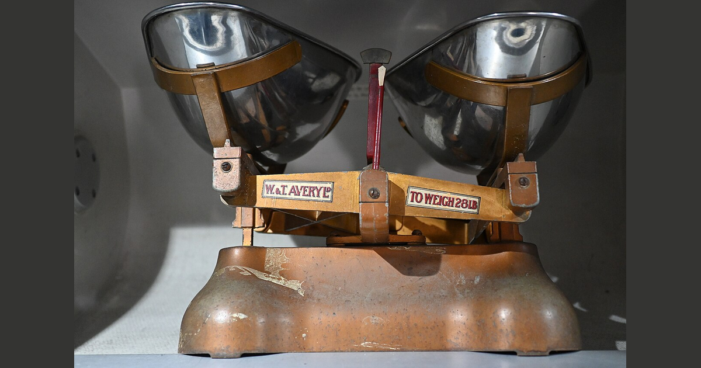

UMAP is often called theoretically flawed: it has no reconstruction loss, and it learns no function from data to map. The reply answers most of that charge, but not the part about a target that moves with the settings.

Fit PCA and you get a number for how much of the data the plot throws away: the variance it leaves out. Fit a regression and you get an error on held-out rows. Fit UMAP and you get a picture with no number attached, and the picture is read with more confidence than either. Whether that missing number is a defect of the method or a wrong question decides how far a UMAP plot can be trusted.

## The case against

### No reconstruction loss

PCA maps each point to $k$ coordinates and back, and scores the fit by the squared distance between a point and its reconstruction:

$$
\text{error}(k) = \frac{1}{n} \sum_{i} \lVert x_i - \hat{x}_i \rVert^2 .
$$

The error can be computed on points the fit never saw, and it is comparable across $k$, because every $k$ is scored against the same target: the data.

UMAP ([McInnes, Healy & Melville 2018](https://arxiv.org/abs/1802.03426)) minimises a cross-entropy between two weighted graphs: a nearest-neighbour graph built from the data and one built from distances on the map. `n_neighbors` builds the first graph, so two settings minimise two different objectives, and no number says which map is better. [Part 5](../when-umap-limits/) of the When UMAP Lies series runs this on a train/dev/test split.

### No fitted function

- **The parameters are the points.** A UMAP fit on $n$ points has $2n$ parameters: each training point's two map coordinates. PCA learns a projection matrix that applies to any point.
- **`transform` is added after the fit.** It finds a new point's neighbours among the training points, starts it at their weighted average, and optimises it against the frozen map. The fit never learned a function from data to map.
- **So there is nothing to generalise.** No function means nothing to cross-validate and no held-out error. umap-learn does not report the loss at the end of a fit.

### Stated and optimised loss

UMAP minimises its cross-entropy by stochastic gradient descent. Each step pulls together the two ends of one sampled edge and pushes the first end away from a few randomly drawn points, a shortcut called negative sampling. [Damrich & Hamprecht (2021)](https://proceedings.neurips.cc/paper/2021/hash/2de5d16682c3c35007e4e92982f1a2ba-Abstract.html) derived the loss this procedure minimises in closed form:

- It differs from the published loss, and the gap depends on the size of the dataset.
- Its repulsion is much weaker than the published loss implies, which helps explain why UMAP packs clusters tighter.
- In effect, UMAP does not try to reproduce its high-dimensional graph.

## The reply

### Neighbour-preservation loss

UMAP's goal was never to reconstruct the data. It is to keep each point's nearest neighbours near it on the map. That goal can be scored, and a held-out point placed by `transform` can be scored like a training point.

- **Neighbour recall:** the fraction of a point's 10 nearest neighbours in the data that are also its 10 nearest on the map.
- **Class accuracy:** how often a 10-nearest-neighbour vote on the map gets the point's label right.
- **Trustworthiness:** how few of a point's map neighbours were far away in the data. Part 5 scores it on dev points.

### Reconstruction as a goal

PCA's best 2-D reconstruction keeps the two directions of largest variance. Clusters that differ along other directions can land on top of each other, and the reconstruction error is still the lowest any 2-D linear map can achieve.

A [companion post on UMAP's defaults](../umap-tsne-bad-defaults/) scores default UMAP against 2-D PCA on nine datasets:

- UMAP keeps more nearest neighbours on 9 of 9.
- UMAP classifies better on 7 of 9.
- PCA keeps the global layout better on 9 of 9: which groups sit near which.

Each method wins what it optimises. Scored by reconstruction error, PCA could not lose, and the clusters it overlays would never count against it.

### Non-parametric fits

- **Coordinates are the usual fit.** t-SNE, MDS and Isomap also solve for the training points' positions; a new point needs an extension added after the fit, as with `transform`. The objection is to the family, not to UMAP.
- **Parametric UMAP exists.** [Sainburg, McInnes & Gentner (2021)](https://doi.org/10.1162/neco_a_01434) replace the coordinates with a neural network trained on the same loss, so new points pass through a learned function. umap-learn's `ParametricUMAP` can also train a decoder with a reconstruction loss beside the UMAP loss (`autoencoder_loss=True`).

### The contrastive spectrum

Damrich & Hamprecht's derivation answers the third charge as well as stating it.

- [Böhm, Berens & Kobak (2022)](https://jmlr.org/papers/v23/21-0055.html) place t-SNE, UMAP and Laplacian eigenmaps on one attraction–repulsion spectrum. UMAP behaves like t-SNE with stronger attraction, which shows continuous structure better and keeps fewer exact nearest neighbours.
- [Damrich, Böhm, Hamprecht & Kobak (2023)](https://iclr.cc/virtual/2023/poster/11861) show that t-SNE and UMAP are both contrastive learning, differing in how they sample the points they push away. A generalised negative sampling interpolates between the two.

The objective UMAP minimises is understood, even though it differs from the one in the original paper.

## The moving target

Every score in the reply is a proxy. Part 5 tests four and finds that each misses a failure: class accuracy cannot see where the islands sit, and silhouette rewards exaggerated separation.

The deeper point survives. `n_neighbors` builds UMAP's target, so changing the setting changes what the fit is trying to match. A held-out loss can rank the settings of a model whose target stays fixed. UMAP's does not stay fixed, parametric or not, and no single loss can say which setting draws the truer map.

Neighbours. Measurable. Functions. Optional. Target. Still. Moves. Settings. Incomparable.

## References

- McInnes, L., Healy, J. & Melville, J. (2018). [UMAP: Uniform Manifold Approximation and Projection for Dimension Reduction](https://arxiv.org/abs/1802.03426). arXiv:1802.03426.
- Damrich, S. & Hamprecht, F. A. (2021). [On UMAP's true loss function](https://proceedings.neurips.cc/paper/2021/hash/2de5d16682c3c35007e4e92982f1a2ba-Abstract.html). *Advances in Neural Information Processing Systems* 34 (NeurIPS 2021).
- Sainburg, T., McInnes, L. & Gentner, T. Q. (2021). [Parametric UMAP embeddings for representation and semisupervised learning](https://doi.org/10.1162/neco_a_01434). *Neural Computation* 33(11).
- Böhm, J. N., Berens, P. & Kobak, D. (2022). [Attraction-repulsion spectrum in neighbor embeddings](https://jmlr.org/papers/v23/21-0055.html). *Journal of Machine Learning Research* 23(95).
- Damrich, S., Böhm, J. N., Hamprecht, F. A. & Kobak, D. (2023). [From t-SNE to UMAP with contrastive learning](https://iclr.cc/virtual/2023/poster/11861). *International Conference on Learning Representations* (ICLR 2023).
- Software: [umap-learn](https://github.com/lmcinnes/umap), `ParametricUMAP` ([documentation](https://umap-learn.readthedocs.io/en/latest/parametric_umap.html)).
- [When UMAP Lies, Part 5: Nothing to Validate Against](../when-umap-limits/) and [Is Default UMAP Bad?](../umap-tsne-bad-defaults/).
