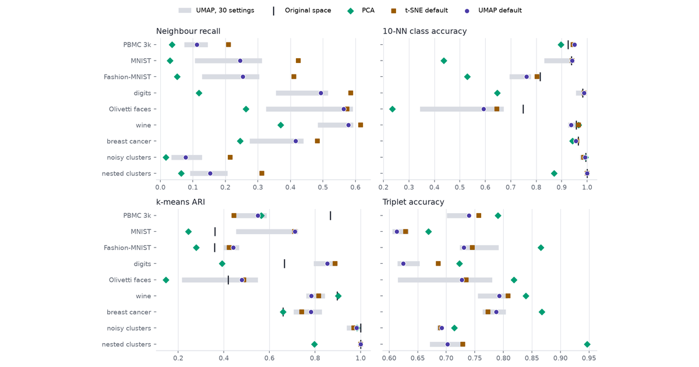

Most UMAP plots come from `umap.UMAP().fit_transform(X)`, with `n_neighbors=15`, `min_dist=0.1` and nothing tuned. The common worry is that those defaults are bad and a search over settings would fix the picture. If so, some setting should beat the default by a clear margin on the same data. This post checks that on nine datasets.

Short answer: no. Hindsight tuning buys a few hundredths on most scores, and where UMAP is weak, its best setting is weak too.

```{python}
#| label: setup
#| echo: false
from pathlib import Path

import numpy as np
import pandas as pd
import matplotlib.pyplot as plt
from IPython.display import Markdown

S = pd.read_parquet("cache/scores.parquet")
CS = pd.read_parquet("cache/class_size.parquet")

ORDER = [
    "PBMC 3k", "MNIST", "Fashion-MNIST", "digits", "Olivetti faces",
    "wine", "breast cancer", "noisy clusters", "nested clusters",
]
COLS = ["neighbor recall", "kNN accuracy", "k-means ARI", "triplet accuracy", "centroid rho"]
INK, MUTED, RULE = "#1F2430", "#5F6672", "#D8DBE2"
C_UMAP, C_TSNE, C_PCA = "#4A3AA7", "#9A5B00", "#009E73"

# Mean over three seeds for every (dataset, setting); "best" is chosen with hindsight
# on the score itself, so best - default is the most any tuning could buy.
grid = S[S.method == "UMAP"].groupby(["dataset", "n_neighbors", "min_dist"])[COLS].mean()
default = grid.xs((15.0, 0.1), level=("n_neighbors", "min_dist")).reindex(ORDER)
best = grid.groupby("dataset").max().reindex(ORDER)
worst = grid.groupby("dataset").min().reindex(ORDER)
ref = S[S.method != "UMAP"].groupby(["method", "dataset"])[COLS].mean()
pca, tsne = ref.loc["PCA"].reindex(ORDER), ref.loc["t-SNE"].reindex(ORDER)
orig = ref.loc["original space"].reindex(ORDER)
new = ref.loc["UMAP 0.6 layout"].reindex(ORDER)
gain = best - default
runs = S[(S.method == "UMAP") & (S.n_neighbors == 15) & (S.min_dist == 0.1)].groupby("dataset")[COLS]
seed_range = (runs.max() - runs.min()).reindex(ORDER)


def f3(x):
    return f"{x:.3f}"


rest = [d for d in ORDER if d != "Olivetti faces"]
KNN_GAIN_MAX = f3(gain.loc[rest, "kNN accuracy"].max())
KNN_GAIN_WHERE = gain.loc[rest, "kNN accuracy"].idxmax()
ARI_GAIN_HI = f3(gain.loc[rest, "k-means ARI"].max())
_moved = gain["k-means ARI"] > 0  # nested clusters scores 1.000 at every setting
N_MOVED = int(_moved.sum())
N_SEED_GE = int((seed_range["k-means ARI"] >= gain["k-means ARI"])[_moved].sum())
N_KNN_NEAR = int(((default["kNN accuracy"] - orig["kNN accuracy"]).abs() <= 0.03).sum())
N_KNN_PCA = int((default["kNN accuracy"] > pca["kNN accuracy"]).sum())
N_TRIP_PCA = int((pca["triplet accuracy"] > best["triplet accuracy"]).sum())
# Centroid correlation needs enough classes to rank: these six have 8 to 40.
many = ["PBMC 3k", "MNIST", "Fashion-MNIST", "digits", "Olivetti faces", "nested clusters"]
N_CENT, N_CENT_PCA = len(many), int((pca.loc[many, "centroid rho"] > best.loc[many, "centroid rho"]).sum())
N_REC_TSNE = int((tsne["neighbor recall"] > best["neighbor recall"]).sum())
N_NEW_TRIP = int((new["triplet accuracy"] > default["triplet accuracy"]).sum())
N_NEW_REC = int((new["neighbor recall"] < default["neighbor recall"]).sum())
_tri_best = grid["triplet accuracy"].groupby("dataset").idxmax()
N_TRIP_MD99 = int(sum(md == 0.99 for _, _, md in _tri_best))
TRIP_GAIN_MAX = f3(gain["triplet accuracy"].max())
TRIP_GAIN_WHERE = gain["triplet accuracy"].idxmax()
V = lambda frame, d, c: f3(frame.loc[d, c])  # noqa: E731
```

## Test

Nine datasets, each run with three seeds:

- **PBMC 3k**: 2,638 blood cells in 50 principal components, eight annotated cell types, from the 10x Genomics tutorial cached in [Part 1 of When UMAP Lies](../when-umap-lies/). A wrong grouping here is a wrong cell-type call.
- **MNIST** and **Fashion-MNIST**: 10,000 images drawn from each 70,000-image set (LeCun et al. 1998; Xiao et al. 2017, via OpenML), raw pixels. A new draw per seed. These are the sets UMAP is usually shown on.
- **Digits**: 1,797 8×8 handwritten digits, scikit-learn's loader.
- **Olivetti faces**: 400 photos, 40 people with 10 each, taken at AT&T Laboratories Cambridge (Samaria & Harter 1994). The only set where a class holds fewer points than `n_neighbors`.
- **Wine** (178 wines, three cultivars) and **breast cancer** (569 Wisconsin biopsies, benign or malignant): small tabular sets, standardised.
- **Noisy clusters**: synthetic, five Gaussian clusters in 5 dimensions plus 45 noise dimensions. Stands in for a weak signal in a wide feature table.
- **Nested clusters**: synthetic, three groups of three subgroups in 20 dimensions, labelled by subgroup. Stands in for a hierarchy, such as lineages and their subtypes.

Methods:

- **UMAP default**: `n_neighbors=15`, `min_dist=0.1`, umap-learn 0.6.0.
- **UMAP grid**: `n_neighbors` ∈ {5, 10, 15, 30, 50, 100} × `min_dist` ∈ {0, 0.1, 0.25, 0.5, 0.99}, 30 settings. The best setting is picked with hindsight on the score being reported. That is the most tuning could ever buy; a real dev-set search buys less.
- **PCA**, two components, and **t-SNE** at openTSNE's defaults (perplexity 30, PCA initialisation).
- **Original space**: the same scores on the data itself, where they apply.

Four scores, one per thing a reader takes from a map:

- **Neighbour recall**: the fraction of each point's 10 nearest neighbours in the data that are also its 10 nearest on the map.
- **10-NN class accuracy**: 5-fold cross-validated accuracy of a 10-nearest-neighbour vote on the map. Are classes kept apart?
- **k-means ARI**: adjusted Rand index of k-means with the true class count, run on the map. Do the clusters you would draw match the labels?
- **Triplet accuracy**: for 20,000 random triplets (i, j, k), how often the map agrees with the data on whether j or k is closer to i (Wang et al. 2021). Is the global layout right?

Labels are used only to score. No method sees them.

## Results

```{python}
#| label: fig-verdict
#| fig-cap: "Grey bar: range of UMAP's 30 settings (mean over three seeds each). Circle: UMAP default. Square: t-SNE default. Diamond: PCA. Tick: the same score in the original space."
#| fig-alt: "Four panels, one row per dataset. On class accuracy and k-means ARI the UMAP default circle sits near the right end of the grey settings bar in most rows; on neighbour recall it sits mid-bar, and on triplet accuracy toward the left end on several. On triplet accuracy the PCA diamond is right of the whole grey bar on all nine datasets; on neighbour recall the t-SNE square is right of the bar on eight."
PANELS = [
    ("neighbor recall", "Neighbour recall"),
    ("kNN accuracy", "10-NN class accuracy"),
    ("k-means ARI", "k-means ARI"),
    ("triplet accuracy", "Triplet accuracy"),
]
fig, axes = plt.subplots(2, 2, figsize=(10, 7.2), sharey=True)
y = np.arange(len(ORDER))
for ax, (col, title) in zip(axes.flat, PANELS):
    ax.hlines(y, worst[col], best[col], color=RULE, lw=7, zorder=1, label="UMAP, 30 settings")
    if col in ("kNN accuracy", "k-means ARI"):
        ax.scatter(orig[col], y, marker="|", s=160, color=INK, lw=1.6, zorder=2,
                   label="Original space")
    ax.scatter(pca[col], y, marker="D", s=34, color=C_PCA, zorder=3, label="PCA")
    ax.scatter(tsne[col], y, marker="s", s=34, color=C_TSNE, zorder=3, label="t-SNE default")
    ax.scatter(default[col], y, marker="o", s=46, color=C_UMAP, edgecolor="white", lw=0.8,
               zorder=4, label="UMAP default")
    ax.set_title(title, color=INK, fontsize=11, loc="left")
    ax.set_yticks(y, ORDER)
    ax.tick_params(colors=MUTED, labelsize=9)
    ax.spines[["top", "right", "left"]].set_visible(False)
    ax.spines["bottom"].set_color(RULE)
    ax.grid(axis="x", color=RULE, lw=0.6)
    ax.set_axisbelow(True)
axes[0, 0].invert_yaxis()
handles, labels = axes[0, 1].get_legend_handles_labels()
fig.legend(handles, labels, loc="upper center", ncol=5, frameon=False, fontsize=9,
           bbox_to_anchor=(0.5, 1.0))
fig.tight_layout(rect=(0, 0, 1, 0.95))
Path("figures").mkdir(exist_ok=True)
fig.savefig("figures/verdict.png", dpi=150, bbox_inches="tight")
plt.show()
```

The default is not the problem:

- **Class separation is near the ceiling on most sets.** Hindsight tuning raises 10-NN accuracy by at most `{python} KNN_GAIN_MAX` (`{python} KNN_GAIN_WHERE`) on eight of nine sets. The default lands within 0.03 of the accuracy in the original space on `{python} N_KNN_NEAR` of nine, and beats PCA on `{python} N_KNN_PCA`. On MNIST it scores `{python} V(default, "MNIST", "kNN accuracy")` against PCA's `{python} V(pca, "MNIST", "kNN accuracy")`.
- **Cluster gains are small.** Hindsight tuning raises k-means ARI by at most `{python} ARI_GAIN_HI` outside Olivetti. On `{python} N_SEED_GE` of the `{python} N_MOVED` sets where tuning moves ARI at all, single runs of the default with different seeds spread at least that far apart. On PBMC the default's three seeds span `{python} f3(runs.min().loc["PBMC 3k", "k-means ARI"])` to `{python} f3(runs.max().loc["PBMC 3k", "k-means ARI"])`.

The method is the problem:

- **The global layout trails PCA at every setting.** PCA beats UMAP's best setting on triplet accuracy on `{python} N_TRIP_PCA` of nine sets: `{python} V(pca, "nested clusters", "triplet accuracy")` against `{python} V(best, "nested clusters", "triplet accuracy")` on nested clusters, `{python} V(pca, "Fashion-MNIST", "triplet accuracy")` against `{python} V(best, "Fashion-MNIST", "triplet accuracy")` on Fashion-MNIST. Tuning helps a little: `min_dist=0.99` is the best triplet setting on `{python} N_TRIP_MD99` of nine sets and adds up to `{python} TRIP_GAIN_MAX` (`{python} TRIP_GAIN_WHERE`), still short of PCA. On the rank correlation of class-centroid distances, PCA beats every setting on `{python} N_CENT_PCA` of the `{python} N_CENT` sets with eight or more classes; on PBMC both sit near `{python} V(pca, "PBMC 3k", "centroid rho")`.
- **t-SNE keeps more fine neighbours on most sets.** Default t-SNE beats UMAP's best setting on neighbour recall on `{python} N_REC_TSNE` of nine sets. Olivetti is the exception: `{python} V(best, "Olivetti faces", "neighbor recall")` for UMAP's best against `{python} V(tsne, "Olivetti faces", "neighbor recall")`.
- **Clustering the map can lose structure the data had.** On PBMC, k-means on the 50 components scores `{python} V(orig, "PBMC 3k", "k-means ARI")`, on the default map `{python} V(default, "PBMC 3k", "k-means ARI")`, and on UMAP's best setting `{python} V(best, "PBMC 3k", "k-means ARI")`. On MNIST the map helps: `{python} V(default, "MNIST", "k-means ARI")` against `{python} V(orig, "MNIST", "k-means ARI")` on raw pixels.

## Small classes

The one clear failure of the default is Olivetti. Its default 10-NN accuracy is `{python} V(default, "Olivetti faces", "kNN accuracy")`, against `{python} V(best, "Olivetti faces", "kNN accuracy")` at UMAP's best setting and `{python} V(orig, "Olivetti faces", "kNN accuracy")` in the original space. Each person has 10 photos, and UMAP's 15 neighbours count the photo itself, so at least 5 of the other 14 are other people.

Subsampling digits to a fixed number of images per class tests that reading. Five seeds per row:

```{python}
#| label: tbl-class-size
#| tbl-cap: "Digits subsampled to m images per class. k-means ARI on UMAP maps at n_neighbors = 5 and 15, and on the original 64 pixels, as a mean over five seeds; and on how many of the five seeds n_neighbors = 5 scores higher."
w = CS.pivot_table(index=["per_class", "seed"], columns="n_neighbors", values="ari")
wins = ((w["5"] - w["15"]) > 0).groupby(level=0).sum()
t = CS.groupby(["per_class", "n_neighbors"])["ari"].mean().unstack()
t = t[["5", "15", "original"]].map(f3)
t.columns = ["nn = 5", "nn = 15", "data"]
t["nn = 5 wins"] = wins.astype(int).astype(str) + " / 5"
t.index.name = "m per class"
Markdown(t.reset_index().to_markdown(index=False, disable_numparse=True))
```

```{python}
#| echo: false
# One test at every size: do all five paired seeds agree on the winner?
diff = (w["5"] - w["15"]).groupby(level=0)
N8_POS, ARI8_MEAN = int(wins.loc[8]), f3(diff.mean().loc[8])
_big = wins.loc[12:]
N_BIG, N_SPLIT = len(_big), int(((_big > 0) & (_big < 5)).sum())
BIG_DIFF = f3(diff.mean().loc[12:].abs().max())
```

At 8 per class, `n_neighbors=5` beats the default's ARI on `{python} N8_POS` of five seeds, by `{python} ARI8_MEAN` on average. At `{python} N_SPLIT` of the `{python} N_BIG` larger sizes the seeds disagree on the winner, and the average difference is at most `{python} BIG_DIFF`. Lower `n_neighbors` to about 5 when the groups you care about hold 10 or fewer points. Above that, which setting wins depends on the seed.

## Constraints

- **Hindsight overstates tuning.** The best setting is picked on the score it is judged by, averaged over the same seeds. A dev-set search, which [Part 5](../when-umap-limits/) runs, buys less.
- **Euclidean distance on raw features.** MNIST and Fashion-MNIST are scored on raw pixels, PBMC on its 50 components. Another metric or preprocessing changes what counts as a neighbour, for UMAP and for the scores.
- **Defaults are moving.** umap-learn 0.6.0 warns that its default pipeline will switch to recursive initialisation and the Adam optimiser. That pipeline, at `n_neighbors=15` and `min_dist=0.1`, raises triplet accuracy on `{python} N_NEW_TRIP` of nine sets and lowers neighbour recall on `{python} N_NEW_REC`. The comparison here uses the current pipeline.
- **Three seeds, nine datasets.** The seed sets the method's randomness, the triplet sample, the cross-validation folds and the k-means start. For MNIST, Fashion-MNIST and the two synthetic sets it also redraws the data.
- **Held-out points are a separate question.** Whether a map places new points correctly, and why no held-out loss exists to choose a setting, is [Part 5](../when-umap-limits/).

Defaults. Fine. Small. Classes. Excepted. Layout. Trails. PCA. Regardless.

## References

- LeCun, Y., Bottou, L., Bengio, Y. & Haffner, P. (1998). [Gradient-based learning applied to document recognition](https://doi.org/10.1109/5.726791). *Proceedings of the IEEE* 86(11), 2278–2324.
- McInnes, L., Healy, J. & Melville, J. (2018). [UMAP: Uniform Manifold Approximation and Projection for Dimension Reduction](https://arxiv.org/abs/1802.03426).
- Samaria, F. & Harter, A. (1994). Parameterisation of a stochastic model for human face identification. *Proceedings of the IEEE Workshop on Applications of Computer Vision*, 138–142.
- van der Maaten, L. & Hinton, G. (2008). [Visualizing Data using t-SNE](https://www.jmlr.org/papers/v9/vandermaaten08a.html).
- Wang, Y., Huang, H., Rudin, C. & Shaposhnik, Y. (2021). [Understanding How Dimension Reduction Tools Work](https://jmlr.org/papers/v22/20-1061.html). *JMLR* 22(201), 1–73.
- Xiao, H., Rasul, K. & Vollgraf, R. (2017). [Fashion-MNIST: a novel image dataset for benchmarking machine learning algorithms](https://arxiv.org/abs/1708.07747).
- [When UMAP Lies, Part 1: The map and the territory](../when-umap-lies/).
- [When UMAP Lies, Part 5: Nothing to validate against](../when-umap-limits/).
