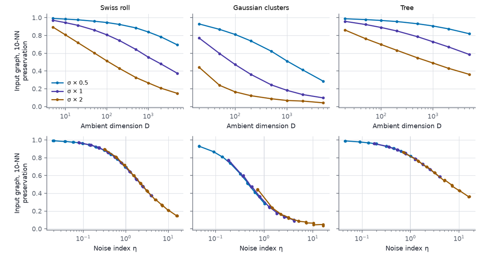

A dataset with 5,000 columns can have the structure of a sheet of paper, and a dataset with 20 columns can have the structure of a 20-dimensional cloud; the two are different problems for a 2-D map, and they fail in different places.

Single-cell data routinely has 20,000 gene columns and 50 principal components, and UMAP plots of it show coherent structure. Textbooks warn that nearest neighbours lose their meaning in high dimensions, because distances between random points concentrate around one value. Both observations cannot apply to the same data in the same way. The resolution is that the number of columns, the *ambient* dimension, is not the number that matters. What matters is how many directions carry structure (the *intrinsic* dimension) and how much noise the remaining columns add. This part separates the two and measures each.

This is the second of four parts. [Part 1](../when-umap-lies/) defined the metrics and the methods; [Part 3](../when-umap-lies-tuning/) covers settings and seeds; [Part 4](../when-umap-lies-gaps-density-holes/) covers gaps, density and holes.

This part covers three ideas:

- **Ambient and intrinsic dimension are different problems.** Rotating data into more columns changes nothing; padding it with noise columns degrades the neighbour graph; adding real degrees of freedom defeats any 2-D map.
- **Noise columns do their damage in the neighbour graph, and one index predicts it.** The index $\eta$ combines the noise level, the number of noise columns, and the scale of the data's neighbourhoods.
- **A 2-D map can recover neighbours its own graph has lost, but only when the structure is about two-dimensional.**

```{python}
#| label: setup
#| echo: false
import json
import sys
from pathlib import Path

import matplotlib.pyplot as plt
import numpy as np
import pandas as pd
from IPython.display import Markdown

sys.path.insert(0, str(Path("../when-umap-lies/src").resolve()))
from umaplab import experiments as X
from umaplab import plotting as P
from umaplab import report as R

P.setup()


def md(df: pd.DataFrame, **kw) -> Markdown:
    kw.setdefault("index", False)
    return Markdown(df.to_markdown(disable_numparse=True, **kw))


BASE_P = {"swiss_roll": 3, "gaussian_clusters": 10, "branching": 10}
GEN_NAME = {"swiss_roll": "Swiss roll", "gaussian_clusters": "Gaussian clusters", "branching": "Tree"}
SHOWN = ["pca", "umap", "tsne", "umap·pca50", "pacmap", "trimap", "isomap"]

ND = R.load("noise_dims")
NS = R.load("noise_sigma")
ISO = R.load("isometry")
GF = pd.concat(
    [pd.read_parquet(R.CACHE / e / "graph_fidelity.parquet").assign(experiment=e) for e in ("noise_dims", "noise_sigma")]
)
RK2 = (
    GF[GF.space == "clean_r10_sq"][["generator", "data_seed", "value"]]
    .drop_duplicates(["generator", "data_seed"])
    .rename(columns={"value": "rk2"})
)


def with_eta(df):
    df = df.merge(RK2, on=["generator", "data_seed"], how="left")
    p = df.generator.map(BASE_P)
    df["eta"] = df.noise_sigma**2 * np.sqrt(8 * np.maximum(df.D - p, 0)) / df.rk2
    return df


q10 = lambda df, ref="truth": R.pick(df, "knn_preservation", 10.0, ref)  # noqa: E731


def med(df, **sel):
    for k, v in sel.items():
        df = df[df[k] == v]
    return df.value.median()


def rng_of(df, **sel):
    for k, v in sel.items():
        df = df[df[k] == v]
    return R.rng(df.value.min(), df.value.max())
```

## Design {#sec-design}

### Three ways to add dimensions {#sec-three}

Start from a base dataset $Z \in \mathbb{R}^{n \times p}$ whose structure is known, and raise its dimension to $D$ in one of three ways.

1. **Rotation.** $X = Z Q^\top$ with $Q$ a random $D \times p$ matrix with orthonormal columns. Every pairwise distance is unchanged, so every distance-based method should be unchanged too. This is the control.
2. **Noise columns.** $X = [\,Z,\ \sigma E\,]$ with $E$ an $n \times (D - p)$ matrix of independent standard normals. The ambient dimension grows; the structure does not.
3. **More degrees of freedom.** The base itself gets $d$ intrinsic dimensions, $d$ from 2 to 100, and is rotated into $D = 200$ columns. The structure grows; the noise does not.

Isotropic Gaussian noise looks the same from every direction, so padding with noise columns and then rotating is close to rotating and then adding noise to every coordinate when $D$ is much larger than $p$: the two differ only by the noise that lands inside the structure's own $p$ directions. Scenario 2 therefore approximates "structure embedded in a random subspace plus measurement noise", not only literal padding.

### Base datasets {#sec-bases}

All three are synthetic, with $n = 2000$ points. Each stands in for a structure common in single-cell and other high-throughput data.

- **Swiss roll.** A flat $88.8 \times 21$ sheet rolled into a spiral in 3 dimensions ($p = 3$, intrinsic dimension 2), sampled uniformly by area. The ground truth is the flat sheet: arc length along the spiral and height. It stands in for a continuous process, such as cells along a differentiation path, that curves through expression space.
- **Gaussian clusters.** Ten clusters of 200 points in 10 dimensions ($p = 10$), unit standard deviation, the closest two centres 6 standard deviations apart. The ground truth is the noiseless 10-D cloud and its labels. It stands in for discrete cell types; each cluster has 10 internal dimensions, so it is intrinsically 10-dimensional.
- **Tree.** A trunk and three branches, straight segments in 10 dimensions ($p = 10$), with no noise of its own. The ground truth is each point's position on the tree. It stands in for a branching lineage. Being one-dimensional and noise-free, it is the easiest of the three for every method; Part 4 adds noise.

### Fixed and varied {#sec-fixed}

- **Varied:** the ambient dimension $D$, over 5, 10, 20, 50, 100, 200, 500, 1,000, 2,000 and 5,000, skipping values below the base's own $p$ (so the Swiss roll starts at $D = 5$ and the clusters and tree at $D = 10$, their unpadded dimension), the noise level $\sigma$ (three levels), the intrinsic dimension $d$.
- **Fixed:** $n = 2000$; every method at its package defaults (the defaults are in Part 1's table); UMAP and t-SNE also run on the first 50 principal components, as single-cell pipelines do.
- **Replication:** five independent draws of every dataset (three for the rotation control and the extra noise levels). Each method runs once per draw with its seed set to the draw's index, so the spread over draws includes both sampling and the method's own randomness. Part 3 separates the two.
- **Reference:** local metrics are scored against the ground truth, so a method is judged on the structure that generated the data, not on the noisy columns it was given. They are also scored against the input itself, and the input's own neighbour graph is scored against the truth, which says how much the graph handed to a method has already lost.

Ranges in the text are the minimum and maximum over the draws; figures show the median and the min–max band.

## Rotation {#sec-rotation}

```{python}
#| label: iso
#| echo: false
iq = q10(ISO)
iq = iq[iq.config.isin(["pca", "umap", "tsne", "umap·pca50", "pacmap", "isomap", "trimap"])]
iso_spread = iq.groupby(["generator", "config", "data_seed"]).value.agg(lambda v: v.max() - v.min())
iso_max = iso_spread.max()
iso_worst = iso_spread.idxmax()
```

Rotated into 5,000 dimensions, the Swiss roll and the clusters embed as they do in 5 and 10. For the seven methods in the figures, the largest change in 10-neighbour preservation across $D$, within one draw, is `{python} R.fmt(iso_max, 3)` (`{python} P.name(iso_worst[1])` on the `{python} GEN_NAME[iso_worst[0]].lower()`). PaCMAP and TriMap switch to their 100-component PCA step above $D = 100$ and move by no more than that, because the data have only $p \le 10$ directions of variance to keep. More columns, on their own, cost nothing but time.

## Noise columns {#sec-noise}

### Results {#sec-noise-result}

```{python}
#| label: fig-noise
#| fig-cap: "Ten-neighbour preservation against the ground truth as noise columns are added, for the Swiss roll (left) and the Gaussian clusters (right). Lines: median of five independent draws; bands: min–max. The dotted line is the input's own 10-neighbour graph, scored against the same truth. Chance is 0.005."
#| fig-alt: "Two line charts against ambient dimension on a log axis. On the Swiss roll the input graph falls from about 0.97 to 0.37 while t-SNE and UMAP fall much less, ending well above it; PCA is flat near 0.3 to 0.4. On the clusters the input graph falls from 1 to 0.1; the neighbour-graph embeddings stay below it, and PCA, flat near 0.11, ends level with it."
fig, axes = plt.subplots(1, 2, figsize=(9.5, 3.4), sharey=True)
nq = q10(ND)
gf = GF[(GF.experiment == "noise_dims") & (GF.k == 10)]
for ax, gen in zip(axes, ["swiss_roll", "gaussian_clusters"]):
    for cfg in SHOWN:
        s = R.summary(nq[(nq.generator == gen) & (nq.config == cfg)], ["D"]).sort_values("D")
        if s.empty:
            continue
        st = P.style(cfg)
        ax.plot(s.D, s["median"], **st, markersize=3)
        P.band(ax, s.D, s.lo, s.hi, cfg)
    s = R.summary(gf[(gf.generator == gen) & (gf.space == "input")], ["D"]).sort_values("D")
    ax.plot(s.D, s["median"], **P.style("input"))
    ax.set_xscale("log")
    ax.set_title(GEN_NAME[gen])
    ax.set_xlabel("Ambient dimension D")
axes[0].set_ylabel("10-neighbour preservation (vs truth)")
axes[0].set_ylim(0, 1.02)
handles, labels = axes[0].get_legend_handles_labels()
fig.legend(handles, labels, loc="center left", bbox_to_anchor=(1.0, 0.5), fontsize=8)
fig.tight_layout()
plt.show()
```

```{python}
#| label: noise-numbers
#| echo: false
gin = gf[gf.space == "input"]
ig = lambda gen, D: med(gin, generator=gen, D=D)  # noqa: E731
eq = lambda gen, cfg, D: med(nq, generator=gen, config=cfg, D=D)  # noqa: E731
er = lambda gen, cfg, D: rng_of(nq, generator=gen, config=cfg, D=D)  # noqa: E731
```

- **The input graph decays steadily.** On the Swiss roll, the 10 nearest neighbours of a point in the padded data include `{python} R.fmt(100 * ig("swiss_roll", 5), 0)`% of its true neighbours at $D = 5$, `{python} R.fmt(100 * ig("swiss_roll", 100), 0)`% at $D = 100$ and `{python} R.fmt(100 * ig("swiss_roll", 5000), 0)`% at $D = 5000$. On the clusters the same figure falls from `{python} R.fmt(100 * ig("gaussian_clusters", 20), 0)`% at $D = 20$ to `{python} R.fmt(100 * ig("gaussian_clusters", 5000), 0)`%.
- **The neighbour-graph methods decay much more slowly on the Swiss roll.** From $D = 5$ to $D = 5000$, t-SNE goes from `{python} er("swiss_roll", "tsne", 5)` to `{python} er("swiss_roll", "tsne", 5000)` and UMAP from `{python} er("swiss_roll", "umap", 5)` to `{python} er("swiss_roll", "umap", 5000)`.
- **PCA is flat** at `{python} R.fmt(eq("swiss_roll", "pca", 5))` on the Swiss roll and `{python} R.fmt(eq("gaussian_clusters", "pca", 20))` on the clusters: two directions out of the base's own three or ten keep the same share of neighbours however many noise columns are added, because the base's directions carry far more variance than any noise column.
- **On the clusters every neighbour-graph embedding ends below the input graph**, which itself ends near `{python} R.fmt(ig("gaussian_clusters", 5000))`.

The difference between the two datasets is the subject of [the last section](#sec-beat). First, the input graph.

### The noise index {#sec-eta}

Why should 5,000 columns of small noise ruin a neighbour graph that 3 columns of structure defined? Write the squared distance between points $i$ and $j$ in the padded data as the structure's part plus the noise's part:

$$
\|x_i - x_j\|^2 = \|z_i - z_j\|^2 + \sigma^2 \sum_{c=1}^{D-p} (e_{ic} - e_{jc})^2 .
$$

The noise sum is $\sigma^2$ times a chi-squared variable with $D - p$ degrees of freedom, scaled by 2. Its mean, $2\sigma^2 (D - p)$, is the same for every pair, so on its own it shifts every distance equally and changes no ranking. Its standard deviation, $\sigma^2 \sqrt{8 (D - p)}$, differs from pair to pair, and that fluctuation can reorder neighbours. (Whether $j$ or $l$ is the nearer neighbour of $i$ depends on the difference of two such terms that share point $i$, whose standard deviation is $\sigma^2 \sqrt{12 (D - p)}$; that changes only the constant, and the index keeps $\sqrt 8$.) It competes with the spread of the structural distances among a point's near neighbours, whose scale is $r_k^2$, the squared distance to the $k$-th neighbour in the clean data. The ratio is the **noise index**:

$$
\eta = \frac{\sigma^2 \sqrt{8 (D - p)}}{r_k^2} .
$$

The argument predicts that, for a given dataset, the input graph's fidelity depends on $\sigma$ and $D$ only through $\eta$. Each base got its own $\sigma$, chosen so that $\eta = 1$ at $D - p = 300$; the extra runs use half and double that $\sigma$.

```{python}
#| label: fig-eta
#| fig-cap: "The input's 10-neighbour graph scored against the ground truth, for three noise levels, against ambient dimension (top) and against the noise index η (bottom). Each line is one noise level; points are medians over draws. Against D the three levels give three curves; against η they fall on one."
#| fig-alt: "Six panels in two rows. Top row, against D, each dataset shows three separated decreasing curves for half, one and twice the noise level. Bottom row, against eta, the three curves in each panel lie on top of each other."
g = with_eta(GF[(GF.space == "input") & (GF.k == 10)].copy())
g = g[g.D > g.generator.map(BASE_P)]
s0 = GF[GF.experiment == "noise_dims"].groupby("generator").noise_sigma.first()
g["mult"] = (g.noise_sigma / g.generator.map(s0)).round(2)
fig, axes = plt.subplots(2, 3, figsize=(9.5, 5.2), sharey=True)
mcol = {0.5: P.C5, 1.0: P.C1, 2.0: P.C3}
for j, gen in enumerate(["swiss_roll", "gaussian_clusters", "branching"]):
    for m, sub in g[g.generator == gen].groupby("mult"):
        a = sub.groupby("D").value.median()
        # eta differs per draw (each draw has its own r10), so take medians per D and
        # plot each at that D's median eta.
        b = sub.groupby("D").agg(eta=("eta", "median"), v=("value", "median")).sort_values("eta")
        lab = f"σ × {m:g}"
        axes[0, j].plot(a.index, a.values, color=mcol[m], marker="o", markersize=3, label=lab)
        axes[1, j].plot(b.eta, b.v, color=mcol[m], marker="o", markersize=3, label=lab)
    axes[0, j].set_title(GEN_NAME[gen])
    axes[0, j].set_xscale("log")
    axes[1, j].set_xscale("log")
    axes[0, j].set_xlabel("Ambient dimension D")
    axes[1, j].set_xlabel("Noise index η")
    axes[1, j].axvline(1, color=P.RULE, lw=1, zorder=0)
axes[0, 0].set_ylabel("Input graph, 10-NN\npreservation")
axes[1, 0].set_ylabel("Input graph, 10-NN\npreservation")
axes[0, 0].legend(fontsize=8)
fig.tight_layout()
plt.show()


def curve_gaps(sub, value="value"):
    curves = {}
    for m, s in sub.groupby("mult"):
        per_D = s.groupby("D").agg(eta=("eta", "median"), v=(value, "median"))
        curves[m] = per_D.set_index("eta").v.sort_index()
    ms = sorted(curves)
    at_eta = 0.0
    for i in range(len(ms)):
        for k2 in range(i + 1, len(ms)):
            a, b = curves[ms[i]], curves[ms[k2]]
            lo, hi = max(a.index.min(), b.index.min()), min(a.index.max(), b.index.max())
            if lo >= hi:
                continue
            grid = np.log(np.geomspace(lo, hi, 50))
            at_eta = max(at_eta, float(np.abs(np.interp(grid, np.log(a.index), a.values) - np.interp(grid, np.log(b.index), b.values)).max()))
    same = sub.groupby(["D", "mult"])[value].median().unstack("mult")
    return at_eta, float((same.max(axis=1) - same.min(axis=1)).max())


GAPS = {gen: curve_gaps(g[g.generator == gen]) for gen in BASE_P}
ACROSS = g[(g.eta >= 0.7) & (g.eta <= 1.0)].groupby("generator").value.median()
```

The prediction holds. At the same ambient dimension, the three noise levels give 10-neighbour fidelities up to `{python} R.fmt(max(v[1] for v in GAPS.values()))` apart. At the same $\eta$ they agree to within `{python} R.fmt(GAPS["branching"][0])` on the tree, `{python} R.fmt(GAPS["swiss_roll"][0])` on the Swiss roll and `{python} R.fmt(GAPS["gaussian_clusters"][0])` on the clusters (the largest gaps between the median curves on their common range of $\eta$). The clusters fit least well where $D - p$ is small, where a chi-squared variable with few degrees of freedom is far from the normal shape the standard-deviation argument assumes.

Across datasets, $\eta$ is not a common scale. At $\eta$ between 0.7 and 1, the input graph keeps `{python} R.fmt(ACROSS["branching"])` of true neighbours on the tree, `{python} R.fmt(ACROSS["swiss_roll"])` on the Swiss roll and `{python} R.fmt(ACROSS["gaussian_clusters"])` on the clusters. $r_k^2$ measures how far a point's neighbourhood reaches, not how closely its successive neighbours are packed; with ten intrinsic dimensions inside each cluster, the gaps between successive neighbour distances are much smaller than $r_k^2$, so the clusters' graph breaks at a smaller $\eta$. The index orders the damage within a dataset; it does not set one threshold for all data.

```{python}
#| label: eta-embed
#| echo: false
E2 = pd.concat([q10(ND), q10(NS)])
E2 = with_eta(E2[E2.config.isin(["umap", "tsne"])].copy())
E2 = E2[E2.D > E2.generator.map(BASE_P)]
E2["mult"] = (E2.noise_sigma / E2.generator.map(s0)).round(2)
EG = {(gen, cfg): curve_gaps(sub) for (gen, cfg), sub in E2.groupby(["generator", "config"])}
umap_eta = max(EG[(gen, "umap")][0] for gen in BASE_P)
umap_D = min(EG[(gen, "umap")][1] for gen in BASE_P)
tsne_eta = max(EG[(gen, "tsne")][0] for gen in BASE_P)
```

The index carries through to the maps drawn from those graphs. For UMAP's embeddings, the curves for the three noise levels agree to within `{python} R.fmt(umap_eta)` at matched $\eta$ on all three datasets, against gaps of at least `{python} R.fmt(umap_D)` at matched $D$. For t-SNE the index removes about half of the mismatch: on the Swiss roll its curves differ by up to `{python} R.fmt(EG[("swiss_roll", "tsne")][1])` at matched $D$ and `{python} R.fmt(EG[("swiss_roll", "tsne")][0])` at matched $\eta$. PCA builds no neighbour graph, and $\eta$ does not describe it.

Within a dataset, then, "high-dimensional" is the wrong warning. The index predicts that five thousand columns of noise with $\sigma$ small next to the data's neighbourhood scale ($\eta \ll 1$) leave the graph intact, and that twenty columns of large noise ($\eta \gg 1$) destroy it. Those extremes are predictions: the runs here reach $\eta$ of about 1 at both $D = 5000$ (smallest noise level) and $D = 20$ (largest).

### PCA preprocessing {#sec-pca}

```{python}
#| label: pca-graph
#| echo: false
gpca = GF[(GF.experiment == "noise_dims") & (GF.k == 10)]
gq = lambda gen, space, D: med(gpca, generator=gen, space=space, D=D)  # noqa: E731
pd_ = R.paired_diff(nq[nq.generator == "swiss_roll"], "umap·pca50", "umap", ["generator", "D"])
pd5000 = pd_[pd_.D == 5000]["diff"]
pd100 = pd_[pd_.D == 100]["diff"]
```

The standard single-cell pipeline reduces the data to its first 50 principal components before building the neighbour graph. PCA keeps the directions of largest variance. The base's own directions carry far more variance than any noise column, so they survive, and most of the noise columns are discarded.

- **On the Swiss roll at $D = 5000$**, the neighbour graph built on 50 components keeps `{python} R.fmt(100 * gq("swiss_roll", "pca50", 5000), 0)`% of true neighbours, against `{python} R.fmt(100 * gq("swiss_roll", "input", 5000), 0)`% for the raw input; on 10 components it keeps `{python} R.fmt(100 * gq("swiss_roll", "pca10", 5000), 0)`%.
- **On the clusters** the numbers are `{python} R.fmt(100 * gq("gaussian_clusters", "pca50", 5000), 0)`% on 50 components, `{python} R.fmt(100 * gq("gaussian_clusters", "input", 5000), 0)`% raw, and `{python} R.fmt(100 * gq("gaussian_clusters", "pca10", 5000), 0)`% on 10.
- **Fewer components help more here** because the base has only 3 or 10 directions: every component beyond those is noise, and the noise components PCA keeps are the noise directions with the *largest* sample variance. With $D$ larger than $n$, the top sample-variance directions of pure noise carry several times $\sigma^2$ (the upper edge of the Marchenko–Pastur law (Marchenko & Pastur 1967), $\sigma^2 (1 + \sqrt{D/n})^2$, is about $6.7\sigma^2$ at $D = 5000$, $n = 2000$), so each noise component PCA keeps carries several times the variance of one original noise column.
- **UMAP on 50 components beats UMAP on the raw input** on the Swiss roll by `{python} R.rng(pd5000.min(), pd5000.max())` in 10-neighbour preservation at $D = 5000$ (paired by draw). At $D = 100$ the difference is `{python} R.rng(pd100.min(), pd100.max())`: the step pays only once the noise columns outnumber the kept components many times over.

PaCMAP, TriMap and PHATE reduce to 100 components by default when $D > 100$. Part of their robustness in the figure is that step, not their objectives. The right number of components depends on the data's intrinsic dimension, which is unknown in practice; 50 is a convention, not a derived value.

### Maps against the input graph {#sec-beat}

```{python}
#| label: fig-beat
#| fig-cap: "Ten-neighbour preservation against the truth of each method's map minus that of the input's own 10-neighbour graph, paired by draw. Above zero, the 2-D map recovers more true neighbours than the graph built from the data it was given. Lines: median; bands: min–max over five draws."
#| fig-alt: "Two line charts against ambient dimension. On the Swiss roll t-SNE and UMAP cross zero between D of 100 and 500 and end about 0.2 to 0.4 above it at D 5000. On the clusters UMAP, t-SNE and PaCMAP stay below zero at every D; PCA ends slightly above it."
# Each map is compared with the 10-neighbour graph of its input: the raw columns, or the
# first 50 components for the PCA-50 arms. (Below D = 50 there is no PCA-50 step.)
own = gf[gf.space.isin(["input", "pca50"])][["generator", "D", "data_seed", "space", "value"]]
own = own.rename(columns={"value": "inp"})
bt = nq[nq.config.isin(["umap", "tsne", "umap·pca50", "tsne·pca50", "pacmap", "pca"])].copy()
bt["space"] = np.where(bt.config.str.endswith("pca50") & (bt.D > 50), "pca50", "input")
bt = bt.merge(own, on=["generator", "D", "data_seed", "space"])
bt["gain"] = bt.value - bt.inp
fig, axes = plt.subplots(1, 2, figsize=(9.5, 3.2), sharey=True)
for ax, gen in zip(axes, ["swiss_roll", "gaussian_clusters"]):
    for cfg in ["umap", "tsne", "umap·pca50", "pacmap", "pca"]:
        s = bt[(bt.generator == gen) & (bt.config == cfg)].groupby("D").gain.agg(["median", "min", "max"])
        ax.plot(s.index, s["median"], **P.style(cfg), markersize=3)
        P.band(ax, s.index, s["min"], s["max"], cfg)
    ax.axhline(0, color=P.INK, lw=0.8)
    ax.set_xscale("log")
    ax.set_title(GEN_NAME[gen])
    ax.set_xlabel("Ambient dimension D")
axes[0].set_ylabel("Map minus input graph\n(10-NN preservation)")
axes[0].legend(fontsize=8, loc="upper left")
fig.tight_layout()
plt.show()
gain = lambda gen, cfg, D: bt[(bt.generator == gen) & (bt.config == cfg) & (bt.D == D)].gain  # noqa: E731
cross = {}
for cfg in ["tsne", "umap"]:
    s = bt[(bt.generator == "swiss_roll") & (bt.config == cfg)].groupby("D").gain.min().sort_index()
    # smallest D from which every draw at every larger D has a positive gain
    pos = (s > 0)[::-1].cummin()[::-1]
    cross[cfg] = int(pos[pos].index.min())
clb = bt[(bt.generator == "gaussian_clusters") & (bt.D > 10)]
cl_max = clb[clb.config != "pca"].gain.max()
cl_pca = clb[(clb.config == "pca") & (clb.D == 5000)].gain
```

A map drawn from noisy data might be expected to keep fewer true neighbours than the input's own 10-neighbour graph. On the Swiss roll it keeps more.

- **t-SNE's map recovers more true neighbours than its input's 10-neighbour graph** in every draw from $D = `{python} cross["tsne"]`$; UMAP's does from $D = `{python} cross["umap"]`$. At $D = 5000$ the gain is `{python} R.rng(gain("swiss_roll", "tsne", 5000).min(), gain("swiss_roll", "tsne", 5000).max())` for t-SNE and `{python} R.rng(gain("swiss_roll", "umap", 5000).min(), gain("swiss_roll", "umap", 5000).max())` for UMAP.
- **On the clusters no neighbour-graph map beats its input's 10-neighbour graph** once noise is added: the largest gain for UMAP, t-SNE (raw or on 50 components) and PaCMAP, over every draw and $D > 10$, is `{python} R.fmt(cl_max)`. PCA edges past the raw graph only at the top of the range (by `{python} R.rng(cl_pca.min(), cl_pca.max())` at $D = 5000$), where that graph is close to chance and PCA's two directions, chosen from the base's ten, ignore the noise columns.

Each map is compared with the 10-neighbour graph of its input: the raw columns, or for the PCA-50 arms the first 50 components.

```{python}
#| label: snn
#| echo: false
snn = GF[(GF.experiment == "noise_dims") & (GF.k == 10) & GF.space.isin(["snn15", "snn90"])]
sv = lambda space, D: med(snn, generator="swiss_roll", space=space, D=D)  # noqa: E731
ev5000 = lambda cfg: med(nq, generator="swiss_roll", config=cfg, D=5000)  # noqa: E731
```

The 10-neighbour graph is a weak baseline. UMAP builds its layout from 15 neighbours per point and t-SNE from about 90, so both see more than the 10 nearest. A baseline with the same information and no layout re-ranks each point's 15 or 90 nearest neighbours by how many neighbours they share with it, and keeps the top 10:

- **Pooling explains t-SNE's gain.** At $D = 5000$, re-ranking within 90 neighbours recovers `{python} R.fmt(sv("snn90", 5000))` of true neighbours, more than t-SNE's map (`{python} R.fmt(ev5000("tsne"))`).
- **UMAP's layout adds something pooling does not.** Re-ranking within 15 neighbours recovers `{python} R.fmt(sv("snn15", 5000))`, less than UMAP's map (`{python} R.fmt(ev5000("umap"))`).

One hypothesis for UMAP's remainder is the two-dimensional layout: when the true structure is a two-dimensional sheet, forcing the layout into the plane removes the noise's freedom to move points off the sheet. This part does not test it. Neither pooling nor the layout helps on the clusters, whose structure has 10 dimensions inside each cluster: a 2-D map cannot hold 10-D neighbourhoods however clean its input.

This is the sense in which Lause, Berens & Kobak (2024) suggested that "it may in fact be undesirable to preserve" high-dimensional distances in a 2-D map. The result here is consistent with the suggestion only conditionally: a map recovers neighbours the noisy 10-neighbour graph has lost when the structure is low-dimensional, and for t-SNE pooling over more neighbours accounts for all of it.

The widget shows the maps behind these numbers. On the Swiss roll, slide $D$ from 5 to 5,000: the input graph's score in the tiles drops below t-SNE's and UMAP's, and the unrolled sheet stays recognisable in their panels long after the dotted input line has fallen. Switch to the clusters and the input line stays above UMAP's and t-SNE's at every $D$.

::: {#widget-dimension}
:::

```{=html}
<script src="../when-umap-lies/umapkit.js"></script>
<script src="widget-data/dimension.js"></script>
<script src="widget-data/signal.js"></script>
<script src="model.js"></script>
<script src="widgets.js"></script>
```

## Intrinsic dimension {#sec-intrinsic}

Noise columns damage the graph and leave the structure two- or ten-dimensional. The opposite experiment keeps the data noise-free and gives the structure more dimensions.

- **Gaussian factor model.** $d$ independent standard normal factors, mapped into 200 columns by a random rotation. No structure beyond a $d$-dimensional cloud; it stands in for data driven by many independent continuous programmes.
- **Sphere.** Points uniform on the unit sphere $S^{d-1}$ in $\mathbb{R}^d$, rotated into 200 columns: a curved, closed surface with $d - 1$ intrinsic dimensions.
- **Clusters.** Ten Gaussian clusters with $d$ internal dimensions each, nearest centres 6 standard deviations apart, rotated into 200 columns.

$d$ runs over 2, 5, 10, 20, 50 and 100, with five draws each. The input's neighbour graph is exact in every case (it scores 1), so whatever is lost, the map loses.

```{python}
#| label: fig-intrinsic
#| fig-cap: "Ten-neighbour preservation against the ground truth as the intrinsic dimension d grows, at a fixed ambient dimension of 200, for three structures. Lines: median of five draws; bands: min–max. Chance is 0.005. The sphere's intrinsic dimension is d − 1."
#| fig-alt: "Three line charts against intrinsic dimension on a log axis. Every method starts high at d = 2 and falls steeply; t-SNE falls least, to about 0.16 to 0.24 at d = 100; PCA and Isomap fall fastest, to near zero by d = 20."
IN = R.load("intrinsic")
iq = q10(IN)
IN_GEN = {"latent_factor": "Gaussian factors", "sphere": "Sphere", "gaussian_clusters": "Clusters"}
iq = iq.assign(d=iq.gp.map(lambda g: g.get("d", g.get("dim", g.get("m", 0) + 1))))
fig, axes = plt.subplots(1, 3, figsize=(10, 3.3), sharey=True)
for ax, (gen, title) in zip(axes, IN_GEN.items()):
    for cfg in ["pca", "umap", "tsne", "umap·pca50", "pacmap", "trimap", "isomap"]:
        s = R.summary(iq[(iq.generator == gen) & (iq.config == cfg)], ["d"]).sort_values("d")
        ax.plot(s.d, s["median"], **P.style(cfg), markersize=3)
        P.band(ax, s.d, s.lo, s.hi, cfg)
    ax.set_xscale("log")
    ax.set_title(title)
    ax.set_xlabel("Intrinsic dimension d")
axes[0].set_ylabel("10-neighbour preservation")
axes[0].set_ylim(0, 1.02)
handles, labels = axes[0].get_legend_handles_labels()
fig.legend(handles, labels, loc="center left", bbox_to_anchor=(1.0, 0.5), fontsize=8)
fig.tight_layout()
plt.show()
iv = lambda gen, cfg, d: med(iq, generator=gen, config=cfg, d=d)  # noqa: E731
```

- **Every method falls steeply.** On the Gaussian factors, PCA keeps every neighbour at $d = 2$ (a 2-D Gaussian is its own principal plane) and `{python} R.fmt(iv("latent_factor", "pca", 5))` at $d = 5$. t-SNE falls least: `{python} R.fmt(iv("latent_factor", "tsne", 10))` at $d = 10$ and `{python} R.fmt(iv("latent_factor", "tsne", 100))` at $d = 100$, still about `{python} R.fmt(iv("latent_factor", "tsne", 100) / 0.005, 0)` times chance. UMAP keeps `{python} R.fmt(iv("latent_factor", "umap", 10))` and `{python} R.fmt(iv("latent_factor", "umap", 100))`.
- **PCA first now hurts.** With 100 real dimensions, keeping 50 components throws away half the structure: t-SNE on 50 components keeps `{python} R.fmt(iv("latent_factor", "tsne·pca50", 100))` at $d = 100$ against `{python} R.fmt(iv("latent_factor", "tsne", 100))` on the raw columns. The step that rescued the noisy Swiss roll is a loss here.
- **Clusters keep more than structureless clouds** at the same $d$ (t-SNE `{python} R.fmt(iv("gaussian_clusters", "tsne", 20))` against `{python} R.fmt(iv("latent_factor", "tsne", 20))` at $d = 20$), because a neighbour of a point is almost always in its cluster, and a map that keeps clusters together keeps part of each neighbourhood by default.

### Folding and tearing {#sec-fold-tear}

```{python}
#| label: fig-fold-tear
#| fig-cap: "Trustworthiness (penalises false neighbours: folding) against continuity (penalises lost neighbours: tearing), k = 10, on the Gaussian factor model. Each line follows one method from d = 2 (top right, both 1) to d = 100 (its lower-left end); points are medians of five draws."
#| fig-alt: "Scatter with connected lines. All methods start at the top right and move down and left as d grows. Continuity falls by similar amounts for every method; trustworthiness falls least for t-SNE and most for PCA and Isomap."
#| fig-dpi: 280
tc = IN[(IN.generator == "latent_factor") & (IN.metric.isin(["trustworthiness", "continuity"])) & (IN.k == 10) & (IN.reference == "truth")]
tc = tc.assign(d=tc.gp.map(lambda g: g["d"]))
tcw = tc.groupby(["config", "d", "metric"]).value.median().unstack("metric").reset_index()
fig, ax = plt.subplots(figsize=(5.2, 4.2))
for cfg in ["pca", "umap", "tsne", "pacmap", "trimap", "isomap"]:
    s = tcw[tcw.config == cfg].sort_values("d")
    ax.plot(s.continuity, s.trustworthiness, **P.style(cfg), markersize=4)
ax.plot([0.5, 1], [0.5, 1], color=P.RULE, lw=1, zorder=0)
ax.set_xlabel("Continuity (low = tears)")
ax.set_ylabel("Trustworthiness (low = folds)")
ax.legend(fontsize=8, loc="lower right")
fig.tight_layout()
plt.show()
tcv = lambda cfg, d, m: tcw[(tcw.config == cfg) & (tcw.d == d)][m].iloc[0]  # noqa: E731
```

A plane cannot hold a 10-dimensional neighbourhood, so a map of one must either place points together that are not neighbours (fold) or separate points that are (tear). Trustworthiness measures the first, continuity the second (Venna & Kaski 2001; definitions in [Part 1](../when-umap-lies/#sec-local)). The methods tear about equally and differ in how much they fold.

- **They tear about equally.** At $d = 10$, continuity is `{python} R.fmt(tcv("tsne", 10, "continuity"))` for t-SNE, `{python} R.fmt(tcv("umap", 10, "continuity"))` for UMAP and `{python} R.fmt(tcv("pca", 10, "continuity"))` for PCA.
- **They fold very differently.** Trustworthiness at $d = 10$ is `{python} R.fmt(tcv("tsne", 10, "trustworthiness"))` for t-SNE, `{python} R.fmt(tcv("umap", 10, "trustworthiness"))` for UMAP and `{python} R.fmt(tcv("pca", 10, "trustworthiness"))` for PCA: projecting onto two directions lays distant points on top of real neighbours, and t-SNE does the least of it. At $d \ge 50$ t-SNE also tears less than PCA.

For a reader, tearing and folding license different mistakes. On a torn map, a gap may run through one population; on a folded map, one blob may hold two. Part 4 measures how often the first happens.

The widget combines the two experiments: six clusters with $d$ internal dimensions, padded with noise columns. Raise $d$ at $\sigma = 0$ and the input graph stays perfect while the maps lose neighbours. Raise $\sigma$ at $d = 2$ and $D = 1000$ and the input graph loses them first, and UMAP's and t-SNE's maps, built from that graph, lose them with it, while the class accuracy under their tiles stays at 1: a map can lose nearly every true neighbour and still keep six well-separated clusters apart. PCA's map keeps its neighbours, because it builds no neighbour graph: its two directions come from the clusters' own two dimensions, which carry far more variance than any noise column. The sample size matters too. At larger $n$ the 10 nearest neighbours lie closer together, $r_{10}$ shrinks, and the same $\sigma$ gives a larger $\eta$. Each setting in the widget is one draw.

::: {#widget-signal}
:::

## Cost {#sec-cost}

Fit time was measured for every run above, and in a separate study over sample size: Gaussian clusters in 50 dimensions padded to 100, $n$ from 500 to 10,000, three draws, each fit in a fresh process on one thread of an Apple-silicon laptop, recording the process's peak memory above its level before the fit.

```{python}
#| label: fig-cost
#| fig-cap: "Fit time on one thread. Left: against sample size, at D = 100. Right: against ambient dimension, Swiss roll with noise columns at n = 2,000. Medians over draws; log scales."
#| fig-alt: "Two log-log line charts. Against n, Laplacian eigenmaps grows fastest, to about a minute at 10,000 points; t-SNE, UMAP and PHATE take 10 to 15 seconds at 10,000; PaCMAP and TriMap stay under 3 seconds; PCA is fastest. Against D at n = 2,000, most methods change little; t-SNE rises from about 6 to over 30 seconds."
SC = pd.read_parquet(R.CACHE / "scaling.parquet")
SC = SC[SC.status == "ok"]
fig, axes = plt.subplots(1, 2, figsize=(9.5, 3.4))
for cfg in ["pca", "umap", "tsne", "pacmap", "trimap", "isomap", "spectral", "diffmap", "phate"]:
    s = SC[SC.config == cfg].groupby("n").seconds.median()
    axes[0].plot(s.index, s.values, **P.style(cfg), markersize=3)
    t = ND[(ND.generator == "swiss_roll") & (ND.config == cfg)].drop_duplicates("cell_id").groupby("D").seconds.median()
    if not t.empty:
        axes[1].plot(t.index, t.values, **P.style(cfg), markersize=3)
for ax, xl in zip(axes, ["Sample size n", "Ambient dimension D"]):
    ax.set_xscale("log")
    ax.set_yscale("log")
    ax.set_xlabel(xl)
axes[0].set_ylabel("Fit time (s)")
axes[0].legend(fontsize=7, ncol=2)
fig.tight_layout()
plt.show()
sec = lambda cfg, n: SC[(SC.config == cfg) & (SC.n == n)].seconds.median()  # noqa: E731
mem = lambda cfg, n: SC[(SC.config == cfg) & (SC.n == n)].peak_rss_mb.median()  # noqa: E731
tD = lambda cfg, D: ND[(ND.generator == "swiss_roll") & (ND.config == cfg) & (ND.D == D)].drop_duplicates("cell_id").seconds.median()  # noqa: E731
```

- **At 10,000 points**, UMAP fits in `{python} R.fmt(sec("umap", 10000), 0)` s, t-SNE in `{python} R.fmt(sec("tsne", 10000), 0)` s, PHATE in `{python} R.fmt(sec("phate", 10000), 0)` s, PaCMAP in `{python} R.fmt(sec("pacmap", 10000), 1)` s and TriMap in `{python} R.fmt(sec("trimap", 10000), 1)` s on one thread. openTSNE switches from its Barnes–Hut to its FFT approximation at 10,000 points, which is why its curve flattens there, and PHATE fixes its number of landmarks at 2,000.
- **Two methods grow quadratically in memory.** Isomap stores all shortest-path distances: `{python} R.fmt(mem("isomap", 5000), 0)` MB at 5,000 points, and the lab does not run it beyond 5,000. Laplacian eigenmaps at scikit-learn's default neighbourhood of $n/10$ points builds a graph whose size grows with $n^2$: `{python} R.fmt(sec("spectral", 10000), 0)` s and about `{python} R.fmt(mem("spectral", 10000) / 1000, 1)` GB at 10,000 points. The other methods' memory growth stayed under about 0.5 GB at 10,000 points, below where this measurement is precise.
- **Ambient dimension costs little except for t-SNE.** At $n = 2000$, UMAP takes `{python} R.fmt(tD("umap", 5), 1)` s at $D = 5$ and `{python} R.fmt(tD("umap", 5000), 1)` s at $D = 5000$; t-SNE takes `{python} R.fmt(tD("tsne", 5), 1)` s and `{python} R.fmt(tD("tsne", 5000), 1)` s, because its neighbour search and affinities work on every column. Reducing to 50 components first removes most of it (t-SNE on 50 components: `{python} R.fmt(tD("tsne·pca50", 5000), 1)` s at $D = 5000$).

These are single-thread timings on small data; every method except the quadratic two is routinely run on hundreds of thousands of points with more threads, and nothing here measures that regime.

## Constraints {#sec-constraints}

- **Noise here is isotropic and Gaussian.** Real measurement noise is neither: count data have variance that grows with the mean, and technical effects concentrate in a few directions. $\eta$ is derived for independent noise of equal variance in every column; correlated or heavy-tailed noise needs its own index.
- **The bases are small and clean.** Three structures, $n = 2000$. The tree has no noise of its own in this part and is easy for every method except PHATE, whose diffusion kernel degrades on a noise-free one-dimensional chain (it keeps about a third of true neighbours there); PHATE is therefore left out of this part's figures and tested on noisy trees in Part 4.
- **The tested range is the claim.** Ambient dimension runs to 5,000 and intrinsic dimension to 100, both at $n = 2000$. The text makes no claim beyond those values, and the crossings ($D$ at which a map overtakes its graph) depend on $n$, $\sigma$ and the data's scale through $\eta$.
- **One noise level per base in the main sweep.** The extra levels ($\sigma/2$, $2\sigma$) ran for five methods with three draws.
- **Defaults throughout.** Every method used its package defaults; a larger `n_neighbors` or perplexity averages over more neighbours and should move the crossings. Part 3 varies them.
- **PCA-50 is a convention.** The comparison of 10 and 50 components shows that the right number depends on the unknown intrinsic dimension; no rule for choosing it is tested here.
- **The widgets show one draw.** Their panels are seed 0; the tiles and the figure use all draws.

Columns. Are. Not. Dimensions. Noise. Breaks. Graphs. Planes. Break. Neighbourhoods.

## References {#sec-references}

- Lause, J., Berens, P. & Kobak, D. (2024). [The art of seeing the elephant in the room: 2D embeddings of single-cell data do make sense](https://doi.org/10.1371/journal.pcbi.1012403). *PLOS Computational Biology* 20(10), e1012403.
- Marchenko, V. A. & Pastur, L. A. (1967). Distribution of eigenvalues for some sets of random matrices. *Mathematics of the USSR-Sbornik* 1(4), 457–483.
- Venna, J. & Kaski, S. (2001). [Neighborhood preservation in nonlinear projection methods: an experimental study](https://doi.org/10.1007/3-540-44668-0_68). In *Artificial Neural Networks — ICANN 2001*, LNCS 2130, 485–491.
- [When UMAP Lies, Part 1: The Map and the Territory](../when-umap-lies/): the metrics, the methods and the lab.
- [When UMAP Lies, Part 3: Settings, Seeds and Starting Points](../when-umap-lies-tuning/).
