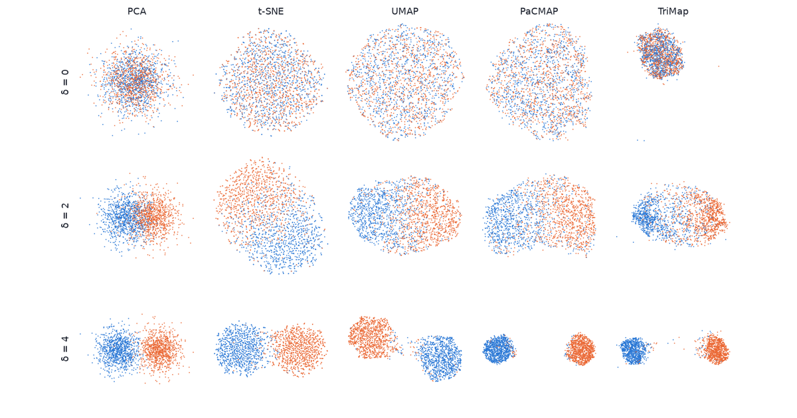

Readers take three kinds of feature from a 2-D map of high-dimensional data: gaps between groups, how tightly a group is packed, and loops or branches. Each is evidence about the data only when the method keeps the matching quantity, and the methods differ in which ones they keep.

Picture a UMAP of blood cells. Two islands with clear water between them read as two distinct populations. A small, dense island next to a large, spread-out one reads as a uniform population next to a varied one. A chain of cells bridging two islands reads as a transition, and a ring reads as a cycle. All three readings are natural, and each is a claim about the data that the map may or may not support. This part tests each one on synthetic data where the answer is known, and closes the series with what the four parts support.

This is the last of four parts. [Part 1](../when-umap-lies/) has the metrics and methods, [Part 2](../when-umap-lies-dimension/) ambient and intrinsic dimension, [Part 3](../when-umap-lies-tuning/) settings and seeds.

This part covers one idea and three tests of it:

- **A visual feature is evidence only of what the method keeps.** A gap is evidence of separation if the method keeps density valleys; a dense patch is evidence of a tight population if it keeps density; a loop is evidence of a cycle if it keeps topology.
- **The tests:** gaps on two overlapping populations, density on a sheet sampled unevenly, holes on circles, a sphere and branching trees.

```{python}
#| label: setup
#| echo: false
import json
import sys
from pathlib import Path

import matplotlib.pyplot as plt
import numpy as np
import pandas as pd
from IPython.display import Markdown

sys.path.insert(0, str(Path("../when-umap-lies/src").resolve()))
from umaplab import plotting as P
from umaplab import report as R

P.setup()


def md(df: pd.DataFrame, **kw) -> Markdown:
    kw.setdefault("index", False)
    return Markdown(df.to_markdown(disable_numparse=True, **kw))


def med(df, **sel):
    for k, v in sel.items():
        df = df[df[k] == v]
    return df.value.median()


def rng_of(df, **sel):
    for k, v in sel.items():
        df = df[df[k] == v]
    return R.rng(df.value.min(), df.value.max())
```

## Gaps {#sec-gaps}

### Design {#sec-gaps-design}

Two Gaussian populations in 10 dimensions, each with unit standard deviation in every direction, with means $\delta$ apart along one axis and 1,000 points each. $\delta$ runs from 0 (one population, labelled at random) to 4. The data are synthetic; they stand in for two cell states that differ in one programme and share the rest, the situation where a reader most needs to know whether an apparent gap is real.

The ground truth is exact. The best possible classifier gets a known share of points right (the Bayes accuracy, from the two densities), and along the axis joining the means the mixture has a density dip whose depth depends on $\delta$: none below $\delta = 2$, and at $\delta = 4$ the density between the means falls to 0.27 of its peaks (0.37 in the smoothed estimate used for every space below). A map that keeps the separation should keep that dip, no deeper and no shallower.

- **Valley ratio.** Project the points onto the line joining the two class centroids, estimate the density along it, find the highest density on each side of the midpoint, and divide the lowest density between those two peaks by the lower of them. A projection with one peak scores 1; an empty gap scores 0. It is computed the same way in the 10-D data and on each map.
- **Clusters found.** HDBSCAN (Campello, Moulavi & Sander 2013; minimum cluster size 20) run on the 10-D data and on each map: how many clusters it reports, and what share of points they hold. scikit-learn's HDBSCAN cannot report a single cluster unless `allow_single_cluster=True`, so it is run both ways.
- **Class accuracy.** A 15-nearest-neighbour classifier on the map, under 5-fold cross-validation, against the Bayes accuracy.

Five independent draws per $\delta$. Methods at defaults, plus UMAP with 5 neighbours and t-SNE at perplexity 5, the settings Liu, Ma & Zhong (2025) associate with spurious fractures.

```{python}
#| label: gaps-load
#| echo: false
from umaplab.generators import overlapping

G = pd.read_parquet(R.CACHE / "overlap" / "gaps.parquet")
OV = R.load("overlap")
OV["delta"] = OV.gp.map(lambda g: g["delta"])
bayes = []
for delta in sorted(G.delta.unique()):
    for s in range(5):
        post = overlapping(2000, s, dim=10, delta=delta).extra["posterior"]
        bayes.append(dict(delta=delta, data_seed=s, value=float(np.mean(np.maximum(post, 1 - post)))))
BAYES = pd.DataFrame(bayes)
GAPCFG = ["pca", "umap", "tsne", "pacmap", "trimap", "umap·nn5", "tsne·perp5"]
vr = G[G.metric == "valley_ratio"]
vv = lambda cfg, d: med(vr, config=cfg, delta=d)  # noqa: E731
vrng = lambda cfg, d: rng_of(vr, config=cfg, delta=d)  # noqa: E731
```

### Dips and gaps {#sec-dip}

```{python}
#| label: fig-valley
#| fig-cap: "Depth of the density dip between two Gaussian populations whose means are δ apart, in the 10-D data (dotted) and on seven maps. 1: no dip; 0: an empty gap. Lines: median of five draws; bands: min–max."
#| fig-alt: "Line chart of valley ratio against delta. The data's ratio is 1 up to delta 2 and falls to about 0.7 at 3 and 0.4 at 4. PCA and t-SNE follow it. UMAP, PaCMAP and TriMap fall below it from delta 3, reaching near zero at delta 4; TriMap already dips at delta 1.5 and 2, where the data have one peak."
fig, ax = plt.subplots(figsize=(6.4, 3.6))
for cfg in GAPCFG:
    s = vr[vr.config == cfg].groupby("delta").value.agg(["median", "min", "max"])
    ax.plot(s.index, s["median"], **P.style(cfg), markersize=4)
    P.band(ax, s.index, s["min"], s["max"], cfg)
s = vr[vr.config == "input"].groupby("delta").value.median()
ax.plot(s.index, s.values, **{**P.style("input"), "label": "10-D data"}, lw=2)
ax.set_xlabel("Distance between means δ (standard deviations)")
ax.set_ylabel("Valley ratio")
ax.set_ylim(-0.02, 1.05)
ax.legend(fontsize=7, loc="lower left", ncol=2)
fig.tight_layout()
plt.show()
```

- **No method splits one population or a heavily overlapping pair.** At $\delta \le 1$ every map's valley ratio is at least `{python} R.fmt(vr[(vr.delta <= 1.0) & vr.config.isin(GAPCFG)].groupby(["config", "delta"]).value.median().min())`.
- **TriMap makes a dip the data do not have.** At $\delta = 1.5$ and 2 the data's projection still has one peak (ratio `{python} R.fmt(vv("input", 2.0))`), but TriMap's ratio is `{python} R.fmt(vv("trimap", 1.5))` and `{python} R.fmt(vv("trimap", 2.0))`. PaCMAP's dips slightly (`{python} R.fmt(vv("pacmap", 1.5))` and `{python} R.fmt(vv("pacmap", 2.0))`); UMAP's and PCA's do not.
- **PCA and t-SNE keep the dip's depth.** At $\delta = 4$ the data's ratio is `{python} R.fmt(vv("input", 4.0))`; PCA's is `{python} R.fmt(vv("pca", 4.0))` and t-SNE's `{python} R.fmt(vv("tsne", 4.0))`.
- **UMAP, PaCMAP and TriMap deepen it into a gap.** At $\delta = 4$ UMAP's ratio is `{python} vrng("umap", 4.0)`, PaCMAP's `{python} vrng("pacmap", 4.0)` and TriMap's `{python} vrng("trimap", 4.0)`. At $\delta = 3$, where the data's ratio is `{python} R.fmt(vv("input", 3.0))`, they give `{python} R.fmt(vv("umap", 3.0))`, `{python} R.fmt(vv("pacmap", 3.0))` and `{python} R.fmt(vv("trimap", 3.0))`.
- **Small neighbourhoods do not deepen the dip here.** UMAP with 5 neighbours tracks default UMAP; t-SNE at perplexity 5 makes the dip *shallower* (`{python} R.fmt(vv("tsne·perp5", 4.0))` at $\delta = 4$). The valley ratio measures only the dip between the two populations. It cannot see small fractures inside them, which Liu, Ma & Zhong (2025) report for t-SNE at small perplexity.

```{python}
#| label: fig-gap-maps
#| fig-cap: "One draw of the two Gaussian populations (coloured by population) at δ = 0, 2 and 4, under five maps. Orientation and scale are arbitrary."
#| fig-alt: "Grid of scatter plots, three rows by five columns. At delta 0 every map is a single round cloud; UMAP and t-SNE make it a uniform disk. At delta 2 every map shows one cloud with the two colours on either side. At delta 4 PCA and t-SNE show two touching groups, while UMAP, PaCMAP and TriMap show two groups with empty space between them."
emb = R.embeddings("overlap")
runs = R.runs("overlap")
runs["delta"] = runs.gen_params.map(lambda g: json.loads(g)["delta"])
show = ["pca", "tsne", "umap", "pacmap", "trimap"]
fig, axes = plt.subplots(3, 5, figsize=(9.5, 5.8))
for i, delta in enumerate([0.0, 2.0, 4.0]):
    lab = overlapping(2000, 0, dim=10, delta=delta).labels
    for j, cfg in enumerate(show):
        cid = runs[(runs.delta == delta) & (runs.config == cfg) & (runs.data_seed == 0)].cell_id.iloc[0]
        P.embedding_panel(axes[i, j], emb[cid], c=list(P.class_colours(lab)), s=1.0, title=f"{P.name(cfg)}" if i == 0 else "")
    axes[i, 0].set_ylabel(f"δ = {delta:g}", color=P.INK)
    axes[i, 0].yaxis.label.set_visible(True)
fig.tight_layout()
plt.show()
```

At $\delta = 4$ the populations are separable in the data (the Bayes accuracy is `{python} R.fmt(BAYES[BAYES.delta == 4.0].value.median())`) and the data have a real valley between them. UMAP, PaCMAP and TriMap show that valley as empty space. The gap is evidence that the populations differ; its width is not evidence of how much.

### Class accuracy {#sec-bayes}

```{python}
#| label: bayes
#| echo: false
acc = OV[(OV.metric == "knn_accuracy")]
acc_gap = acc.merge(BAYES.rename(columns={"value": "bayes"}), on=["delta", "data_seed"])
acc_gap["excess"] = acc_gap.value - acc_gap.bayes
max_excess = acc_gap.excess.max()
```

The share of points a 15-neighbour classifier gets right on each map tracks the Bayes accuracy at every $\delta$: the largest excess over it, across methods, draws and $\delta$, is `{python} R.fmt(max_excess)`. That is the size expected of the largest of `{python} len(acc_gap)` noisy comparisons: one standard error of an accuracy measured on 2,000 points is about 0.01. Deepening a valley into a gap moves points away from the boundary visually; it does not make the populations more separable than they are.

### Clustering the map {#sec-cluster-map}

Running a clustering algorithm on the 2-D map, instead of the data, is a common step in single-cell analysis. Whether it finds structure that is not there depends here more on the clustering's settings than on the map.

```{python}
#| label: tbl-hdbscan
#| tbl-cap: "Clusters reported by HDBSCAN (minimum cluster size 20) in the 10-D data and on each map, median over five draws. Default: scikit-learn's setting, which cannot report one cluster; in brackets, the share of points in clusters other than the largest. Single allowed: allow_single_cluster=True. At δ = 0 there is one population; at δ = 4, two."
hc = G[G.metric == "hdbscan_clusters"]
hf = G[G.metric == "hdbscan_fragments"]
h1 = G[G.metric == "hdbscan1_clusters"]
hn = G[G.metric == "hdbscan1_noise"]
rows = []
for cfg in ["input"] + GAPCFG:
    r = [("10-D data" if cfg == "input" else P.name(cfg))]
    for d in [0.0, 2.0, 4.0]:
        c = hc[(hc.config == cfg) & (hc.delta == d)].value.median()
        f = hf[(hf.config == cfg) & (hf.delta == d)].value.median()
        r.append(f"{c:.0f} ({100 * f:.0f}%)")
    for d in [0.0, 2.0, 4.0]:
        r.append(f"{h1[(h1.config == cfg) & (h1.delta == d)].value.median():.0f}")
    rows.append(r)
md(pd.DataFrame(rows, columns=["Space", "Default, δ = 0", "δ = 2", "δ = 4", "Single allowed, δ = 0", "δ = 2", "δ = 4"]))
h1v = lambda cfg, d: h1[(h1.config == cfg) & (h1.delta == d)].value.median()  # noqa: E731
noise_in = hn[hn.config == "input"].value
```

- **At scikit-learn's default, HDBSCAN splits every 2-D layout of one Gaussian, PCA's included.** It reports a median of `{python} f'{hc[(hc.config == "pca") & (hc.delta == 0.0)].value.median():.0f}'` clusters on PCA, `{python} f'{hc[(hc.config == "umap") & (hc.delta == 0.0)].value.median():.0f}'` on UMAP, `{python} f'{hc[(hc.config == "pacmap") & (hc.delta == 0.0)].value.median():.0f}'` on PaCMAP and `{python} f'{hc[(hc.config == "trimap") & (hc.delta == 0.0)].value.median():.0f}'` on TriMap at $\delta = 0$. That setting can never answer "one cluster", so a count from it is not evidence of more than one population on any map.
- **Allowed to answer one, it does, on every map, at every $\delta \le 2$.** No map here turns one population into two clusters.
- **At $\delta = 4$ the maps that deepen the dip split into the two populations.** UMAP, PaCMAP and TriMap give `{python} f'{h1v("umap", 4.0):.0f}'`, `{python} f'{h1v("pacmap", 4.0):.0f}'` and `{python} f'{h1v("trimap", 4.0):.0f}'` clusters, each holding about half the points; PCA and t-SNE, which keep the shallower dip, give `{python} f'{h1v("pca", 4.0):.0f}'`.
- **In the 10-D data HDBSCAN finds almost nothing.** With either setting it labels `{python} R.fmt(100 * noise_in.min(), 0)`–`{python} R.fmt(100 * noise_in.max(), 0)`% of points as noise at every $\delta$: at 2,000 points, density in 10 dimensions is too thin for it.

A cluster found on a map, or the number of clusters, needs checking in the data with a method suited to its dimension, and with settings that allow the answer "one".

## Density {#sec-density}

### Design {#sec-density-design}

A flat $88.8 \times 21$ sheet in 3 dimensions, 2,000 points, sampled so that the density along its length changes smoothly by a factor of 1, 3, 10 or 30 from one end to the other. Synthetic; it stands in for a continuous population sampled unevenly, such as a differentiation path with many cells at the start and few at the end. The true sampling density of each point is known. The score is the Spearman correlation between that density and the map's local density, $1/r_{15}^2$ with $r_{15}$ the distance to the 15th neighbour on the map. Five draws per ratio; densMAP (`umap-learn` with `densmap=True`) is added, since it was built for this.

```{python}
#| label: fig-density
#| fig-cap: "Left: correlation between the true sampling density and the map's local density, against how much the density varies along the sheet. Lines: median of five draws; bands: min–max. Right: one draw at a 30-fold ratio, coloured by true density (dark = dense)."
#| fig-alt: "Left, line chart: PCA, Isomap and densMAP correlate at 0.7 to 0.9 once the density varies; UMAP, t-SNE, PaCMAP and PHATE stay near zero at every ratio. Right, three maps of the sheet: PCA shows a dense end crowded and a sparse end spread out; UMAP and t-SNE show the sheet evenly filled throughout."
DN = R.load("density")
DN["ratio"] = DN.gp.map(lambda g: g["density_ratio"])
td = DN[(DN.metric == "true_density_spearman")]
fig = plt.figure(figsize=(10, 3.4))
ax = fig.add_subplot(1, 2, 1)
for cfg in ["pca", "umap", "tsne", "pacmap", "phate", "isomap", "umap·densmap"]:
    s = td[td.config == cfg].groupby("ratio").value.agg(["median", "min", "max"])
    st = P.style(cfg) if cfg != "umap·densmap" else dict(color=P.C1, linestyle=":", marker="o", label="densMAP")
    ax.plot(s.index, s["median"], **st, markersize=4)
    ax.fill_between(s.index, s["min"], s["max"], color=st["color"], alpha=0.12, lw=0)
ax.set_xscale("log")
ax.set_xticks([3, 10, 30])
ax.set_xticklabels(["3", "10", "30"])
ax.xaxis.set_minor_formatter(plt.NullFormatter())
ax.set_xlabel("Density ratio along the sheet")
ax.set_ylabel("Correlation with true density")
ax.axhline(0, color=P.INK, lw=0.8)
ax.legend(fontsize=7, loc="center right")
from umaplab.generators import variable_density

ds30 = variable_density(2000, 0, density_ratio=30.0)
embD = R.embeddings("density")
rD = R.runs("density")
rD["ratio"] = rD.gen_params.map(lambda g: json.loads(g)["density_ratio"])
for j, cfg in enumerate(["pca", "umap", "tsne"]):
    a = fig.add_subplot(1, 6, 4 + j)
    cid = rD[(rD.ratio == 30.0) & (rD.config == cfg) & (rD.data_seed == 0)].cell_id.iloc[0]
    P.embedding_panel(a, embD[cid], c=np.log(ds30.density), cmap=P.SEQ, s=1.0, title=P.name(cfg))
fig.tight_layout()
plt.show()
tdv = lambda cfg, r: med(td, config=cfg, ratio=r)  # noqa: E731
tdr = lambda cfg, r: rng_of(td, config=cfg, ratio=r)  # noqa: E731
```

- **UMAP, t-SNE, PaCMAP and PHATE erase density.** With a 30-fold change along the sheet, their correlation with the true density is `{python} tdr("umap", 30.0)` (UMAP), `{python} tdr("tsne", 30.0)` (t-SNE), `{python} tdr("pacmap", 30.0)` (PaCMAP) and `{python} tdr("phate", 30.0)` (PHATE): no relation.
- **PCA and Isomap keep it** (`{python} R.fmt(tdv("pca", 30.0))` and `{python} R.fmt(tdv("isomap", 30.0))`), but the test is easy for them: the sheet is flat, so PCA reproduces it exactly and crowded points stay crowded. On curved, unevenly sampled data the test says nothing about them.
- **densMAP (Narayan, Berger & Cho 2021) restores it** (`{python} R.fmt(tdv("umap·densmap", 30.0))`), at the cost of an extra term in UMAP's objective.

UMAP normalises each point's neighbourhood to a fixed size, and t-SNE sets each point's bandwidth so its neighbourhood has the same perplexity; on this sheet both come out evenly filled. The real data in [Part 1](../when-umap-lies/#sec-real-result) agree for UMAP (density correlation near 0 on PBMC, MNIST and Fashion-MNIST) and disagree for t-SNE, which kept the most density of any method on MNIST. The erasure is clearest for UMAP; for t-SNE it depends on the data. On these maps, a tight-looking island is not evidence of a tight population, and the size of an island says more about how many points it holds than how varied they are. Wattenberg, Viégas & Johnson (2016) made the same point about t-SNE in one heading: "Cluster sizes in a t-SNE plot mean nothing".

## Holes and branches {#sec-holes}

```{python}
#| label: topo-load
#| echo: false
T = R.load("topology")


def case(row):
    g = row.gp
    if row.generator == "circle":
        return "Circle, 50-D" if row.D == 50 else "Circle"
    if row.generator == "branching":
        return "Tree, 2 levels" if g.get("levels") == 2 else "Tree, 1 level"
    return "Sphere"


T["case"] = T.apply(case, axis=1)
TOPO_IN = (
    T[(T.reference == "input") & T.metric.isin(["betti0", "betti1"])]
    .assign(g=lambda d: d.generator)
    .groupby(["g", "metric"]).value.median().unstack("metric")
)
tv = lambda m, cfg, c, ref=None: med(T[(T.reference == ref)] if ref else T, metric=m, config=cfg, case=c)  # noqa: E731
```

### Design {#sec-holes-design}

Four synthetic shapes with known topology, 2,000 points each, five draws:

- **Circle** of radius 1 with noise of standard deviation 0.02, in 2 dimensions and padded with noise columns to 50 dimensions. One loop.
- **Sphere** $S^2$ in 3 dimensions, no noise. One connected surface with no loop, which cannot be flattened without cutting or overlapping.
- **Trees**: a trunk with three branches, and a trunk with three branches that each split in two, straight segments in 10 dimensions with noise of standard deviation 0.03. No loops; the ground truth is distance along the tree.

They stand in for cyclic processes (the cell cycle), closed surfaces, and branching lineages. UMAP and t-SNE also run from a random start, which is the test Kobak & Linderman (2021) used.

Topology is estimated with persistent homology: `ripser` on 400 points chosen to cover the shape evenly, rescaled to unit diameter, counting connected components and loops that persist across more than 0.1 of that diameter. This is itself an estimate from a finite sample, and it can be wrong on the data: on the noise-free sphere it reports `{python} f'{TOPO_IN.loc["sphere", "betti0"]:.0f}'` components where there is one, because 400 points on a sphere's surface leave gaps wider than the threshold. Its loop counts on the circles and trees are right.

```{python}
#| label: tbl-topology
#| tbl-cap: "Persistent homology of each map: connected components / loops, median over five draws. The data have 1 / 1 (circles) and 1 / 0 (sphere, trees). Large distances: Spearman correlation of map distance with true geodesic distance."
CASES = ["Circle", "Circle, 50-D", "Sphere", "Tree, 1 level", "Tree, 2 levels"]
TCFG = ["pca", "umap", "umap·init-random", "tsne", "tsne·init-random", "pacmap", "trimap", "isomap", "phate"]
rows = []
for cfg in TCFG:
    name = P.name(cfg) if "random" not in cfg else P.name(cfg.split("·")[0]) + ", random start"
    r = [name]
    for c in CASES:
        b0 = tv("betti0", cfg, c, "emb")
        b1 = tv("betti1", cfg, c, "emb")
        g = tv("geodesic_spearman", cfg, c, "truth")
        r.append(f"{b0:.0f} / {b1:.0f} · {g:.2f}")
    rows.append(r)
md(pd.DataFrame(rows, columns=["Method"] + CASES))
```

```{python}
#| label: fig-topology
#| fig-cap: "One draw of the circle, the sphere (coloured by height) and the two-level tree (coloured by branch), under four maps. UMAP is shown from its default spectral start and from a random start."
#| fig-alt: "Grid of scatter plots. The circle is a clean ring under PCA, t-SNE and default UMAP, and broken into separate arcs under UMAP from a random start. The sphere is a filled disk under PCA and an annulus or cut-open sheet under UMAP and t-SNE. The tree shows separate branches under every map, with branch tips pulled together under PHATE."
from umaplab.generators import branching, circle, sphere

embT = R.embeddings("topology")
rT = R.runs("topology")
rT["gpd"] = rT.gen_params.map(json.loads)


def cid_for(gen, cfg, D=None, levels=None):
    s = rT[(rT.generator == gen) & (rT.config == cfg) & (rT.data_seed == 0)]
    if D is not None:
        s = s[s.D == D]
    if levels is not None:
        s = s[s.gpd.map(lambda g: g.get("levels") == levels)]
    return s.cell_id.iloc[0]


shapes = [
    ("Circle", "circle", dict(D=2), circle(2000, 0, noise=0.02).extra["theta"], "seq"),
    ("Sphere", "sphere", {}, sphere(2000, 0, m=2).X[:, 2], "seq"),
    ("Tree, 2 levels", "branching", dict(levels=2), branching(2000, 0, levels=2, noise=0.03).labels, "class"),
]
cols = [("pca", "PCA"), ("umap", "UMAP"), ("umap·init-random", "UMAP, random start"), ("tsne", "t-SNE"), ("phate", "PHATE")]
fig, axes = plt.subplots(3, 5, figsize=(9.5, 5.8))
for i, (title, gen, kw, colour, kind) in enumerate(shapes):
    for j, (cfg, ctitle) in enumerate(cols):
        Y = embT[cid_for(gen, cfg, **kw)]
        if kind == "seq":
            P.embedding_panel(axes[i, j], Y, c=colour, cmap=P.SEQ, s=0.8, title=ctitle if i == 0 else "")
        else:
            P.embedding_panel(axes[i, j], Y, c=list(P.class_colours(colour)), s=0.8, title=ctitle if i == 0 else "")
    axes[i, 0].set_ylabel(title, color=P.INK)
    axes[i, 0].yaxis.label.set_visible(True)
fig.tight_layout()
plt.show()
```

- **Circles are kept when the start is informative.** From their default starts (spectral for UMAP, PCA for t-SNE), every method draws the circle as one ring, with or without 48 noise columns (PHATE adds a second, smaller loop on the 2-D circle); the geodesic correlation is `{python} R.fmt(tv("geodesic_spearman", "umap", "Circle", "truth"))` for UMAP. From a random start UMAP breaks it into `{python} f'{tv("betti0", "umap·init-random", "Circle", "emb"):.0f}'` pieces and the loop disappears (geodesic correlation `{python} R.fmt(tv("geodesic_spearman", "umap·init-random", "Circle", "truth"))`), the "tangled web with multiple tears" Kobak & Linderman described. t-SNE from a random start breaks it into `{python} f'{tv("betti0", "tsne·init-random", "Circle", "emb"):.0f}'` pieces whose arcs still close one loop at the persistence scale used.
- **The sphere is folded or cut, and a cut sphere can show a hole.** PCA flattens the front onto the back: its trustworthiness at $k = 10$ is `{python} R.fmt(tv("trustworthiness", "pca", "Sphere", "truth"))`. UMAP and t-SNE cut it open instead (trustworthiness `{python} R.fmt(tv("trustworthiness", "umap", "Sphere", "truth"))` and `{python} R.fmt(tv("trustworthiness", "tsne", "Sphere", "truth"))`, and they keep `{python} R.fmt(tv("knn_preservation", "umap", "Sphere", "truth"))` and `{python} R.fmt(tv("knn_preservation", "tsne", "Sphere", "truth"))` of true neighbours against PCA's `{python} R.fmt(tv("knn_preservation", "pca", "Sphere", "truth"))`). The cut can have a cost: in some draws UMAP's and PaCMAP's maps of the sphere carry a loop the sphere does not have (up to `{python} f'{T[(T.metric == "betti1") & (T.reference == "emb") & (T.config == "umap") & (T.case == "Sphere")].value.max():.0f}'` and `{python} f'{T[(T.metric == "betti1") & (T.reference == "emb") & (T.config == "pacmap") & (T.case == "Sphere")].value.max():.0f}'` loops); t-SNE's cut sphere shows none in most draws.
- **Trees keep their arms, with no loop except under PHATE.** UMAP often detaches sub-branches of the two-level tree (a median of `{python} f'{tv("betti0", "umap", "Tree, 2 levels", "emb"):.0f}'` pieces), and t-SNE sometimes does (`{python} f'{tv("betti0", "tsne", "Tree, 2 levels", "emb"):.0f}'`). UMAP, t-SNE and PaCMAP keep the most of the distance along the tree on the one-level tree (`{python} R.fmt(tv("geodesic_spearman", "umap", "Tree, 1 level", "truth"))`, `{python} R.fmt(tv("geodesic_spearman", "tsne", "Tree, 1 level", "truth"))`, `{python} R.fmt(tv("geodesic_spearman", "pacmap", "Tree, 1 level", "truth"))`). PHATE (Moon et al. 2019), built for branching trajectories, draws the arms clearly but pulls their tips together, which the persistence computation reads as `{python} f'{tv("betti1", "phate", "Tree, 2 levels", "emb"):.0f}'` loops, and its correlation with distance along the tree is the lowest of any method at its defaults (`{python} R.fmt(tv("geodesic_spearman", "phate", "Tree, 2 levels", "truth"))` on the two-level tree). This is one tree geometry, straight segments in random directions; PHATE's own benchmark used simulated single-cell data, which this test does not cover.

A ring on a map is evidence of a cycle in the data only if the method started from an informative layout and the shape is not a cut-open surface. A ring of the second kind is indistinguishable on the map from the first.

## Rankings by metric {#sec-best}

The tests in this part and the earlier ones can be laid side by side: ten datasets (seven synthetic, three real), every method at its defaults, and seven measures of faithfulness. For each pair of dataset and measure, the winner is the method with the highest median score, and methods within 0.01 of it share the win.

```{python}
#| label: ranking
#| echo: false
sys.path.insert(0, str(Path("../when-umap-lies/src").resolve()))
from collections import Counter

import export_widget_data as XW

RANK = XW.ranking_data()
WINS = XW.ranking_wins(RANK)
n_pairs = len(WINS)
n_shared = sum(len(v) > 1 for v in WINS.values())
any_win = Counter(m for v in WINS.values() for m in v)
solo_win = Counter(v[0] for v in WINS.values() if len(v) == 1)
dist_pairs = {k: v for k, v in WINS.items() if k[1] == "distances"}
dist_win = Counter(m for v in dist_pairs.values() for m in v)
nb_pairs = {k: v for k, v in WINS.items() if k[1] == "neighbours"}
nb_win = Counter(m for v in nb_pairs.values() for m in v)
```

```{python}
#| label: tbl-wins
#| tbl-cap: "Wins per method over every pair of dataset and measure (defaults only). A win is shared when two or more methods are within 0.01 of the best median."
rows = [
    (P.name(m), any_win[m], solo_win.get(m, 0), nb_win.get(m, 0), dist_win.get(m, 0))
    for m, _ in any_win.most_common()
]
md(pd.DataFrame(rows, columns=["Method", "Wins (incl. shared)", "Outright", "Neighbour wins (of 10)", "Large-distance wins (of 10)"]))
```

- t-SNE has the most wins, `{python} any_win["tsne"]` of `{python} n_pairs`, but `{python} any_win["tsne"] - solo_win["tsne"]` of them are shared, mostly on trustworthiness and continuity, where several methods tie. It wins the neighbour measure on `{python} nb_win["tsne"]` of 10 datasets and the large-distance measure on `{python} dist_win.get("tsne", 0)`.
- PCA wins the large-distance measure on `{python} dist_win["pca"]` of 10 datasets and Isomap on `{python} dist_win["isomap"]`; neither wins the neighbour measure on more than `{python} max(nb_win.get("pca", 0), nb_win.get("isomap", 0))`.
- Only t-SNE wins more than half the pairs, and only by counting shared wins: it wins `{python} solo_win["tsne"]` outright. The methods that win on neighbours are not the methods that win on distances. Part 3 adds that tuning changes several of these rankings.

The widget shows every score. Choose "Neighbours" and t-SNE leads on almost every row; choose "Large distances" and PCA and Isomap do; choose "Density" and the winners change again.

::: {#widget-ranking}
:::

```{=html}
<script src="../when-umap-lies/umapkit.js"></script>
<script src="widget-data/ranking.js"></script>
<script src="model.js"></script>
<script src="widgets.js"></script>
```

## Conclusions {#sec-trust}

The series set out to answer seven questions. The answers are conditional on what a plot is used for, and limited to the data tested.

1. **Is UMAP reliable for local neighbourhoods?** It keeps more true neighbours than PCA on the Swiss roll, the clean clusters, the sphere, the overlapping Gaussians, every structure with more than two intrinsic dimensions, and the three real datasets. PCA matches or beats it where the structure barely needs flattening (a circle already in the plane, a flat sheet, a two-dimensional Gaussian, the noise-free tree) and on clusters buried under 500 or more noise columns. t-SNE keeps at least as many as UMAP on every dataset tested but one near-tie ([Part 1](../when-umap-lies/#sec-real-result), [Part 2](../when-umap-lies-dimension/#sec-noise-result)). UMAP both folds and tears: on PBMC and on structures with many intrinsic dimensions its trustworthiness is below its continuity. On PBMC 3k it keeps about one in nine of each cell's 10 nearest neighbours in principal-component space and t-SNE about one in five, in line with the low recall both Chari & Pachter (2023) and Lause, Berens & Kobak (2024) reported.
2. **When does it mislead about separation?** It does not split a single or heavily overlapping population. It does widen a real density dip into an empty gap, so a gap's width is not evidence of how different two populations are ([Dips and gaps](#sec-dip)). A clustering of the map finds two clusters where the map has widened a dip into a gap, and at scikit-learn's default HDBSCAN setting it splits any 2-D layout, PCA's included ([Clustering the map](#sec-cluster-map)). The relative position of clusters changes from seed to seed even at defaults ([Part 3](../when-umap-lies-tuning/#sec-rotation)).
3. **Does a larger ambient dimension degrade it?** Not on its own: rotating data into 5,000 dimensions changes nothing. Noise in the extra columns degrades the neighbour graph, and within a dataset the damage follows one index, $\eta$, whatever the mix of noise level and column count; the map degrades with it, though a map can recover neighbours the 10-neighbour graph lost; reducing to principal components first delays the damage when the structure has few dimensions ([Part 2](../when-umap-lies-dimension/#sec-eta)).
4. **Is a larger intrinsic dimension different?** Yes. The neighbour graph stays exact and the map fails, because a plane cannot hold a 10-dimensional neighbourhood. No preprocessing helps, and reducing to 50 components hurts once the structure has more than 50 ([Part 2](../when-umap-lies-dimension/#sec-intrinsic)).
5. **Which methods keep global geometry?** At defaults, PCA and Isomap. Tuned, most methods keep a Swiss roll's large distances about equally well; on separated clusters PCA and TriMap stay ahead ([Part 3](../when-umap-lies-tuning/#sec-tuned)). For UMAP and t-SNE, the start decides the large distances.
6. **Is one method consistently best?** No. The method that wins on neighbours loses on distances, and density and topology have their own winners ([Rankings by metric](#sec-best)).
7. **What should a reader infer from a UMAP plot?** That points drawn together are usually near each other in the data, though rarely each other's nearest neighbours, and that well-separated groups in the data appear as separate groups. Not: the distance between islands, their relative positions in one run, their sizes or densities, the width of a gap, a cluster count from clustering the map, or a loop drawn from a random start.

For anyone making these plots, the series supports six habits:

- **Check a claim in the data, not the map.** Recompute neighbours, clusters and distances in the principal-component space before reporting them.
- **Cluster the data, then colour the map.** A cluster found on the 2-D coordinates needs confirming in the data, with settings that allow the answer "one".
- **Show more than one run.** Two or three seeds, or settings, separate the arrangement a run chose from the arrangement the data force.
- **Start informatively and say how.** UMAP's spectral start and t-SNE's PCA start; report `n_neighbors` or perplexity.
- **Show PCA beside it** when large distances matter, and use densMAP when density does.
- **Score the map.** Trustworthiness, continuity and 10-neighbour recall against the input space cost seconds and say which kind of mistake a map makes.

## Constraints {#sec-constraints}

- **The density test is easy for PCA.** The sheet is flat, so PCA reproduces it exactly; a curved, unevenly sampled surface would test PCA and Isomap properly.
- **Synthetic, small and clean.** Two-population Gaussians, a flat sheet, circles, a sphere and straight-segment trees, at $n = 2000$. Real populations are skewed, nested and noisy in structured ways.
- **The gap measure is one-dimensional.** The valley ratio projects onto the line joining two class centroids; a gap that curves around a population, or a split along another axis, is not measured.
- **HDBSCAN at one cluster size.** Minimum cluster size 20, with and without `allow_single_cluster`; other sizes report other counts. HDBSCAN in the 10-D data labels nearly every point as noise, so the data-against-map comparison is weak.
- **Topology is an estimate.** Persistent homology on 400 points, with a fixed persistence threshold, reports three components for a sphere that has one. Loop counts here agree with the truth on the data; on maps they are evidence, not proof.
- **The ranking is uneven.** PHATE was not run on the Swiss roll, the clusters or the overlapping Gaussians; class accuracy exists only for the six labelled datasets; the gap measure only for the overlapping Gaussians. The Swiss roll in the ranking is its 5-dimensional rotation, which has the same distances. Defaults only.
- **One PHATE result, one geometry.** PHATE's false loops and low geodesic correlation are on straight-segment trees in random directions; its own benchmark used different data.

Gaps. Widen. Density. Vanishes. Loops. Need. Good. Starts. Check. Data.

## References {#sec-references}

- Campello, R. J. G. B., Moulavi, D. & Sander, J. (2013). [Density-based clustering based on hierarchical density estimates](https://doi.org/10.1007/978-3-642-37456-2_14). In *Advances in Knowledge Discovery and Data Mining (PAKDD 2013)*, LNCS 7819, 160–172. HDBSCAN.
- Chari, T. & Pachter, L. (2023). [The specious art of single-cell genomics](https://doi.org/10.1371/journal.pcbi.1011288). *PLOS Computational Biology* 19(8), e1011288.
- Kobak, D. & Linderman, G. C. (2021). [Initialization is critical for preserving global data structure in both t-SNE and UMAP](https://doi.org/10.1038/s41587-020-00809-z). *Nature Biotechnology* 39(2), 156–157.
- Lause, J., Berens, P. & Kobak, D. (2024). [The art of seeing the elephant in the room: 2D embeddings of single-cell data do make sense](https://doi.org/10.1371/journal.pcbi.1012403). *PLOS Computational Biology* 20(10), e1012403.
- Liu, Z., Ma, R. & Zhong, Y. (2025). [Assessing and improving reliability of neighbor embedding methods: a map-continuity perspective](https://doi.org/10.1038/s41467-025-60434-9). *Nature Communications* 16, 5037.
- Moon, K. R. et al. (2019). [Visualizing structure and transitions in high-dimensional biological data](https://doi.org/10.1038/s41587-019-0336-3). *Nature Biotechnology* 37(12), 1482–1492. PHATE.
- Narayan, A., Berger, B. & Cho, H. (2021). [Assessing single-cell transcriptomic variability through density-preserving data visualization](https://doi.org/10.1038/s41587-020-00801-7). *Nature Biotechnology* 39(6), 765–774. densMAP.
- Wattenberg, M., Viégas, F. & Johnson, I. (2016). [How to use t-SNE effectively](https://doi.org/10.23915/distill.00002). *Distill*.
- Software: [ripser](https://ripser.scikit-tda.org) 0.6.15 for persistent homology; [scikit-learn](https://scikit-learn.org) 1.9.1 for HDBSCAN.
- [When UMAP Lies, Part 1: The Map and the Territory](../when-umap-lies/), [Part 2: Ambient and Intrinsic Dimension](../when-umap-lies-dimension/), [Part 3: Settings, Seeds and Starting Points](../when-umap-lies-tuning/).
