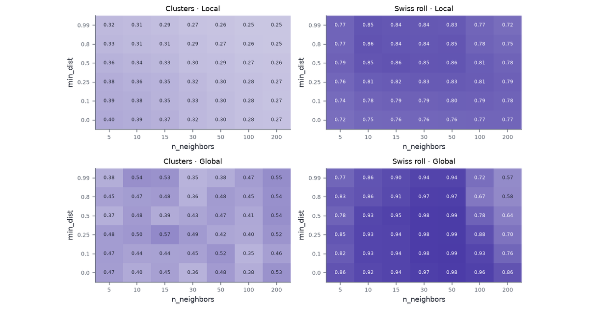

The settings, the starting layout and the random seed of a UMAP or t-SNE run all change the map it draws, and some of those changes are as large as switching to a different method.

Anyone who has re-run UMAP has seen a different picture: the islands in new places, one of them now upside down, a bridge that was there before now gone. Some of that is meaningless, since a map rotated or mirrored is the same map. Some of it is not. A comparison of methods that ignores this can rank the methods by their defaults instead of by what they can do, and a reader who ignores it can take one run's arrangement for a property of the data.

This is the third of four parts. [Part 1](../when-umap-lies/) has the metrics and methods; [Part 2](../when-umap-lies-dimension/) ambient and intrinsic dimension; [Part 4](../when-umap-lies-gaps-density-holes/) gaps, density and holes.

This part covers three ideas:

- **A fair comparison tunes every method on a comparable grid and scores it on data it was not tuned on.** Tuned that way, most of the defaults' differences in global structure disappear.
- **The starting layout decides the large distances and leaves the neighbourhoods alone.**
- **Seed-to-seed change has two parts:** a rotation or reflection that means nothing, and a rearrangement that alignment cannot remove. Only the second matters, and it differs by method.

```{python}
#| label: setup
#| echo: false
import json
import sys
from pathlib import Path

import matplotlib.pyplot as plt
import numpy as np
import pandas as pd
from IPython.display import Markdown

sys.path.insert(0, str(Path("../when-umap-lies/src").resolve()))
from umaplab import experiments as X
from umaplab import plotting as P
from umaplab import report as R

P.setup()


def md(df: pd.DataFrame, **kw) -> Markdown:
    kw.setdefault("index", False)
    return Markdown(df.to_markdown(disable_numparse=True, **kw))


GEN = {"swiss_roll": "Swiss roll", "gaussian_clusters": "Clusters", "branching": "Tree"}
TU = R.load("tuning")
LOCAL = R.pick(TU, "knn_preservation", 10.0, "truth")
# Global structure: distance along the surface where the case has one (Swiss roll,
# tree), straight-line distance otherwise (clusters).
GLOBAL = pd.concat(
    [
        R.pick(TU[TU.generator.isin(["swiss_roll", "branching"])], "geodesic_spearman", None, "truth"),
        R.pick(TU[TU.generator == "gaussian_clusters"], "dist_spearman", None, "truth"),
    ]
)
METHODS = ["umap", "tsne", "pacmap", "trimap", "isomap", "spectral", "diffmap", "phate"]


def tuned_vs_default(df):
    """Choose each method's best setting on draw 0; score it and the default on draws 1-2."""
    rows = []
    for (gen, mth), sub in df[df.method.isin(METHODS + ["pca"])].groupby(["generator", "method"]):
        sel = sub[sub.data_seed == 0].groupby("config").value.mean()
        best = sel.idxmax()
        ev = sub[sub.data_seed > 0]
        rows.append(
            dict(
                generator=gen,
                method=mth,
                best=best,
                default=ev[ev.config == mth].value.mean(),
                tuned=ev[ev.config == best].value.mean(),
                grid_lo=sub.groupby("config").value.median().min(),
                grid_hi=sub.groupby("config").value.median().max(),
            )
        )
    return pd.DataFrame(rows)


TL = tuned_vs_default(LOCAL)
TG = tuned_vs_default(GLOBAL)
```

## Design {#sec-design}

### Data {#sec-data}

Three synthetic datasets of 2,000 points, with three independent draws each:

- **Swiss roll**: the flat sheet rolled in 3 dimensions of [Part 2](../when-umap-lies-dimension/#sec-bases), no noise. Truth: the flat sheet.
- **Clusters**: ten Gaussian clusters in 10 dimensions, nearest centres 6 standard deviations apart, sizes unequal (the largest four times the smallest). Truth: the clusters and their labels.
- **Tree**: a trunk with three branches that each split in two, straight segments in 10 dimensions with noise of standard deviation 0.03. Truth: distance along the tree.

### Grids {#sec-grids}

```{python}
#| label: tbl-grids
#| tbl-cap: "Settings tried per method. Every method also ran at its defaults."
from umaplab.embeddings import METHODS as _M


def R_is_default(m, g):
    """True when a grid entry equals the method's defaults on every key it sets.

    Two defaults are resolved at fit time, so they are resolved here for n = 2,000:
    openTSNE's exaggeration None means 1, and scikit-learn's SpectralEmbedding
    n_neighbors None means n / 10.
    """
    d = dict(_M[m].defaults)
    if m == "tsne" and d.get("exaggeration") is None:
        d["exaggeration"] = 1.0
    if m == "spectral" and d.get("n_neighbors") is None:
        d["n_neighbors"] = 2000 // 10
    return all(k in d and d[k] == v for k, v in g.items())


rows = []
for m, grid in X.TUNE_GRIDS.items():
    keys = sorted({k for g in grid for k in g})
    vals = "; ".join(f"{k} ∈ {{{', '.join(str(v) for v in sorted({g[k] for g in grid if k in g}, key=str))}}}" for k in keys)
    distinct = {json.dumps(g, sort_keys=True) for g in grid}
    has_default = any(R_is_default(m, g) for g in grid)
    n_set = len(distinct) + (0 if has_default else 1)
    rows.append((P.name(m), n_set, vals, has_default))
GRIDS = pd.DataFrame(rows, columns=["Method", "Settings", "Values", "dup"])
GRID_MIN, GRID_MAX = int(GRIDS.Settings.min()), int(GRIDS.Settings.max())
N_DUP = int(GRIDS.dup.sum())
md(GRIDS.drop(columns="dup"))
```

Each method gets a grid around its defaults, from `{python} GRID_MIN` settings for the methods with one main parameter to `{python} GRID_MAX` for t-SNE, counting the default once. The grids vary the parameters each method's documentation names as its main ones; methods with more parameters get larger grids, which favours them slightly in the selection.

### Selection {#sec-selection}

Choosing the best setting and reporting its score on the same data flatters every method with a grid, and flatters most the method with the largest grid. Here each method's best setting for each metric is **chosen on draw 0 and scored on draws 1 and 2**, which it has not seen. Two metrics are used: 10-neighbour preservation against the truth (local) and the Spearman correlation of map distances with true distances (global; on the Swiss roll and the tree, the true distances run along the surface).

## Settings {#sec-settings}

### Range over settings {#sec-range}

```{python}
#| label: fig-range
#| fig-cap: "Range of each method's score over its grid of settings (bar: lowest to highest median over draws), with its default marked (dot). The grey band is the range across all methods at their defaults. Left: local structure; right: global structure."
#| fig-alt: "Two panels of horizontal range bars, one row per method and dataset. For global structure on the Swiss roll and the tree, several methods' ranges span most of the grey band of between-method differences; for local structure the ranges are shorter except t-SNE and Isomap on the Swiss roll."
fig, axes = plt.subplots(1, 2, figsize=(10, 5.2), sharey=True)
order = [(g, m) for g in GEN for m in METHODS]
for ax, (df, title) in zip(axes, [(LOCAL, "Local: 10-neighbour preservation"), (GLOBAL, "Global: distance correlation")]):
    for y, (gen, mth) in enumerate(order):
        sub = df[(df.generator == gen) & (df.method == mth)]
        if sub.empty:
            continue
        cm = sub.groupby("config").value.median()
        st = P.style(mth)
        ax.plot([cm.min(), cm.max()], [y, y], color=st["color"], lw=3, solid_capstyle="round", alpha=0.6)
        ax.plot(cm.get(mth, np.nan), y, marker="o", color=st["color"], markersize=5, ls="")
    for i, gen in enumerate(GEN):
        dm = df[(df.generator == gen) & (df.config.isin(METHODS))].groupby("config").value.median()
        ax.axhspan(i * len(METHODS) - 0.5, (i + 1) * len(METHODS) - 0.5, xmin=0, xmax=1, color="none")
        ax.fill_betweenx([i * len(METHODS) - 0.4, (i + 1) * len(METHODS) - 0.6], dm.min(), dm.max(), color=P.RULE, alpha=0.5, lw=0, zorder=0)
    ax.set_title(title)
    ax.set_xlim(0, 1.02)
axes[0].set_yticks(range(len(order)))
axes[0].set_yticklabels([f"{GEN[g]} · {P.name(m)}" for g, m in order], fontsize=7)
axes[0].invert_yaxis()
fig.tight_layout()
plt.show()


def span(df, gen, mth):
    cm = df[(df.generator == gen) & (df.method == mth)].groupby("config").value.median()
    return cm.max() - cm.min()


def between(df, gen):
    dm = df[(df.generator == gen) & (df.config.isin(METHODS))].groupby("config").value.median()
    return dm.max() - dm.min()
```

- **On global structure, a method's own settings can move it as far as switching methods.** On the Swiss roll, the distance correlation of t-SNE spans `{python} R.fmt(span(GLOBAL, "swiss_roll", "tsne"))` across its grid, TriMap's `{python} R.fmt(span(GLOBAL, "swiss_roll", "trimap"))` and Laplacian eigenmaps' `{python} R.fmt(span(GLOBAL, "swiss_roll", "spectral"))`; the spread across all eight methods at their defaults is `{python} R.fmt(between(GLOBAL, "swiss_roll"))`. On the tree, UMAP's own range is `{python} R.fmt(span(GLOBAL, "branching", "umap"))` against a between-method spread of `{python} R.fmt(between(GLOBAL, "branching"))`.
- **Local structure moves less**, except where a setting changes the neighbourhood size the method works at. t-SNE's local score on the Swiss roll spans `{python} R.fmt(span(LOCAL, "swiss_roll", "tsne"))` and Isomap's `{python} R.fmt(span(LOCAL, "swiss_roll", "isomap"))`; UMAP's spans `{python} R.fmt(span(LOCAL, "swiss_roll", "umap"))`.

### Defaults against tuned {#sec-tuned}

```{python}
#| label: tbl-tuned
#| tbl-cap: "Each method at its defaults and at the setting chosen on draw 0, both scored on draws 1–2 (mean). Global structure: distance correlation with the truth. Local: 10-neighbour preservation."
rows = []
for gen in ["swiss_roll", "gaussian_clusters", "branching"]:
    for mth in ["pca"] + METHODS:
        g = TG[(TG.generator == gen) & (TG.method == mth)]
        l = TL[(TL.generator == gen) & (TL.method == mth)]
        if g.empty:
            continue
        g, l = g.iloc[0], l.iloc[0]
        rows.append(
            [GEN[gen], P.name(mth), f"{g.default:.2f} → {g.tuned:.2f}", g.best.replace(mth, "").lstrip("·") or "default",
             f"{l.default:.2f} → {l.tuned:.2f}", l.best.replace(mth, "").lstrip("·") or "default"]
        )
md(pd.DataFrame(rows, columns=["Data", "Method", "Global", "chosen", "Local", "chosen "]))


def tv(df, gen, mth, col):
    return df[(df.generator == gen) & (df.method == mth)][col].iloc[0]


sr_tuned = TG[(TG.generator == "swiss_roll") & TG.method.isin(METHODS)].tuned
cl_g = TG[(TG.generator == "gaussian_clusters")].set_index("method")
TGm = TG[TG.method != "pca"]
TLm = TL[TL.method != "pca"]
worse = TGm[TGm.tuned < TGm.default - 0.02]
worse_l = TLm[TLm.tuned < TLm.default - 0.02]
```

- **Tuned, most methods keep the Swiss roll's large distances about equally well.** At defaults, the eight methods with settings span `{python} R.rng(TG[(TG.generator == "swiss_roll") & TG.method.isin(METHODS)].default.min(), TG[(TG.generator == "swiss_roll") & TG.method.isin(METHODS)].default.max())` in distance correlation; tuned, they span `{python} R.rng(sr_tuned.min(), sr_tuned.max())`. TriMap goes from `{python} R.fmt(tv(TG, "swiss_roll", "trimap", "default"))` to `{python} R.fmt(tv(TG, "swiss_roll", "trimap", "tuned"))` with 40 inlier neighbours, and UMAP from `{python} R.fmt(tv(TG, "swiss_roll", "umap", "default"))` to `{python} R.fmt(tv(TG, "swiss_roll", "umap", "tuned"))` with 200 neighbours out of 2,000 points (on 1,000 points 200 is too many; see [UMAP's two settings](#sec-umap-knobs)). A default-settings comparison would have reported TriMap and Laplacian eigenmaps as poor at global structure; the defaults were poor, not the methods.
- **On the clusters, PCA and TriMap keep the arrangement best, tuned or not.** Their correlations are `{python} R.fmt(cl_g.loc["pca", "tuned"])` and `{python} R.fmt(cl_g.loc["trimap", "tuned"])`; tuned t-SNE reaches `{python} R.fmt(cl_g.loc["tsne", "tuned"])` (at perplexity 300) and tuned UMAP `{python} R.fmt(cl_g.loc["umap", "tuned"])`.
- **Tuning can lose.** For global structure, in `{python} len(worse)` of the `{python} len(TGm)` method–dataset pairs with a grid, the setting chosen on draw 0 did worse on draws 1–2 than the default, by up to `{python} R.fmt((worse.default - worse.tuned).max())`; for local structure, in `{python} len(worse_l)`. Choosing among settings on the data being reported can overstate how good the chosen plot is, though across these grids the overstatement was small.

### UMAP's two settings {#sec-umap-knobs}

UMAP's `n_neighbors` sets how many neighbours define each point's neighbourhood; `min_dist` sets how close points may sit on the map. A finer grid of the two (seven values by six, three seeds each, 1,000 points) shows what each one changes.

```{python}
#| label: fig-umap-grid
#| fig-cap: "UMAP on 1,000 points, over seven values of n_neighbors and six of min_dist, median of three seeds. Top: local structure (10-neighbour preservation). Bottom: global structure (distance correlation with the truth). Left: unequal Gaussian clusters; right: Swiss roll."
#| fig-alt: "Four heatmaps. On the clusters, local structure is highest at small n_neighbors and small min_dist, and global structure shows no pattern. On the Swiss roll, global structure is highest at 30 to 50 neighbours and lowest at 200 neighbours with large min_dist; local structure is highest at moderate settings."
UW = R.load("umap_widget")
UW["nn"] = UW.method_params.map(lambda s: json.loads(s).get("n_neighbors"))
UW["md"] = UW.method_params.map(lambda s: json.loads(s).get("min_dist"))
fig, axes = plt.subplots(2, 2, figsize=(8.4, 5.6))
for j, gen in enumerate(["gaussian_clusters", "swiss_roll"]):
    for i, (m, k, ref, lab) in enumerate([("knn_preservation", 10.0, "truth", "Local"), ("dist_spearman", None, "truth", "Global")]):
        s = R.pick(UW[UW.generator == gen], m, k, ref).groupby(["md", "nn"]).value.median().unstack("nn")
        ax = axes[i, j]
        im = ax.imshow(s.values, cmap=P.SEQ, vmin=0, vmax=1, aspect="auto", origin="lower")
        ax.set_xticks(range(s.shape[1]))
        ax.set_xticklabels([int(c) for c in s.columns], fontsize=7)
        ax.set_yticks(range(s.shape[0]))
        ax.set_yticklabels(s.index, fontsize=7)
        for (a, b), v in np.ndenumerate(s.values):
            ax.text(b, a, f"{v:.2f}", ha="center", va="center", fontsize=6, color="white" if v > 0.6 else P.INK)
        ax.set_title(f"{GEN[gen]} · {lab}")
        ax.set_xlabel("n_neighbors")
        ax.set_ylabel("min_dist")
        ax.grid(False)
fig.tight_layout()
plt.show()


def uw(gen, m, k, nn, md_, agg="median"):
    s = R.pick(UW[(UW.generator == gen) & (UW.nn == nn) & (UW.md == md_)], m, k, "truth")
    return getattr(s.value, agg)()


def uw_seed_spread(gen, m, k):
    s = R.pick(UW[UW.generator == gen], m, k, "truth")
    return s.groupby(["nn", "md"]).value.agg(lambda v: v.max() - v.min()).median()


cl_glob = R.pick(UW[UW.generator == "gaussian_clusters"], "dist_spearman", None, "truth").groupby(["nn", "md"]).value.median()
```

- **On the clusters, both settings lower local structure, and neither steers the arrangement.** Ten-neighbour preservation falls from `{python} R.fmt(uw("gaussian_clusters", "knn_preservation", 10.0, 5, 0.0))` at 5 neighbours to `{python} R.fmt(uw("gaussian_clusters", "knn_preservation", 10.0, 200, 0.0))` at 200 (`min_dist` 0), and from `{python} R.fmt(uw("gaussian_clusters", "knn_preservation", 10.0, 5, 0.0))` to `{python} R.fmt(uw("gaussian_clusters", "knn_preservation", 10.0, 5, 0.99))` as `min_dist` goes from 0 to 0.99 (5 neighbours). The distance correlation, which measures how the clusters are arranged, varies between `{python} R.fmt(cl_glob.min())` and `{python} R.fmt(cl_glob.max())` over the grid with no trend in either setting. Three seeds at one setting differ by a median of `{python} R.fmt(uw_seed_spread("gaussian_clusters", "dist_spearman", None))` in it, and by `{python} R.fmt(uw_seed_spread("gaussian_clusters", "knn_preservation", 10.0), 3)` in local preservation: where the clusters sit relative to each other is decided by the run, not the setting.
- **On the Swiss roll, `n_neighbors` decides whether the sheet holds together.** At 5 neighbours UMAP tears the sheet into a dozen short fragments; from about 30 it draws one continuous strip. The distance correlation rises from `{python} R.fmt(uw("swiss_roll", "dist_spearman", None, 5, 0.1))` at 5 neighbours to `{python} R.fmt(uw("swiss_roll", "dist_spearman", None, 50, 0.1))` at 50, and falls again at 200 (`{python} R.fmt(uw("swiss_roll", "dist_spearman", None, 200, 0.1))`), most of all with a large `min_dist` (`{python} R.fmt(uw("swiss_roll", "dist_spearman", None, 200, 0.99))` at 0.99). At 200 the strip curls into a spiral. A neighbourhood of 200 out of 1,000 points is a fifth of the sheet, wide enough to reach across the roll's layers in the 3-D data, which is one likely reason; this part does not test it.
- **`min_dist` is not only cosmetic.** On the Swiss roll, raising it from 0.1 to 0.5 at 15 neighbours raises local preservation from `{python} R.fmt(uw("swiss_roll", "knn_preservation", 10.0, 15, 0.1))` to `{python} R.fmt(uw("swiss_roll", "knn_preservation", 10.0, 15, 0.5))`, because points packed less tightly on the map keep their order within the sheet; on the clusters it lowers it.

The widget shows the maps behind the grid. On the clusters, change the seed at any setting: the islands trade places and the global tile moves, by as much as 0.4, while the local tile moves by two hundredths at most. On the Swiss roll, drag `n_neighbors` from 5 to 50 and the torn fragments join into one flat strip; go on to 200 with `min_dist` at 0.99 and the strip curls into a spiral, its ends wrapping round each other.

::: {#widget-umap}
:::

```{=html}
<script src="../when-umap-lies/umapkit.js"></script>
<script src="widget-data/umap.js"></script>
<script src="model.js"></script>
<script src="widgets.js"></script>
```

## Starting points {#sec-init}

```{python}
#| label: tbl-init
#| tbl-cap: "UMAP and t-SNE from different starting layouts: median over 15 runs (three draws × five seeds), range in brackets. UMAP's default start is spectral (Laplacian eigenmaps of its graph); t-SNE's is PCA. UMAP from a PCA start ran on three draws with one seed."
ST = R.load("stability")
rows = []
for gen in ["swiss_roll", "gaussian_clusters"]:
    for cfg, lab, src in [
        ("umap", "UMAP, spectral start", ST),
        ("umap·init-pca", "UMAP, PCA start", TU),
        ("umap·init-random", "UMAP, random start", ST),
        ("tsne", "t-SNE, PCA start", ST),
        ("tsne·init-random", "t-SNE, random start", ST),
    ]:
        sub = src[(src.generator == gen) & (src.config == cfg)]
        if gen == "gaussian_clusters" and src is TU:
            sub = sub[sub.gp.map(lambda g: g.get("imbalance") == 4.0)]
        l = R.pick(sub, "knn_preservation", 10.0, "truth").value
        g = R.pick(sub, "dist_spearman", None, "truth").value
        rows.append([GEN[gen], lab, f"{l.median():.2f} ({R.rng(l.min(), l.max())})", f"{g.median():.2f} ({R.rng(g.min(), g.max())})"])
md(pd.DataFrame(rows, columns=["Data", "Method and start", "Local", "Global"]))


def stv(gen, cfg, m, k, agg):
    v = R.pick(ST[(ST.generator == gen) & (ST.config == cfg)], m, k, "truth").value
    return getattr(v, agg)()
```

Kobak & Linderman (2021) found that UMAP's apparent advantage over t-SNE in global structure came from its spectral start, and that random starts damage both. The runs here agree on both points, with one exception, and add one.

- **The start does not change local structure.** UMAP's 10-neighbour preservation on the Swiss roll is `{python} R.fmt(stv("swiss_roll", "umap", "knn_preservation", 10.0, "median"))` from a spectral start and `{python} R.fmt(stv("swiss_roll", "umap·init-random", "knn_preservation", 10.0, "median"))` from a random one; t-SNE's is `{python} R.fmt(stv("swiss_roll", "tsne", "knn_preservation", 10.0, "median"))` either way.
- **A random start lowers global structure and makes it erratic, except for t-SNE on the Swiss roll.** On the clusters, UMAP's distance correlation falls from a median of `{python} R.fmt(stv("gaussian_clusters", "umap", "dist_spearman", None, "median"))` to `{python} R.fmt(stv("gaussian_clusters", "umap·init-random", "dist_spearman", None, "median"))` and t-SNE's from `{python} R.fmt(stv("gaussian_clusters", "tsne", "dist_spearman", None, "median"))` to `{python} R.fmt(stv("gaussian_clusters", "tsne·init-random", "dist_spearman", None, "median"))`. On the Swiss roll, UMAP from random starts ranges from `{python} R.fmt(stv("swiss_roll", "umap·init-random", "dist_spearman", None, "min"))` to `{python} R.fmt(stv("swiss_roll", "umap·init-random", "dist_spearman", None, "max"))` over 15 runs. t-SNE on the Swiss roll is the exception: from random starts it keeps the large distances as well as from its PCA start (median `{python} R.fmt(stv("swiss_roll", "tsne·init-random", "dist_spearman", None, "median"))` against `{python} R.fmt(stv("swiss_roll", "tsne", "dist_spearman", None, "median"))`).
- **An informative start carries its own view of the shape.** PCA of a Swiss roll is the rolled-up spiral, so UMAP started from PCA keeps less of the unrolled sheet's distances than UMAP started from its spectral layout, which follows the graph along the sheet. "Use an informative start" is right; which start is informative depends on the data.

## Seeds {#sec-seeds}

### Design {#sec-seed-design}

Three draws of the Swiss roll and of the unequal clusters, each embedded with five seeds by UMAP, t-SNE, PaCMAP, TriMap and PHATE, and by UMAP and t-SNE from random starts. The design separates two sources of variation: a different draw of the data (what a replicate experiment would give) and a different seed on the same data (what re-running gives). Repeated runs on one draw are not independent samples of the data-generating process, so they are never pooled with the draws.

```{python}
#| label: tbl-variance
#| tbl-cap: "Standard deviation of each score between draws of the data (of the mean over five seeds) and between seeds on one draw (pooled within draws). With three draws the between-draw figure has two degrees of freedom, so it is a rough guide (a 95% interval spans about half to six times the estimate), and it also contains a fifth of the between-seed variance."
rows = []
for gen in ["swiss_roll", "gaussian_clusters"]:
    for cfg in ["umap", "tsne", "pacmap", "trimap", "phate", "umap·init-random", "tsne·init-random"]:
        for m, k, lab in [("knn_preservation", 10.0, "Local"), ("dist_spearman", None, "Global")]:
            v = R.pick(ST[(ST.generator == gen) & (ST.config == cfg)], m, k, "truth")
            if v.empty:
                continue
            within = np.sqrt(v.groupby("data_seed").value.var(ddof=1).mean())
            between_ = v.groupby("data_seed").value.mean().std(ddof=1)
            rows.append([GEN[gen], P.name(cfg.split("·")[0]) + (", random start" if "random" in cfg else ""), lab, f"{between_:.3f}", f"{within:.3f}"])
VAR = pd.DataFrame(rows, columns=["Data", "Method", "Score", "Between draws", "Between seeds"])
md(VAR)
```

### Rotation and real change {#sec-rotation}

Two maps that differ by a rotation, a reflection or a change of scale show the same thing. Each pair of seeds on the same draw is therefore compared after aligning one map onto the other (Procrustes), and with two measures that alignment cannot affect: the share of each point's 10 map neighbours the two maps share, and the rank correlation of their distances.

```{python}
#| label: tbl-seed-pairs
#| tbl-cap: "Agreement between maps from different seeds on the same draw: median over 30 pairs (ten pairs of seeds × three draws). Disparity is what remains after the best rotation, reflection and scaling (0 = identical); the other two columns are unaffected by rotation."
SP = pd.read_parquet(R.CACHE / "stability" / "seed_pairs.parquet")
rows = []
for gen in ["swiss_roll", "gaussian_clusters"]:
    for cfg in ["umap", "tsne", "pacmap", "trimap", "phate", "umap·init-random", "tsne·init-random"]:
        s = SP[(SP.generator == gen) & (SP.config == cfg)]
        dis = s[s.metric == "procrustes_disparity"].value.median()
        nb = s[(s.metric == "seed_knn_overlap") & (s.k == 10)].value.median()
        dc = s[s.metric == "seed_dist_spearman"].value.median()
        rows.append([GEN[gen], P.name(cfg.split("·")[0]) + (", random start" if "random" in cfg else ""), f"{dis:.3f}", f"{nb:.2f}", f"{dc:.2f}"])
md(pd.DataFrame(rows, columns=["Data", "Method", "Disparity after alignment", "Shared 10-NN", "Distance rank corr."]))


def sp(gen, cfg, metric, k=None):
    s = SP[(SP.generator == gen) & (SP.config == cfg) & (SP.metric == metric)]
    if k is not None:
        s = s[s.k == k]
    return s.value.median()
```

- **t-SNE from its PCA start keeps its arrangement between seeds.** After alignment its disparity is `{python} R.fmt(sp("swiss_roll", "tsne", "procrustes_disparity"), 3)` on the Swiss roll and `{python} R.fmt(sp("gaussian_clusters", "tsne", "procrustes_disparity"), 3)` on the clusters. Inside each cluster it still changes: two seeds share `{python} R.fmt(sp("gaussian_clusters", "tsne", "seed_knn_overlap", 10.0))` of each point's 10 map neighbours.
- **UMAP rearranges the clusters from seed to seed, even from its spectral start.** Its disparity on the clusters is `{python} R.fmt(sp("gaussian_clusters", "umap", "procrustes_disparity"))` and the rank correlation of distances between two seeds' maps is `{python} R.fmt(sp("gaussian_clusters", "umap", "seed_dist_spearman"))`: which cluster sits next to which changes when the seed does. On the connected Swiss roll it changes much less (`{python} R.fmt(sp("swiss_roll", "umap", "procrustes_disparity"), 3)`).
- **PaCMAP and TriMap fix the arrangement but not the inside of each cluster.** Their maps from two seeds agree almost perfectly on large distances (`{python} R.fmt(sp("gaussian_clusters", "pacmap", "seed_dist_spearman"))` and `{python} R.fmt(sp("gaussian_clusters", "trimap", "seed_dist_spearman"))`), but share only `{python} R.fmt(sp("gaussian_clusters", "pacmap", "seed_knn_overlap", 10.0))` and `{python} R.fmt(sp("gaussian_clusters", "trimap", "seed_knn_overlap", 10.0))` of each point's 10 map neighbours. A 10-dimensional cluster has no preferred 2-D layout, and each run picks one.
- **Random starts change the arrangement of both UMAP and t-SNE** (disparity `{python} R.fmt(sp("gaussian_clusters", "umap·init-random", "procrustes_disparity"))` for UMAP and `{python} R.fmt(sp("gaussian_clusters", "tsne·init-random", "procrustes_disparity"))` for t-SNE on the clusters).

A reader comparing two runs should discount orientation entirely. The relative positions of clusters are a property of the run for UMAP at defaults and for any method from a random start, and a property of the data only where several seeds agree on them.

## Constraints {#sec-constraints}

- **Three datasets, three draws.** The tuning results are for a rolled sheet, separated Gaussian clusters and a noisy tree, at $n = 2000$ (1,000 in the UMAP grid). Tuned rankings on real data depend on its structure.
- **Grids are coarse and unequal.** From `{python} GRID_MIN` to `{python} GRID_MAX` settings per method can miss a better region, and the larger grids give their methods more chances in the selection; the comparison is not exhaustive.
- **Selection on one draw is noisy.** Choosing on draw 0 and scoring on draws 1–2 removes the optimism of reporting the chosen score, but one draw is a small selection set, which is part of why some tuned settings did worse.
- **Two metrics drive the selection.** A setting chosen for global structure can lose local structure, and the reverse; the table shows each metric's choice separately, and selection never used the two jointly (in three rows the same setting happened to win both).
- **UMAP with a PCA start ran with one seed per draw;** the other starting points ran with five.
- **Learning rate and early exaggeration were varied for t-SNE only at single values** ($\text{early exaggeration} \in \{4, 36\}$; learning rate at openTSNE's automatic setting), so this part says little about them.
- **Seed-to-seed comparisons use maps stored at half precision.** Rounding moves individual points' neighbour sets slightly, but changes the reported seed-to-seed overlaps by about 0.0002, well below the two decimals quoted.
- **`{python} N_DUP` methods ran their default setting twice per draw**, because the grid already contained it (for t-SNE and Laplacian eigenmaps once their automatic defaults are resolved); the two runs share settings and seed, give identical scores, and change no chosen setting.

Tune. Every. Method. Starts. Set. Distances. Seeds. Move. Clusters.

## References {#sec-references}

- Kobak, D. & Linderman, G. C. (2021). [Initialization is critical for preserving global data structure in both t-SNE and UMAP](https://doi.org/10.1038/s41587-020-00809-z). *Nature Biotechnology* 39(2), 156–157.
- [When UMAP Lies, Part 1: The Map and the Territory](../when-umap-lies/): the metrics, the methods and the lab.
- [When UMAP Lies, Part 4: Gaps, Density and Holes](../when-umap-lies-gaps-density-holes/).
