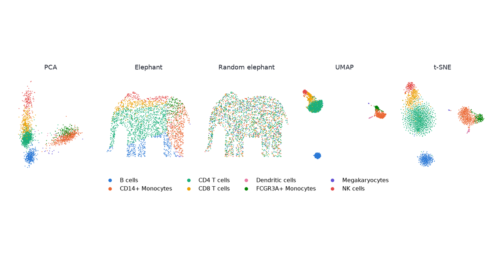

A 2-D UMAP or t-SNE plot of high-dimensional data keeps some kinds of structure and throws others away, and which kinds it keeps decides what the plot can be used for.

Most single-cell papers now open with the same figure: thousands of cells as dots, gathered into coloured islands, one island per cell type. The islands look like evidence. Two islands far apart look unrelated; a bridge between them looks like a transition; a dense island looks like a tight population. Yet the same cells give a different picture with a different `n_neighbors`, the distances between islands change from run to run, and a 2023 paper showed that an embedding shaped like an elephant scores about as well as UMAP on two distance metrics. The question this series asks is narrower than "is UMAP good": which of those visual readings does a 2-D map support, under which conditions, and how would one know?

The answers here come from a computational laboratory. Synthetic data with known ground truth make it possible to score a map against the structure that generated it, and three real datasets check that the findings survive contact with data nobody designed. Every number in the series comes from that laboratory's cached results, run over several independent draws of each dataset.

This is the first of four parts.

1. **The map and the territory** (this part): what a map can keep, how each kind of structure is measured, what the methods optimise, and the dispute over the elephant.
2. [**Ambient and intrinsic dimension**](../when-umap-lies-dimension/): adding noise columns and adding real degrees of freedom are different problems, and the first one breaks the neighbour graph before any embedding is drawn.
3. [**Settings, seeds and starting points**](../when-umap-lies-tuning/): hyperparameters, initialisation and random seeds, with every method tuned on a comparable grid.
4. [**Gaps, density and holes**](../when-umap-lies-gaps-density-holes/): whether a gap means separation, a dense region means a tight population, and a loop means a cycle; and what to trust.

This part covers two ideas:

- **Local and global structure are different quantities.** Whether a point's neighbours stay its neighbours, and whether large distances keep their order, are measured separately and can disagree completely.
- **The elephant dispute is a disagreement about which of the two to measure.** On distance metrics the elephant ties with UMAP; on neighbour metrics it loses badly. Both papers report their measurements correctly.

```{python}
#| label: setup
#| echo: false
import sys
from pathlib import Path

import matplotlib.pyplot as plt
import numpy as np
import pandas as pd
from IPython.display import Markdown

sys.path.insert(0, str(Path("src").resolve()))
from umaplab import plotting as P
from umaplab import report as R

P.setup()


def md(df: pd.DataFrame, **kw) -> Markdown:
    kw.setdefault("index", False)
    return Markdown(df.to_markdown(disable_numparse=True, **kw))
```

## Kinds of structure {#sec-keep}

An embedding places $n$ points $x_1, \dots, x_n \in \mathbb{R}^D$ at positions $y_1, \dots, y_n \in \mathbb{R}^2$. Nothing about $\mathbb{R}^2$ can hold every relationship among points in $\mathbb{R}^D$: at most $D + 1$ points can be mutually equidistant in $\mathbb{R}^D$, and only three in the plane. Every map keeps some relationships and gives up others. The series scores five kinds separately and never folds them into one number.

- **Local structure.** Whether each point's nearest neighbours in the data are still its nearest neighbours on the map.
- **Global structure.** Whether large distances keep their order: far things stay far, and the far-from-far ordering survives.
- **Cluster separation.** Whether groups that are separate in the data are separate on the map, and whether groups that overlap in the data overlap on the map.
- **Density.** Whether regions where points are packed tightly in the data are packed tightly on the map.
- **Topology.** Whether loops, branches and holes in the data appear on the map, and whether the map invents ones that are not there.

Two further properties belong to the method, not the map: **stability** (does a different seed or a small change of settings give a different picture?) and **cost** (time and memory as $n$ and $D$ grow).

### Local structure {#sec-local}

Write $N_k(i)$ for the indices of the $k$ nearest neighbours of point $i$ in the reference space, and $\hat N_k(i)$ for its $k$ nearest neighbours on the map.

- **Neighbour preservation** (also called kNN recall; $Q_{NX}(k)$ in Lee & Verleysen's notation) is the average overlap:

  $$
  Q_{NX}(k) = \frac{1}{n} \sum_{i=1}^{n} \frac{|N_k(i) \cap \hat N_k(i)|}{k}.
  $$

  A map that placed points at random would score about $k/(n-1)$: 0.005 at $k = 10$ and $n = 2000$. The chance-adjusted version (Lee et al. 2013) $R_{NX}(k) = \frac{(n-1)Q_{NX}(k) - k}{n - 1 - k}$ is 0 for a random map and 1 for a perfect one.
- **Trustworthiness** $T(k)$ (Venna & Kaski 2001) penalises *intrusions*: points that are neighbours on the map but not in the data, weighted by how far down the data's ranking they really are. With $r(i,j)$ the rank of $j$ among $i$'s neighbours in the data and $U_k(i) = \hat N_k(i) \setminus N_k(i)$,

  $$
  T(k) = 1 - \frac{2}{nk(2n - 3k - 1)} \sum_{i=1}^n \sum_{j \in U_k(i)} \bigl(r(i,j) - k\bigr).
  $$

  A low $T$ means the map shows neighbours that are not real: points are torn from distant regions and pressed together.
- **Continuity** $C(k)$ is the same formula with the two spaces swapped. It penalises *extrusions*: real neighbours pushed apart. A low $C$ means the map tears the data.

Trustworthiness and continuity separate two failures that neighbour preservation alone mixes: folding distant parts of the data onto each other, and tearing a continuous region apart.

### Global structure {#sec-global}

Large distances are measured on a reproducible random sample of 50,000 point pairs (the full set has $n(n-1)/2 \approx 2$ million at $n = 2000$).

- **Distance correlation**: the Spearman (rank) and Pearson correlations between the pairs' distances in the reference space and on the map. Pearson is dominated by the largest distances, Spearman by their order.
- **Geodesic correlation**: on a curved manifold the right reference distance runs along the surface, not through the ambient space. Where the generator knows it (Swiss roll, sphere, circle, tree), the Spearman correlation with the true geodesic distance is reported too.
- **Normalised stress**: $\sqrt{\sum (d_{ij} - a\,\hat d_{ij})^2 / \sum d_{ij}^2}$ with the scale $a$ chosen optimally, so 0 is a perfect copy up to scale.

### Clusters, density and topology {#sec-other}

- **Cluster separation**, where labels exist: the silhouette coefficient on the true labels, the accuracy of a 15-nearest-neighbour classifier under 5-fold cross-validation, and the agreement (adjusted Rand index and adjusted mutual information) between the true labels and a clustering of the map by k-means or HDBSCAN. The same scores are computed in the original space, because a clustering run on the map is a second algorithm with its own failure modes, separate from the embedding.
- **Density**: the distance $r_k(i)$ to the $k$-th neighbour ($k = 15$) is a local radius, small where points are packed. The Spearman correlation between $\log r_k$ in the data and on the map (close to what densMAP optimises, which is a Pearson correlation of the log of a weighted local radius; Narayan, Berger & Cho 2021) measures whether packing survives, and where the generator knows the true sampling density, so does its correlation with $1/r_k^2$ on the map.
- **Topology**: persistent homology (`ripser`) on a 400-point subsample, counting connected components and loops that persist over a range of scales. On finite noisy samples this is itself an estimate, so Part 4 reports it next to the true answer and never as a verdict on one run.

## Methods {#sec-methods}

The nine methods differ less in their mathematics than in which distances they try to keep. Methods that build a $k$-nearest-neighbour graph and fit the map to the graph keep local structure and are free with large distances. Methods that work from all pairwise or geodesic distances keep large distances and crush small ones.

```{python}
#| label: tbl-methods
#| tbl-cap: "The methods compared in the series. Parameters are the package defaults, passed explicitly; complexity is per the method's papers and documentation for the default algorithm."
from umaplab.embeddings import METHODS

rows = [
    ("PCA", "Pearson 1901; Hotelling 1933", "Linear projection onto the two directions of largest variance", "Large distances, linear structure", "none", "O(nD min(n, D))"),
    ("t-SNE", "van der Maaten & Hinton 2008", "Gaussian neighbour probabilities (bandwidth set by perplexity) matched by Student-t similarities; minimise KL(P‖Q)", "Neighbourhoods", "perplexity 30, early exaggeration 12, PCA init", "O(n log n) per iteration (Barnes–Hut / FFT)"),
    ("UMAP", "McInnes, Healy & Melville 2018", "Fuzzy kNN graph matched by low-dimensional similarities 1/(1 + a d^2b); cross-entropy with negative sampling", "Neighbourhoods", "n_neighbors 15, min_dist 0.1, spectral init", "approx. kNN + O(n) per epoch"),
    ("PaCMAP", "Wang et al. 2021", "Attraction of neighbour and mid-near pairs, repulsion of further pairs, re-weighted over three phases", "Neighbourhoods and coarse layout", "n_neighbors 10, MN_ratio 0.5, FP_ratio 2, PCA to 100 dims", "approx. kNN + O(n) per iteration"),
    ("TriMap", "Amid & Warmuth 2019", "Triplets (i nearer j than k) from neighbours and random points, weighted by how strongly the data agree", "Coarse layout", "12 inliers, 4 outliers, 3 random, PCA to 100 dims", "kNN + O(n) per iteration"),
    ("Isomap", "Tenenbaum, de Silva & Langford 2000", "Shortest-path (geodesic) distances on the kNN graph, then classical MDS", "Geodesic distances", "n_neighbors 10", "O(n² log n) time, O(n²) memory"),
    ("Laplacian eigenmaps", "Belkin & Niyogi 2003", "Smoothest non-constant eigenvectors of the kNN graph Laplacian", "Graph adjacency", "n_neighbors n/10", "sparse eigensolve; dense as k grows"),
    ("Diffusion map", "Coifman & Lafon 2006", "Leading eigenvectors of a density-normalised diffusion operator", "Diffusion distance", "k 15, α 1, t 1", "sparse eigensolve"),
    ("PHATE", "Moon et al. 2019", "Potential distances between diffused transition profiles, then metric MDS", "Trajectories, coarse layout", "knn 5, decay 40, t auto, PCA to 100 dims", "landmarks (2,000) + MDS"),
]
md(pd.DataFrame(rows, columns=["Method", "Source", "Objective", "Tries to keep", "Main defaults", "Cost"]))
```

Three facts about the neighbour-graph methods recur through the series.

- **UMAP and t-SNE fit the same object.** Both turn the data into a graph over each point's nearest neighbours and lay that graph out with attraction along edges and repulsion between everything else. Damrich & Hamprecht (2021) derived the loss UMAP's sampling procedure minimises and found that it differs from the published one: it "tries to reproduce similarities that only encode the shared k nearest neighbor graph". Böhm, Berens & Kobak (2022) placed UMAP on a spectrum of attraction strength, where it sits near t-SNE with its attraction exaggerated about four-fold.
- **Large distances are set by the start, not the objective.** A graph of 15 nearest neighbours says nothing about how far apart two unconnected regions should be, so their placement is inherited from the initial layout. Kobak & Linderman (2021) showed that UMAP's reputed advantage over t-SNE in global structure came from its spectral initialisation; with matched initialisation the advantage disappeared. Part 3 tests this.
- **Three methods carry their own denoiser.** PaCMAP, TriMap and PHATE reduce data with more than 100 columns to 100 principal components before building their graph; UMAP and t-SNE do not. Single-cell pipelines add the step by hand (UMAP on 50 PCs), so the series reports UMAP and t-SNE both ways. Part 2 shows why this step matters more than the choice of method.

The implementation details that change results are in the lab's source: `umap-learn` 0.6.0 is pinned to its legacy layout with spectral initialisation, because its new default emits a warning that the default will change; t-SNE is `openTSNE` 1.0.4; the diffusion map is written out in the lab (α = 1 normalisation, adaptive bandwidth); TriMap 1.2.0 is given exact neighbours because its approximate-neighbour library failed on the test machine (see [Constraints](#sec-constraints)).

## The elephant dispute {#sec-dispute}

In 2021 Tara Chari and Lior Pachter posted a preprint, published in 2023 in *PLOS Computational Biology* as "The specious art of single-cell genomics", arguing that 2-D embeddings of single-cell data distort so much that they are "counter-productive for exploratory, biological analyses". In 2024 Jan Lause, Philipp Berens and Dmitry Kobak replied in the same journal with "The art of seeing the elephant in the room: 2D embeddings of single-cell data do make sense". The two papers measure different things.

### Chari & Pachter's case {#sec-chari}

- **Data.** Fourteen published single-cell datasets, preprocessed to the top 2,000 variable genes and 50 principal components (15 or 100 for some, as in the source studies). UMAP and t-SNE ran at default settings on the principal components.
- **Local structure.** Comparing each cell's 30 nearest neighbours in the gene space and on the map, the Jaccard distance between the two sets averaged "consistently above 0.7". Against the 50-PC space it was above 0.8.
- **Global structure.** Ranking the other cell types by distance from each type, the rank correlation between gene space and map was "low (≤ 0.4)".
- **Distances.** Among groups of cells that are nearly equidistant in gene space, the ratio of largest to smallest map distance rose 4- to 200-fold.
- **The elephant.** Their method Picasso is an autoencoder whose 2-D latent space is pulled onto an elephant outline: each cell is matched to a distinct point of the shape by linear sum assignment, and a linear decoder must still reconstruct the data. On three datasets, the elephant correlated with gene-space distances between cell-type centroids and within cell types about as well as UMAP and t-SNE did. Their conclusion: Picasso "can quantitatively represent these visually inferred characteristics similarly to, or better than, the respective t-SNE/UMAP embeddings, while producing arbitrary shapes."

Their reading is that a metric which an elephant passes cannot be the reason to trust a UMAP, so the visual impression must be carrying the weight. They recommend analysis in the high-dimensional space instead, and treating 2-D plots "more as cartoon diagrams to be displayed post-analysis".

### Lause, Berens & Kobak's reply {#sec-lause}

- **Scope.** The reply addresses only the elephant, on the same three datasets, with UMAP and t-SNE at defaults on 50 PCs and five runs per method.
- **Reproduction.** They reproduced Chari & Pachter's two distance correlations: 2-D PCA scored best, and the elephant scored similar to or better than UMAP and t-SNE.
- **The metrics they added.** The accuracy of a 10-nearest-neighbour vote for each cell's type on the map, the recall of each cell's 10 nearest neighbours, the silhouette of the cell types, and the best agreement between the types and an HDBSCAN clustering of the map.
- **Result.** "UMAP and t-SNE consistently and strongly outperformed PCA and Picasso elephant embeddings (Fig 2C–2D, >90% vs. <62% accuracy, >15% vs. <5% recall for all datasets)". A simulation with known classes gave the same split.

Their reading is that Chari & Pachter's metrics "only quantify a single aspect", preservation of distances, on which 2-D PCA unsurprisingly wins. The elephant succeeds on that aspect and fails at what UMAP and t-SNE are built to do.

### Points of agreement {#sec-agree}

The disagreement is narrower than the titles suggest.

- **Both find exact neighbourhoods mostly lost.** Chari & Pachter's Jaccard distance above 0.7 at $k = 30$ is an overlap below 46%; Lause et al. report recall "below 40% for all methods" at $k = 10$.
- **Both find 2-D PCA best on distance correlations.**
- **Neither recommends 2-D coordinates for quantitative analysis.** Lause et al.: "we do agree with Chari and Pachter that 2D visualisations distort distances and should not be blindly trusted", and "any generated insight should then be validated in the high-dimensional data by other means".
- **They differ on exploration.** Chari & Pachter call the plots counter-productive for it; Lause et al. "endorse them for that very purpose".

One result stays unreconciled. Chari & Pachter found label prediction from neighbours (at $k = 50$, with 30% of cells held out) "consistently worse" on the map than in higher dimensions on four datasets; Lause et al. found it similar or better at $k = 10$ on three others. The datasets and protocols differ, and neither paper addresses the other's result. No published rejoinder from Chari or Pachter could be found as of November 2026.

## The elephant experiment {#sec-elephant}

Retraining Picasso is not needed to see the dispute. Its loss has two parts, and both have a cheap stand-in.

- **Reconstruction.** A linear decoder from a 2-D latent space reconstructs the data best when the latent space is the plane of the first two principal components. The reconstruction-optimal layout is 2-D PCA.
- **Shape.** Each cell is matched to a distinct point inside an elephant silhouette by linear sum assignment, minimising the total squared distance cells move from their PCA positions.

A weight $f$ blends the two, $Y_f = (1 - f)\,Y_\text{PCA} + f\,Y_\text{elephant}$, from pure PCA at $f = 0$ to a pure elephant at $f = 1$ that keeps PCA's coarse arrangement of the cells. A second elephant assigns cells to the shape's points at random and keeps no structure at all. This is an embedding in the spirit of Picasso, not a reproduction of it: Picasso's encoder is nonlinear and it is trained on the outline, not the filled shape.

### Data {#sec-elephant-data}

- **PBMC 3k.** About 2,700 peripheral blood mononuclear cells from one healthy donor, sequenced by 10x Genomics in 2016 as a public demonstration dataset and used since as the standard tutorial dataset of Seurat and of Scanpy (Wolf, Angerer & Theis 2018). The preprocessing follows that tutorial: cells with fewer than 200 or more than 2,500 detected genes or more than 5% mitochondrial reads are dropped; counts are normalised to 10,000 per cell and log-transformed; the 1,838 highly variable genes are scaled; and the data are reduced to 50 principal components, the space UMAP and t-SNE see in practice. That leaves 2,638 cells. The eight cell-type labels come from the tutorial's processed copy, where they were assigned by clustering a neighbour graph of these same principal components and naming the clusters from marker genes. They are not independent ground truth. Agreement with them partly measures agreement with that earlier clustering, and two of the eight types are tiny: 15 megakaryocytes and 37 dendritic cells.
- **Synthetic clusters.** 2,000 points from ten Gaussian clusters in 10 dimensions, 200 per cluster, each with unit standard deviation in every direction, with centres drawn at random and rescaled so the closest two are 4 standard deviations apart. The clusters have no internal structure, so they stand in for discrete cell types with known membership, as in Lause et al.'s simulation.

Every embedding is scored against the 50-PC space (PBMC) or the 10-D data (clusters), with both papers' metrics. UMAP and t-SNE ran with five seeds; the ranges are over seeds.

```{python}
#| label: elephant-load
#| echo: false
from umaplab.elephant import _centroid_dists
from types import SimpleNamespace

from umaplab.generators import gaussian_clusters

E = pd.read_parquet(R.CACHE / "elephant" / "scores.parquet")
LAY = np.load(R.CACHE / "elephant" / "layouts.npz")
# The PBMC reference space, cached by run_experiments.py so the render needs no download.
_ref = np.load(R.CACHE / "elephant" / "pbmc_reference.npz")
pbmc = SimpleNamespace(
    X=_ref["X"].astype(np.float64),
    labels=_ref["labels"].astype(int),
    meta={"label_names": [str(s) for s in _ref["label_names"]]},
)
CL = gaussian_clusters(2000, 0, n_clusters=10, dim=10, separation=4.0)
REF = {"pbmc3k": (pbmc.X, pbmc.labels), "clusters": (CL.X, CL.labels)}


def emb_name(row):
    e, f = row.embedding, row.f
    if e == "elephant":
        return {0.0: "PCA", 1.0: "Elephant"}.get(f, f"Elephant f={f:.1f}")
    return {"random": "Random elephant"}.get(e, e.split("·")[0])


E["name"] = E.apply(emb_name, axis=1).replace({"umap": "UMAP", "tsne": "t-SNE"})

# Chari & Pachter's centroid metric again, on the PBMC types with >= 100 cells only.
yb = pbmc.labels
big = np.isin(yb, np.flatnonzero(np.bincount(yb) >= 100))
a_big = _centroid_dists(pbmc.X[big], yb[big])
extra = []
for key in LAY.files:
    if not key.startswith("pbmc3k/") or key.endswith("labels"):
        continue
    nm = key.split("/", 1)[1]
    b = _centroid_dists(LAY[key][big], yb[big])
    r = float(np.corrcoef(a_big, b)[0, 1])
    if nm.startswith("elephant·f"):
        f = float(nm.split("f")[-1])
        name = {0.0: "PCA", 1.0: "Elephant"}.get(f, f"Elephant f={f:.1f}")
    elif nm == "random_elephant":
        name = "Random elephant"
    else:
        name = {"umap": "UMAP", "tsne": "t-SNE"}[nm.split("·")[0]]
    extra.append(dict(dataset="pbmc3k", name=name, metric="inter_big", value=r))
E = pd.concat([E, pd.DataFrame(extra)], ignore_index=True)

SHOW = ["PCA", "Elephant", "Random elephant", "UMAP", "t-SNE"]
MET = {
    "inter_corr": "Centroid distances",
    "inter_big": "Centroid distances, types ≥ 100 cells",
    "intra_corr": "Within-type spread",
    "knn_acc": "10-NN type accuracy",
    "knn_recall": "10-NN recall",
    "silhouette": "Silhouette",
    "max_ami": "Best HDBSCAN AMI",
}


def cell(sub):
    lo, hi = sub.value.min(), sub.value.max()
    return R.rng(lo, hi)


def etab(ds, drop=()):
    sub = E[(E.dataset == ds) & E.name.isin(SHOW) & ~E.metric.isin(drop)]
    t = sub.groupby(["metric", "name"]).apply(cell, include_groups=False).unstack("name")
    t = t.reindex([m for m in MET if m in t.index])[SHOW]
    t.index = [MET[m] for m in t.index]
    return t.reset_index(names="Metric")


def ev(ds, name, metric, agg="median"):
    v = E[(E.dataset == ds) & (E.name == name) & (E.metric == metric)].value
    return getattr(v, agg)()
```

### Result {#sec-elephant-result}

```{python}
#| label: tbl-elephant-clusters
#| tbl-cap: "The elephant and four other embeddings of ten synthetic Gaussian clusters, scored with Chari & Pachter's centroid-distance metric (first row) and Lause et al.'s four neighbourhood and class metrics. Their within-type spread metric is left out here: the ten clusters have the same spread by construction, so its correlation would measure sampling noise. UMAP and t-SNE: range over five seeds."
md(etab("clusters", drop=("intra_corr",)))
```

On the synthetic clusters, the two papers' findings both reproduce.

- **Chari & Pachter's distance metric does not separate the elephant from UMAP.** The elephant's centroid-distance correlation is `{python} R.fmt(ev("clusters", "Elephant", "inter_corr"))`, against `{python} R.rng(ev("clusters", "UMAP", "inter_corr", "min"), ev("clusters", "UMAP", "inter_corr", "max"))` for UMAP and `{python} R.rng(ev("clusters", "t-SNE", "inter_corr", "min"), ev("clusters", "t-SNE", "inter_corr", "max"))` for t-SNE. PCA, the elephant's starting point, scores highest at `{python} R.fmt(ev("clusters", "PCA", "inter_corr"))`.
- **Lause et al.'s metrics separate them by a wide margin.** A 10-neighbour vote recovers the cluster of `{python} R.fmt(100 * ev("clusters", "Elephant", "knn_acc"), 0)`% of points on the elephant and `{python} R.fmt(100 * ev("clusters", "UMAP", "knn_acc", "min"), 0)`% on UMAP; the elephant keeps `{python} R.fmt(100 * ev("clusters", "Elephant", "knn_recall"), 0)`% of each point's 10 nearest neighbours, UMAP `{python} R.rng(100 * ev("clusters", "UMAP", "knn_recall", "min"), 100 * ev("clusters", "UMAP", "knn_recall", "max"), 0)`% and t-SNE `{python} R.rng(100 * ev("clusters", "t-SNE", "knn_recall", "min"), 100 * ev("clusters", "t-SNE", "knn_recall", "max"), 0)`%.

```{python}
#| label: tbl-elephant-pbmc
#| tbl-cap: "The same comparison on PBMC 3k, against the 50-PC space. The second row repeats Chari & Pachter's centroid metric on the six cell types with at least 100 cells. UMAP and t-SNE: range over five seeds."
md(etab("pbmc3k"))
```

```{python}
#| label: centroid-null
#| echo: false
# What does the centroid metric give a layout with no structure? 500 random
# assignments of the cells to the elephant's points.
names = pbmc.meta["label_names"]
mk = names.index("Megakaryocytes")
shape = LAY["pbmc3k/random_elephant"]
rng_ = np.random.default_rng(1)
a_all = _centroid_dists(pbmc.X, yb)
null8, null6 = [], []
for _ in range(500):
    Yr = shape[rng_.permutation(len(shape))]
    null8.append(np.corrcoef(a_all, _centroid_dists(Yr, yb))[0, 1])
    null6.append(np.corrcoef(a_big, _centroid_dists(Yr[big], yb[big]))[0, 1])
null8, null6 = np.array(null8), np.array(null6)
q = lambda v, p: R.fmt(np.percentile(v, p))  # noqa: E731
# 2-D PCA without the megakaryocytes alone
no_mk = yb != mk
pca2 = LAY["pbmc3k/elephant·f0.0"]
pca_no_mk = np.corrcoef(
    _centroid_dists(pbmc.X[no_mk], yb[no_mk]), _centroid_dists(pca2[no_mk], yb[no_mk])
)[0, 1]
# how far the megakaryocyte centroid sits from the others in the 50-PC space
cents = np.stack([pbmc.X[yb == c].mean(0) for c in range(len(names))])
dmk = np.delete(np.linalg.norm(cents - cents[mk], axis=1), mk)
from scipy.spatial.distance import pdist as _pdist

next_largest = _pdist(np.delete(cents, mk, 0)).max()
```

On PBMC 3k the neighbourhood metrics give the same verdict, and the distance metric needs a caveat before it says anything.

- **On all eight types the centroid metric is dominated by one outlying type.** 2-D PCA scores `{python} R.fmt(ev("pbmc3k", "PCA", "inter_corr"))` and the random elephant, which keeps no structure, `{python} R.fmt(ev("pbmc3k", "Random elephant", "inter_corr"))`. The 15 megakaryocytes sit far from every other type in the 50-PC space (their centroid is `{python} R.fmt(dmk.min(), 0)`–`{python} R.fmt(dmk.max(), 0)` units from the others; the largest distance among the other seven types is `{python} R.fmt(next_largest, 0)`), and 2-D PCA places them near the middle. Leaving out the megakaryocytes alone raises PCA's score to `{python} R.fmt(pca_no_mk)`.
- **A layout with no structure is unstable on this metric.** Over 500 random assignments of the cells to the elephant's points, the eight-type correlation has median `{python} q(null8, 50)` (5–95%: `{python} q(null8, 5)` to `{python} q(null8, 95)`). The centroid of a small random group lands away from the rest by sampling noise alone, and the smallest group is also the most distant type in expression space, so noise and signal line up.
- **On the six types with at least 100 cells the metric behaves better, and the elephant still ties UMAP.** PCA scores `{python} R.fmt(ev("pbmc3k", "PCA", "inter_big"))`, the elephant `{python} R.fmt(ev("pbmc3k", "Elephant", "inter_big"))`, UMAP `{python} R.rng(ev("pbmc3k", "UMAP", "inter_big", "min"), ev("pbmc3k", "UMAP", "inter_big", "max"))`, t-SNE `{python} R.rng(ev("pbmc3k", "t-SNE", "inter_big", "min"), ev("pbmc3k", "t-SNE", "inter_big", "max"))` and the random elephant `{python} R.fmt(ev("pbmc3k", "Random elephant", "inter_big"))`. With only 15 distances the null is still wide: random layouts give a median of `{python} q(null6, 50)` (5–95%: `{python} q(null6, 5)` to `{python} q(null6, 95)`).
- **Neighbour recall separates them.** The elephant keeps `{python} R.fmt(100 * ev("pbmc3k", "Elephant", "knn_recall"), 0)`% of each cell's 10 nearest neighbours; UMAP keeps `{python} R.rng(100 * ev("pbmc3k", "UMAP", "knn_recall", "min"), 100 * ev("pbmc3k", "UMAP", "knn_recall", "max"), 0)`% and t-SNE `{python} R.rng(100 * ev("pbmc3k", "t-SNE", "knn_recall", "min"), 100 * ev("pbmc3k", "t-SNE", "knn_recall", "max"), 0)`%. All are low in absolute terms, as both papers found.
- **Type accuracy separates them less here than on the synthetic clusters.** A 10-neighbour vote gets `{python} R.fmt(100 * ev("pbmc3k", "Elephant", "knn_acc"), 0)`% of cell types right on the elephant and `{python} R.rng(100 * ev("pbmc3k", "UMAP", "knn_acc", "min"), 100 * ev("pbmc3k", "UMAP", "knn_acc", "max"), 0)`% on UMAP. The first two principal components already separate the major lineages (T and NK cells, B cells, monocytes), which hold most of the cells, and the elephant inherits that separation.

```{python}
#| label: fig-elephant
#| fig-cap: "PBMC 3k under five embeddings, coloured by the tutorial's cell-type labels. The elephant is 2-D PCA moved onto an elephant silhouette by optimal assignment; the random elephant assigns cells to the same points at random. UMAP and t-SNE: seed 0."
#| fig-alt: "Five scatter plots of 2,638 cells. In PCA the cells form three lobes, T and NK cells, B cells, and monocytes, that touch at their edges. The elephant keeps those groups as coloured regions of the elephant's body, B cells in the legs. The random elephant is a uniform mix of colours. UMAP and t-SNE show three separated groups: B cells; T and NK cells, with CD4 and CD8 T cells touching; and monocytes, with dendritic cells and megakaryocytes beside them."
names = pbmc.meta["label_names"]
panels = [
    ("elephant·f0.0", "PCA"),
    ("elephant·f1.0", "Elephant"),
    ("random_elephant", "Random elephant"),
    ("umap·s0", "UMAP"),
    ("tsne·s0", "t-SNE"),
]
fig, axes = plt.subplots(1, 5, figsize=(10, 2.5))
cols = P.class_colours(pbmc.labels)
for ax, (key, title) in zip(axes, panels):
    P.embedding_panel(ax, LAY[f"pbmc3k/{key}"], c=list(cols), s=1.2, title=title)
handles = [
    plt.Line2D([], [], marker="o", ls="", color=P.CLASS[i], label=nm, markersize=4)
    for i, nm in enumerate(names)
]
fig.legend(handles=handles, loc="lower center", ncol=4, fontsize=8, bbox_to_anchor=(0.5, -0.12))
fig.tight_layout()
plt.show()
```

The widget runs the full sweep. On the synthetic clusters, drag the elephant weight from 0 to 1. The centroid-distance correlation falls slowly from PCA's level into the band UMAP and t-SNE span, while neighbour recall and the class metrics stay near PCA's level, far below UMAP and t-SNE. Switch to the random elephant to see what a layout with no structure scores, and to PBMC to see the small-type artefact in the first metric.

::: {#widget-elephant}
:::

```{=html}
<script src="umapkit.js"></script>
<script src="widget-data/elephant.js"></script>
<script src="model.js"></script>
<script src="widgets.js"></script>
```

Both papers measured correctly. The elephant keeps the arrangement of cell types that 2-D PCA keeps, which is what the centroid metric rewards, and it keeps none of the neighbourhoods, which is what UMAP and t-SNE are built to keep. "Quantitatively similar in terms of fidelity" is true of one kind of structure and false of the other. Whether a UMAP plot is evidence depends on which of the two a reader takes from it.

## Real data {#sec-real}

The elephant shows that two families of metric can disagree about one embedding. Real data show that they disagree about which *method* is best.

### Data {#sec-real-data}

- **PBMC 3k**, as in the elephant experiment: 2,638 cells in 50 principal components, eight annotated types.
- **MNIST.** 70,000 handwritten digits, 28 × 28 greyscale, collected by NIST from census employees and high-school students and assembled by LeCun et al. (1998) as a benchmark for digit recognition. Read from OpenML (dataset 554).
- **Fashion-MNIST.** 70,000 product photographs from Zalando's catalogue in ten clothing classes, built by Xiao, Rasul & Vollgraf (2017) as a harder drop-in replacement for MNIST. Read from OpenML (dataset 40996).

For the two image sets, three independent stratified subsamples of 5,000 images each are embedded from the raw 784 pixel values scaled to [0, 1], and the reference space is those pixels. Each PBMC method ran with five seeds on the one dataset. The labels here are not ground truth for neighbourhoods: two images of different digits can be nearest neighbours in pixel space, and a map that keeps that is faithful to the data. Class accuracy is reported as a separate question, whether a map keeps the classes apart.

```{python}
#| label: real-load
#| echo: false
RL = R.load("real")
RL = RL[~((RL.generator == "pbmc3k") & RL.config.str.endswith("pca50"))]  # PBMC input is already 50 PCs
REAL = {"pbmc3k": "PBMC 3k", "mnist_784": "MNIST", "Fashion-MNIST": "Fashion-MNIST"}
RMET = [
    ("knn_preservation", 10.0, "truth", "10-NN recall"),
    ("trustworthiness", 10.0, "truth", "Trustworthiness"),
    ("dist_spearman", None, "truth", "Distance rank corr."),
    ("density_spearman", None, "truth", "Density corr."),
    ("knn_accuracy", None, "emb", "Class accuracy"),
]
CONF = ["pca", "umap", "tsne", "pacmap", "trimap", "isomap", "spectral", "diffmap", "phate"]


def real_med(gen):
    out = {}
    for m, k, ref, lab in RMET:
        s = R.pick(RL[RL.generator == gen], m, k, ref)
        out[lab] = s.groupby("config").value.median()
    return pd.DataFrame(out).reindex(CONF)


RMED = {g: real_med(g) for g in REAL}


def rv(gen, cfg, lab):
    return RMED[gen].loc[cfg, lab]
```

### Result {#sec-real-result}

```{python}
#| label: fig-ranks
#| fig-cap: "Rank of nine methods (1 = best) on five metrics, for PBMC 3k, MNIST and Fashion-MNIST, by median over seeds or subsamples. A method that is best on neighbour recall is not best on distance rank correlation, and the ranking changes again for density."
#| fig-alt: "Three bump charts. In each, t-SNE ranks first or second on 10-NN recall and trustworthiness and drops on distance rank correlation, while PCA ranks last on recall and first or second on distance rank correlation. UMAP drops to near last on density correlation."
labs = [lab for *_, lab in RMET]
fig, axes = plt.subplots(1, 3, figsize=(11, 3.6), sharey=True)
for ax, (gen, title) in zip(axes, REAL.items()):
    ranks = RMED[gen].rank(ascending=False, method="min")
    for cfg in CONF:
        st = P.style(cfg)
        ax.plot(range(len(labs)), ranks.loc[cfg].values, **{**st, "markersize": 4})
        ax.text(len(labs) - 0.85, ranks.loc[cfg].values[-1], P.name(cfg), fontsize=7, va="center", color=P.INK)
    ax.set_xticks(range(len(labs)))
    ax.set_xticklabels(labs, rotation=30, ha="right", fontsize=8)
    ax.set_xlim(-0.3, len(labs) + 0.9)
    ax.set_title(title)
    ax.grid(axis="x")
axes[0].invert_yaxis()
axes[0].set_yticks(range(1, 10))
axes[0].set_ylabel("Rank (1 = best)")
fig.tight_layout()
plt.show()
```

```{python}
#| label: tbl-real
#| tbl-cap: "Median score of each method on each real dataset. Rows: metric and dataset. Bold: the best method on that row."
rows = []
for lab in labs:
    for gen, title in REAL.items():
        v = RMED[gen][lab]
        best = v.idxmax()
        rows.append(
            [lab, title]
            + [f"**{R.fmt(v[c])}**" if c == best else R.fmt(v[c]) for c in CONF]
        )
md(pd.DataFrame(rows, columns=["Metric", "Data"] + [P.name(c) for c in CONF]))
```

```{python}
#| label: real-numbers
#| echo: false
best = {(g, lab): RMED[g][lab].idxmax() for g in REAL for lab in labs}
_acc = RMED["mnist_784"]["Class accuracy"].loc[["pacmap", "trimap", "umap", "tsne"]]
NG_ACC = (_acc.min(), _acc.max())
```

- **Neighbours.** t-SNE keeps the most: `{python} R.fmt(rv("mnist_784", "tsne", "10-NN recall"))` of each MNIST image's 10 nearest neighbours and `{python} R.fmt(rv("pbmc3k", "tsne", "10-NN recall"))` of each PBMC cell's, against `{python} R.fmt(rv("mnist_784", "umap", "10-NN recall"))` and `{python} R.fmt(rv("pbmc3k", "umap", "10-NN recall"))` for UMAP and `{python} R.fmt(rv("mnist_784", "pca", "10-NN recall"))` and `{python} R.fmt(rv("pbmc3k", "pca", "10-NN recall"))` for PCA.
- **Large distances.** The order reverses. PCA has the highest distance rank correlation on PBMC (`{python} R.fmt(rv("pbmc3k", "pca", "Distance rank corr."))`) and Fashion-MNIST (`{python} R.fmt(rv("Fashion-MNIST", "pca", "Distance rank corr."))`); on MNIST the best is `{python} P.name(best[("mnist_784", "Distance rank corr.")])` at `{python} R.fmt(RMED["mnist_784"]["Distance rank corr."].max())`, with PCA at `{python} R.fmt(rv("mnist_784", "pca", "Distance rank corr."))`. UMAP scores `{python} R.fmt(rv("pbmc3k", "umap", "Distance rank corr."))`, `{python} R.fmt(rv("mnist_784", "umap", "Distance rank corr."))` and `{python} R.fmt(rv("Fashion-MNIST", "umap", "Distance rank corr."))`.
- **Density.** UMAP keeps almost none of the variation in local density: its correlation is `{python} R.fmt(rv("pbmc3k", "umap", "Density corr."))` on PBMC, `{python} R.fmt(rv("mnist_784", "umap", "Density corr."))` on MNIST and `{python} R.fmt(rv("Fashion-MNIST", "umap", "Density corr."))` on Fashion-MNIST. Narayan, Berger & Cho (2021) reported the same for UMAP on PBMC data (R² = 0.000 for local radius), which is why they built densMAP. Part 4 tests whether that matters.
- **Classes.** The neighbour-graph methods keep classes apart about equally well (10-neighbour class accuracy `{python} R.rng(*NG_ACC)` on MNIST for PaCMAP, TriMap, UMAP and t-SNE), and PCA does not (`{python} R.fmt(rv("mnist_784", "pca", "Class accuracy"))`).

No method is best on every row. "Which embedding is most faithful" has no answer until the question names what it should be faithful to. Part 4 makes the same comparison on synthetic data, where the right answer for density and topology is known as well, and its widget lets the reader pick the metric and watch the ranking change.

## Constraints {#sec-constraints}

- **The elephant is a stand-in, not Picasso.** It is 2-D PCA moved by optimal assignment onto points filling an elephant silhouette, blended by $f$. Picasso trains a nonlinear encoder against the outline. The two share the ingredients the dispute is about (a shape term and a linear reconstruction) but not their numbers, and only one elephant draw was used.
- **Reference spaces differ from the papers'.** PBMC is scored against its 50 principal components, the space UMAP and t-SNE actually see; Chari & Pachter scored against 2,000 genes. MNIST and Fashion-MNIST are scored against raw pixels with Euclidean distance, which is itself a crude similarity for images.
- **Real data have no ground truth for neighbourhoods.** A real-data metric measures agreement with a reference space, and Lause et al.'s argument is that the reference space's own distances are not to be trusted far. The synthetic datasets in Parts 2–4 exist to remove that ambiguity.
- **PBMC labels are not independent.** They come from clustering a neighbour graph of the same principal components, so a map built on that graph agrees with them partly by construction (Chari & Pachter make the same point about the shared graph in Scanpy and Seurat).
- **Variation is partial on PBMC.** One dataset, five method seeds: the ranges cover the methods' randomness, not resampling of cells. MNIST and Fashion-MNIST use three independent subsamples.
- **Defaults only.** Every method here runs at its package defaults. Part 3 tunes all of them, on grids of 4 to 12 settings.
- **Implementation choices that change numbers.** `umap-learn` 0.6.0 is pinned to its legacy layout. TriMap 1.2.0 normally finds neighbours with the `annoy` library, which has no prebuilt package for this machine; the copy built from source returned only the query point from every search, which left TriMap at chance. The lab gives TriMap exact neighbours instead and reproduces its default preprocessing, and a test now requires every method to beat chance on a Swiss roll. The HDBSCAN agreement in the benchmark uses one setting (minimum cluster size $\max(10, n/100)$); the elephant experiment uses Lause et al.'s maximum over nine.

Maps. Keep. Neighbours. Or. Distances. Rarely. Both. Name. The. Ruler.

## References {#sec-references}

- Amid, E. & Warmuth, M. K. (2019). [TriMap: large-scale dimensionality reduction using triplets](https://arxiv.org/abs/1910.00204). arXiv:1910.00204.
- Belkin, M. & Niyogi, P. (2003). [Laplacian eigenmaps for dimensionality reduction and data representation](https://doi.org/10.1162/089976603321780317). *Neural Computation* 15(6), 1373–1396.
- Böhm, J. N., Berens, P. & Kobak, D. (2022). [Attraction-repulsion spectrum in neighbor embeddings](https://arxiv.org/abs/2007.08902). *Journal of Machine Learning Research* 23(95), 1–32.
- Chari, T. & Pachter, L. (2023). [The specious art of single-cell genomics](https://doi.org/10.1371/journal.pcbi.1011288). *PLOS Computational Biology* 19(8), e1011288.
- Coifman, R. R. & Lafon, S. (2006). [Diffusion maps](https://doi.org/10.1016/j.acha.2006.04.006). *Applied and Computational Harmonic Analysis* 21(1), 5–30.
- Damrich, S. & Hamprecht, F. A. (2021). [On UMAP's true loss function](https://arxiv.org/abs/2103.14608). *Advances in Neural Information Processing Systems* 34.
- Kobak, D. & Linderman, G. C. (2021). [Initialization is critical for preserving global data structure in both t-SNE and UMAP](https://doi.org/10.1038/s41587-020-00809-z). *Nature Biotechnology* 39(2), 156–157.
- Lause, J., Berens, P. & Kobak, D. (2024). [The art of seeing the elephant in the room: 2D embeddings of single-cell data do make sense](https://doi.org/10.1371/journal.pcbi.1012403). *PLOS Computational Biology* 20(10), e1012403.
- LeCun, Y., Bottou, L., Bengio, Y. & Haffner, P. (1998). [Gradient-based learning applied to document recognition](https://doi.org/10.1109/5.726791). *Proceedings of the IEEE* 86(11), 2278–2324. The source of MNIST.
- Lee, J. A. & Verleysen, M. (2009). [Quality assessment of dimensionality reduction: rank-based criteria](https://doi.org/10.1016/j.neucom.2008.12.017). *Neurocomputing* 72(7–9), 1431–1443.
- Lee, J. A., Renard, E., Bernard, G., Dupont, P. & Verleysen, M. (2013). [Type 1 and 2 mixtures of Kullback–Leibler divergences as cost functions in dimensionality reduction based on similarity preservation](https://doi.org/10.1016/j.neucom.2012.12.036). *Neurocomputing* 112, 92–108. The definition of $R_{NX}$ used here.
- McInnes, L., Healy, J. & Melville, J. (2018). [UMAP: uniform manifold approximation and projection for dimension reduction](https://arxiv.org/abs/1802.03426). arXiv:1802.03426. Software: McInnes, L., Healy, J., Saul, N. & Großberger, L. (2018), [UMAP](https://doi.org/10.21105/joss.00861), *Journal of Open Source Software* 3(29), 861.
- Hotelling, H. (1933). [Analysis of a complex of statistical variables into principal components](https://doi.org/10.1037/h0071325). *Journal of Educational Psychology* 24(6), 417–441.
- Moon, K. R. et al. (2019). [Visualizing structure and transitions in high-dimensional biological data](https://doi.org/10.1038/s41587-019-0336-3). *Nature Biotechnology* 37(12), 1482–1492. PHATE.
- Narayan, A., Berger, B. & Cho, H. (2021). [Assessing single-cell transcriptomic variability through density-preserving data visualization](https://doi.org/10.1038/s41587-020-00801-7). *Nature Biotechnology* 39(6), 765–774.
- Pearson, K. (1901). [On lines and planes of closest fit to systems of points in space](https://doi.org/10.1080/14786440109462720). *Philosophical Magazine* 2(11), 559–572.
- Tenenbaum, J. B., de Silva, V. & Langford, J. C. (2000). [A global geometric framework for nonlinear dimensionality reduction](https://doi.org/10.1126/science.290.5500.2319). *Science* 290(5500), 2319–2323.
- van der Maaten, L. & Hinton, G. (2008). [Visualizing data using t-SNE](https://jmlr.org/papers/v9/vandermaaten08a.html). *Journal of Machine Learning Research* 9(86), 2579–2605.
- Venna, J. & Kaski, S. (2001). [Neighborhood preservation in nonlinear projection methods: an experimental study](https://doi.org/10.1007/3-540-44668-0_68). In *Artificial Neural Networks — ICANN 2001*, LNCS 2130, 485–491.
- Wang, Y., Huang, H., Rudin, C. & Shaposhnik, Y. (2021). [Understanding how dimension reduction tools work: an empirical approach to deciphering t-SNE, UMAP, TriMap, and PaCMAP for data visualization](https://jmlr.org/papers/v22/20-1061.html). *Journal of Machine Learning Research* 22(201), 1–73.
- Wolf, F. A., Angerer, P. & Theis, F. J. (2018). [SCANPY: large-scale single-cell gene expression data analysis](https://doi.org/10.1186/s13059-017-1382-0). *Genome Biology* 19, 15. The PBMC 3k tutorial whose preprocessing and annotations are used here.
- Xiao, H., Rasul, K. & Vollgraf, R. (2017). [Fashion-MNIST: a novel image dataset for benchmarking machine learning algorithms](https://arxiv.org/abs/1708.07747). arXiv:1708.07747.
- 10x Genomics (2016). [3k PBMCs from a healthy donor](https://support.10xgenomics.com/single-cell-gene-expression/datasets/1.1.0/pbmc3k), Chromium v1 demonstration dataset.
- Software: [umap-learn](https://github.com/lmcinnes/umap) 0.6.0, [openTSNE](https://github.com/pavlin-policar/openTSNE) 1.0.4, [PaCMAP](https://github.com/YingfanWang/PaCMAP) 0.9.1, [TriMap](https://github.com/eamid/trimap) 1.2.0, [PHATE](https://github.com/KrishnaswamyLab/PHATE) 2.0.0, [scikit-learn](https://scikit-learn.org) 1.9.1, [ripser](https://ripser.scikit-tda.org) 0.6.15.
- [When UMAP Lies, Part 2: Ambient and Intrinsic Dimension](../when-umap-lies-dimension/).
