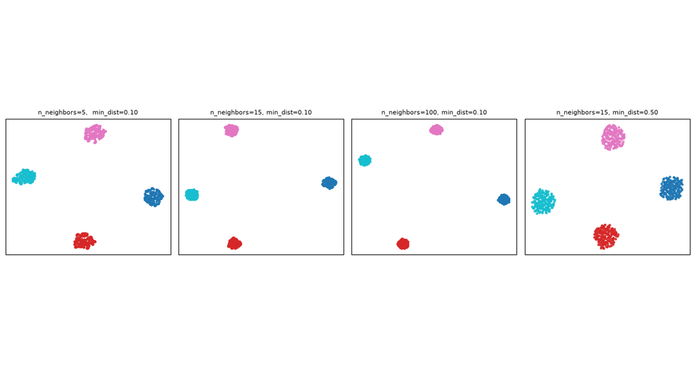

A UMAP plot invites reading. Two islands look like two populations, the water between them like separation, a dense patch like a tight group. The standard way to decide which picture is right is to hold out data and score the fit. UMAP gives you nothing to score. This post shows what follows, on train/dev/test splits where the answer is known.

The series so far measured what a 2-D map keeps ([Part 1](../when-umap-lies/)), how dimension breaks it ([Part 2](../when-umap-lies-dimension/)), how settings and seeds move it ([Part 3](../when-umap-lies-tuning/)), and which visual features it can support ([Part 4](../when-umap-lies-gaps-density-holes/)). This part asks what kind of object a UMAP embedding is, then demonstrates the failures that follow from it.

The post covers one idea and three demonstrations of it:

- **The idea:** a UMAP fit returns coordinates for the training points, not a function of the data. The graph objective never sees a held-out point, so there is no value on a dev or test set to choose settings or catch a bad map.
- **The demonstrations:** a train/dev/test split that cannot decide between settings; four settings that all fit and disagree; three ways the map fails with no signal that it has.

```{python}
#| label: setup
#| echo: false
import numpy as np
import matplotlib.pyplot as plt
from sklearn.datasets import make_blobs
from sklearn.model_selection import train_test_split
from sklearn.decomposition import PCA
from sklearn.neighbors import NearestNeighbors
from sklearn.metrics.pairwise import pairwise_distances
from scipy.stats import spearmanr
import umap


def _ranks(X):
    D = pairwise_distances(X)
    n = D.shape[0]
    R = np.empty((n, n), dtype=int)
    for i in range(n):
        R[i, np.argsort(D[i], kind="mergesort")] = np.arange(n)
    return R


def trustworthiness(X, Y, n_neighbors=10):
    n = X.shape[0]; k = n_neighbors
    RX = _ranks(X); RY = _ranks(Y)
    emb_nbrs = np.argsort(RY, axis=1)[:, 1:k + 1]
    ranks = np.take_along_axis(RX, emb_nbrs, axis=1)
    excess = np.clip(ranks - k, 0, None)
    return 1.0 - (2.0 / (n * k * (2 * n - 3 * k - 1))) * excess.sum()


def continuity(X, Y, n_neighbors=10):
    return trustworthiness(Y, X, n_neighbors)


def scores(emb, high, n=10):
    return trustworthiness(high, emb, n_neighbors=n), continuity(high, emb, n_neighbors=n)


def local_density(Z, k=15):
    d, _ = NearestNeighbors(n_neighbors=k + 1).fit(Z).kneighbors(Z)
    return 1.0 / d[:, -1] ** 2
```

## A split that decides nothing

Start with one draw of four clusters in ten dimensions, then split it into train, dev and test. The three parts come from the same distribution: same centres, same spread. Under supervised learning the dev set would pick the hyperparameters and the test set would confirm the choice.

```{python}
#| label: split
#| echo: false
X, y = make_blobs(
    n_samples=1200, centers=4, cluster_std=1.0, n_features=10, random_state=1
)
X_train, X_hold, y_train, y_hold = train_test_split(
    X, y, test_size=0.4, random_state=42, stratify=y
)
X_dev, X_test, y_dev, y_test = train_test_split(
    X_hold, y_hold, test_size=0.5, random_state=43, stratify=y_hold
)
print(f"train {X_train.shape[0]}  dev {X_dev.shape[0]}  test {X_test.shape[0]}")
```

Fit UMAP on train only, then place dev and test with `transform`. Both land near the cluster their label belongs to. But two settings put them in different places, and neither fit produces a number on the held-out points that could say which placement is better.

```{python}
#| label: split-fit
#| echo: false
settings = [
    ("n_neighbors=5,  min_dist=0.10", dict(n_neighbors=5, min_dist=0.10)),
    ("n_neighbors=15, min_dist=0.10", dict(n_neighbors=15, min_dist=0.10)),
    ("n_neighbors=100, min_dist=0.10", dict(n_neighbors=100, min_dist=0.10)),
    ("n_neighbors=15, min_dist=0.50", dict(n_neighbors=15, min_dist=0.50)),
]
FITS = {}
for label, kw in settings:
    model = umap.UMAP(random_state=0, **kw).fit(X_train)
    FITS[label] = dict(
        train=model.transform(X_train),
        dev=model.transform(X_dev),
        test=model.transform(X_test),
    )

dev_shift = np.linalg.norm(
    FITS["n_neighbors=5,  min_dist=0.10"]["dev"]
    - FITS["n_neighbors=100, min_dist=0.10"]["dev"],
    axis=1,
).mean()

seed_shift = np.linalg.norm(
    umap.UMAP(n_neighbors=15, min_dist=0.10, random_state=0).fit(X_train).transform(X_dev)
    - umap.UMAP(n_neighbors=15, min_dist=0.10, random_state=1).fit(X_train).transform(X_dev),
    axis=1,
).mean()
dev_shift_str = f"{dev_shift:.2f}"
seed_shift_str = f"{seed_shift:.2f}"
print(f"dev placement shift, n_neighbors 5 vs 100: {dev_shift_str}")
print(f"dev placement shift, seed 0 vs 1: {seed_shift_str}")
```

```{python}
#| label: fig-split
#| fig-cap: "One train/dev/test split of the same four clusters, fitted on train only. Crosses are dev points placed by `transform`; squares are test points. Both land near their cluster under either setting, but the held-out points sit in different places under `n_neighbors=5` and `n_neighbors=100`. Neither map reports a value on them that ranks the two."
#| fig-alt: "Two scatter plots. Each shows four coloured training clusters as small dots with dev and test points overlaid as crosses and squares. Under n_neighbors 5 the held-out points sit near compact training clusters; under n_neighbors 100 the same held-out points sit near tighter, more separated clusters."
#| column: page
fig, axes = plt.subplots(1, 2, figsize=(9, 3.4))
for ax, label in zip(axes, ["n_neighbors=5,  min_dist=0.10", "n_neighbors=100, min_dist=0.10"]):
    e = FITS[label]
    ax.scatter(e["train"][:, 0], e["train"][:, 1], c=y_train, s=7, cmap="tab10", alpha=0.6, label="train")
    ax.scatter(e["dev"][:, 0], e["dev"][:, 1], c=y_dev, s=26, cmap="tab10", marker="x", label="dev")
    ax.scatter(e["test"][:, 0], e["test"][:, 1], c=y_test, s=26, cmap="tab10", marker="s", facecolors="none", label="test")
    ax.set_title(label, fontsize=9)
    ax.set_xticks([]); ax.set_yticks([])
axes[0].legend(fontsize=7, loc="upper right", framealpha=0.9)
fig.tight_layout()
```

The dev points move by `{python} dev_shift_str` units on average when `n_neighbors` changes from 5 to 100, and by `{python} seed_shift_str` when only the seed changes from 0 to 1 at the same setting. A dev set in supervised learning rejects the worse setting; here there is no quantity on dev to compare.

## Four settings, all acceptable

Fit the training data under four settings and score each map against the input space. Trustworthiness and continuity are computed on train; they are not held-out reconstruction losses.

```{python}
#| label: grid
#| echo: false
TABLE = {}
for label, kw in settings:
    model = umap.UMAP(random_state=0, **kw).fit(X_train)
    emb = model.transform(X_train)
    tw, cont = scores(emb, X_train)
    TABLE[label] = (tw, cont)
    print(f"{label:32} trustworthiness={tw:.3f} continuity={cont:.3f}")
print(f"inverse_transform available: {hasattr(umap.UMAP(), 'inverse_transform')}")
best_tw_label = max(TABLE, key=lambda k: TABLE[k][0])
best_cont_label = max(TABLE, key=lambda k: TABLE[k][1])
best_tw_str = f"{TABLE[best_tw_label][0]:.3f}"
best_cont_str = f"{TABLE[best_cont_label][1]:.3f}"
```

```{python}
#| label: fig-umap-grid
#| fig-cap: "The same training clusters under four UMAP settings. All four complete, and four well-separated groups appear in every panel. The settings change how tight and how far apart the groups look; none of the four is rejected by a loss. The title of each panel is its full setting."
#| fig-alt: "Four scatter plots of the same four coloured clusters projected by UMAP. Under n_neighbors 5 and 15 the groups are compact and clearly separated; under n_neighbors 100 they are tighter and further apart; under min_dist 0.5 they are larger and closer. All four show four groups."
#| column: page
fig, axes = plt.subplots(1, 4, figsize=(13, 3.0))
for ax, (label, kw) in zip(axes, settings):
    e = FITS[label]["train"]
    ax.scatter(e[:, 0], e[:, 1], c=y_train, s=6, cmap="tab10", alpha=0.85)
    ax.set_title(label, fontsize=8)
    ax.set_xticks([]); ax.set_yticks([])
fig.tight_layout()
```

All four maps keep neighbourhoods well, with scores between 0.938 and 0.960. They rank differently: trustworthiness is highest at `{python} best_tw_label` (`{python} best_tw_str`), continuity at `{python} best_cont_label` (`{python} best_cont_str`). No setting leads on both, and neither score is measured on dev or test. Now vary the settings beyond these four: `n_neighbors`, `min_dist`, `spread`, `metric`, `init` and `seed` each have ranges of acceptable values. Every combination that runs returns a layout, and no held-out loss rejects any of them.

## What the fit returns

UMAP builds a fuzzy simplicial set from the high-dimensional data — local connectivity controlled by `n_neighbors` — and a matching set from the 2-D coordinates, controlled by `min_dist` and `spread`. It minimises the cross-entropy between the two sets. That objective is defined over the training graph; it takes no dev or test point as input.

There are no parameters beyond the coordinates themselves. UMAP is non-parametric: there is no function $f: \mathbb{R}^D \rightarrow \mathbb{R}^2$ learned from the data. `transform` places a new point by relating it to the training graph, an approximate extension rather than a fitted model. `inverse_transform` exists in umap-learn, but it is a graph-based approximation, not a parametric decoder: neither direction reconstructs the data through a learned function with a loss on new points.

PCA minimises reconstruction error and an autoencoder minimises reconstruction error. UMAP has no equivalent. There is no reconstruction of a held-out point and no reconstruction error to report. "No loss on dev" is the consequence: trustworthiness and continuity can be computed on transformed dev points, but they are input-space diagnostics, not a loss the method optimises or a score that selects a setting.

## Three failures with no signal

Each failure below is a real experiment. Each produces a map that satisfies the graph objective and gives no indication on a held-out set that anything went wrong.

### A varying density is flattened

A curved sheet sampled with a nine-to-one change in density along its length stands in for a population collected unevenly. The true local sampling density of each point is known.

```{python}
#| label: density
#| echo: false
t = np.concatenate([
    np.random.default_rng(0).uniform(0, 0.33, 900),
    np.random.default_rng(1).uniform(0.33, 1.0, 100),
])
sheet = np.column_stack([t, 0.1 * np.sin(6 * t), np.zeros_like(t)])
sheet = sheet + np.random.default_rng(2).normal(0, 0.01, (1000, 3))
truth_density = local_density(sheet)
pca_map = PCA(2).fit_transform(sheet)
umap_map = umap.UMAP(random_state=0).fit_transform(sheet)
pca_rho = spearmanr(truth_density, local_density(pca_map)).statistic
umap_rho = spearmanr(truth_density, local_density(umap_map)).statistic
pca_rho_str = f"{pca_rho:.2f}"
umap_rho_str = f"{umap_rho:.2f}"
print(f"density correlation: PCA {pca_rho_str}  UMAP {umap_rho_str}")
```

```{python}
#| label: fig-density
#| fig-cap: "A sheet sampled unevenly along its length, coloured by true sampling density. PCA shows the dense end crowded and the sparse end spread out; UMAP fills both ends evenly. The rank correlation with the true density falls sharply from PCA to UMAP (values in the text)."
#| fig-alt: "Two maps of a curved sheet coloured by sampling density. The PCA panel has a dense cluster of dark points at one end that thins out toward the other. The UMAP panel is filled uniformly from one end to the other."
#| column: page
fig, axes = plt.subplots(1, 2, figsize=(8, 3.2))
for ax, (e, name) in zip(axes, [(pca_map, "PCA"), (umap_map, "UMAP")]):
    ax.scatter(e[:, 0], e[:, 1], c=np.log(truth_density), s=6, cmap="viridis", alpha=0.8)
    ax.set_title(name, fontsize=10); ax.set_xticks([]); ax.set_yticks([])
fig.tight_layout()
```

The correlation drops from `{python} pca_rho_str` to `{python} umap_rho_str`: UMAP erases the density difference. A tight-looking region on the map is not evidence of a tight population. No loss on dev flags the erasure, because the graph objective was met.

### Overlapping populations drift together

Two Gaussians that overlap in the input space are the case where a sample's group membership is genuinely uncertain.

```{python}
#| label: overlap
#| echo: false
Xo, yo = make_blobs(
    n_samples=800, centers=2, cluster_std=3.0, center_box=(-3, 3),
    n_features=10, random_state=1,
)
sep = {}
for nn in [5, 100]:
    e = umap.UMAP(n_neighbors=nn, random_state=0).fit_transform(Xo)
    sep[nn] = np.linalg.norm(e[yo == 0].mean(0) - e[yo == 1].mean(0))
sep5_str = f"{sep[5]:.2f}"
sep100_str = f"{sep[100]:.2f}"
print(f"centroid separation on the map: n_neighbors=5 {sep5_str}, n_neighbors=100 {sep100_str}")
```

```{python}
#| label: fig-overlap
#| fig-cap: "Two overlapping Gaussians under two settings. With `n_neighbors=5` the clouds sit further apart on the map; with `n_neighbors=100` the same groups sit closer together (separations in the text). A larger neighbourhood pulls overlapping populations together. No held-out loss chooses between the two pictures."
#| fig-alt: "Two scatter plots of overlapping blue and orange clouds. Under n_neighbors 5 the two coloured groups have clearly different centres; under n_neighbors 100 their centres are much closer and the groups overlap more."
#| column: page
fig, axes = plt.subplots(1, 2, figsize=(8, 3.2))
for ax, nn in zip(axes, [5, 100]):
    e = umap.UMAP(n_neighbors=nn, random_state=0).fit_transform(Xo)
    ax.scatter(e[:, 0], e[:, 1], c=yo, s=6, cmap="tab10", alpha=0.85)
    ax.set_title(f"n_neighbors={nn}", fontsize=10)
    ax.set_xticks([]); ax.set_yticks([])
fig.tight_layout()
```

The separation falls from `{python} sep5_str` to `{python} sep100_str`, a third of its former value, by changing one setting. Both maps are acceptable to the objective. A reader who sees two groups in one figure and one blended group in the other has no held-out number to decide which reading to keep.

### A single population grows gaps

A single Gaussian has one population by construction. At a small neighbourhood it draws as loose strands with visible gaps; at a large one it draws as a filled disk.

```{python}
#| label: fig-single
#| fig-cap: "One Gaussian in ten dimensions under two settings. With `n_neighbors=5` the points form strands with gaps through the cloud; with `n_neighbors=100` they form a filled disk. The map gains structure the data do not have, with no loss on dev or test to flag it."
#| fig-alt: "Two scatter plots of one blue point cloud. Under n_neighbors 5 the points form curved strands separated by thin gaps. Under n_neighbors 100 the same points form an even, filled disk."
#| column: page
G, _ = make_blobs(n_samples=600, centers=1, cluster_std=3.0, n_features=10, random_state=1)
fig, axes = plt.subplots(1, 2, figsize=(8, 3.2))
for ax, nn in zip(axes, [5, 100]):
    e = umap.UMAP(n_neighbors=nn, random_state=0).fit_transform(G)
    ax.scatter(e[:, 0], e[:, 1], s=6, alpha=0.85)
    ax.set_title(f"single Gaussian, n_neighbors={nn}", fontsize=10)
    ax.set_xticks([]); ax.set_yticks([])
fig.tight_layout()
```

The gaps are a property of a small neighbourhood, not of the sample. Earlier parts trace this to UMAP's start and neighbourhood scale ([Part 3](../when-umap-lies-tuning/), [Part 4](../when-umap-lies-gaps-density-holes/)); the point here is that no held-out value tells you the gaps are an artefact.

## What to do

- **Check a claim in the data, not the map.** Recompute density, separation and neighbours in the input space before reporting what a plot appears to show.
- **Show more than one setting and seed.** The dev placement moves by `{python} seed_shift_str` units between two seeds at the same setting; one run is one drawing, not an answer.
- **Report the setting.** `n_neighbors` and `min_dist` change the picture enough that a plot without them is not reproducible.
- **Show PCA beside it** when density or large distances matter, and use densMAP when density is the claim.

## Constraints

- The data are synthetic, small and clean: Gaussian draws at $n = 1200/240/240$, a noisy sheet at $n = 1000$, and one Gaussian at $n = 600$. Real populations are skewed, nested and noisy in structured ways.
- Only UMAP (umap-learn 0.6.0) is shown. Other graph-based manifold learners fit a graph rather than a reconstruction and share the absence of a held-out loss.
- Trustworthiness and continuity are input-space diagnostics on training points. They describe which kind of mistake a map makes; they do not validate a setting on held-out data.
- Separation and density are each measured one way. The sheet is flat and curved only slightly; a curved, unevenly sampled surface would test PCA and Isomap properly.

Embed. Fit. Transform. Test. Generalise. None. Reconstruct. Nothing. Accept. Fail.

## References

- McInnes, Healy & Melville (2018), "UMAP: Uniform Manifold Approximation and Projection for Dimension Reduction."
- umap-learn documentation: `transform` and `inverse_transform` are approximate graph-based extensions, not parametric decoders.
